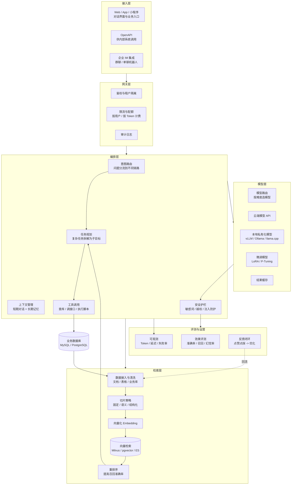
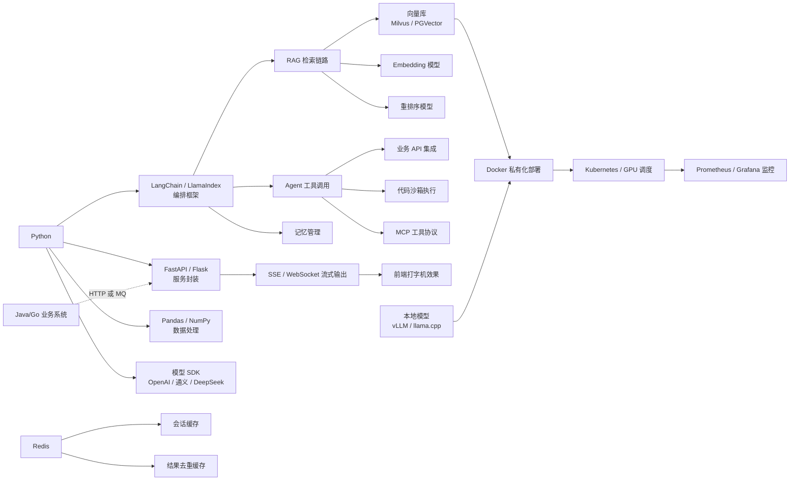
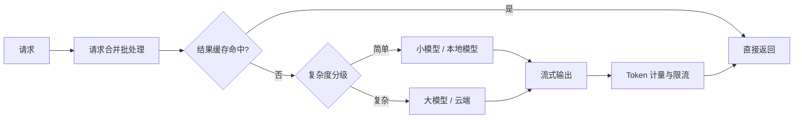
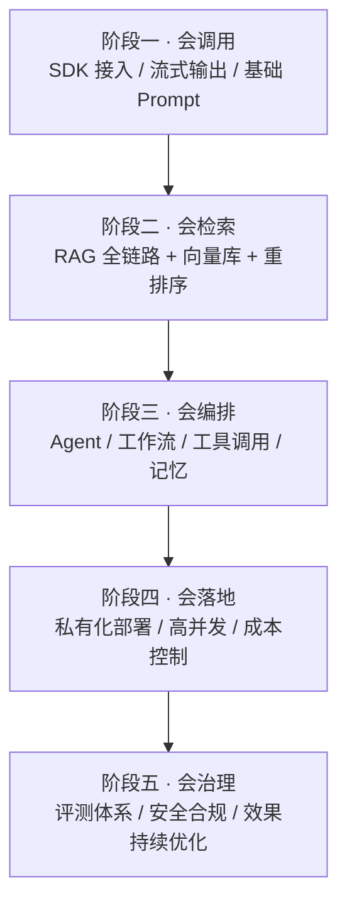

# 01 · AI 大模型应用工程

> 数据基础：59 份 JD 聚合去重 | 薪资均值 19-31K | 学历主流：本科 | 经验主流：3-5 年
> 内容已去除公司信息，保留技术事实。

---

## 一、方向定位

这一方向的核心职责不是训练模型，而是**把模型能力接进业务系统并保证它稳定、可控、可维护**。

从 JD 的词频分布可以清楚看到它的工程属性：

| 技术/能力 | 出现篇数 | 占本方向比例 | 解读 |
|-----------|---------|-------------|------|
| Python | 44 | 75% | 主力语言，负责编排、数据处理与服务封装 |
| 大模型相关关键词 | 43 | 73% | 已不再是差异化能力，而是岗位基线 |
| Agent / 智能体 | 41 | 69% | 需求重心从"问答"转向"能执行任务的智能体" |
| RAG / 检索增强 | 35 | 59% | 事实性回答的主流解法 |
| Java | 33 | 56% | 大量岗位要求把 AI 能力嵌入既有 Java 业务系统 |
| Docker | 27 | 46% | 私有化部署是刚需 |
| MySQL | 23 | 39% | 业务数据才是 RAG 的真正数据源 |
| Go | 22 | 37% | 高并发场景下用 Go 承载推理网关/流式接口 |
| Redis | 19 | 32% | 会话缓存、结果缓存、限流计数 |
| React / Vue | 31 合计 | 53% | AI 能力需要可被使用的前端入口 |
| 向量数据库 | 13 | 22% | 专业检索链路才会引入 |
| CI/CD | 15 | 25% | 提示词版本化、评测、灰度发布 |

**一句话总结**：这个方向真正的门槛在"工程闭环"——数据怎么进来、模型怎么接、结果怎么校验、成本怎么控制、出问题怎么排查。

---


### 完整技术栈清单（全量抽取 · 基于本方向 59 篇 JD）

> 下表由 JD 全文穷举抽取生成，数字为**出现该术语的 JD 篇数**，用于补齐正文未展开的细分技术项。

| 类别 | 技术栈（数字为出现篇数） |
|------|------------------------|
| **语言** | Python(44)、Java(33)、Go(18)、SQL(13)、Node.js(10)、TypeScript(8)、Golang(6)、C++(5)、JavaScript(5)、C#(3)、Shell(2)、PHP(1)、Dart(1) |
| **后端框架** | Spring(12)、FastAPI(12)、Spring Boot(10)、Spring Cloud(8)、MyBatis(5)、Django(4)、SpringBoot(3)、gRPC(3)、Flask(3)、Gin(2)、RPC(2)、Spring MVC(2)、NestJS(2)、Celery(2)、MyBatis-Plus(1)、Express(1)、Fastify(1) |
| **前端框架与UI** | React(18)、Vue(10)、Next.js(4)、Vue3(3)、Vite(2)、Ant Design(2)、组件化(2)、Flutter(1)、低代码(1)、H5(1)、Webpack(1)、ECharts(1)、Three.js(1)、响应式(1)、ESLint(1)、uni-app(1)、WebGL(1)、微前端(1)、qiankun(1)、拖拽(1) |
| **移动端** | 移动端(4)、Android(1)、iOS(1)、Framework(1)、App开发(1)、React Native(1)、Uniapp(1) |
| **数据库与存储** | MySQL(23)、Redis(19)、PostgreSQL(14)、向量数据库(13)、Milvus(7)、pgvector(5)、Oracle(4)、Elasticsearch(3)、MongoDB(2)、ClickHouse(2)、Neo4j(2)、SQL Server(1)、Doris(1)、图数据库(1) |
| **消息与中间件** | Kafka(8)、RabbitMQ(6)、RocketMQ(3)、NATS(2)、Prometheus(2)、Grafana(2)、OpenTelemetry(2)、MQTT(1)、Nacos(1)、Loki(1) |
| **云容器与DevOps** | Docker(27)、CI/CD(15)、容器化(9)、K8s(9)、Kubernetes(7)、Nginx(6)、流水线(6)、回滚(3)、DevOps(2)、灰度发布(2)、自动化部署(2)、Helm(2)、资源调度(1)、Jenkins(1)、GitHub Actions(1)、Istio(1)、Service Mesh(1)、GitLab CI(1)、Terraform(1)、Ingress(1) |
| **大数据与数据平台** | BI(6)、报表(5)、ETL(3)、批处理(3)、Hadoop(2)、Flink(2)、Spark(2)、数据质量(2)、元数据(2)、数据仓库(2)、数据同步(1)、埋点(1)、数据治理(1)、Hive(1)、实时计算(1)、Storm(1)、OLAP(1)、Tableau(1)、用户画像(1) |
| **AI与机器学习** | 大模型(43)、Agent(41)、RAG(35)、智能体(19)、Claude(18)、LLM(18)、LangChain(18)、Prompt(17)、MCP(12)、DeepSeek(10)、微调(10)、多模态(9)、LangGraph(8)、模型部署(7)、Llama(6)、vLLM(6)、Dify(6)、Embedding(6)、GPU(5)、PyTorch(5) |
| **音视频与流媒体** | 低延迟(4)、回放(2)、硬编(2)、丢包(1)、WebRTC(1)、转码(1)、FFmpeg(1)、预览(1)、切片(1) |
| **嵌入式与硬件** | LoRa(4)、中断(2)、嵌入式(1)、串口(1)、电源(1)、蓝牙(1)、固件(1)、WiFi(1)、5G(1)、数字孪生(1) |
| **桌面与客户端** | 客户端(2) |
| **协议与接口** | RESTful(15)、HTTP(7)、WebSocket(7)、SDK(4)、HTTPS(4)、gRPC(3)、接口对接(2)、REST(2)、JSON(2)、开放平台(2)、Webhook(2)、SSE(2)、SSO(2)、TCP(1)、OAuth2(1)、JWT(1) |
| **安全与合规** | 合规(12)、权限控制(5)、HTTPS(4)、等保(2)、RBAC(2)、数据加密(2)、脱敏(2)、隐私保护(2)、SSL(1)、防火墙(1)、密钥管理(1)、审计日志(1)、敏感信息(1) |
| **工程化与质量** | 日志(13)、重构(10)、技术文档(9)、Git(9)、单元测试(8)、监控告警(6)、GitHub(5)、代码评审(4)、集成测试(3)、灰度(3)、压测(3)、设计文档(2)、接口文档(2)、复盘(2)、敏捷(2)、压力测试(2)、Selenium(2)、Playwright(2)、编码规范(1)、覆盖率(1) |
| **架构与设计** | 架构设计(27)、性能优化(13)、微服务(13)、高并发(13)、SaaS(12)、技术选型(9)、限流(8)、高可用(7)、异步(7)、抽象(6)、方案设计(5)、多线程(5)、锁(5)、重试(5)、降级(4)、低延迟(4)、模块化(4)、多租户(4)、负载均衡(3)、熔断(3) |
| **业务领域** | ERP(16)、实施(12)、供应链(10)、电商(10)、财务(9)、库存(8)、MES(5)、WMS(4)、订单(4)、OA(4)、产品化(4)、金融(3)、物流(3)、医疗(3)、风控(3)、支付(2)、CRM(2)、PLM(2)、金蝶(2)、SAP(2) |
| **软技能** | 规划(15)、团队协作(13)、培训(10)、需求分析(9)、沟通能力(8)、跨部门(7)、责任心(6)、学习能力(4)、英语(3)、复盘(2)、文档编写(1)、抗压(1)、出差(1)、带团队(1)、owner(1) |

---

## 二、参考架构图

企业级大模型应用平台的典型分层结构。注意其中"业务数据接入"与"结果校验"两块，是区别于 Demo 的关键。



---

## 三、技术栈关联图



---

## 四、核心能力矩阵

| 能力项 | 出现率 | 关键要点 | 常见追问 |
|--------|-------|---------|---------|
| Prompt 工程与设计 | 高 | 结构化提示模板、少样本示例、系统提示分层、版本管理 | 怎么让输出稳定在某个 JSON 结构上？ |
| RAG 检索链路 | 59% | 切片策略、混合检索（向量+关键词）、重排序、元数据过滤 | 召回不准怎么定位是切分问题还是模型问题？ |
| Agent / 工作流编排 | 69% | 任务拆解、工具注册、循环控制、超时与重试、人工兜底 | 多轮工具调用失败后如何降级？ |
| 模型微调 | 中 | LoRA/P-Tuning、数据构造、评测集设计、灾难遗忘规避 | 什么情况下选择微调而不是 RAG？ |
| 推理服务化 | 46% | vLLM/Ollama、批处理与流式、并发控制、GPU 显存管理 | 如何提升单机吞吐并控制首字延迟？ |
| 数据处理与 ETL | 中 | 文档解析（PDF/扫描件）、表格抽取、增量更新、脏数据治理 | 增量更新的向量如何失效？ |
| 成本控制 | 高 | Token 计量、缓存复用、小模型兜底、路由策略 | 同样功能如何把调用成本降一半？ |
| 安全与合规 | 中 | 提示注入防护、敏感数据脱敏、私有化部署、审计留痕 | 如何防止模型被诱导输出系统提示？ |
| 评测体系 | 高 | 构建评测集、自动化打分、A/B、幻觉率监控 | 效果变好了还是变差了，怎么量化？ |
| 工程交付 | 25%+ | Docker 镜像、CI/CD、灰度发布、回滚 | 提示词改动如何灰度上线？ |

---

## 五、关键实现要点

### 5.1 RAG：决定效果的三个地方

```
数据质量 → 切片策略 → 检索策略 → 重排序 → 提示组织
   ↑           ↑           ↑          ↑         ↑
  最重要      业务相关    向量+关键词  性价比高   控制结构
```

1. **切片比模型更能决定上限**：按语义/标题层级切，避免把表格切断；每条切片携带标题、来源、时间等元数据便于过滤。
2. **混合检索几乎必做**：纯向量检索对专有名词、型号、编号不敏感，应与 BM25 类关键词检索融合再做 RRF 排序。
3. **重排序（Rerank）性价比最高**：召回 top-50 后用交叉编码模型精排出 top-5，准确率提升明显于成本增加。
4. **答案必须带引用**：输出到前端时附原文片段与来源链接，既便于用户核验也便于定位召回问题。

### 5.2 Agent：让它别失控

- **明确工具边界**：每个工具要有清晰的入参 schema、幂等保证、超时时间，禁止无约束的任意操作。
- **规划与执行分离**：先产出可执行计划（Plan），再逐步执行（Execute），失败时回溯到计划层重试而不是原地死循环。
- **设置步数与预算上限**：最大步数、最大 Token、最长耗时三重闸门，超限转人工或返回兜底答案。
- **关键操作加确认**：下单、转账、删库类高危动作必须二次确认（Human-in-the-loop）。

### 5.3 推理服务化：性能与成本的平衡



常用组合：`vLLM` 做连续批处理 + PagedAttention 提吞吐；`llama.cpp/GGUF` 做 CPU 或轻量 GPU 场景；`TensorRT-LLM` 做极致推理性能；`Ollama` 做开发自测与小规模私有化。

### 5.4 提示词工程：像管代码一样管理

- 提示词进 Git，带版本号与变更说明；
- 建立离线评测集（≥100 条真实问题），每次改动跑回归；
- 首页景色-loaded的功能性输出用 JSON Schema 约束，配合重试修正机制；
- 系统提示、用户提示、示例提示分层组织，避免互相污染。

---

## 六、部署形态对照

| 形态 | 适用场景 | 关键技术 | 主要风险 |
|------|---------|---------|---------|
| 云端 API | 快速验证、公网业务 | SDK 接入、流式、重试 | 数据出境合规、成本随量增长 |
| 本地私有化 | 政务/医疗/制造内网 | vLLM、GPU 服务器、容器编排 | 显存规划、并发排队、运维门槛 |
| 混合路由 | 大部分生产企业 | 敏感数据走本地、通用问答走云端 | 路由策略复杂度、结果一致性 |
| 边缘轻量 | 工控机、边缘盒子 | 量化模型、llama.cpp、TFLite | 算力受限、模型能力下降 |

---

## 七、典型职责归纳（去重合并）

- 负责大模型应用的需求拆解、技术选型与方案设计，确定 RAG / 微调 / 提示工程的组合方式。
- 搭建知识库流水线：文档解析、切片、向量化、增量更新、权限隔离与效果评测。
- 实现 Agent 编排：任务规划、工具/插件注册、业务 API 接入、异常兜底与人工接管。
- 封装模型服务：流式接口、批处理、并发控制、Token 计量、灰度发布。
- 建设评测与观测：评测集、自动化打分、幻觉监控、调用链路追踪、成本看板。
- 负责安全合规：敏感数据脱敏、注入防护、审计留痕、私有化部署方案落地。
- 与业务团队协作，把 AI 能力嵌入既有 Java/Go/Python 系统，而不是另起炉灶。

---

## 八、进阶路径建议



每个阶段都要有对应产出物：Demo → 可用的知识库问答 → 能执行任务的智能体 → 生产级服务 → 可量化效果的运营闭环。

---

## 九、常见考察点清单

1. RAG 召回不准，你的排查顺序是什么？（数据源 → 切片 → 向量模型 → 检索策略 → 重排序 → 提示）
2. 什么时候用微调，什么时候用 RAG？（知识更新频率 vs 行为格式定制）
3. 如何把一次对话的成本降到十分之一？（缓存、路由、小模型、裁剪上下文、批处理）
4. 模型输出不稳定怎么办？（Schema 约束、少样本、低温、重试修正、投票）
5. 私有化部署需要考虑哪些事？（显存、并发、模型格式、更新机制、监控、备份）
6. 怎样证明你的 AI 功能真的有用？（离线评测集 + 在线 A/B + 幻觉率/采纳率指标）
7. Agent 死循环怎么办？（步数上限、重复检测、回溯、降级、人工兜底）
8. 提示词如何做版本管理和灰度？（进 Git、挂开关、按比例分流、回滚预案）

---

## 十、与其他方向的连接

- **与 Go/Java 后端**：AI 能力必须嵌入既有业务系统，通常通过 HTTP 或 MQ 解耦；流式结果需要 WebSocket/SSE 支持。
- **与数据平台**：RAG 的数据源往往来自数仓，Embedding 的增量更新依赖 CDC 与调度作业。
- **与前端**：对话界面的流式渲染、markdown 解析、代码高亮、引用溯源都影响体验。
- **与嵌入式**：本地算力部署涉及 GPU/边缘设备、模型量化与运行时优化。
