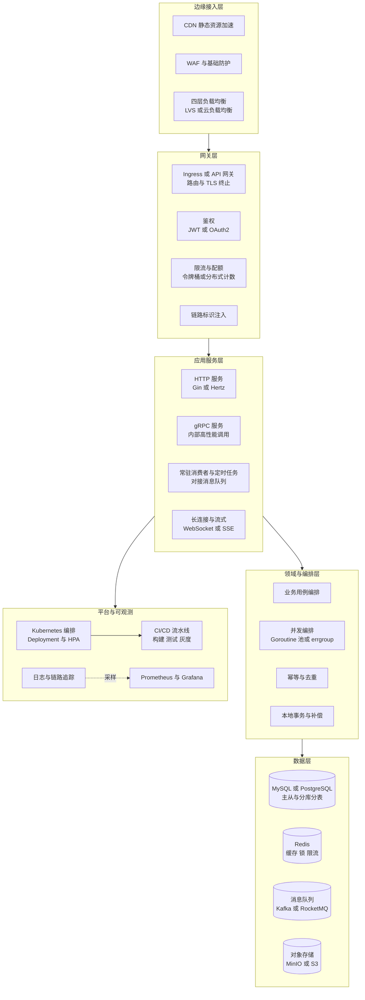
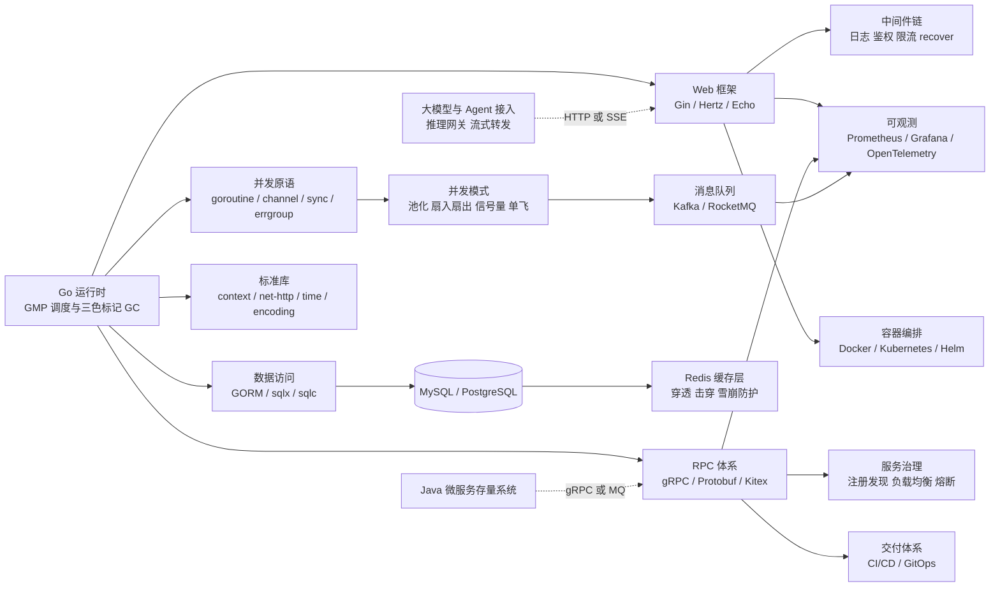
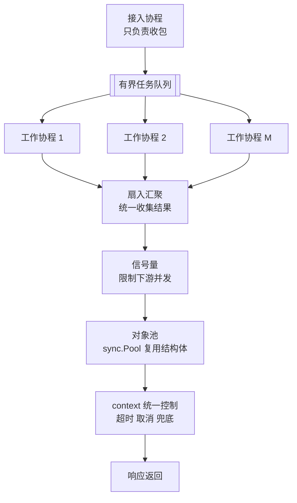
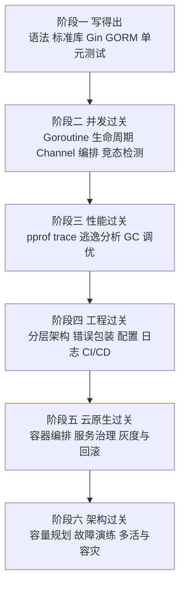

# 02 · Go 云原生与高并发服务

> 数据基础：69 份 JD 聚合去重 | 薪资均值 20-32K | 学历主流：本科 | 经验主流：5 年以上
> 内容已去除公司信息，保留技术事实。

---

## 一、方向定位

这一方向的核心职责不是"会写 Go 语法"，而是**用 Go 构建能横向扩展、能扛峰值、可被观测、可快速迭代的服务体系**，并把这套体系稳定地跑在容器与编排平台之上。

从 JD 的词频分布可以看到两个非常明确的特征：**一是"双语言栈"常态化，二是"云原生"已经从加分项变成了基线能力**。

| 技术/能力 | 出现篇数 | 占本方向比例 | 解读 |
|-----------|---------|-------------|------|
| Docker | 52 | 75% | 容器化是默认交付形态，不再是差异化能力 |
| Java | 49 | 71% | 大量岗位由 Java 体系外扩 Go，要求双语协作与互调 |
| Redis | 48 | 70% | 缓存、分布式锁、限流计数三位一体 |
| MySQL | 43 | 62% | 关系型仍是主存储，Go 侧重点在连接池与索引 |
| Python | 36 | 52% | 工具链、脚本化与 AI 侧协同语言 |
| Go | 35 | 51% | 方向主语言，但并非每篇都显式写在标签里 |
| 微服务 | 35 | 51% | 服务拆分与治理是日常工作的默认背景 |
| 高并发 | 32 | 46% | 真正的岗位分水岭，也是面试主战场 |
| 性能优化 | 28 | 41% | 从语言运行时到系统内核的全栈优化 |
| CI/CD | 25 | 36% | 自动化构建、测试与发布流水线 |
| PostgreSQL | 25 | 36% | 与 MySQL 并列，GIS、JSONB 场景更常见 |
| Agent | 22 | 32% | AI 能力正被 Go 网关与编排层承接 |
| Gin | 21 | 30% | HTTP 框架事实标准 |
| RESTful | 21 | 30% | 对外接口主流风格 |
| 大模型 | 20 | 29% | 推理网关、流式转发是新增长点 |
| Git | 20 | 29% | 协作、分支策略与代码评审基线 |
| Spring Boot | 20 | 29% | 与既有 Java 服务长期共存的直接证据 |
| React | 18 | 26% | 后端全栈化要求上升 |
| Kubernetes | 17 | 25% | 编排平台进入门槛区，高级岗硬指标 |
| K8s | 17 | 25% | 同上，仅写法差异 |
| Kafka | 17 | 25% | 异步解耦、削峰填谷与事件驱动 |
| LLM | 15 | 22% | 与 Agent 配套出现，多为网关/流式场景 |

**补充抽样统计**（可回溯子样 55 篇，用于补充上表 Top 之外的细项）：gRPC 12 篇约 21%、消息队列 18 篇约 32%、网关 6 篇约 10%、限流 6 篇约 10%、云原生 6 篇约 10%、降级 4 篇约 7%、分布式锁 4 篇约 7%、单元测试 8 篇约 14%、熔断与链路追踪各 2 篇。

**城市与薪资侧写**：样本以深圳为主（南山区占子样 26/55），广州天河、海珠、黄埔次之，另有少量东莞、佛山岗位；薪资可统计样本 55 条，低端均值 19.7K、高端均值 31.3K，上探到 60K 档位。

**一句话总结**：这个方向的门槛集中在三件事——**能不能用 Goroutine / Channel 写出不出事故的高并发逻辑；能不能用 pprof / trace / GC 参数把服务调到目标水位；能不能让服务在容器编排平台上稳定发布、灰度与回滚。** 语法只是入场券。

---


### 完整技术栈清单（全量抽取 · 基于本方向 69 篇 JD）

> 下表由 JD 全文穷举抽取生成，数字为**出现该术语的 JD 篇数**，用于补齐正文未展开的细分技术项。

| 类别 | 技术栈（数字为出现篇数） |
|------|------------------------|
| **语言** | Java(47)、Python(36)、SQL(25)、Go(24)、Golang(12)、Node.js(10)、TypeScript(10)、C++(7)、JavaScript(4)、Shell(2)、Kotlin(2)、Lua(2)、Dart(2)、C#(1)、PHP(1)、Swift(1) |
| **后端框架** | Spring(29)、Spring Boot(20)、MyBatis(15)、Spring Cloud(13)、FastAPI(10)、gRPC(8)、Gin(7)、Dubbo(6)、Django(5)、Flask(5)、RPC(5)、Spring MVC(5)、NestJS(4)、SpringBoot(3)、MyBatis-Plus(3)、Hibernate(2)、JPA(2)、Express(2)、Netty(1)、Celery(1) |
| **前端框架与UI** | React(18)、Vue(11)、Flutter(4)、Vite(4)、Next.js(2)、小程序(2)、H5(2)、Vue3(2)、Ant Design(2)、组件化(2)、Webpack(2)、Three.js(2)、低代码(1)、Element UI(1)、ECharts(1)、Nuxt(1)、ESLint(1)、WebGL(1)、微前端(1)、qiankun(1) |
| **移动端** | 移动端(6)、iOS(5)、Android(4)、Kotlin(2)、Framework(1)、鸿蒙(1)、Swift(1)、Uniapp(1) |
| **数据库与存储** | Redis(48)、MySQL(43)、PostgreSQL(25)、MongoDB(11)、向量数据库(7)、Elasticsearch(7)、Oracle(5)、SQL Server(4)、pgvector(4)、Milvus(3)、ClickHouse(3)、Doris(2)、Neo4j(2)、MinIO(2)、InfluxDB(1)、对象存储(1)、S3(1)、时序数据库(1)、图数据库(1) |
| **消息与中间件** | Kafka(17)、RabbitMQ(14)、RocketMQ(6)、MQTT(5)、Nacos(4)、NATS(2)、Prometheus(2)、Grafana(2)、OpenTelemetry(2)、定时任务(1)、ZooKeeper(1)、XXL-JOB(1)、Sentinel(1)、Loki(1) |
| **云容器与DevOps** | Docker(52)、CI/CD(25)、容器化(23)、Kubernetes(17)、K8s(17)、Nginx(11)、DevOps(9)、流水线(7)、回滚(4)、资源调度(4)、Jenkins(4)、灰度发布(3)、GitHub Actions(3)、自动化部署(2)、Helm(2)、Istio(2)、Service Mesh(2)、GitLab CI(2)、Terraform(2)、Ingress(2) |
| **大数据与数据平台** | ETL(5)、Flink(5)、Hadoop(4)、Spark(4)、BI(3)、数据质量(3)、元数据(3)、报表(2)、数据同步(2)、埋点(2)、数据中台(2)、数据仓库(2)、数据治理(1)、批处理(1)、Hive(1)、血缘(1)、实时计算(1)、Storm(1)、Trino(1)、Iceberg(1) |
| **AI与机器学习** | Agent(22)、大模型(20)、RAG(15)、LLM(14)、Claude(13)、智能体(10)、Prompt(9)、LangChain(8)、MCP(7)、DeepSeek(5)、多模态(5)、微调(3)、模型部署(3)、LangGraph(3)、Embedding(3)、LlamaIndex(3)、Gemini(3)、PyTorch(2)、ASR(2)、Llama(2) |
| **音视频与流媒体** | 低延迟(6)、回放(3)、GB28181(2)、转码(2)、硬编(2)、RTSP(1)、WebRTC(1)、推流(1)、FFmpeg(1)、RTMP(1)、SIP(1)、预览(1)、切片(1)、拥塞控制(1)、ZLMediaKit(1) |
| **嵌入式与硬件** | OTA(4)、CoAP(2)、嵌入式(1)、CAN(1)、Modbus(1)、中断(1)、蓝牙(1)、固件(1)、WiFi(1)、5G(1)、LoRa(1)、ROS(1)、ZigBee(1) |
| **桌面与客户端** | 客户端(1) |
| **协议与接口** | RESTful(21)、WebSocket(10)、HTTP(8)、gRPC(8)、TCP(5)、SDK(5)、REST(3)、JSON(3)、HTTPS(3)、GraphQL(3)、开放平台(2)、FTP(2)、长连接(2)、JWT(2)、接口对接(1)、Webhook(1)、SSE(1)、OAuth2(1)、SSO(1)、SNMP(1) |
| **安全与合规** | 合规(5)、权限控制(5)、HTTPS(3)、RBAC(3)、SSL(2)、数据加密(2)、等保(1)、TLS(1)、防火墙(1)、脱敏(1)、国密(1)、密钥管理(1)、敏感信息(1)、网闸(1) |
| **工程化与质量** | 日志(15)、重构(14)、Git(13)、单元测试(13)、技术文档(11)、代码评审(7)、GitHub(7)、集成测试(6)、监控告警(6)、接口文档(5)、灰度(5)、设计文档(4)、编码规范(4)、Maven(3)、SVN(2)、压测(2)、敏捷(2)、GitLab(2)、容量规划(2)、复盘(1) |
| **架构与设计** | 架构设计(40)、微服务(35)、高并发(32)、性能优化(28)、高可用(17)、限流(14)、方案设计(13)、多线程(13)、技术选型(13)、SaaS(9)、异步(9)、抽象(9)、锁(9)、降级(9)、重试(8)、幂等(7)、负载均衡(7)、熔断(7)、低延迟(6)、对账(6) |
| **业务领域** | ERP(12)、支付(10)、实施(8)、供应链(7)、电商(7)、财务(6)、库存(6)、订单(6)、金融(5)、风控(5)、MES(4)、WMS(3)、医疗(3)、SAP(3)、OA(2)、项目管理(2)、金蝶(2)、物流(2)、教育(2)、产品化(2) |
| **软技能** | 规划(15)、团队协作(15)、责任心(10)、沟通能力(9)、需求分析(9)、文档编写(5)、学习能力(5)、英语(4)、抗压(4)、培训(3)、跨部门(2)、出差(2)、复盘(1)、owner(1) |

---

## 二、参考架构图

一个典型的 Go 云原生高并发服务体系。注意图中"并发编排"与"平台与可观测"两块，是把"能跑的 Go 服务"与"能上生产的 Go 服务体系"区分开的关键。



### 架构解读

1. **边缘层解决"流量怎么进来"**：静态资源交给 CDN，动态流量经四层负载均衡分发。Go 服务通常不直接暴露公网，TLS 终止放在网关层，减少握手开销对业务协程的占用。
2. **网关层解决"谁能进、进多少"**：鉴权与限流必须前置。Go 网关常用 `net/http` 中间件或 `gin.HandlerFunc` 链实现，限流计数落 Redis，用 Lua 脚本保证原子性。链路标识在这一层注入，后续全链路透传。
3. **应用服务层区分四种工作负载**：短请求 HTTP、内部 gRPC、常驻消费者、长连接流式。四类负载的协程生命周期、超时策略、资源上限完全不同，**混在一个进程里是常见的故障源**。
4. **领域与编排层是并发复杂度收敛的地方**：Goroutine 池、errgroup、信号量都在这一层，业务用例只描述"做什么"，不直接 `go func`。
5. **数据层的关键是连接与超时**：`SetMaxOpenConns`、`SetMaxIdleConns`、`SetConnMaxLifetime` 三个参数决定数据库侧压力；Redis 侧要区分缓存、锁、限流三类用途，避免共用一个 DB 索引导致误删。
6. **平台与可观测不是附属品**：HPA 依赖真实指标，指标依赖埋点，埋点依赖统一的中间件与 context 传递。这一条链断了，扩容就只能拍脑袋。

---

## 三、技术栈关联图



### 说明

- **运行时是根**：GMP 调度模型（`runtime.GOMAXPROCS`）、逃逸分析、GC 触发时机，决定了上层框架能跑多快。不理解运行时，"性能优化"只能停留在换库。
- **Web 与 RPC 是两条腿**：对外 HTTP/RESTful，对内 gRPC/Protobuf。Go 在这两条路上的生态都很成熟，选型关键在团队存量与跨语言需求。
- **并发原语是分水岭**：`sync.Pool`、`sync.Map`、`errgroup.Group`、`semaphore`、`singleflight` 这些包掌握程度，直接区分"写过 Go"和"用 Go 扛过高并发"。
- **可观测要贯穿三层**：指标、日志、链路三者必须共享同一 `trace_id`，而 `trace_id` 依赖 `context` 全链路传递——这是 Go 服务治理的地基。
- **与 Java 共存是现实**：71% 的 JD 同时提到 Java，说明 Go 更多是在既有 Java 微服务体系上做增量（网关、中间件、高并发模块），而非全面重写。

---

## 四、核心能力矩阵

| 能力项 | 出现率 | 关键要点 | 常见追问 |
|--------|-------|---------|---------|
| Go 并发模型 | 46%+ | GMP 调度、Goroutine 泄漏识别、Channel 有界与无界、select 多路复用 | 一个请求一个 Goroutine 会有什么问题？ |
| Goroutine 池与编排 | 中高 | 池化参数、errgroup 错误传播、context 取消级联、panic 捕获 | 池子打满后请求应该拒绝还是排队？ |
| 内存与 GC 优化 | 41% 相关 | 逃逸分析、`sync.Pool` 复用、GOGC/GOMEMLIMIT、减少指针扫描 | 为什么堆内存降不下来？GC 频率怎么判断异常？ |
| 性能剖析 | 41% 相关 | pprof CPU/heap/goroutine/block/mutex、trace、benchstat 对比 | 线上 CPU 飙高，你第一步做什么？ |
| 存储与缓存 | 70% Redis | 缓存穿透/击穿/雪崩、一致性策略、热 key、Big Key、连接池 | 先删缓存还是先更新库？双写不一致怎么兜底？ |
| 数据库与分库分表 | 62% MySQL | 索引失效场景、执行计划、主从延迟、Sharding 与迁移方案 | 一个慢 SQL 你怎么定位到根因？ |
| 消息队列 | 32% | 顺序性、重复消费、幂等、积压处理、死信与重试 | 消息积压几百万条怎么紧急处理？ |
| 服务治理 | 51% 微服务 | 注册发现、负载均衡、限流熔断降级、超时预算、重试风暴 | 下游雪崩，你的熔断阈值怎么定？ |
| 容器与编排 | 75% Docker / 25% K8s | 多阶段构建瘦身、健康探针、资源 request/limit、优雅退出、HPA | 容器 OOM 了但监控内存不高，为什么？ |
| CI/CD 与交付 | 36% | 流水线分层、镜像签名、灰度与蓝绿、一键回滚 | 发布到 30% 发现错误率上升，怎么处理？ |
| 可观测体系 | 中 | 三支柱、RED/USE 指标、采样策略、告警收敛 | 告警太多没人看，怎么治理？ |
| 工程规范 | 29% Git | 分支模型、错误包装、日志分级、单测与基准测试 | Go 的 error 怎么处理才算规范？ |

---

## 五、关键实现要点

### 5.1 Goroutine 池：为什么必须有界

"来一个请求开一个 Goroutine"在 Demo 里没问题，但在生产中意味着**并发度完全由流量决定**。下游数据库连接池只有 100 个，前端却放进来 5 万个协程，结果就是所有协程一起等锁、一起超时、一起重试。

设计要点：

| 参数 | 含义 | 经验取值 |
|------|------|---------|
| 池容量 | 同时运行的工作协程上限 | 与下游连接池、CPU 核数对齐，常见 2N ~ 4N |
| 队列容量 | 等待队列长度 | 有界，建议与池容量同量级 |
| 队列策略 | 打满后的行为 | 快速失败优于无限排队 |
| 空闲回收 | 长期空闲协程退出 | 避免常驻上万空协程 |
| panic 兜底 | 工作协程 panic 不拖垮池 | 每个 worker 必须 `recover` |

骨架代码：

```go
type Pool struct {
    tasks   chan func()
    workers int
    wg      sync.WaitGroup
    quit    chan struct{}
}

func NewPool(size, queue int) *Pool {
    p := &Pool{tasks: make(chan func(), queue), quit: make(chan struct{})}
    for i := 0; i < size; i++ {
        p.wg.Add(1)
        go p.loop()
    }
    return p
}

func (p *Pool) loop() {
    defer p.wg.Done()
    for {
        select {
        case fn := <-p.tasks:
            p.safeRun(fn) // 内部 recover，防止单个任务带崩 worker
        case <-p.quit:
            return
        }
    }
}

// Submit 非阻塞提交，队列满直接返回 false 交给上层降级
func (p *Pool) Submit(fn func()) bool {
    select {
    case p.tasks <- fn:
        return true
    default:
        return false
    }
}
```

关键取舍：`Submit` 用 `select` + `default` 实现非阻塞提交，**队列满时快速失败而不是无限等待**，这样背压能传导到网关层，触发限流而不是把延迟堆在进程内部。

### 5.2 Channel 编排：四种高频模式



1. **池化（Pooling）**：控制并发上限，见 5.1。
2. **扇出扇入（Fan-out / Fan-in）**：把一批子任务分发给 N 个协程，再统一收集结果。收集端用带缓冲 channel，容量等于子任务数，避免收集者未启动造成发送阻塞。
3. **信号量（Semaphore）**：golang.org/x/sync/semaphore 限制对特定稀缺资源（如第三方接口配额）的并发。
4. **单飞（singleflight）**：`golang.org/x/sync/singleflight` 合并同一 key 的并发请求，是解决缓存击穿的标准动作。

组合使用时统一用 `errgroup.WithContext`：任一子任务出错即取消其余任务，避免"错误了但其他协程还在跑"的半完成状态。

### 5.3 context 超时治理：三个必须遵守的规则

- **规则一：超时预算逐层递减**。网关 800ms → 业务服务 500ms → 下游调用 300ms。每层减去的余量用于序列化、重试与日志。下游超时必须小于上游，否则上游放弃了下游还在跑。
- **规则二：context 要传到底，不能断**。所有阻塞调用（HTTP、gRPC、SQL、Redis）都必须使用带 deadline 的 context 版本：`QueryContext`、`GetWithContext`、`http.NewRequestWithContext`。
- **规则三：只用于控制生命周期，不要拿来传业务参数**。`context.WithValue` 只放 `trace_id`、`user_id` 这类请求级元数据，且必须用自定义 key 类型避免冲突。

```go
ctx, cancel := context.WithTimeout(r.Context(), 300*time.Millisecond)
defer cancel() // 必须 defer，否则计时器泄漏到超时那一刻

rows, err := db.QueryContext(ctx, "SELECT id, name FROM t_order WHERE uid = ?", uid)
if errors.Is(err, context.DeadlineExceeded) {
    // 记录超时指标并降级，不要直接 500
    return fallback(ctx, uid)
}
```

排查口诀：**协程数持续上涨 = 有协程卡在 channel 或 I/O 上没被取消；`goroutine profile` 里大量同名栈帧，基本就是泄漏点。**

### 5.4 pprof 与 trace：性能剖析的标准动作

| Profile | 看什么 | 典型结论 |
|---------|-------|---------|
| `profile` CPU | 谁在吃 CPU | 正则回溯、序列化热路径、无效循环 |
| `heap` | 内存分配与常驻 | 大对象、缓存无上限、切片不释放 |
| `allocs` | 分配次数 | 高频小对象 → 上 `sync.Pool` |
| `goroutine` | 协程数量与栈 | 泄漏、阻塞在 channel |
| `block` | 阻塞点 | 锁竞争、channel 阻塞 |
| `mutex` | 锁争用 | 热点锁、锁粒度过大 |
| `trace` | 调度与延迟 | GC 停顿、P 饥饿、网络等待 |

线上安全用法：

```go
import _ "net/http/pprof" // 仅注册到内部端口，禁止暴露公网

// 采样 30 秒 CPU
// go tool pprof -http=:8080 http://127.0.0.1:6060/debug/pprof/profile?seconds=30
// 对比基线：benchstat old.txt new.txt
```

落地流程：**先在压测环境用 `go test -bench` 建立基线 → 用 `benchstat` 对比改动前后 → 线上只做短时采样并限流 → 结论落进性能回归清单。**

### 5.5 内存逃逸与 GC 优化

用 `go build -gcflags="-m"` 看逃逸分析结果，重点关注四类逃逸：

1. **返回局部变量指针** → 变量分配到堆。若对象小且生命周期短，考虑改为值传递。
2. **发送指针到 channel / 存入 interface** → 编译器无法证明生命周期，逃逸到堆。
3. **闭包捕获变量** → 被捕获变量逃逸。
4. **切片 / map 动态扩容** → 容量不确定时堆分配，可用 `make([]T, 0, n)` 预留。

优化手段：

```go
var bufPool = sync.Pool{
    New: func() any { return new(bytes.Buffer) },
}

func render(data []byte) []byte {
    buf := bufPool.Get().(*bytes.Buffer)
    buf.Reset()              // 必须 Reset
    defer bufPool.Put(buf)   // 用完归还
    buf.Write(data)
    return append([]byte(nil), buf.Bytes()...) // 避免返回池内引用
}
```

GC 侧三个可调项：

- `GOGC`：默认 100，堆增长一倍触发一次 GC。内存敏感型服务可下调（更频繁但峰值低），CPU 敏感型可上调。
- `GOMEMLIMIT`（Go 1.19+）：设置软内存上限，容器环境强烈建议设置，避免超出 cgroup 限制被 OOMKill。
- **减少指针密度**：`map[int64]struct{}` 优于 `map[int64]*Item`；大结构体里把指针字段与数值字段分组，能明显降低扫描成本。

容器环境铁律：**`GOMEMLIMIT` 应显著低于容器 memory limit，因为 Go 只统计自身堆，runtime、栈、OS 页缓存都不算在内。**

### 5.6 gRPC / Protobuf 与连接治理

- **连接复用**：gRPC 基于 HTTP/2 多路复用，一个 `ClientConn` 即可承载大量并发流，**不要每次调用新建连接**。
- **拦截器链**：统一在 `UnaryClientInterceptor` 里做超时注入、链路透传、指标上报、错误映射，避免散落在业务代码。
- **Keepalive**：跨 AZ、跨云调用必须配置 keepalive 与 `PermitWithoutStream`，否则 NAT 空闲断连会导致首次调用超时。
- **重试与幂等**：只对幂等接口开启重试，并配 `retry.DefaultThrottler` 防止重试风暴；非幂等接口用请求 ID 做服务端去重。
- **错误语义**：用 `status.Code` 传递标准码，业务错误放 `details`，不要把所有错误都塞进 `Unknown`。

### 5.7 稳定性三板斧：限流、熔断、降级

| 手段 | 解决的问题 | 常用算法/策略 | 关键参数 |
|------|-----------|-------------|---------|
| 限流 | 入口流量超过容量 | 令牌桶、漏桶、滑动窗口 | 阈值、突发量、分布式一致性 |
| 熔断 | 下游持续故障拖垮本服务 | 三态机：关闭/打开/半开 | 错误率阈值、最小请求数、恢复探测间隔 |
| 降级 | 非核心能力让位 | 开关、兜底值、异步化 | 开关粒度、灰度比例、恢复条件 |

三个容易踩的坑：

1. **只限流不限并发**：QPS 限住了，但慢请求堆积照样耗尽协程与连接，必须配合并发数限制（信号量）。
2. **熔断后没有半开探测**：一刀切熔断后无法自动恢复，需要半开状态放少量请求试探。
3. **重试放大**：上游超时重试 + 下游重试，叠加后流量成倍放大。原则是**只在链路的一层做重试**，并用退避 + 抖动。

---

## 六、部署形态对照

| 形态 | 适用场景 | 关键技术 | 主要风险 |
|------|---------|---------|---------|
| 裸机 / 虚拟机 | 起步阶段、资源敏感型长连接服务 | systemd 托管、多实例 + 负载均衡 | 环境漂移、扩容慢、回滚靠手工 |
| 单机容器 | 中小规模、团队刚引入容器 | Docker 多阶段构建、compose 编排 | 无自愈、无弹性、单机故障即不可用 |
| Kubernetes 编排 | 主流生产形态 | Deployment/StatefulSet、Service、HPA、探针 | 资源规划不当、探针误杀、发布批次策略 |
| GitOps 持续交付 | 多集群、多环境、合规要求高 | Helm/Kustomize、ArgoCD、镜像签名 | 配置漂移、权限模型复杂度 |
| Serverless / 边缘 | 突发流量、任务型、边缘节点 | 函数运行时、轻量镜像、冷启动优化 | 冷启动延迟、执行时长限制、状态外置 |

### 典型业务场景映射

| 业务场景 | 技术诉求 | 对应要点 |
|---------|---------|---------|
| 聚合网关 / BFF | 高并发转发、协议转换、流式输出 | 5.2 编排、5.3 超时预算 |
| 实时推送 / IM | 海量长连接、心跳、广播 | 5.1 池化、连接层内存复用 |
| 订单与交易链路 | 一致性、幂等、削峰 | 5.7 限流降级、MQ 幂等消费 |
| 设备接入 / IoT | 长连接、海量小包、时序写 | 5.5 逃逸优化、批量写 |
| AI 推理网关 | 流式 SSE、并发排队、Token 计量 | 5.6 gRPC、背压传导 |
| 数据中转与同步 | 高吞吐、可靠投递、积压可观测 | MQ 幂等、积压告警 |

---

## 七、典型职责归纳（去重合并）

- 负责核心后端服务的架构设计、模块拆分与编码实现，用 Go 交付可水平扩展的服务。
- 设计并实现高并发处理链路：协程池化、并发编排、背压传导、超时与重试治理。
- 负责服务性能优化：pprof/trace 剖析、内存逃逸治理、GC 参数调优、连接池与缓存命中率优化。
- 建设稳定性体系：限流、熔断、降级、灰度发布、故障演练与应急预案。
- 负责数据存储方案设计：MySQL/PostgreSQL 索引与分库分表、Redis 缓存与分布式锁、消息队列可靠投递。
- 推动云原生落地：容器镜像瘦身、Kubernetes 编排、HPA 弹性、服务网格与配置中心接入。
- 建设可观测能力：指标、日志、链路追踪三位一体，建立 SLO 与告警收敛机制。
- 维护 CI/CD 流水线与工程规范：静态检查、单元测试与基准测试、代码评审、发布与回滚流程。
- 与 Java/Python 既有系统协同对接，通过 gRPC、HTTP 或消息队列完成跨语言集成。
- 参与技术方案评审与线上疑难问题排查，沉淀排查手册与技术文档。

---

## 八、进阶路径建议



| 阶段 | 产出物 | 验收标准 |
|------|-------|---------|
| 一 | 一个可用的 CRUD 服务 | 有分层、有单测、能跑通接口 |
| 二 | 一个并发处理组件 | `-race` 无告警，压测下协程数平稳 |
| 三 | 一份性能剖析报告 | 有基线数据、有优化前后对比 |
| 四 | 一套工程脚手架 | 有 linter、CI、发布与回滚脚本 |
| 五 | 一份 K8s 部署清单 | 有探针、资源限制、HPA 与灰度策略 |
| 六 | 一份容量与容灾方案 | 有压测数据、故障演练记录与 SLO |

---

## 九、常见考察点清单

1. **GMP 模型是什么？P 的作用是什么？**
   G 是协程、M 是内核线程、P 是逻辑处理器与本地队列。P 决定了并行度（`GOMAXPROCS`）。要点：P 持有本地可运行队列，减少全局锁竞争；M 阻塞时 P 会被摘走交给其他 M，这是 Go 能把阻塞系统调用与协程调度解耦的关键。

2. **Goroutine 泄漏怎么发现、怎么定位？**
   发现：监控 `runtime.NumGoroutine()` 曲线持续上涨且不随流量回落。定位：`/debug/pprof/goroutine?debug=2` 看全量栈，找数量最多且卡在同一个位置的栈帧。根因通常是：向无缓冲/无消费者 channel 发送、等待永不关闭的 channel、下游 I/O 没传 context、ticker 未 stop。

3. **一个请求一个 Goroutine 有什么问题？**
   并发度失控。下游连接池、第三方配额、内存都是有限的，无限开协程等于把背压藏起来。正确做法是有界池 + 有界队列 + 队列满快速失败，把压力传回网关触发限流。

4. **CPU 飙高，你的排查步骤是什么？**
   先看是 GC 还是业务：`GODEBUG=gctrace=1` 或看 `go_gc_duration_seconds`。若非 GC，`pprof profile` 采样 30 秒看火焰图 top 函数。常见元凶：低效正则、热路径反射、JSON 序列化大对象、日志拼接、死循环、锁竞争（此时看 `mutex` profile）。

5. **怎么减少 GC 压力？**
   三层：① 减少分配——`sync.Pool`、预分配切片容量、避免热路径上 `fmt.Sprintf`；② 降低指针密度——值类型替代指针、结构体字段分组；③ 调整策略——`GOGC` 与 `GOMEMLIMIT`，容器环境必设后者。

6. **Channel 有缓冲和无缓冲怎么选？**
   无缓冲是同步传递，发送方阻塞到接收方就绪，天然有背压；有缓冲可以削峰但会隐藏延迟。经验：控制并发用带缓冲的 semaphore 模式，传递所有权用无缓冲，批量收集用容量等于任务数的缓冲。

7. **超时预算怎么设计？为什么下游超时必须更短？**
   总预算由外到内逐层递减。下游超时若不小于上游，上游已放弃、下游仍在计算与占用连接，等于做了无用功还消耗资源。同时每层的重试次数要计入预算，避免总耗时翻倍。

8. **缓存穿透、击穿、雪崩分别怎么解决？**
   穿透（查不存在的 key）：布隆过滤器 + 空值缓存短 TTL。击穿（热点 key 失效瞬间）：`singleflight` 合并回源 + 互斥锁重建。雪崩（大批 key 同时失效）：TTL 加随机抖动 + 多级缓存 + 熔断兜底。

9. **消息积压几百万条怎么处理？**
   先止血：临时扩容消费者实例数与分区数，必要时降级为非核心逻辑；再提速：批量消费、并发消费（注意顺序性）、关闭自动提交改批量提交；最后兜底：判别是否可跳过历史数据，走离线补数。

10. **容器里 Go 服务 OOM 了但监控内存不高，为什么？**
    常见原因：① `GOMEMLIMIT` 未设置，堆增长越过 cgroup 上限；② 大量 goroutine 各自的栈内存未被计入"堆"；③ mmap 或 cgo 分配不计入 Go heap；④ 监控指标取的是 Go heap 而非容器 RSS。对策：设 `GOMEMLIMIT` 为 limit 的 70%~80%，监控以容器 RSS 为准。

---

## 十、与其他方向的连接

- **与 Java 微服务后端**：本方向 JD 中 Java 出现率高达 71%，实际工作中多为"Java 承载核心业务 + Go 承载网关/中间件/高并发模块"的混合形态，两者通过 gRPC、HTTP 或 MQ 集成，共享同一套注册中心与可观测体系。
- **与 AI 大模型应用工程**：Go 正成为推理网关与 Agent 编排层的首选语言，负责流式 SSE 转发、并发排队、Token 计量与多模型路由，与 Python 侧的模型服务形成前后端分工。
- **与数据平台与实时计算**：高并发写入场景需要把数据先落 MQ 再由流处理消费，Go 侧负责高吞吐采集与背压传导，与 Flink/ClickHouse 侧构成端到端链路。
- **与前端与全栈**：React 出现率 26%，说明后端需要理解 SSE/WebSocket 的前端消费方式、接口契约与错误码语义，避免前后端在超时与重试上互相放大。
- **与嵌入式与边缘计算**：边缘节点资源受限，Go 的静态编译与低内存占用适合在网关盒子、工控机上部署采集与转发服务，与云端 K8s 形成云边协同。
