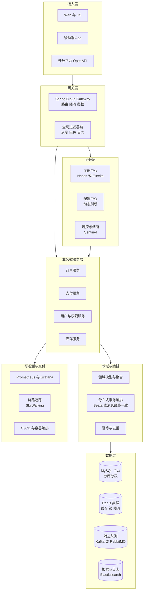
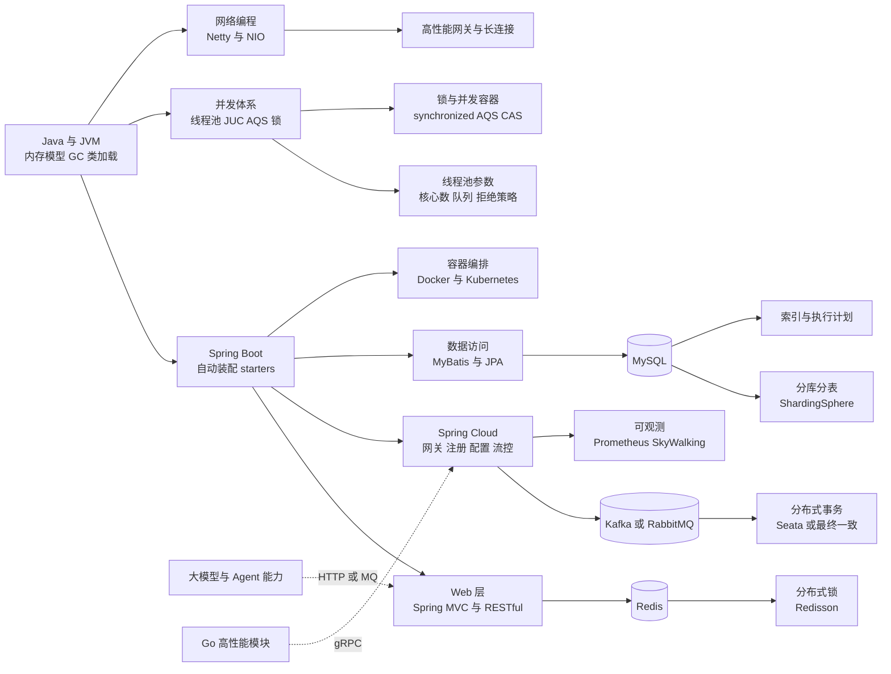
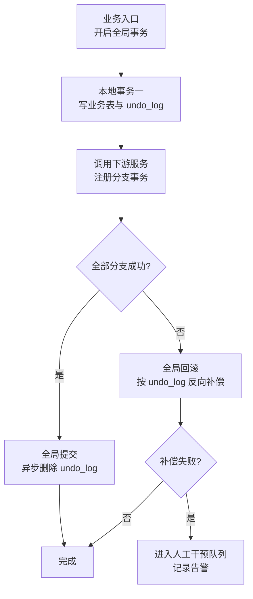
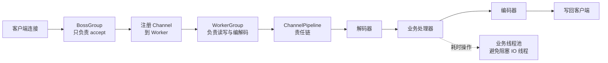
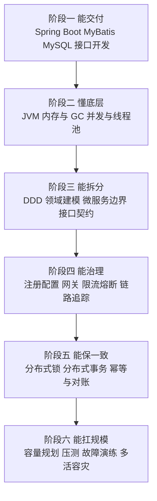

# 03 · Java 微服务后端架构

> 数据基础：56 份 JD 聚合去重 | 薪资均值 17-28K | 学历主流：本科 | 经验主流：5 年以上
> 内容已去除公司信息，保留技术事实。

---

## 一、方向定位

这一方向的核心职责不是"会用 Spring Boot 写接口"，而是**在既有业务复杂度之上，用微服务的方式把系统拆得开、连得上、扛得住、改得动**。

Java 是本批 JD 中体量最大、要求最"深"的方向：它同时考核语言底层（JVM、多线程）与架构上层（服务治理、分布式一致性），是典型的"两头都硬"岗位。

| 技术/能力 | 出现篇数 | 占本方向比例 | 解读 |
|-----------|---------|-------------|------|
| Java | 56 | 100% | 岗位基线语言，无例外 |
| MySQL | 45 | 80% | 关系型主存储，索引与事务是核心考点 |
| Redis | 43 | 77% | 缓存、分布式锁、限流、会话 |
| 微服务 | 32 | 57% | 拆分、治理、注册发现是日常背景 |
| Spring Boot | 29 | 52% | 事实标准开发框架 |
| Docker | 26 | 46% | 容器化交付已普及 |
| MyBatis | 21 | 38% | 国内主流 ORM，SQL 可控性优先 |
| 高并发 | 19 | 34% | 与多线程构成能力分水岭 |
| Go | 19 | 34% | 多语言协同，Go 承载高性能模块 |
| Python | 18 | 32% | 脚本化与 AI 侧协同 |
| Spring Cloud | 18 | 32% | 微服务全家桶，治理能力载体 |
| 多线程 | 17 | 30% | JMM、锁、线程池是必考项 |
| Kafka | 16 | 29% | 异步解耦与事件驱动 |
| RESTful | 16 | 29% | 对外接口主流风格 |
| JVM | 15 | 27% | 内存模型、GC、调优，高级岗硬门槛 |
| 性能优化 | 15 | 27% | 从 SQL 到 JVM 到架构的全栈优化 |
| Vue | 13 | 23% | 全栈化要求 |
| PostgreSQL | 13 | 23% | 与 MySQL 互补，GIS/JSONB 场景 |
| RabbitMQ | 13 | 23% | 轻量异步与延迟队列场景 |
| Git | 13 | 23% | 协作与分支管理 |
| React | 12 | 21% | 前后端协同 |
| 大模型 | 12 | 21% | AI 能力嵌入既有 Java 业务系统 |

**补充抽样统计**（可回溯子样 58 篇，用于补充上表 Top 之外的细项）：并发相关表述 25 篇约 43%、调优 16 篇约 27%、CI/CD 11 篇约 18%、单元测试 9 篇约 15%、锁 8 篇约 13%、限流 5 篇约 8%、幂等 5 篇约 8%、分库分表 2 篇、MVCC 与索引优化各 2 篇、Netty 1 篇。

**城市与薪资侧写**：样本以深圳为主（南山区占子样 23/58），广州天河、海珠、黄埔与深圳宝安、龙岗次之，另有佛山岗位；薪资可统计样本 58 条，低端均值 17.8K、高端均值 28.6K，上探到 70K 档位。

**一句话总结**：这个方向的门槛在"深度 + 体系"——**向下要能讲清 JVM 内存与线程模型、能调线程池和 GC；向上要能设计服务拆分、保证分布式一致性、建立可观测与发布体系。** 只会 CRUD 和只会背八股，都过不了。

---


### 完整技术栈清单（全量抽取 · 基于本方向 56 篇 JD）

> 下表由 JD 全文穷举抽取生成，数字为**出现该术语的 JD 篇数**，用于补齐正文未展开的细分技术项。

| 类别 | 技术栈（数字为出现篇数） |
|------|------------------------|
| **语言** | Java(56)、SQL(28)、Python(18)、Go(7)、JavaScript(7)、TypeScript(4)、C++(3)、Node.js(3)、Kotlin(2)、Golang(1)、Shell(1)、PHP(1)、Lua(1)、Dart(1)、Swift(1) |
| **后端框架** | Spring(45)、Spring Boot(29)、MyBatis(21)、Spring Cloud(18)、SpringBoot(13)、Dubbo(6)、FastAPI(5)、Django(5)、Spring MVC(5)、MyBatis-Plus(5)、RPC(4)、Flask(3)、Hibernate(3)、gRPC(2)、Gin(2)、NestJS(2)、JPA(2)、Netty(2)、Celery(2)、Express(1) |
| **前端框架与UI** | React(12)、Vue(12)、jQuery(3)、Vite(3)、小程序(3)、H5(3)、Flutter(2)、Next.js(2)、低代码(2)、Element UI(2)、Ant Design(2)、Vue3(1)、组件化(1)、Webpack(1)、Three.js(1)、响应式(1)、Nuxt(1)、uni-app(1) |
| **移动端** | 移动端(6)、Android(4)、iOS(3)、Kotlin(2)、App开发(1)、鸿蒙(1)、Swift(1)、React Native(1)、Uniapp(1) |
| **数据库与存储** | MySQL(45)、Redis(43)、PostgreSQL(13)、MongoDB(8)、Oracle(6)、SQL Server(5)、Elasticsearch(4)、pgvector(2)、Milvus(1)、ClickHouse(1)、MinIO(1)、HBase(1)、InfluxDB(1)、时序数据库(1) |
| **消息与中间件** | Kafka(16)、RabbitMQ(13)、RocketMQ(7)、MQTT(3)、Nacos(3)、定时任务(1)、ZooKeeper(1)、XXL-JOB(1)、Sentinel(1) |
| **云容器与DevOps** | Docker(26)、CI/CD(12)、容器化(11)、Kubernetes(10)、K8s(8)、Nginx(7)、DevOps(6)、流水线(4)、资源调度(3)、Jenkins(3)、灰度发布(1)、自动化部署(1)、Istio(1)、Service Mesh(1)、GitLab CI(1)、Ingress(1)、镜像(1)、K3s(1)、Operator(1)、持续交付(1) |
| **大数据与数据平台** | 报表(3)、BI(3)、数据同步(3)、Hadoop(3)、ETL(2)、Flink(2)、Spark(1)、数据质量(1)、数据中台(1)、Hive(1)、数据仓库(1)、离线计算(1) |
| **AI与机器学习** | Claude(13)、大模型(12)、Agent(10)、RAG(6)、LLM(4)、智能体(3)、Prompt(3)、MCP(3)、多模态(3)、模型部署(3)、LangChain(2)、微调(2)、ASR(2)、DeepSeek(1)、LangGraph(1)、PyTorch(1)、OpenCV(1)、vLLM(1)、Dify(1)、提示词(1) |
| **音视频与流媒体** | 低延迟(2)、转码(2)、FFmpeg(1)、RTMP(1)、硬编(1) |
| **嵌入式与硬件** | CAN(1)、OTA(1)、WiFi(1)、ROS(1)、储能(1)、CoAP(1)、数字孪生(1)、光伏(1) |
| **桌面与客户端** | 客户端(3)、.NET(2) |
| **协议与接口** | RESTful(16)、WebSocket(6)、HTTP(5)、TCP(4)、GraphQL(3)、接口对接(2)、gRPC(2)、JSON(2)、HTTPS(2)、长连接(2)、SDK(1)、开放平台(1)、Webhook(1)、FTP(1)、WebService(1)、SSE(1)、OAuth2(1)、JWT(1)、CAS(1)、Protobuf(1) |
| **安全与合规** | HTTPS(2)、RBAC(2)、合规(1)、权限控制(1)、SSL(1) |
| **工程化与质量** | 重构(14)、Git(11)、单元测试(11)、代码评审(8)、技术文档(7)、集成测试(6)、日志(5)、设计文档(5)、接口文档(5)、编码规范(5)、Maven(3)、SVN(2)、压测(2)、GitHub(1)、灰度(1)、复盘(1)、敏捷(1)、Jira(1)、GitLab(1)、Selenium(1) |
| **架构与设计** | 微服务(32)、架构设计(26)、高并发(19)、多线程(17)、性能优化(15)、方案设计(15)、高可用(10)、异步(10)、锁(7)、技术选型(6)、限流(6)、抽象(6)、设计模式(6)、负载均衡(6)、SaaS(5)、降级(5)、幂等(5)、熔断(5)、分布式事务(5)、分库分表(5) |
| **业务领域** | ERP(11)、电商(7)、订单(6)、支付(6)、实施(5)、金融(5)、物流(5)、MES(4)、供应链(4)、风控(4)、WMS(3)、库存(3)、医疗(3)、PLM(2)、物联网平台(2)、财务(1)、CRM(1)、OA(1)、项目管理(1)、金蝶(1) |
| **软技能** | 团队协作(15)、沟通能力(14)、需求分析(11)、责任心(11)、规划(9)、学习能力(7)、培训(6)、文档编写(5)、跨部门(4)、抗压(3)、出差(2)、owner(2)、英语(1)、复盘(1) |

---

## 二、参考架构图

一套典型的 Spring Cloud 微服务参考架构。注意"分布式一致性"与"治理与可观测"两块，是把"一堆 Spring Boot 应用"变成"可运营的微服务体系"的关键。



### 架构解读

1. **网关是唯一入口**：路由、鉴权、限流、灰度染色都在这里完成。把横切关注点收在网关，业务服务才能保持"只关心业务"。
2. **治理层提供运行时的"神经系统"**：注册中心负责服务发现，配置中心负责动态下发，Sentinel 负责流控熔断。这一层缺失，微服务就会退化为"一堆互相写死 IP 的应用"。
3. **业务层按领域边界拆分**：拆分的依据是**业务边界与数据所有权**，而不是代码量。一个服务拥有自己的数据，跨服务只能通过接口或事件，这是微服务能独立演进的前提。
4. **领域层收敛分布式复杂度**：分布式事务、幂等、补偿都在这里统一处理。业务代码里直接写"先调 A 再调 B 出错就回滚 A"是事故温床。
5. **数据层要分开看待**：MySQL 解决一致性，Redis 解决性能，MQ 解决解耦与削峰，ES 解决检索。混用会导致一致性与性能双双失控。
6. **可观测与交付决定迭代速度**：没有链路追踪，跨服务排查只能靠猜；没有 CI/CD 与灰度，发布就是赌博。

---

## 三、技术栈关联图



### 说明

- **JVM 是底**：内存区域划分、对象生命周期、GC 算法与回收器选择，决定了服务的延迟特征与稳定性上限。
- **Spring Boot 是骨架**：自动装配降低了使用门槛，但也要求工程师理解"为什么这么配"，否则出问题时无从下手。
- **并发体系是分水岭**：JMM（可见性/原子性/有序性）、`synchronized` 与 `AQS` 的实现、`ThreadPoolExecutor` 的七个参数，是区分中级与高级的关键。
- **数据一致性是微服务的核心难题**：本地事务 → 分布式锁 → 分布式事务/最终一致，是递进关系，能用前者解决就别上后者。
- **可观测与编排是运营基础**：微服务把"单体内的调用"变成了"网络调用"，没有追踪和指标，系统就是黑盒。

---

## 四、核心能力矩阵

| 能力项 | 出现率 | 关键要点 | 常见追问 |
|--------|-------|---------|---------|
| Java 语言与 JVM | 100% / 27% | 内存区域、对象创建与回收、类加载、GC 算法与回收器 | 一个对象从创建到回收经历了什么？ |
| 并发与多线程 | 30%+ | JMM、`volatile`、`synchronized`、AQS、CAS、线程池 | 线程池队列满了会怎样？ |
| Spring 生态 | 52% Boot | IOC/AOP、循环依赖、事务传播、自动装配原理 | Bean 的生命周期与循环依赖怎么解决？ |
| 微服务治理 | 57% / 32% Cloud | 注册发现、配置中心、网关、限流熔断、链路追踪 | 服务雪崩怎么防？ |
| 数据存储与 SQL | 80% MySQL | 索引结构、执行计划、事务隔离、锁、慢查询治理 | 为什么这条 SQL 没走索引？ |
| 缓存体系 | 77% Redis | 数据结构选型、穿透/击穿/雪崩、一致性、热 key | 缓存和数据库一致性怎么保证？ |
| 分布式一致性 | 中 | 分布式锁、Seata AT/TCC/Saga、消息最终一致、幂等 | 分布式事务为什么不用 XA？ |
| 消息中间件 | 29% Kafka | 分区与顺序、重复消费、积压、可靠投递 | 怎么保证消息不丢失且不重复？ |
| 性能调优 | 27% | JVM 参数、GC 日志、线程池、SQL、缓存命中率 | Full GC 频繁怎么排查？ |
| 容器与交付 | 46% Docker | 镜像构建、健康检查、优雅停机、CI/CD、灰度 | 发布时如何做到无损？ |
| 工程规范 | 23% Git | 分支模型、单测、日志规范、错误码、代码评审 | 如何保证重构不出问题？ |
| AI 能力集成 | 21% | 模型调用、流式输出、工具编排、权限隔离 | 怎么把 AI 能力接入存量业务？ |

---

## 五、关键实现要点

### 5.1 JVM 内存模型与调优

**内存区域划分**：堆（新生代 Eden/Survivor + 老年代）、元空间、虚拟机栈、本地方法栈、程序计数器、直接内存。调优主要围绕堆与元空间。

**对象回收判定**：可达性分析（GC Roots），不是引用计数。`GC Roots` 包括栈帧局部变量、静态字段、常量、JNI 引用等。

**主流回收器选择**：

| 回收器 | 特点 | 适用 |
|-------|------|------|
| G1 | 区域化、可预测停顿 | 默认选择，堆 4G~64G |
| ZGC | 亚毫秒停顿、着色指针 | 大堆、极低延迟要求 |
| Parallel | 吞吐优先 | 离线任务、批处理 |

**关键参数（`JDK 8` 与 `JDK 11+` 有差异，下表为 `JDK 11+`）**：

```
-Xms4g -Xmx4g                  # 堆大小固定，避免动态扩缩容抖动
-XX:MaxMetaspaceSize=512m      # 元空间上限，防类加载泄漏
-XX:+UseG1GC
-XX:MaxGCPauseMillis=200       # G1 软目标，非硬保证
-XX:+HeapDumpOnOutOfMemoryError
-XX:HeapDumpPath=/data/dump
-Xlog:gc*:file=/data/logs/gc.log:time,uptime:filecount=10,filesize=64m
```

排查套路：
1. `jstat -gcutil <pid> 1000` 看各区占用与 GC 次数趋势；
2. `jmap -histo:live <pid>` 快速看对象分布；
3. OOM 时依赖 `HeapDump`，用 MAT 定位支配树根节点；
4. CPU 高但 GC 正常 → `top -H` + `jstack` 找热点线程栈。

**最常见的三类 JVM 问题**：① 元空间增长（动态代理、热部署、类加载器泄漏）；② 老年代缓慢上涨（缓存无上限、ThreadLocal 未清理）；③ 直接内存溢出（Netty 池化未释放或 `-XX:MaxDirectMemorySize` 未设）。

### 5.2 线程池：七个参数与四个拒绝策略

```java
ThreadPoolExecutor pool = new ThreadPoolExecutor(
    8,                              // corePoolSize
    32,                             // maximumPoolSize
    60L, TimeUnit.SECONDS,          // keepAliveTime
    new ArrayBlockingQueue<>(2000), // 有界队列，禁止用无界
    new ThreadFactoryBuilder()
        .setNameFormat("biz-pool-%d").build(), // 必须命名
    new CallerRunsPolicy()          // 拒绝策略：调用方执行，天然背压
);
```

核心认知：

- **执行顺序不是"先扩容到 max 再入队"**，而是：核心线程未满 → 建核心线程；核心满了 → 入队列；队列满了 → 建非核心线程直到 max；都满了 → 拒绝策略。
- **必须用有界队列**：`Executors.newCachedThreadPool` 与 `newFixedThreadPool` 底层是无界队列，生产禁用。
- **必须自定义 `ThreadFactory`**：线程池里抛异常时，`pool-1-thread-3` 这种名字基本等于无法定位。
- **拒绝策略选择**：`CallerRunsPolicy` 让调用线程自己干活，变相降低提交速率，是最温和的背压；`AbortPolicy` 抛异常适合必须快速失败的场景。
- **参数估算**：CPU 密集型 ≈ 核数或核数 + 1；IO 密集型 ≈ 核数 × 等待时间/计算时间比。实际以压测为准。
- **禁用 `ThreadLocal` 传递线程池上下文**：线程池复用线程会导致上下文串号，应使用 `TransmittableThreadLocal`。

### 5.3 分布式锁：从 SETNX 到 Redisson

演进路径与坑点：

| 方案 | 问题 | 修正 |
|------|------|------|
| `SETNX` 不加过期 | 宕机后死锁 | 必须加过期时间 |
| `SETNX` + `EXPIRE` 两步 | 非原子，中间宕机死锁 | 用 `SET key val NX EX 30` 一条命令 |
| 固定过期时间 | 业务未执行完锁先失效 | 引入看门狗自动续期 |
| 误删别人的锁 | A 超时后删了 B 的锁 | value 存唯一标识，用 Lua 校验后删除 |
| 主从切换 | 主节点锁未同步即宕机 | 多节点 Redlock（有争议）或对一致性要求高的场景改用数据库/etcd |

生产推荐直接使用 **Redisson**：`RLock` 自带看门狗续期、可重入、公平/非公平选项。核心原则：**锁的粒度要小、必须带超时、必须可重入、必须能观测持有时长。**

### 5.4 分布式事务：Seata 与消息最终一致性



方案选型：

| 方案 | 一致性 | 性能 | 侵入性 | 适用 |
|------|-------|------|-------|------|
| 本地事务 + 幂等重试 | 最终 | 高 | 低 | **首选**，能通过设计规避就别上分布式事务 |
| 消息最终一致 | 最终 | 高 | 中 | 跨服务异步场景主流 |
| Seata AT | 弱隔离的最终一致 | 中 | 低（靠 undo_log） | 快速落地、容忍短暂脏读 |
| TCC | 强 | 中 | 高（要写三套接口） | 资金、交易核心链路 |
| Saga | 最终 | 高 | 中 | 长事务、业务流程编排 |

**消息最终一致性的三个必备件**：

1. **本地消息表或事务消息**：保证"业务操作成功"与"消息一定能发出"原子化；
2. **消费端幂等**：唯一键去重表或 Redis `SETNX`，重复消费无副作用；
3. **对账与补偿**：定时任务扫描长时间未完成的状态，主动回查上游。

### 5.5 MyBatis 与数据层优化

- **优先使用 `#{}`**：`${}` 是字符串拼接，有 SQL 注入风险，只可用于动态表名/排序字段且需白名单校验。
- **警惕 N+1 查询**：`association`/`collection` 的嵌套查询容易产生 N+1，用 `JOIN` + `resultMap` 嵌套结果映射替代，或显式批量查询后内存组装。
- **合理开启二级缓存**：二级缓存以 namespace 为单位，跨表更新易产生脏数据；读多写少且更新集中时可开，否则宁可依赖 Redis。
- **批量操作走 `BATCH` 执行器**：`ExecutorType.BATCH` + 分批提交，比循环单条插入快一个量级；注意每批控制在 500~1000 条，避免 SQL 过长与锁持有过久。
- **分页用真分页**：大偏移量 `LIMIT 1000000, 20` 会扫描大量行，改用"上一页最大 ID"游标分页。
- **连接池参数**：`maximumPoolSize` 并非越大越好，一般设为 `CPU 核数 × 2 + 磁盘数` 量级，配合 `connectionTimeout` 与 `maxLifetime` 防止被数据库侧断连。

### 5.6 Netty 与 Reactor 模型



要点：

1. **Reactor 三层**：Boss 接收连接、Worker 处理 I/O、业务线程池处理耗时逻辑。**绝不能在 NIO 线程里做数据库调用等阻塞操作**，否则一个慢查询会拖垮整组连接。
2. **零拷贝**：`CompositeByteBuf` 合并多个 buffer、`FileRegion` 做文件传输，减少内存拷贝次数。
3. **背压与水位**：`ChannelOption.WRITE_BUFFER_WATER_MARK` 设置高/低水位，配合 `channel.isWritable()` 判断，防止写缓冲无限堆积导致 OOM。
4. **内存泄漏检测**：`ResourceLeakDetector` 设置为 `PARANOID` 用于调试；`ByteBuf` 必须成对 `release`，推荐 `SimpleChannelInboundHandler`（自动释放）。
5. **心跳与空闲检测**：`IdleStateHandler` 处理死连接，避免半开连接耗尽资源。

### 5.7 Spring Cloud 治理：超时、重试与熔断的协同

| 组件 | 职责 | 关键配置 |
|------|------|---------|
| Gateway | 路由、鉴权、限流 | 路由断言、过滤器、局部限流 |
| Nacos | 注册发现 + 配置 | 命名空间隔离、灰度配置 |
| OpenFeign | 声明式调用 | `connectTimeout`、`readTimeout`、重试器 |
| Sentinel | 流控、熔断、降级 | QPS/并发阈值、慢调用比例、熔断恢复时长 |
| LoadBalancer | 负载均衡 | 轮询、随机、权重、区域优先 |

三条硬性经验：

1. **超时必须逐层收敛**：Gateway 超时 > Feign 超时 > 下游服务自身超时。Ribbon/LoadBalancer 的重试次数要计入总预算。
2. **熔断与重试不能同时激进**：下游已经在熔断了，上游还在重试，等于雪上加霜。原则是**重试只在最外层做一次，且只对幂等接口**。
3. **降级要有兜底数据**：`FallbackFactory` 里要能拿到异常原因，返回可用的默认值或缓存值，而不是简单抛错。

---

## 六、典型业务场景

| 业务场景 | 技术特征 | 关键技术组合 | 常见难点 |
|---------|---------|-------------|---------|
| 电商订单与交易 | 高一致性、峰值明显 | 本地事务 + 幂等 + MQ 削峰 + 分布式锁 | 超卖、重复下单、状态机混乱 |
| 支付与对账 | 资金安全、可追溯 | TCC 或消息最终一致 + 幂等表 + 定时对账 | 部分成功、回退补偿 |
| 库存与秒杀 | 瞬时极高并发 | Redis 预扣 + 异步落库 + 限流 + 令牌桶 | 热点行锁、缓存一致性 |
| ERP / MES / WMS | 业务复杂、长流程 | 领域建模 + 工作流引擎 + 事务编排 | 长事务、跨模块一致性 |
| 权限与组织架构 | 多租户、细粒度 | RBAC/ABAC + 数据权限 + 单点登录 | 权限模型膨胀、性能 |
| 设备接入与 IoT | 海量长连接、高频小包 | Netty + MQTT + 时序存储 + 批量写 | 连接稳定性、数据积压 |
| 内容与社交 | 读多写少、关系复杂 | 多级缓存 + 异步写入 + 检索 | 缓存一致性、粉丝关系 |
| AI 能力嵌入 | 流式、异步、权限隔离 | SSE/WebSocket + 异步任务 + 审计 | 超时、Token 计量、合规 |

### 部署形态对照

| 形态 | 适用场景 | 关键技术 | 主要风险 |
|------|---------|---------|---------|
| 传统虚拟机 | 存量系统、稳定业务 | 多实例 + 负载均衡 + 手工/脚本发布 | 环境漂移、扩容慢、回滚慢 |
| 容器化单机 | 中小规模、引入容器初期 | Docker + compose | 无自愈、无弹性 |
| Kubernetes | 主流生产形态 | Deployment、Service、Ingress、HPA | 资源规划、探针误杀、JVM 容器感知 |
| 服务网格 | 多语言、治理需求复杂 | Sidecar 流量治理、mTLS、可观测 | 运维复杂度、性能开销 |

> JVM 容器化特别提示：务必使用 `JDK 11+`（或 `JDK 8u191+`）并设置 `-XX:MaxRAMPercentage`，否则 JVM 会按宿主机内存而非 cgroup 限制来分配堆。

---

## 七、典型职责归纳（去重合并）

- 负责业务系统的架构设计、服务拆分与核心模块编码，基于 Spring Boot / Spring Cloud 交付微服务。
- 主导数据库设计：表结构、索引、分库分表方案与慢 SQL 治理，保障数据层性能与一致性。
- 设计并实现高并发链路：多级缓存、异步化、削峰填谷、限流熔断降级与幂等机制。
- 负责 JVM 与性能调优：内存与 GC 参数、线程池配置、连接池调优、压测与瓶颈定位。
- 负责分布式一致性方案落地：分布式锁、分布式事务或消息最终一致性、补偿与对账。
- 建设服务治理体系：注册发现、配置中心、网关路由、链路追踪与熔断流控规则。
- 推动 DevOps 落地：容器镜像构建、CI/CD 流水线、健康检查、优雅停机、灰度与回滚。
- 建设可观测与告警：指标埋点、日志规范、链路采样、告警分级与值班响应机制。
- 参与需求评审与技术选型，输出技术方案、接口文档与排期评估。
- 负责线上问题排查与故障处理，组织复盘并沉淀故障案例与排查手册。
- 与前端、测试、产品协同，推动自动化测试与代码评审规范落地。
- 探索 AI 能力在既有业务系统中的集成路径，包括模型调用、工具编排与权限隔离。

---

## 八、进阶路径建议



| 阶段 | 产出物 | 验收标准 |
|------|-------|---------|
| 一 | 一套完整业务接口 | 有分层、有单测、有接口文档 |
| 二 | 一份 JVM 调优报告 | 有 GC 日志分析与参数依据 |
| 三 | 一份服务拆分方案 | 有边界划分依据与数据所有权 |
| 四 | 一套治理配置 | 有限流熔断规则与追踪串联 |
| 五 | 一个一致性方案 | 有幂等设计、补偿与对账机制 |
| 六 | 一次全链路压测 | 有瓶颈清单与扩容预案 |

---

## 九、常见考察点清单

1. **JVM 内存区域有哪些？哪些会 OOM？**
   堆（对象实例）、元空间（类元数据）、虚拟机栈（栈帧）、本地方法栈、程序计数器、直接内存。堆、元空间、栈、直接内存都可能溢出，各自原因不同：堆是对象太多或泄漏，元空间是类加载泄漏，栈是递归过深，直接内存是 NIO/Netty 未释放。

2. **对象什么时候进入老年代？**
   ① 年龄达到阈值（默认 15）；② 大对象直接分配（`-XX:PretenureSizeThreshold`）；③ Survivor 中同龄对象总大小超过一半则年龄大于等于该年龄的对象直接晋升；④ 空间分配担保失败。

3. **G1 和 CMS 的核心区别？**
   CMS 是"标记-清除"，追求低延迟但有碎片、有并发模式失败风险；G1 是"标记-整理 + 区域化"，把堆切成 Region，可预测停顿，通过回收收益高的区域控制停顿时间。CMS 在 JDK 9 被废弃，G1 是默认选择。

4. **CPU 飙高怎么排查？**
   `top` 找进程 → `top -Hp <pid>` 找线程 → `jstack <pid>` 把线程 ID 转 16 进制匹配栈 → 定位热点方法。若发现大量 GC 线程，则转 GC 日志分析；若有 BLOCKED 线程，则看锁竞争。

5. **`volatile` 能做什么、不能做什么？**
   能保证可见性与禁止指令重排，**不保证复合操作的原子性**（如 `i++`）。典型场景：状态标志位、双重检查锁定的单例。底层通过内存屏障实现。

6. **`synchronized` 与 `ReentrantLock` 怎么选？**
   优先 `synchronized`（JVM 内置、自动释放、有锁升级优化）；需要可中断、可超时、公平锁、多个条件变量时用 `ReentrantLock`。AQS 是后者的核心，用 `volatile state` + CAS + CLH 队列实现。

7. **线程池参数怎么定？队列用什么？**
   核心数按负载类型估算（CPU 密集 ≈ N，IO 密集 ≈ N × 等待/计算比），队列**必须用有界队列**，拒绝策略按业务语义选（快速失败或调用方执行）。必须自定义线程名，方便排查。

8. **分布式锁怎么避免误删和死锁？**
   死锁：加锁必须带过期时间，用一条 `SET key val NX EX 30` 保证原子性。误删：value 存唯一请求标识，删除时用 Lua 脚本比对后再删。续期：用 Redisson 看门狗。主从切换场景要评估 Redlock 或改用强一致存储。

9. **缓存与数据库一致性怎么保证？**
   常规方案是"更新数据库 → 删除缓存"，而不是更新缓存；删除失败要重试（走 MQ）。容忍短暂不一致时用 TTL 兜底；强一致场景用分布式锁串行化或监听 binlog 做异步补偿。核心认知：**不要追求绝对一致，要追求可收敛。**

10. **分布式事务怎么选型？**
    先问能不能用最终一致。能通过"本地事务 + 可靠消息 + 消费幂等 + 定时对账"解决的，就不上 Seata/TCC。资金核心链路才考虑 TCC。Seata AT 模式侵入低但有全局锁与脏读窗口，适合快速落地。

11. **慢 SQL 怎么定位？**
    ① 开慢查询日志或用 APM 抓取；② `EXPLAIN` 看 `type`、`key`、`rows`、`Extra`；③ 检查索引失效场景：函数包裹、隐式类型转换、`LIKE '%x'`、最左前缀不满足、`OR` 连接、数据倾斜导致优化器误判；④ 看是否回表过多，考虑覆盖索引。

12. **微服务雪崩怎么防止？**
    四道防线：① 超时控制且逐层收敛；② 限流（网关与服务双端）；③ 熔断（错误率/慢调用比例触发，半开恢复）；④ 降级（非核心功能关闭，兜底数据）。再加资源隔离（线程池/信号量）避免单一依赖耗尽全局资源。

---

## 十、与其他方向的连接

- **与 Go 云原生与高并发服务**：本方向 JD 中 Go 出现 19 篇约 34%，现实中是"Java 承载核心业务、Go 承载网关与高性能模块"的混合架构，两者共享注册中心、消息队列与可观测体系，跨语言靠 gRPC 或 MQ。
- **与 AI 大模型应用工程**：大模型出现 12 篇约 21%，典型形态是把模型能力嵌入既有 Java 业务系统——Java 负责权限、数据与事务边界，AI 侧负责推理与编排，通过 HTTP 或 MQ 解耦。
- **与前端与全栈**：Vue 23%、React 21%，要求后端理解接口契约、错误码语义、SSE/WebSocket 的前端消费方式，以及前后端超时与重试的协同，避免互相放大故障。
- **与数据平台与实时计算**：业务数据经 CDC 进入数仓，Java 侧要理解 binlog、幂等与最终一致的边界，避免业务库与分析库职责混淆。
- **与嵌入式与边缘计算**：设备接入侧与云端 Java 平台配合，Java 负责设备影子、指令下发与数据处理，边缘侧负责采集与协议转换。
