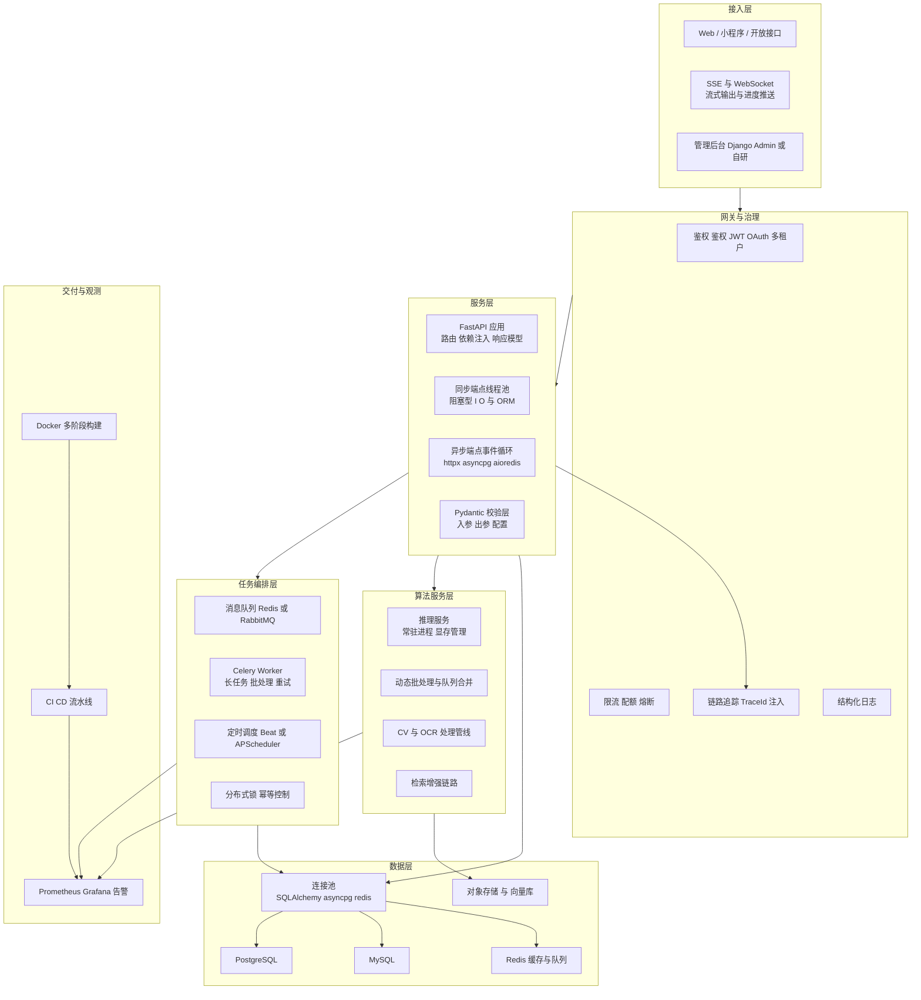
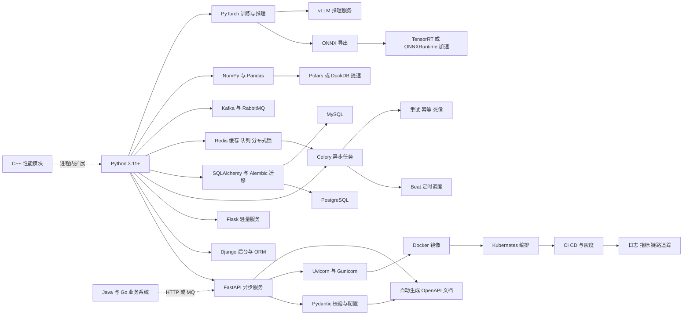
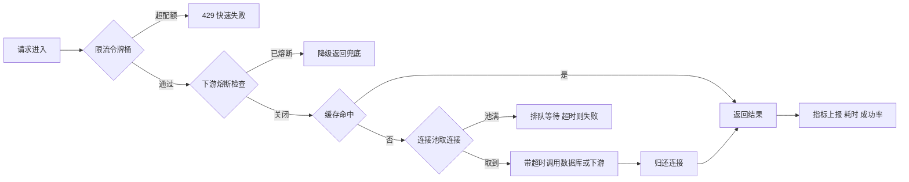
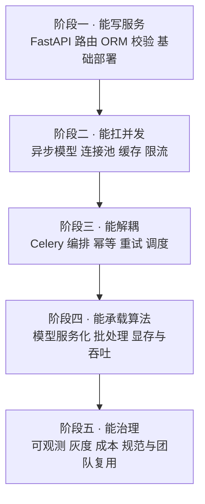

# 04 · Python 工程化与算法服务

> 数据基础：31 份 JD 聚合去重 | 薪资均值 19-29K | 学历主流：本科 | 经验主流：5 年以上
> 内容已去除公司信息，保留技术事实。

---

## 一、方向定位

这个方向不是"写 Python 脚本"，而是**用 Python 把业务服务、算法/模型能力与数据链路组织成可上线、可运维、可扩展的系统**。它的典型形态是：FastAPI/Django 承载业务接口，Celery 之类承担异步与定时，PyTorch/OpenCV 之类的算法模块被封装成独立服务，外面再用 Docker 与 CI/CD 交付。

从 JD 词频看，这个方向的"多语言共存"特征非常明显——Python 是主力，但 Java、Go、C++ 的高频出现说明它几乎总是在一个异构系统里做集成者。

| 技术/能力 | 出现篇数 | 占本方向比例 | 解读 |
|-----------|---------|-------------|------|
| Python | 30 | 97% | 绝对主力语言，无争议 |
| Java | 18 | 58% | 需与既有 Java 业务系统对接、共存或替换部分模块 |
| MySQL | 17 | 55% | 主业务库，绝大多数岗位的第一存储 |
| FastAPI | 17 | 55% | Python 侧服务化的事实标准，已远超 Flask |
| Redis | 15 | 48% | 缓存、队列、限流计数三合一 |
| 大模型相关关键词 | 14 | 45% | "算法服务"正在大量变成"模型服务" |
| Agent / 智能体 | 14 | 45% | 复杂任务编排成为 Python 侧的高价值场景 |
| PostgreSQL | 14 | 45% | 与 MySQL 并列，JSON/向量/GIS 场景更常见 |
| Go | 14 | 45% | 高性能旁路服务、网关与长连接服务由 Go 承担 |
| Docker | 12 | 39% | 容器化交付是基线而非加分项 |
| C++ | 12 | 39% | 性能内核、推理加速、硬件/设备对接 |
| Django | 11 | 35% | 后台管理、ORM 重的业务系统仍大量使用 |
| LLM 直接提及 | 9 | 29% | 明确要求懂模型调用与工程化封装 |
| PyTorch | 7 | 23% | 真正要求自训/微调的比例不高，多数是"会部署、会封装" |

对同批 JD 做二次细粒度扫描（n=31），还能看到这些更具体的技术点：

| 细分技术点 | 出现篇数 | 解读 |
|-----------|---------|------|
| SQL / 数据库设计 | 18 | 无论算法多复杂，最终都落在库表与查询上 |
| 流式输出 SSE / WebSocket | 8 | 模型与长任务的交互形态改变接口设计 |
| 异步 / 协程 | 6 | 高并发 Python 服务的分水岭 |
| 监控与日志体系 | 10 | 要求"能上线也能排障" |
| 权限体系 RBAC / OAuth / JWT | 9 | 系统级岗位而非脚本级岗位 |
| 知识库 / 向量检索 | 8 | Milvus、pgvector 出现 3 篇，属专业检索链路 |
| 单元测试与代码规范 | 6 | 工程化成熟度的直接指标 |
| 消息队列 Kafka / RabbitMQ | 4 | 解耦业务与重任务 |
| 模型推理运行时 vLLM / ONNX / TensorRT | 3 | 真正做推理加速的岗位 |
| 任务调度 | 4 | 周期任务、批处理、定时报表 |
| BI / 报表 | 4 | 结果最终要被人看、被决策用 |

**一句话总结**：这个方向的门槛在"工程闭环"——接口怎么设计、阻塞怎么消除、任务怎么编排、模型怎么部署、出问题怎么定位。

---


### 完整技术栈清单（全量抽取 · 基于本方向 31 篇 JD）

> 下表由 JD 全文穷举抽取生成，数字为**出现该术语的 JD 篇数**，用于补齐正文未展开的细分技术项。

| 类别 | 技术栈（数字为出现篇数） |
|------|------------------------|
| **语言** | Python(30)、Java(18)、C++(12)、SQL(7)、TypeScript(6)、Node.js(5)、JavaScript(5)、Go(4)、C#(3)、Golang(2)、Shell(1)、Kotlin(1)、PHP(1)、Dart(1) |
| **后端框架** | FastAPI(17)、Django(11)、Spring(8)、Flask(7)、Spring Boot(6)、SpringBoot(4)、Spring Cloud(2)、gRPC(2)、Gin(2)、RPC(2)、Celery(2)、MyBatis(1)、Dubbo(1)、NestJS(1) |
| **前端框架与UI** | React(11)、Vue(7)、Flutter(2)、Vite(2)、Ant Design(2)、组件化(2)、Next.js(1)、H5(1)、Vue3(1)、Webpack(1)、ESLint(1)、uni-app(1)、微前端(1)、qiankun(1)、拖拽(1) |
| **移动端** | Android(4)、移动端(3)、iOS(1)、Kotlin(1)、Framework(1)、App开发(1)、Uniapp(1) |
| **数据库与存储** | MySQL(17)、Redis(15)、PostgreSQL(14)、向量数据库(5)、pgvector(4)、MongoDB(3)、Milvus(3)、Neo4j(2)、Oracle(1)、SQL Server(1)、Elasticsearch(1)、SQLite(1)、ClickHouse(1)、Doris(1)、MinIO(1)、对象存储(1)、图数据库(1) |
| **消息与中间件** | Kafka(4)、RabbitMQ(2)、MQTT(1)、RocketMQ(1)、Nacos(1)、Prometheus(1)、Grafana(1)、OpenTelemetry(1) |
| **云容器与DevOps** | Docker(12)、CI/CD(7)、Kubernetes(6)、容器化(5)、流水线(4)、Nginx(3)、K8s(2)、回滚(2)、DevOps(1)、灰度发布(1)、资源调度(1)、Jenkins(1)、Ingress(1)、持续交付(1) |
| **大数据与数据平台** | 报表(3)、数据同步(2)、ETL(2)、Hadoop(2)、Flink(2)、埋点(2)、Spark(2)、BI(1)、数据治理(1)、数据质量(1)、元数据(1)、批处理(1)、血缘(1)、Trino(1)、Iceberg(1)、Hudi(1)、Airflow(1)、Superset(1)、离线计算(1) |
| **AI与机器学习** | 大模型(14)、Agent(14)、RAG(11)、Claude(9)、LLM(7)、LangChain(7)、多模态(7)、PyTorch(7)、Prompt(5)、微调(5)、模型部署(5)、TensorFlow(5)、智能体(4)、MCP(4)、LangGraph(4)、OpenCV(4)、Embedding(4)、DeepSeek(3)、ASR(3)、vLLM(3) |
| **音视频与流媒体** | 低延迟(2)、硬编(2)、编解码(1)、回放(1)、预览(1)、切片(1) |
| **嵌入式与硬件** | 运动控制(3)、嵌入式(2)、中断(2)、LoRa(2)、ROS(2)、SPI(1)、I2C(1)、串口(1)、CAN(1)、Modbus(1)、RTOS(1)、OTA(1)、PLC(1)、原理图(1)、传感器(1)、交叉编译(1)、瑞芯微(1)、IMU(1)、ROS2(1)、SLAM(1) |
| **桌面与客户端** | 客户端(1)、.NET(1)、WPF(1)、WinForms(1) |
| **协议与接口** | RESTful(6)、WebSocket(3)、SDK(3)、HTTP(2)、REST(2)、gRPC(2)、HTTPS(2)、SSE(2)、TCP(1)、接口对接(1)、JSON(1)、开放平台(1)、GraphQL(1)、OpenAPI(1) |
| **安全与合规** | 合规(3)、HTTPS(2)、权限控制(1)、SSL(1)、数据加密(1)、隐私保护(1)、敏感信息(1) |
| **工程化与质量** | 技术文档(8)、日志(6)、Git(4)、重构(4)、单元测试(4)、代码评审(2)、设计文档(2)、GitHub(2)、集成测试(2)、接口文档(2)、编码规范(2)、Selenium(2)、灰度(1)、监控告警(1)、复盘(1)、CMake(1)、覆盖率(1)、Playwright(1)、容量规划(1) |
| **架构与设计** | 架构设计(12)、性能优化(8)、微服务(6)、异步(5)、高并发(4)、方案设计(4)、高可用(4)、SaaS(4)、重试(3)、限流(2)、抽象(2)、降级(2)、幂等(2)、低延迟(2)、对账(2)、超时(2)、解耦(2)、DDD(2)、多线程(1)、技术选型(1) |
| **业务领域** | ERP(9)、库存(6)、供应链(5)、电商(5)、订单(5)、实施(3)、MES(3)、财务(3)、WMS(3)、支付(2)、金蝶(2)、物流(2)、SAP(2)、用友(2)、CRM(1)、OA(1)、金融(1)、医疗(1)、风控(1)、定制化(1) |
| **软技能** | 团队协作(9)、规划(6)、沟通能力(5)、需求分析(4)、培训(4)、文档编写(4)、责任心(3)、英语(3)、跨部门(2)、出差(2)、复盘(1)、owner(1) |

---

## 二、参考架构图

Python 侧服务体系的典型分层。注意"阻塞隔离"与"任务编排"两层，是把 Python 服务从能跑变成能扛的关键。



**解读**：
- 服务层内部区分同步端点和异步端点，是 FastAPI 项目能否扛住并发的分水岭；
- 任务编排层必须独立进程，绝不能让重任务占用 Web 请求线程；
- 算法服务层独立部署，便于 GPU 资源隔离与单独扩缩容；
- 观测不是附属品，TraceId 需要在网关层注入并贯穿队列任务。

---

## 三、技术栈关联图



**说明**：这张图里真正决定上限的是两条边——`Python → NumPy/Pandas` 的数据处理路径，以及 `Python → Celery` 的异步解耦路径。前者决定单机能处理多大数据量，后者决定系统能否承受突发流量。

---

## 四、核心能力矩阵

| 能力项 | 出现率 | 关键要点 | 常见追问 |
|--------|-------|---------|---------|
| FastAPI 服务开发 | 55% | 路由分层、依赖注入、响应模型、生命周期管理、自动文档 | `async def` 和 `def` 到底怎么选？ |
| 异步与并发模型 | 26%+ | 事件循环、线程池、GIL 影响面、阻塞点识别 | 为什么加了 async 反而更慢？ |
| 任务编排 | 中 | Celery 队列路由、重试与幂等、定时任务去重、结果后端 | 任务重复执行了怎么排查？ |
| 数据校验与契约 | 高 | Pydantic 模型、字段约束、版本兼容、OpenAPI 一致性 | 接口改字段怎么保证不破坏调用方？ |
| 数据库与连接池 | 55% | 池参数、慢查询、索引、事务边界、迁移管理 | 连接数打满的原因有哪些？ |
| 算法/模型服务化 | 45% | 模型加载策略、批处理、显存、健康检查、gRPC/HTTP 取舍 | 模型服务如何做到不停机更新？ |
| 数据处理性能 | 中高 | 向量化、dtype 优化、分块读、避免逐行遍历 | 一个 10GB 的文件怎么在 8G 内存里处理？ |
| 缓存与限流 | 48% | 缓存穿透/击穿/雪崩、令牌桶、熔断降级 | 缓存和数据库不一致怎么处理？ |
| 容器化交付 | 39% | 多阶段构建、依赖锁定、非 root 运行、镜像瘦身 | 镜像 1.2G 怎么降到 300M？ |
| 可观测与排障 | 32% | 结构化日志、TraceId、指标与告警、慢请求定位 | 线上偶发超时怎么定位？ |

---

## 五、关键实现要点

### 5.1 FastAPI 异步模型：最常见的坑是"假异步"

FastAPI 的规则很简单，但很多人理解反了：

- `async def` 端点在**事件循环**里执行，任何同步阻塞调用都会卡住整个进程的所有请求；
- `def` 端点会被丢进**线程池**执行，不阻塞事件循环，但受 `AnyThreadExecutor` 默认 40 线程限制。

因此真正的选择标准是：**这个端点内部的所有 I/O 是否都能 await**。

```python
# 反例：async 端点里用同步客户端，等价于把并发降到 1
@app.get("/bad")
async def bad():
    r = requests.get("https://api.example.com")   # 阻塞事件循环
    row = session.query(User).first()             # 同步 ORM，同样阻塞
    return {"ok": True}

# 正例一：全部异步化
@app.get("/good")
async def good():
    async with httpx.AsyncClient(timeout=3.0) as cli:
        r = await cli.get("https://api.example.com")
    row = await db.fetch_one(select(User).limit(1))  # asyncpg / SQLAlchemy asyncio
    return {"ok": True}

# 正例二：不得不阻塞时，显式声明为同步端点交给线程池
@app.get("/legacy")
def legacy():
    return {"data": old_blocking_sdk.query()}
```

配套要点：

1. **进程模型**：`gunicorn -k uvicorn.workers.UvicornWorker -w 4` 起多进程，worker 数按 CPU 核数与 GIL 争用实测决定，不要盲目等于核数×2+1（那是同步模型的经验值）。
2. **背压保护**：`--limit-concurrency`、`--timeout-keep-alive`、`--backlog` 三件套必须有，否则突发流量会把内存打爆而不是排队。
3. **生命周期**：用 `lifespan` 管理连接池、模型加载、后台任务的启停，避免用已废弃的 `@app.on_event`。
4. **依赖注入清理**：`Depends` + `yield` 保证会话归还连接池，异常路径也要能回滚。

### 5.2 任务编排：Celery 还是 APScheduler

| 维度 | Celery | APScheduler |
|------|--------|------------|
| 运行形态 | 独立 worker 进程，可跨机扩展 | 进程内调度器，随应用启停 |
| 持久化 | Broker 天然持久化 | 默认内存，需配 SQLAlchemyJobStore |
| 多副本问题 | 天然支持 | 每个副本都会触发，必须加分布式锁 |
| 适用 | 长任务、重试、削峰、跨服务 | 单机小任务、轻量定时 |

Celery 生产配置的关键项：

```python
app.conf.update(
    task_acks_late=True,              # 执行完再 ack，防止 worker 崩溃丢任务
    task_reject_on_worker_lost=True,  # worker 被杀时任务重回队列
    worker_prefetch_multiplier=1,     # 长任务必须设为 1，否则任务被某个 worker 独占
    task_default_retry_delay=3,
    task_max_retries=3,
    result_expires=86400,
    broker_transport_options={
        "visibility_timeout": 7200,   # 必须大于任务最长耗时，否则会被重复投递
    },
    task_routes={"app.tasks.heavy": {"queue": "heavy"}},  # 快慢队列隔离
)
```

必须处理的三件事：

- **幂等**：重试、重复投递、人为重放都会导致重复执行，任务入口用业务键先查状态再执行；
- **去重**：定时任务用 Redis 分布式锁（或 RedBeat）保证多副本只跑一次；
- **死信与告警**：失败任务进死信队列并告警，绝不能"失败了就失败了"。

### 5.3 Pydantic：把契约从文档搬进代码

- 入参与出参都用模型声明，`response_model` 显式指定，避免把内部字段（密码哈希、内部状态）泄露出去；
- 用 `Field(..., gt=0, le=100, description=...)` 把约束写进类型层，校验失败自动返回 422 并带字段级错误信息；
- 配置统一走 `pydantic-settings`，环境变量、`.env`、默认值三层覆盖，避免散落的 `os.getenv`；
- 性能敏感路径用 `model_validate_json`（v2 的 Rust 核心）而不是 `parse_obj(json.loads(...))`；
- 接口演进时用别名与 `model_config` 控制兼容，破坏性变更走 `/v2` 路径而不是原地改字段语义。

```python
class PredictIn(BaseModel):
    model_config = ConfigDict(extra="forbid", str_strip_whitespace=True)

    text: str = Field(min_length=1, max_length=4000)
    top_k: int = Field(default=5, ge=1, le=50)
    threshold: float | None = Field(default=None, ge=0.0, le=1.0)

    @model_validator(mode="after")
    def check_pair(self):
        if self.threshold is not None and self.top_k > 20 and self.threshold < 0.1:
            raise ValueError("阈值过低且返回条数过多，疑似误用")
        return self
```

### 5.4 连接池、超时与限流：三层防护



- **池参数**：`pool_size` 按并发峰值估算，`max_overflow` 只作为缓冲；`pool_pre_ping=True` 抵御数据库主动断连；`pool_recycle` 小于数据库 `wait_timeout`；异步驱动用 `asyncpg.create_pool(min_size, max_size)`。
- **超时三层**：连接超时 < 读超时 < 接口总超时，缺任何一层都会出现"请求挂死"。
- **重试只对幂等操作**：读可以重试，写要么带幂等键要么不重试；重试必须加指数退避与抖动，否则会制造重试风暴。
- **限流实现**：单实例用内存令牌桶不够，多副本要用 Redis + Lua 保证原子；`INCR` + 过期时间的写法在边界会有漏桶问题。
- **优雅退出**：容器终止前先摘流量（preStop + sleep），再关闭连接池，否则会出现大量 502。

### 5.5 算法模型封装成服务：四种模式与 gRPC/HTTP 取舍

| 模式 | 结构 | 适用 | 风险 |
|------|------|------|------|
| 进程内联 | 模型加载进 Web 进程 | 小模型、低 QPS、快速验证 | 显存与请求争抢，一条进程挂全线挂 |
| 独立推理服务 | 单独进程/容器，HTTP 或 gRPC | 大多数生产场景 | 网络开销、序列化开销 |
| 队列异步 | 请求进队列，worker 批量处理 | 耗时任务、离线批处理 | 无法同步返回结果 |
| 专业推理服务器 | Triton / vLLM 统一管理 | 多模型、多版本、GPU 共享 | 运维复杂度高 |

**gRPC 还是 HTTP**：

- 选 gRPC：内部服务间、QPS 高、payload 大且要求低延迟、需要双向流、需要强 IDL 契约与多语言代码生成；
- 选 HTTP/JSON：需要浏览器或第三方直连、需要人类可读与 curl 调试、生态中间件（网关、限流、观测）成熟、团队异构；
- 现实中最常见的组合是：**内部用 gRPC，对外用 HTTP 网关做协议转换**，流式生成场景则优先 SSE（浏览器原生支持、穿透代理友好）。

服务化必须补齐的细节：

- `/health` 只探活，`/ready` 检查模型是否加载完成，否则滚动发布时会把流量打到未就绪实例；
- 模型**预热**：启动后先跑一次 dummy 推理，避免首个真实请求承受编译/显存分配开销；
- **动态批处理**：攒 8~16ms 窗口合并推理，吞吐可提升数倍，但要给单请求设置最大等待时间；
- 显存与并发的关系要先压测出"单实例最大并发"，再据此设置副本数与队列长度。

### 5.6 NumPy / Pandas 的性能坑

```python
# 坑 1：逐行遍历。10 万行时比向量化慢 1~2 个数量级
for i, row in df.iterrows():        # 避免
    df.at[i, "score"] = f(row)
df["score"] = np.where(df["x"] > 0, df["a"] * 2, df["b"])   # 向量化

# 坑 2：dtype 默认 float64/int64，内存翻倍
df["uid"] = df["uid"].astype("int32")
df["city"] = df["city"].astype("category")

# 坑 3：链式赋值产生副本，改动丢失
df[df.x > 1]["y"] = 0               # 无效
df.loc[df.x > 1, "y"] = 0           # 正确

# 坑 4：一次性读入大文件
for chunk in pd.read_parquet(path, chunksize=200_000):   # 或用 pyarrow 列裁剪
    process(chunk)
```

- 内存估算：行数 × 列数 × 8 字节起步，字符串列按平均长度另算，先算再写；
- 关联前统一 key 的 dtype 与编码，否则 `merge` 会静默产生空结果或退化成笛卡尔积；
- `groupby` 用 `agg` 一次算完，避免多次扫描；
- 热点循环用 `numba` 或 C 扩展；CPU 密集且无法向量化时用 `multiprocessing` 绕开 GIL，注意 Windows/macOS 的 spawn 语义与序列化开销；
- 单机分析型负载优先考虑 DuckDB/Polars，往往能直接把分钟级降到秒级。

### 5.7 工程规范与可观测

- 日志统一结构化（JSON），每条日志带 `trace_id`、`user_id`、`request_id`，禁止拼字符串式日志；
- 用 OpenTelemetry 打通 HTTP 与 Celery 任务的链路，任务侧的 TraceId 通过消息头传递；
- `ruff` + `mypy` + `pytest` 进 pre-commit 与 CI，覆盖率阈值只设在新代码上（`diff-cover`）才可持续；
- 依赖用 `uv` 或 `poetry` 锁定，Docker 用多阶段构建：builder 装依赖 → runtime 只拷虚拟环境，配合 `--no-cache-dir` 与 slim 基础镜像。

---

## 六、典型职责归纳（去重合并）

- 负责 Python 侧服务的需求拆解、技术选型与接口设计，确定同步/异步、进程/任务的边界。
- 基于 FastAPI 或 Django 开发业务接口，设计数据模型、迁移脚本与权限体系。
- 设计异步与定时任务方案：队列选型、重试与幂等、调度去重、失败告警与死信处理。
- 把算法与模型能力封装为服务：加载策略、批处理、健康检查、扩缩容与版本管理。
- 打通异构系统：与 Java/Go/C++ 模块通过 HTTP、gRPC 或消息队列集成。
- 优化数据处理与查询性能：向量化、索引、缓存、分块与并发模型调整。
- 建设可观测与交付体系：结构化日志、链路追踪、指标告警、Docker 镜像与 CI/CD。
- 沉淀工程规范：代码评审标准、单元测试要求、配置管理、文档与知识库维护。

---

## 七、进阶路径建议



每个阶段都要有对应产出物：可跑的接口 → 压测报告达标的接口 → 稳定的任务系统 → 可独立扩缩容的模型服务 → 有 SLO 与告警的完整服务。

---

## 八、常见考察点清单

1. **FastAPI 里 `async def` 和 `def` 的区别？**（前者在事件循环执行，阻塞会拖垮全进程；后者进线程池；判断标准是端点内 I/O 是否全可 await）
2. **Python 服务 CPU 打不满但吞吐上不去怎么办？**（找阻塞点：同步 SDK、同步 ORM、CPU 密集逻辑未绕开 GIL；再调 worker 数与线程池）
3. **Celery 任务重复执行的原因？**（visibility_timeout 小于任务耗时、acks_late 未开、定时任务多副本无锁、业务侧不幂等）
4. **数据库连接池打满怎么排查？**（慢查询占连接、事务未提交、连接池过小、下游超时过长、连接泄漏进 finally 未释放）
5. **模型服务该用 HTTP 还是 gRPC？**（内部高 QPS 与流式用 gRPC，对外与浏览器场景用 HTTP/SSE，常见组合是网关转换）
6. **如何做到模型更新不停机？**（多版本并存、就绪探针区分加载状态、影子流量验证、按流量比例切换、保留回滚版本）
7. **Pandas 处理超大文件的思路？**（列裁剪、dtype 压缩、分块处理、换成 Parquet + 列式引擎、必要时上 Polars/DuckDB）
8. **缓存与数据库一致性怎么保证？**（更新数据库后删除缓存而非更新、设置短过期兜底、延迟双删、订阅 binlog 做最终一致）
9. **接口改字段如何不破坏调用方？**（契约由 Pydantic 模型与 OpenAPI 保证，破坏性变更走新版本路径，保留旧字段过渡期）
10. **限流为什么要用 Redis + Lua？**（多副本下内存计数不共享，`INCR`+`EXPIRE` 非原子会出现永不过期的 key，Lua 保证原子）

---

## 九、与其他方向的连接

- **与 AI 大模型应用工程**：本方向承担的是"模型能力的承载层"，RAG、Agent 的编排服务大多落在 FastAPI + Celery 上。
- **与 Java/Go 后端**：Python 服务通常以旁路或能力服务形式存在，通过 HTTP/gRPC/MQ 与主流业务系统集成，接口契约是协作焦点。
- **与数据平台**：算法特征、训练样本与效果指标依赖数仓与调度作业；Python 是数据清洗与特征工程的主力语言。
- **与前端**：SSE/WebSocket 流式输出改变了前端交互形态，接口契约与 Mock 需要提前对齐。
- **与 C/C++ 系统软件**：性能热点与硬件对接由 C++ 实现，通过扩展模块或独立进程与 Python 协作。
