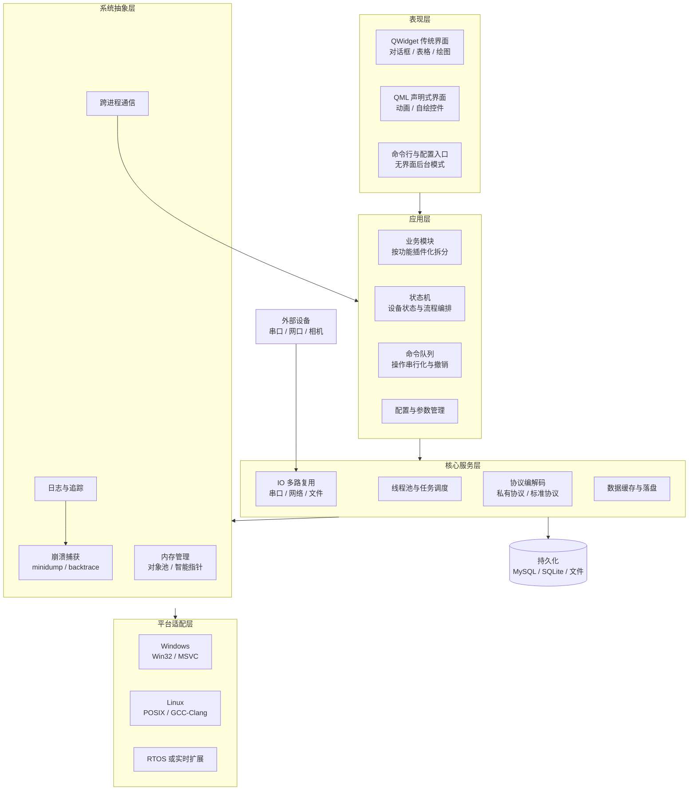
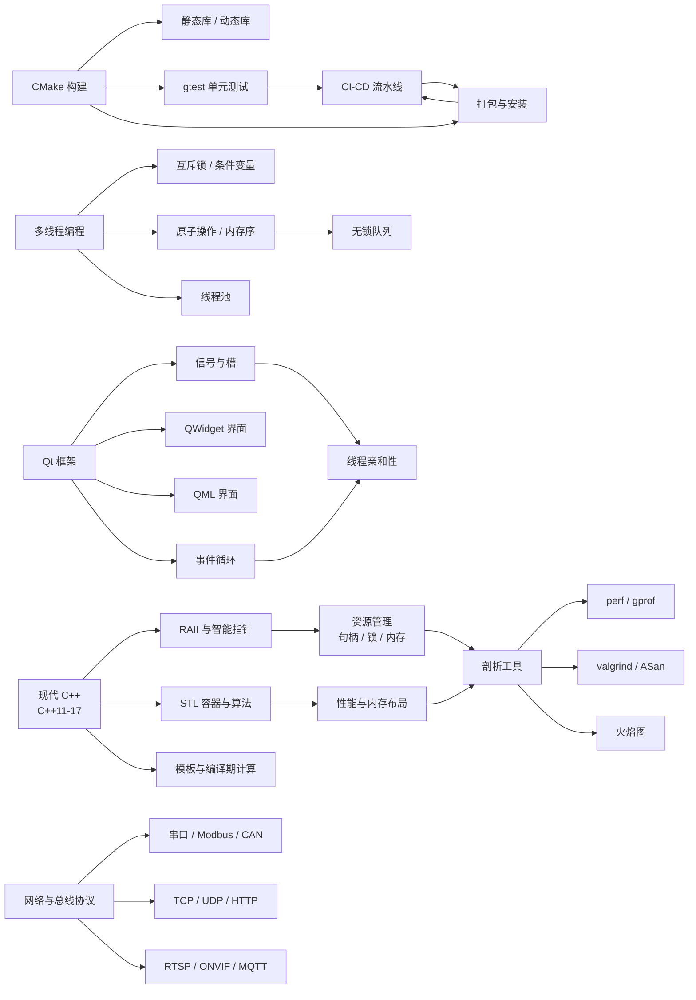
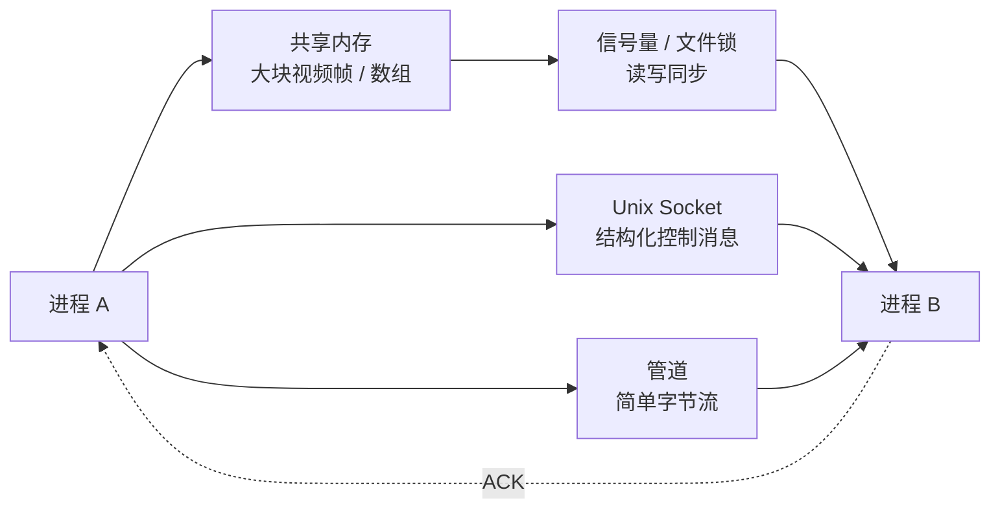
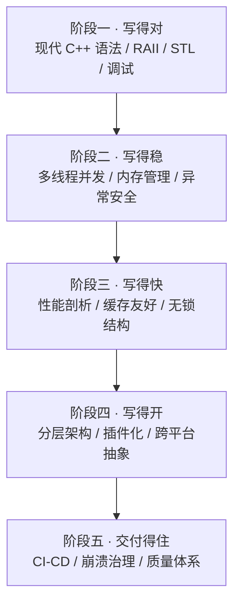

# 05 · C++ 系统软件

> 数据基础：40 份 JD 聚合去重 | 薪资均值 18-31K | 学历主流：本科 | 经验主流：3-5 年
> 内容已去除公司信息，保留技术事实。

---

## 一、方向定位

这个方向的核心职责不是"会写 C++"，而是**用 C++ 交付长期运行、资源可控、可被维护的本地软件**——桌面客户端、上位机、设备控制程序、网关与中间件。

它的边界很宽泛：一端贴着硬件（串口、驱动、实时采集），另一端贴着业务（数据库、界面、网络协议）。因此 JD 里的关键词分布天然呈现"双侧拉扯"的形态。

### 1.1 高频技术统计（按出现篇数）

| 技术/能力 | 出现篇数 | 占本方向比例 | 解读 |
|-----------|---------|-------------|------|
| C++ | 39 | 98% | 岗位基线，几乎是同名要求，不构成差异化 |
| Qt | 17 | 43% | 桌面端事实标准，GUI 岗位几乎必考 |
| 嵌入式 | 15 | 38% | 与硬件打交道的上位机/控制类岗位占比很高 |
| MySQL | 12 | 30% | 本地或轻量服务端存储，配置与业务数据落库 |
| 多线程 | 10 | 25% | 采集/通信/渲染并发模型的必备项 |
| 性能优化 | 10 | 25% | 侧重点是 CPU、内存、启动时间、帧率 |
| Java | 11 | 28% | 一部分岗位需与 Java 后端系统对接 |
| Python | 8 | 20% | 脚本化工具、测试、数据处理 |
| 单元测试 | 5 | 13% | 占比偏低，但实际是拉开差距的分水岭 |
| RTOS | 4 | 10% | 与实时控制/下位机协同的场景 |
| Go | 6 | 15% | 少量岗位要求 Go 写配套服务 |
| MQTT / RTSP | 各 4 | 10% | 设备接入与视频取流的常见协议 |
| CMake | 3 | 8% | 构建系统事实标准，写在 JD 里的不多但必会 |

### 1.2 细分技术二次统计

对 40 份 JD 正文做更细的关键词扫描后，能看到一些不写在标签里、但实际高频出现的工程细节：

| 细分技术项 | 出现篇数 | 占比 | 说明 |
|-----------|---------|------|------|
| Linux | 20 | 50% | 过半岗位要求 Linux 环境开发或交叉部署 |
| 驱动 / 底层接口 | 19 | 48% | 设备控制类岗位绕不开驱动与系统调用 |
| 算法 / 数据结构 | 16 | 40% | 多数以"基础扎实"形式出现 |
| TCP / Socket / 网络编程 | 15 | 38% | 网络通信是系统软件的主干能力 |
| 内存管理 | 8 | 20% | 显式提及，是面试高频区 |
| 串口 / Modbus / CAN | 9 / 7 / 5 | 22% / 18% / 12% | 工业与设备场景的三大总线 |
| 上位机 | 8 | 20% | 典型岗位形态 |
| SDK / API 交付 | 8 | 20% | 以库或接口形式对外提供能力 |
| 多进程 | 6 | 15% | 进程隔离与模块解耦 |
| 设计模式 | 6 | 15% | 代码可维护性考察 |
| 日志 / 崩溃分析 | 7 / 3 | 18% / 8% | 现场问题定位能力 |
| Docker / CI-CD | 4 / 6 | 10% / 15% | 交付方式现代化 |
| C++11 及以上标准 | 3 | 8% | 但默认按现代 C++ 考察 |
| OpenCV / OpenGL | 6 / 3 | 15% / 8% | 图像与可视化相关岗位 |
| Windows / MFC | 5 / 3 | 12% / 8% | 传统桌面端存量市场 |

**一句话总结**：这个方向真正的门槛不在语法，而在**资源与生命周期的可控性**——内存谁释放、线程谁回收、崩溃后怎么复盘、跨平台怎么收敛。

---


### 完整技术栈清单（全量抽取 · 基于本方向 40 篇 JD）

> 下表由 JD 全文穷举抽取生成，数字为**出现该术语的 JD 篇数**，用于补齐正文未展开的细分技术项。

| 类别 | 技术栈（数字为出现篇数） |
|------|------------------------|
| **语言** | C++(39)、Java(11)、C#(10)、Python(8)、SQL(5)、Go(4)、C语言(3)、Rust(3)、TypeScript(2)、JavaScript(2)、Shell(2)、Node.js(1)、Golang(1)、Kotlin(1)、Lua(1) |
| **后端框架** | Spring(2)、Spring Boot(1)、SpringBoot(1)、Django(1)、Flask(1)、RPC(1) |
| **前端框架与UI** | React(2)、Vue(2)、Flutter(2)、Electron(2)、Tauri(2) |
| **移动端** | Android(5)、Framework(2)、Kotlin(1)、鸿蒙(1)、JNI(1)、APK(1) |
| **数据库与存储** | MySQL(12)、Redis(3)、Oracle(3)、SQLite(3)、PostgreSQL(2)、SQL Server(2)、MongoDB(1) |
| **消息与中间件** | MQTT(4)、定时任务(1) |
| **云容器与DevOps** | CI/CD(3)、流水线(2)、灰度发布(2)、容器化(1)、Nginx(1)、回滚(1)、资源调度(1) |
| **大数据与数据平台** | CDC(2)、报表(1)、Hadoop(1)、数据中台(1)、实时计算(1) |
| **AI与机器学习** | OpenCV(6)、大模型(4)、GPU(4)、Claude(3)、PyTorch(2)、提示词(2)、TensorFlow(2)、ASR(1)、算力(1)、OCR(1)、推理优化(1)、NPU(1)、YOLO(1) |
| **音视频与流媒体** | 编解码(8)、RTSP(4)、ONVIF(3)、GB28181(2)、帧率(2)、拉流(2)、低延迟(1)、丢包(1)、WebRTC(1)、转码(1)、推流(1)、FFmpeg(1)、RTMP(1)、SIP(1)、GStreamer(1)、HTTP-FLV(1)、拥塞控制(1) |
| **嵌入式与硬件** | 嵌入式(15)、串口(8)、运动控制(8)、Modbus(6)、SPI(5)、I2C(5)、ARM(5)、PLC(5)、传感器(4)、RTOS(3)、蓝牙(3)、固件(3)、STM32(3)、Yocto(3)、CAN(2)、中断(2)、OTA(2)、电机(2)、原理图(2)、RS485(2) |
| **桌面与客户端** | Qt(13)、客户端(6)、OpenGL(4)、.NET(3)、WPF(3)、MFC(3)、安装包(2)、QWidget(1)、QML(1)、WinForms(1)、桌面应用(1) |
| **协议与接口** | TCP(12)、HTTP(7)、SDK(6)、UDP(5)、WebSocket(3)、FTP(2)、SNMP(2)、REST(1)、HTTPS(1)、SMTP(1) |
| **安全与合规** | 合规(4)、TLS(2)、SSL(2)、HTTPS(1)、防火墙(1)、数据加密(1)、国密(1)、漏洞扫描(1)、网闸(1) |
| **工程化与质量** | 技术文档(8)、单元测试(5)、设计文档(5)、日志(4)、Git(3)、CMake(3)、重构(2)、代码评审(2)、集成测试(2)、灰度(2)、覆盖率(2)、技术债(2)、复盘(1)、编码规范(1)、SVN(1)、压测(1)、Make(1) |
| **架构与设计** | 架构设计(14)、性能优化(10)、多线程(10)、方案设计(9)、技术选型(5)、设计模式(4)、锁(3)、高可用(2)、异步(2)、抽象(2)、并发编程(2)、微服务(1)、高并发(1)、中台(1)、重试(1)、幂等(1)、低延迟(1)、模块化(1)、分片(1)、超时(1) |
| **业务领域** | 定制化(4)、MES(3)、保险(2)、实施(1)、WMS(1)、医疗(1)、教育(1)、车联网(1) |
| **软技能** | 团队协作(9)、沟通能力(8)、需求分析(8)、责任心(8)、英语(7)、培训(6)、文档编写(6)、规划(5)、出差(4)、跨部门(3)、学习能力(1)、抗压(1)、复盘(1) |

---

## 二、参考架构图

一套典型的 C++ 系统软件分层结构。关键在于把"平台差异"和"业务易变部分"隔离到最外层，中间保持稳定。



### 解读

1. **系统抽象层是分水岭**：跨平台项目里，把文件、线程、时间、路径、动态库加载全部收敛到一层，上层不允许直接调用平台 API，否则移植成本会指数级上升。
2. **状态机比 if-else 更抗变更**：设备类软件的业务复杂度几乎都体现在状态迁移上，用显式状态机描述，可以让"非法操作"在编译或运行期被立刻拦住。
3. **崩溃捕获必须内置**：客户端软件部署在用户机器上，无法复现的问题只能靠 minidump + 符号表回溯，这属于架构级能力，不是事后补的。
4. **插件化解决的是发布节奏问题**：把易变模块做成插件，主程序保持稳定，可以显著降低全量回归测试的成本。

---

## 三、技术栈关联图



### 说明

- **语言 → 资源 → 工具**是一条完整的因果链：现代 C++ 用 RAII 管资源，资源问题用 perf/valgrind 定位，两者缺一不可。
- **Qt 的复杂度集中在信号槽与线程亲和**：跨线程槽函数的连接类型决定了回调在哪个线程执行，这是 Qt 项目最常见的 Bug 根源。
- **构建 → 测试 → 打包 → CI** 是交付闭环，CMake 是这条链的中枢，而非可有可无的脚本。
- **协议层按物理介质分三类**：串行总线、IP 网络、设备专用协议，各自有一套调试工具与排错方法论。

---

## 四、核心能力矩阵

| 能力项 | 出现率 | 关键要点 | 常见追问 |
|--------|-------|---------|---------|
| C++ 语言基础 | 98% | 对象模型、虚函数表、拷贝控制、移动语义、RAII | 虚函数调用开销有多大？什么场景下禁用？ |
| 内存管理 | 20% 显式 | 智能指针语义、循环引用、内存池、越界检测 | shared_ptr 循环引用怎么破？ |
| 多线程并发 | 25% | 锁粒度、死锁四条件、条件变量、原子操作、无锁队列 | 如何定位死锁与伪共享？ |
| Qt 应用开发 | 43% | 信号槽、元对象系统、事件循环、线程亲和、模型视图 | 跨线程信号槽的连接类型怎么选？ |
| 网络与总线编程 | 38% | TCP 粘包、IO 多路复用、串口参数、Modbus 帧格式 | 粘包怎么拆？心跳怎么做？ |
| 跨进程通信 | 15% | 共享内存、管道、Unix Socket、命名管道、内存映射 | 共享内存如何做同步与失效？ |
| 性能优化 | 25% | perf 采样、火焰图、cache 命中、内存分配、编译优化 | 如何把启动时间从 3s 降到 1s？ |
| 调试与崩溃分析 | 18% | core dump、minidump、符号表、backtrace、日志分级 | 线上偶发崩溃怎么查？ |
| 构建与工程化 | 8% 显式 | CMake 组织、依赖管理、静态动态库、单元测试 | 如何管理第三方依赖与版本？ |
| 数据结构与算法 | 40% | 容器选择、复杂度、时空权衡、算法实现 | 为什么这里用 deque 不用 vector？ |

---

## 五、关键实现要点

### 5.1 内存管理：RAII 与智能指针的生命周期

**原则：资源获取即初始化**，把释放动作绑定到对象析构，而不是靠人记得调用 `delete`。

```cpp
// 反例：裸资源，异常路径下会泄漏
void bad() {
    FILE* f = fopen("data.bin", "rb");
    parse(f);          // 若 parse 抛异常，f 永远不会关闭
    fclose(f);
}

// 正例：RAII 包装
class FileHandle {
public:
    explicit FileHandle(const char* path) : fp_(std::fopen(path, "rb")) {
        if (!fp_) throw std::runtime_error("open failed");
    }
    ~FileHandle() { if (fp_) std::fclose(fp_); }
    FileHandle(const FileHandle&) = delete;
    FileHandle& operator=(const FileHandle&) = delete;
    FileHandle(FileHandle&& o) noexcept : fp_(std::exchange(o.fp_, nullptr)) {}
private:
    FILE* fp_;
};
```

智能指针选型要点：

| 类型 | 语义 | 典型误用 |
|------|------|---------|
| `unique_ptr` | 独占所有权，零开销，可移动 | 需要共享时硬转 shared_ptr |
| `shared_ptr` | 引用计数共享，有控制块开销 | 互相持有导致循环引用 |
| `weak_ptr` | 观察者，不增加计数 | 忘记 `lock()` 后判空 |

**循环引用的破解**：父子关系中父用 `shared_ptr` 持有子，子用 `weak_ptr` 回指父；或者在设计上直接把关系改成单向所有权 + 事件回调。

**生命周期的三条硬规则**：
1. 跨线程传递 `shared_ptr` 按值传递，不要传引用；
2. 异步回调捕获 `this` 必须搭配 `weak_ptr::lock()` 判空，或继承 `enable_shared_from_this`；
3. 高频分配场景（如采集帧）使用对象池/环形缓冲，避免每秒数千次 `new/delete` 引发碎片与锁竞争。

### 5.2 多线程：锁、条件变量与无锁队列

**锁的粒度决定吞吐**。粗粒度锁安全但串行化严重；细粒度锁快但容易死锁。

死锁的四个必要条件：互斥、占有且等待、不可抢占、循环等待。**工程上最有效的破法是对所有锁定义全局加锁顺序**，或用 `std::scoped_lock` 一次性拿多把锁避免部分占有：

```cpp
std::mutex m1, m2;
void transfer() {
    std::scoped_lock lk(m1, m2);   // 内部用死锁避免算法，不会卡死
    // ...
}
```

**条件变量必须配谓词循环**，防止虚假唤醒：

```cpp
std::queue<Task> q;
std::mutex mu;
std::condition_variable cv;

void consumer() {
    for (;;) {
        std::unique_lock lk(mu);
        cv.wait(lk, [] { return !q.empty() || stopped; });  // 带谓词
        if (q.empty() && stopped) break;
        auto t = std::move(q.front()); q.pop();
        lk.unlock();          // 尽早释放锁再干活
        t.run();
    }
}
```

**无锁队列适用于 SPSC 场景**（单生产者单消费者），典型用在"采集线程写、处理线程读"：

```cpp
template <typename T, size_t N>
class RingBuffer {
    std::array<T, N> buf_;
    std::atomic<size_t> head_{0}, tail_{0};
public:
    bool push(const T& v) {
        auto h = head_.load(std::memory_order_relaxed);
        auto next = (h + 1) % N;
        if (next == tail_.load(std::memory_order_acquire)) return false; // 满
        buf_[h] = v;
        head_.store(next, std::memory_order_release);
        return true;
    }
    bool pop(T& out) {
        auto t = tail_.load(std::memory_order_relaxed);
        if (t == head_.load(std::memory_order_acquire)) return false;   // 空
        out = buf_[t];
        tail_.store((t + 1) % N, std::memory_order_release);
        return true;
    }
};
```

要点：`acquire/release` 内存序即可满足 SPSC；MPMC 场景建议直接用成熟库而非自研。另外**伪共享**问题——把 `head_` 和 `tail_` 用 `alignas(64)` 分开到不同 cache line，性能常有可观提升。

### 5.3 Qt：信号槽、线程亲和与事件循环

**连接类型决定回调线程**，这是 Qt 最核心也最容易出错的点：

| 连接类型 | 行为 |
|---------|------|
| `AutoConnection` | 同线程则 Direct，跨线程则 Queued |
| `DirectConnection` | 立即在发送者线程同步调用，接收者对象可能被跨线程访问 |
| `QueuedConnection` | 投递事件到接收者所属线程的事件循环，异步执行 |
| `BlockingQueuedConnection` | 类似 Queued 但发送者阻塞等待，**同线程使用必死锁** |

**线程亲和性**：每个 `QObject` 记录自己所属的 `QThread`，`moveToThread()` 可迁移，但有父对象的对象不能迁移，且对象的所有子对象必须与其同线程。

典型正确姿势是"worker-object 模式"——不要继承 `QThread` 重写 `run()`，而是把工作对象 moveToThread：

```cpp
auto* worker = new Worker;          // 不要指定 parent
worker->moveToThread(&workThread);
connect(&workThread, &QThread::finished, worker, &QObject::deleteLater);
connect(this, &Controller::startWork, worker, &Worker::doWork);  // 自动 Queued
workThread.start();
```

**UI 只能在主线程操作**：后台线程想刷新界面，通过信号把数据发回主线程，绝不能直接调 widget 方法。

### 5.4 跨进程 IPC：选型与实现



| 方式 | 带宽 | 复杂度 | 适用场景 |
|------|------|--------|---------|
| 共享内存 | 最高，零拷贝 | 高，需自行同步 | 视频帧、批量采集数据 |
| Unix Socket | 中 | 低 | 控制指令、结构化消息 |
| 管道 | 低 | 最低 | 父子进程、简单通知 |
| 消息队列 | 中 | 中 | 解耦的多对多通信 |

**共享内存的两个坑**：
1. **同步**：`shm_open` + `mmap` 只解决映射，读写互斥要靠信号量或 `flock`，否则会读到撕裂数据；
2. **失效**：进程崩溃时共享内存段不会自动释放，需要在启动时检测 stale 段并清理，或用 `pthread_mutex` 的 `PTHREAD_MUTEX_ROBUST` 属性处理持有者崩溃。

### 5.5 性能剖析：perf / valgrind / 火焰图

排查顺序建议：**先确认瓶颈类型，再选工具。**

| 问题类型 | 工具 | 关键命令要点 |
|---------|------|-------------|
| CPU 热点 | perf | `perf record -F 99 -g -- ./app`，再 `perf report` |
| 内存泄漏 | valgrind | `--leak-check=full --show-leak-kinds=all` |
| 内存越界 | ASan | `-fsanitize=address -g` 编译 |
| 竞争与死锁 | TSan | `-fsanitize=thread` |
| 调用链可视化 | 火焰图 | perf script → stackcollapse → flamegraph |
| IO 与系统调用 | strace | `-c` 统计耗时分布 |

要点：
- **perf 需要带调试符号编译**（`-g` 且不要 `strip`），否则只能看到地址；
- **valgrind 会慢 10-50 倍**，只用于测试环境定位，不能用于线上；
- **ASan 有约 2 倍内存开销**，适合 CI 里的回归测试；
- 优化前必须**先量化基线**，否则无法证明优化有效；优化后要回归功能与内存。

### 5.6 构建与交付：CMake 与单元测试

一个可维护的 CMake 工程应遵循"目标（target）为中心"的现代写法，而非全局变量式：

```cmake
cmake_minimum_required(VERSION 3.16)
project(device_suite LANGUAGES CXX)

set(CMAKE_CXX_STANDARD 17)
set(CMAKE_CXX_STANDARD_REQUIRED ON)

add_library(core STATIC src/core/scheduler.cpp src/core/protocol.cpp)
target_include_directories(core PUBLIC ${CMAKE_CURRENT_SOURCE_DIR}/include)
target_compile_options(core PRIVATE -Wall -Wextra)

add_executable(app src/main.cpp)
target_link_libraries(app PRIVATE core)

enable_testing()
add_subdirectory(tests)      # 里面 add_test 注册 gtest 用例
```

要点：
- **用 `target_*` 而非全局 `include_directories`**，让依赖传播显式化；
- **第三方依赖用 `find_package` 或 FetchContent 固定版本**，禁止把源码拷进仓库；
- **单元测试聚焦可测逻辑**：协议编解码、状态机迁移、算法，而非 GUI；
- **CI 里跑编译告警为错误 + 单测 + ASan 回归**，这三件事能拦掉大部分线上问题。

---

## 六、典型职责归纳（去重合并）

- 负责 Windows/Linux 桌面客户端或上位机软件的需求分析、模块划分与技术方案设计。
- 基于 Qt 实现人机界面：QWidget 或 QML 界面开发、自定义控件、数据表格与曲线绘制。
- 实现设备通信层：串口、TCP/UDP、Modbus、CAN 等总线的协议解析与数据收发。
- 设计多线程/多进程架构，处理采集、解析、存储、界面刷新的并发与解耦。
- 负责系统性能优化：内存占用、CPU 占用、启动速度、界面帧率与大数据量渲染。
- 编写单元测试与技术文档，参与代码评审，维护公共库与 SDK 接口。
- 定位并修复线上问题：日志分析、dump 回溯、现场复现与补丁发布。
- 负责跨平台适配与构建发布：CMake 工程维护、依赖管理、安装包与自动升级。
- 与嵌入式、算法、后端等团队协作，定义软硬件接口与联调方案。

---

## 七、进阶路径建议



每个阶段的产出物建议：可运行的小工具 → 多线程采集程序 → 带性能报告的优化记录 → 插件化的客户端框架 → 有 crash 率与启动耗时看板的生产软件。

---

## 八、常见考察点清单

1. **`new` 和 `malloc` 的区别？**
   前者是运算符，调用构造函数、可重载、失败抛异常；后者是库函数，只分配原始内存、失败返回 NULL。混用会导致未定义行为。

2. **`shared_ptr` 是否线程安全？**
   引用计数的增减是原子的，多线程拷贝同一个 `shared_ptr` 安全；但**指向的对象本身不保证线程安全**，多线程读写对象需额外加锁。

3. **虚函数表存放在哪里？虚函数调用的性能开销？**
   vptr 在对象内存布局头部，vtable 通常在只读数据段。开销是一次间接寻址 + 无法内联，热点路径可用 CRTP 静态多态替代。

4. **死锁如何定位与避免？**
   定位：`gdb thread apply all bt` 看持有与等待，或 TSan。避免：固定加锁顺序、`scoped_lock`、`try_lock` + 回退、无锁结构。

5. **TCP 粘包怎么处理？**
   定长消息、分隔符、长度前缀三选一；工程上最常用"魔数 + 长度 + 校验"的帧头，收包端按状态机解析，处理半包与粘包。

6. **Qt 跨线程信号槽为什么界面会崩？**
   用了 `DirectConnection` 导致槽在发送者线程执行并直接操作 widget。应让槽回到 GUI 线程，或用 `QueuedConnection`。

7. **`QThread` 正确的使用方式？**
   推荐 worker-object 模式：`QThread` 管理事件循环，工作对象 `moveToThread` 进去，通过信号驱动，退出时 `deleteLater`。

8. **内存泄漏如何排查？**
   开发期 ASan/valgrind；线上靠 heap profiler 对比快照、自定义分配器打点统计、定期重启兜底。

9. **如何优化程序启动时间？**
   延迟加载非关键模块、减少静态初始化、预读/预链接、异步化 IO、用 perf 找真正的热点再动手。

10. **为什么需要 `volatile`？它能替代原子变量吗？**
    不能。`volatile` 只阻止编译器优化，不提供内存序与原子性，多线程同步必须用 `std::atomic` 或锁。

---

## 九、与其他方向的连接

- **与嵌入式 Linux**：上位机与下位机通过串口/Modbus/CAN/自定义协议对接，双方需要共同约定帧格式、校验与超时重试策略。
- **与音视频流媒体**：采集端常由 C++ 实现（V4L2、DirectShow、SDK 取流），再交给 FFmpeg 或硬件编码器处理。
- **与机器人与智能硬件**：运动控制、设备调度等实时模块多用 C++ 编写，界面层复用 Qt。
- **与 Java/Go 后端**：本地客户端通过 HTTP/WebSocket/MQTT 与后端交互，接口契约与鉴权是联调重点。
- **与 AI 大模型应用**：本地侧承担模型推理前的预处理与后处理，C++ 负责高性能数据管道与 ONNX Runtime 集成。
