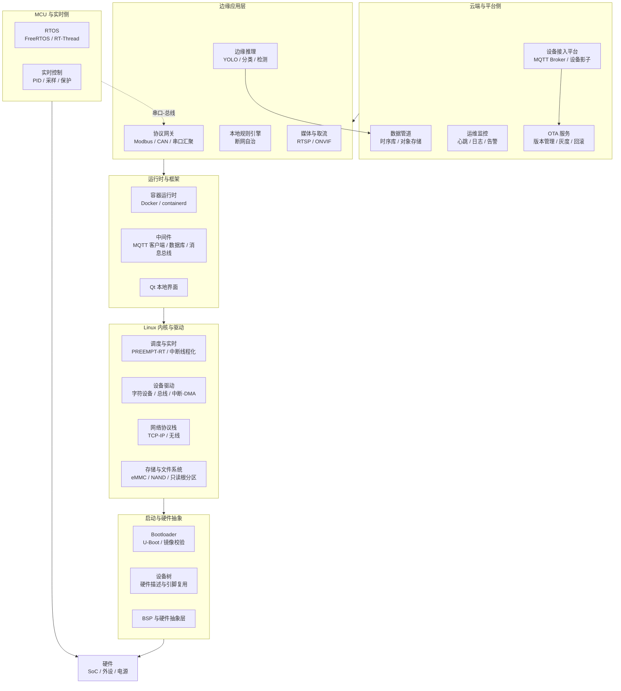
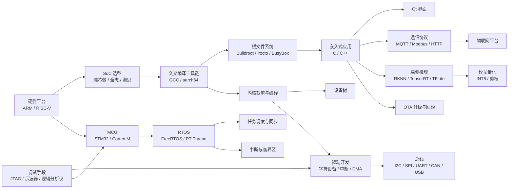
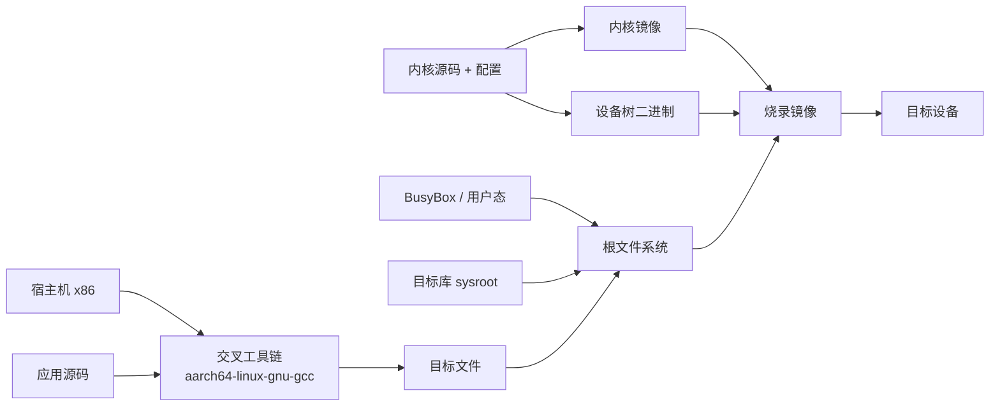
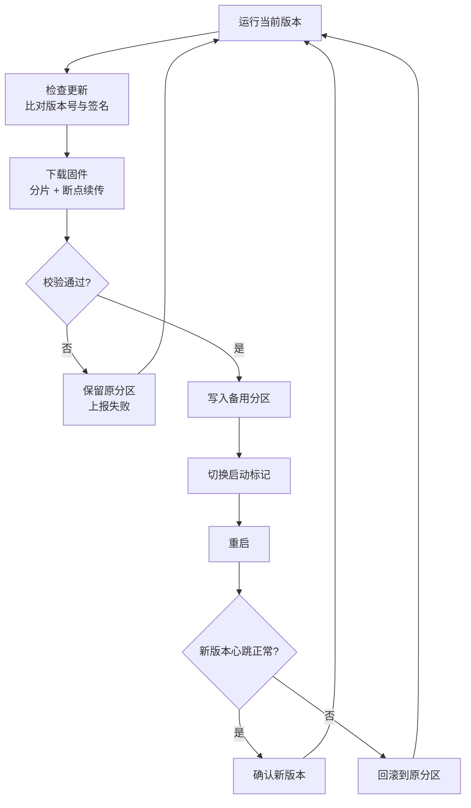
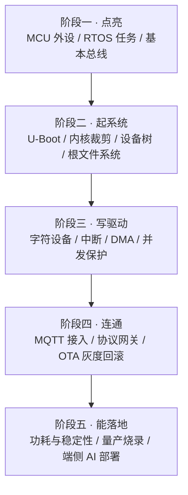

# 06 · 嵌入式 Linux 与边缘计算

> 数据基础：30 份 JD 聚合去重 | 薪资均值 19-32K | 学历主流：本科 | 经验主流：5 年以上
> 内容已去除公司信息，保留技术事实。

---

## 一、方向定位

这个方向的核心职责是**在资源受限的硬件上，让软件长期、确定、低功耗地跑起来**，并且能规模化地被部署与升级。

它横跨三层：裸机/RTOS 侧的实时控制、Linux 侧的驱动与应用、云端侧的设备管理与数据回传。JD 的关键词分布清晰地体现了这种"上下贯通"的要求——这也是为什么这个方向的经验门槛普遍要求 5 年以上。

### 1.1 高频技术统计（按出现篇数）

| 技术/能力 | 出现篇数 | 占本方向比例 | 解读 |
|-----------|---------|-------------|------|
| 嵌入式 | 25 | 83% | 方向主标签 |
| C++ | 15 | 50% | 应用层主力语言，C 仍占主导 |
| RTOS | 10 | 33% | 实时侧刚需，FreeRTOS 最常见 |
| 性能优化 | 8 | 27% | 内存、启动时间、功耗是三大目标 |
| Qt | 5 | 17% | 带屏设备的 UI 方案 |
| STM32 | 4 | 13% | MCU 侧主流平台 |
| MQTT | 4 / 6 | 13% / 20% | 设备接入云的事实标准协议 |
| CMake | 3 | 10% | 构建工具 |
| RK3588 / 瑞芯微 | 2 | 7% | 边缘 AI 盒子的主流 SoC |
| Docker / Kubernetes | 3 / 2 | 10% / 7% | 边缘侧容器化趋势已出现 |

### 1.2 细分技术二次统计

对 30 份 JD 正文做细粒度扫描后，可以看到大量不写在岗位标签里、却在职责描述中反复出现的技术点：

| 细分技术项 | 出现篇数 | 占比 | 说明 |
|-----------|---------|------|------|
| C 语言 | 23 | 77% | 仍是嵌入式第一语言，尤其是驱动与 MCU |
| 驱动开发 | 20 | 67% | 岗位重心，字符设备与总线驱动为主 |
| Linux | 19 | 63% | 嵌入式 Linux 是主流形态 |
| SPI | 12 | 40% | 高速外设总线 |
| I2C | 11 | 37% | 传感器与配置芯片 |
| RTOS | 9 | 30% | 与 Linux 并存而非替代 |
| ARM 架构 | 9 | 30% | Cortex-M / Cortex-A 双线 |
| CAN | 9 | 30% | 工业与车载总线 |
| UART | 9 | 30% | 调试与低速通信 |
| 内核 / 中断 | 7 / 6 | 23% / 20% | 内核裁剪与中断处理 |
| USB | 6 | 20% | 外设与烧录 |
| 功耗 / 低功耗 | 5 / 3 | 17% / 10% | 电池设备的核心指标 |
| 蓝牙 | 5 | 17% | 近距离配网与通信 |
| OTA 升级 | 5 | 17% | 规模化运维的前提 |
| 4G / 5G | 5 / 4 | 17% / 13% | 蜂窝回传 |
| 可靠性 / EMC | 5 / 3 | 17% / 10% | 硬件产品化必过关卡 |
| 原理图 / PCB | 5 / 3 | 17% / 10% | 软硬协同能力 |
| Yocto / OpenWrt | 各 3 | 10% | 定制发行版构建 |
| 实时性 / PREEMPT-RT | 3 / 2 | 10% / 7% | Linux 实时化改造 |
| NPU / 边缘 AI | 2 | 7% | 端侧推理是新增长点 |
| 交叉编译 / 根文件系统 | 2 / 1 | 7% / 3% | 工具链基础能力 |

**一句话总结**：这个方向的门槛不在"能不能跑通"，而在**能不能在几万台设备上，跑三年不出事、出问题能修、修完能回滚**。

---


### 完整技术栈清单（全量抽取 · 基于本方向 30 篇 JD）

> 下表由 JD 全文穷举抽取生成，数字为**出现该术语的 JD 篇数**，用于补齐正文未展开的细分技术项。

| 类别 | 技术栈（数字为出现篇数） |
|------|------------------------|
| **语言** | C++(15)、Python(4)、C语言(4)、Java(3)、Go(3)、Shell(2)、Rust(2)、C#(1)、Golang(1) |
| **后端框架** | Spring(1)、Spring Boot(1)、Django(1)、Flask(1) |
| **前端框架与UI** | Flutter(1)、SVG(1) |
| **移动端** | Android(4)、Framework(2)、Jetpack(1) |
| **数据库与存储** | MySQL(2)、Redis(2)、MongoDB(1)、SQLite(1)、S3(1) |
| **消息与中间件** | MQTT(4)、Kafka(1) |
| **云容器与DevOps** | Docker(3)、容器化(2)、Kubernetes(2)、CI/CD(1)、流水线(1)、DevOps(1)、GitHub Actions(1)、Terraform(1) |
| **大数据与数据平台** | Hadoop(1)、Flink(1)、Spark(1)、离线计算(1) |
| **AI与机器学习** | ASR(3)、GPU(2)、OpenCV(2)、NPU(2)、Claude(1)、智能体(1)、模型部署(1)、PyTorch(1)、TensorFlow(1)、算力(1)、TTS(1)、语音识别(1)、推理优化(1)、Whisper(1) |
| **音视频与流媒体** | 编解码(4)、低延迟(1)、RTSP(1)、WebRTC(1)、ONVIF(1)、推流(1)、帧率(1)、拉流(1)、DTS(1) |
| **嵌入式与硬件** | 嵌入式(25)、SPI(10)、I2C(10)、RTOS(9)、ARM(8)、单片机(8)、CAN(7)、Modbus(5)、中断(5)、原理图(5)、RS485(5)、串口(4)、电源(4)、OTA(4)、蓝牙(4)、PCB(4)、电机(4)、传感器(4)、STM32(4)、运动控制(3) |
| **桌面与客户端** | Qt(1)、客户端(1) |
| **协议与接口** | TCP(7)、HTTP(3)、UDP(2)、RESTful(1)、SDK(1)、接口对接(1)、FTP(1) |
| **安全与合规** | 合规(4)、防火墙(1) |
| **工程化与质量** | 技术文档(5)、设计文档(5)、Git(4)、日志(3)、CMake(3)、单元测试(2)、代码评审(2)、SVN(2)、GitHub(1)、集成测试(1)、接口文档(1)、复盘(1)、编码规范(1)、Make(1) |
| **架构与设计** | 性能优化(8)、架构设计(7)、方案设计(6)、高可用(4)、技术选型(3)、微服务(2)、高并发(2)、多线程(2)、SaaS(1)、低延迟(1)、边缘计算(1) |
| **业务领域** | 定制化(2)、物联网平台(2)、MES(1)、供应链(1)、支付(1)、项目管理(1)、医疗(1)、SAP(1)、教育(1)、车联网(1) |
| **软技能** | 英语(8)、团队协作(6)、规划(4)、沟通能力(3)、责任心(3)、需求分析(2)、培训(2)、跨部门(2)、文档编写(2)、抗压(2)、复盘(1) |

---

## 二、参考架构图



### 解读

1. **两条技术路线并存**：Linux 侧负责复杂业务与网络，MCU/RTOS 侧负责硬实时。**不要用 Linux 去做微秒级确定性控制**，也不要用 RTOS 去做复杂的网络与文件系统。
2. **设备树是硬件与内核的契约**：同一份内核镜像配合不同 dtb 适配不同板卡，避免把硬件参数硬编码进驱动。
3. **OTA 是产品化分水岭**：没有可靠 OTA 与回滚机制的设备，一旦出厂就无法修复，运维成本不可控。
4. **断网自治必须设计**：边缘设备不能假设网络永远可用，本地要缓存数据、本地要能独立决策，联网后补全。
5. **容器化在边缘是趋势但非必需**：资源紧张时容器开销并不划算，需按设备算力权衡。

---

## 三、技术栈关联图



### 说明

- **工具链 → 内核 → 驱动 → 总线**是嵌入式 Linux 的主干依赖链，任何一环缺失都会导致板卡起不来。
- **MCU → RTOS → 任务调度**是并行的一条链，与 Linux 链在"实时性"上互补。
- **端侧推理依赖模型量化**：不量化的模型在 NPU 上往往跑不动或性能不达标。
- **调试工具是硬门槛**：只会写代码、不会用示波器和逻辑分析仪，无法定位硬件相关问题。

---

## 四、核心能力矩阵

| 能力项 | 出现率 | 关键要点 | 常见追问 |
|--------|-------|---------|---------|
| C/C++ 语言 | 77% / 50% | 指针、位操作、内存对齐、volatile、无标准库环境 | `volatile` 和原子变量的区别？ |
| Linux 驱动开发 | 67% | 字符设备、设备树匹配、中断上下半部、DMA、并发保护 | 中断里能不能睡眠？为什么？ |
| 交叉编译与构建 | 27% | 工具链、sysroot、根文件系统、静态与动态链接 | 动态库版本不兼容怎么排查？ |
| RTOS 实时编程 | 33% | 任务优先级、优先级反转、信号量、消息队列、临界区 | 优先级反转怎么解决？ |
| 总线与协议 | 30%-40% | I2C/SPI/UART/CAN/Modbus 时序与帧格式 | SPI 四种模式的区别？ |
| 设备接入与云端 | 20% | MQTT QoS、Keepalive、断线重连、消息补发 | QoS1 和 QoS2 的区别与代价？ |
| 边缘 AI 部署 | 7% | 量化、算子支持、NPU 加速、前后处理 | INT8 量化精度掉了怎么办？ |
| 功耗与稳定性 | 17% | 休眠唤醒、看门狗、掉电保护、老化测试 | 设备跑一周死机怎么查？ |
| OTA 与运维 | 17% | A/B 分区、校验、灰度、回滚 | 升级断电了怎么办？ |
| 硬件协同 | 17% | 看原理图、引脚复用、时序、EMC | 通信不稳定是软件还是硬件问题？ |

---

## 五、关键实现要点

### 5.1 RTOS：任务调度与优先级反转

RTOS 通常采用**基于优先级的抢占式调度**：就绪队列中优先级最高的任务立即获得 CPU。

**优先级反转**是经典问题：低优先级任务 L 持有锁 → 高优先级任务 H 等待该锁 → 中优先级任务 M 抢占 L → 结果是 H 被 M 间接阻塞，优先级关系被"反转"。

三种解法：

| 方法 | 原理 | 代价 |
|------|------|------|
| 优先级继承 | L 临时提升到 H 的优先级，尽快释放锁 | 普遍支持，推荐 |
| 优先级天花板 | 持有锁时直接提升到预设上限 | 更保守，需配置 |
| 避免共享 / 无锁 | 设计上消除互斥 | 最彻底，但难 |

FreeRTOS 中的互斥量默认带优先级继承，而**二值信号量不带**——这正是两者关键区别，也是面试常考点。

其它要点：
- **ISR 中不能调用阻塞 API**，应使用 `xQueueSendFromISR` 等 FromISR 变体，并配合 `portYIELD_FROM_ISR`；
- **栈大小要量化**：启用 `uxTaskGetStackHighWaterMark` 检查水位，避免静默栈溢出；
- **临界区要短**：`taskENTER_CRITICAL` 关中断会影响系统实时性，只保护极小段代码。

### 5.2 FreeRTOS 与 Linux 的差异

这是选型时最需要讲清楚的问题：

| 维度 | FreeRTOS | Linux |
|------|----------|-------|
| 调度 | 优先级抢占，确定性高 | CFS 公平调度，吞吐优先 |
| 实时性 | 硬实时，抖动微秒级 | 默认软实时，需 PREEMPT-RT 补丁 |
| 内存 | 无 MMU，静态分配为主 | 有 MMU，虚拟内存与进程隔离 |
| 文件系统 | 可选轻量 FS | 完整 VFS 与多种 FS |
| 网络 | LwIP 等轻量栈 | 完整 TCP/IP 协议栈 |
| 启动 | 毫秒到百毫秒 | 秒级 |
| 适用场景 | 电机控制、采样、保护 | 网关、AI 盒子、复杂业务 |

**工程结论**：需要确定性响应 → RTOS；需要复杂生态与算力 → Linux；两者都要 → **异构方案**（如 Cortex-A + Cortex-M 双核，通过 RPMsg 或共享内存通信）。

### 5.3 交叉编译工具链与根文件系统



要点：

1. **sysroot 必须与目标机完全一致**，否则会出现"编译通过、运行段错误"的经典问题；
2. **ABI 与浮点选项要对齐**（`hard-float` vs `softfp`），不匹配会导致难以理解的崩溃；
3. **根文件系统构建方式选型**：
   - `Buildroot`：简单、构建快，适合产品化；
   - `Yocto`：灵活、可维护性强，适合长生命周期产品线；
   - `BusyBox` 手工：最小但维护成本高；
4. **只读根分区 + 独立数据分区**是提升可靠性的标准做法，配合 overlayfs 提供可写层；
5. **调试符号单独保存**：发布镜像 strip，符号文件归档，用于后续 crash 回溯。

### 5.4 设备树与驱动

设备树把"硬件是什么"从内核代码里剥离出来：

```dts
&sensor@48 {
    compatible = "vendor,temp-sensor";   /* 与驱动的匹配键 */
    reg = <0x48>;                         /* I2C 地址 */
    interrupt-parent = <&gpio1>;
    interrupts = <5 IRQ_TYPE_EDGE_FALLING>;
};
```

驱动侧通过 `of_device_id` 表匹配 `compatible`，匹配成功后 `probe()` 被调用，在其中完成资源获取、中断注册与设备节点创建。

关键要点：
- **`compatible` 必须带厂商前缀**，避免与上游冲突；
- **中断上下文不能睡眠**，耗时操作交给下半部：tasklet、工作队列或线程化中断；
- **并发保护**：驱动可能被多进程同时访问，需要 `mutex`、`spinlock` 或原子变量；自旋锁保护的临界区不能睡眠；
- **与用户态接口**：字符设备 `read/write/ioctl` + 异步通知 `poll/fasync`；调试阶段优先用 sysfs 暴露参数。

### 5.5 MQTT：Keepalive 与断线重连

MQTT 是设备接入的事实标准，工程落地有三个必答题：

**(1) Keepalive 与心跳**
客户端在 CONNECT 报文里声明 Keepalive 间隔，需在该周期内发送 PINGREQ。建议取 **60 秒**，弱网场景可适当放大，但要小于服务端超时时间的一半。

**(2) QoS 等级选择**

| QoS | 语义 | 代价 | 适用 |
|-----|------|------|------|
| 0 | 至多一次，可能丢 | 最低 | 高频遥测、允许丢 |
| 1 | 至少一次，可能重复 | 一次往返 | 状态上报，需去重 |
| 2 | 恰好一次 | 两次往返 | 计费、关键指令 |

**(3) 断线重连与消息补发**
- 指数退避重连（如 1s → 2s → 4s，上限 60s），避免网络恢复瞬间全网设备同时冲击 Broker；
- 使用 **Clean Session = false + 持久会话**，让离线期间的 QoS1 消息在重连后补发；
- 本地**环形缓冲**缓存断网期间数据，重连后批量补报并做幂等去重；
- 遗嘱消息（LWT）用于通知其他系统设备掉线。

### 5.6 OTA 升级与回滚

可靠 OTA 的核心不是"下载固件"，而是**"任何时刻断电都能恢复"**。



要点：
- **A/B 双分区**是底线：永远保留一个可启动的旧版本；
- **签名校验必须做**：固件用非对称签名，设备端验签，防止恶意固件；
- **确认机制**：新版本启动后需在窗口期内上报健康状态，否则看门狗或 bootloader 自动回滚；
- **灰度发布**：先 1% → 10% → 全量，配合版本回滚率监控；
- **断电保护**：写分区前确保有足够空间，写入过程分块校验，避免半写状态。

### 5.7 端侧模型量化部署

推理运行时选型：

| 运行时 | 适用硬件 | 特点 |
|--------|---------|------|
| TensorRT | NVIDIA GPU / Jetson | 性能极致，需算子支持 |
| ONNX Runtime | 通用 CPU/GPU | 跨框架，EP 机制灵活 |
| TFLite | ARM CPU / NPU delegate | 移动端生态成熟 |
| RKNN | 瑞芯微 NPU | 端侧 So C 专用加速 |
| NCNN / MNN | ARM CPU | 轻量，无重依赖 |

量化落地要点：
1. **训练后量化（PTQ）优先**，需要一份有代表性的校准集（几百张即可）；
2. **精度掉太多改量化感知训练（QAT）**，在训练时插入伪量化节点；
3. **算子支持是最大坑**：某些算子 NPU 不支持会回退到 CPU，性能断崖式下跌，需先用工具检查算子覆盖；
4. **前后处理常成为瓶颈**：解码、resize、归一化用 OpenCV/硬件加速，别让 CPU 拖后腿；
5. **批处理与异步**：多路视频时批处理能显著提升 NPU 利用率。

---

## 六、典型职责归纳（去重合并）

- 负责嵌入式 Linux 系统的 Bring-up：Bootloader 移植、内核裁剪、设备树编写与根文件系统构建。
- 负责外设驱动开发与调试：I2C、SPI、UART、CAN、USB、网卡、显示等模块的驱动适配。
- 负责 MCU 侧 RTOS 应用开发：任务划分、优先级设计、中断处理、实时控制与保护逻辑。
- 实现设备通信与协议栈：Modbus、CANopen、MQTT、自定义二进制协议的编解码与状态机。
- 负责设备接入云平台：MQTT 连接管理、心跳保活、断线重连、数据上报与指令下发。
- 实现 OTA 升级方案：固件签名校验、A/B 分区、灰度发布、失败回滚与健康确认。
- 负责系统稳定性与功耗优化：看门狗、休眠唤醒、掉电保护、内存与启动时间优化。
- 负责端侧 AI 模型部署：模型转换、量化、算子适配、推理性能调优与前后处理加速。
- 与硬件工程师协作：参与原理图评审、引脚分配、时序确认与 EMC、可靠性测试。
- 编写设计文档、测试用例与生产烧录方案，支撑量产与售后问题定位。

---

## 七、进阶路径建议



每阶段产出物建议：外设 Demo → 可启动的定制镜像 → 可交付的驱动模块 → 接入云平台的设备端 SDK → 批量部署并稳定运行的产品固件。

---

## 八、常见考察点清单

1. **优先级反转是什么，怎么解决？**
   低优先级持锁阻塞高优先级，被中优先级间接拖长。用优先级继承或优先级天花板。

2. **中断上半部和下半部怎么划分？**
   上半部关中断、只做最紧急的清中断与取数；耗时处理放 tasklet / 工作队列 / 线程化中断。中断上下文不能睡眠、不能做可能阻塞的分配。

3. **`spinlock` 和 `mutex` 怎么选？**
   临界区极短且可能在原子上下文 → `spinlock`；可能睡眠或临界区较长 → `mutex`。自旋锁期间禁止抢占与睡眠。

4. **设备树的作用是什么？**
   把硬件拓扑、地址、中断、引脚复用从内核代码剥离，实现同一内核镜像适配不同板卡，驱动靠 `compatible` 匹配。

5. **MQTT 的 QoS 等级区别？**
   QoS0 至多一次；QoS1 至少一次，可能重复需去重；QoS2 恰好一次，两次往返开销最大。

6. **设备断网期间数据怎么办？**
   本地环形缓冲持久化，重连后批量补报，服务端按消息 ID 或时间戳幂等去重，注意时钟回拨问题。

7. **OTA 升级断电了怎么办？**
   A/B 双分区 + 启动标记，只有新版本确认健康后才提交；未确认则由 bootloader 自动切回旧分区。

8. **交叉编译的程序在板子上跑不起来，怎么排查？**
   依次检查：架构 `file`、动态库依赖 `ldd`、sysroot 一致性、ABI 与浮点选项、`strip` 后是否误删符号。

9. **INT8 量化后精度下降明显怎么处理？**
   换校准集使其更具代表性；做混合精度（敏感层保留 FP16）；改用 QAT；检查是否有算子被回退到 CPU 导致数值差异。

10. **如何降低设备功耗？**
    空闲进休眠、外设时钟门控、降低采样率与唤醒频率、批量上报减少无线模块工作时间、选择低功耗模式与电源域划分。

11. **设备现场偶发死机如何定位？**
    看门狗复位计数 + 保留 RAM 中的日志、core dump 捕获、`addr2line` 回溯、内存泄漏与水位监控、长时间老化压测复现。

---

## 九、与其他方向的连接

- **与 C++ 系统软件**：嵌入式侧负责下位机与驱动，上位机由 Qt/C++ 实现，两者通过串口、总线或私有协议定义接口契约。
- **与音视频与流媒体**：边缘盒子常承担取流、转码与 AI 分析，涉及 RTSP/GB28181 接入与硬件编解码。
- **与机器人与智能硬件**：运动控制、传感器采集与实时保护属于嵌入式范畴，上层导航规划依赖其提供稳定的数据与控制接口。
- **与 Go 云原生高并发**：设备侧 MQTT 接入平台通常由 Go 实现高并发连接管理与消息路由。
- **与 AI 大模型应用**：边缘侧运行量化后的小模型，云端运行大模型，两者在算力、延迟与隐私之间做分工。
