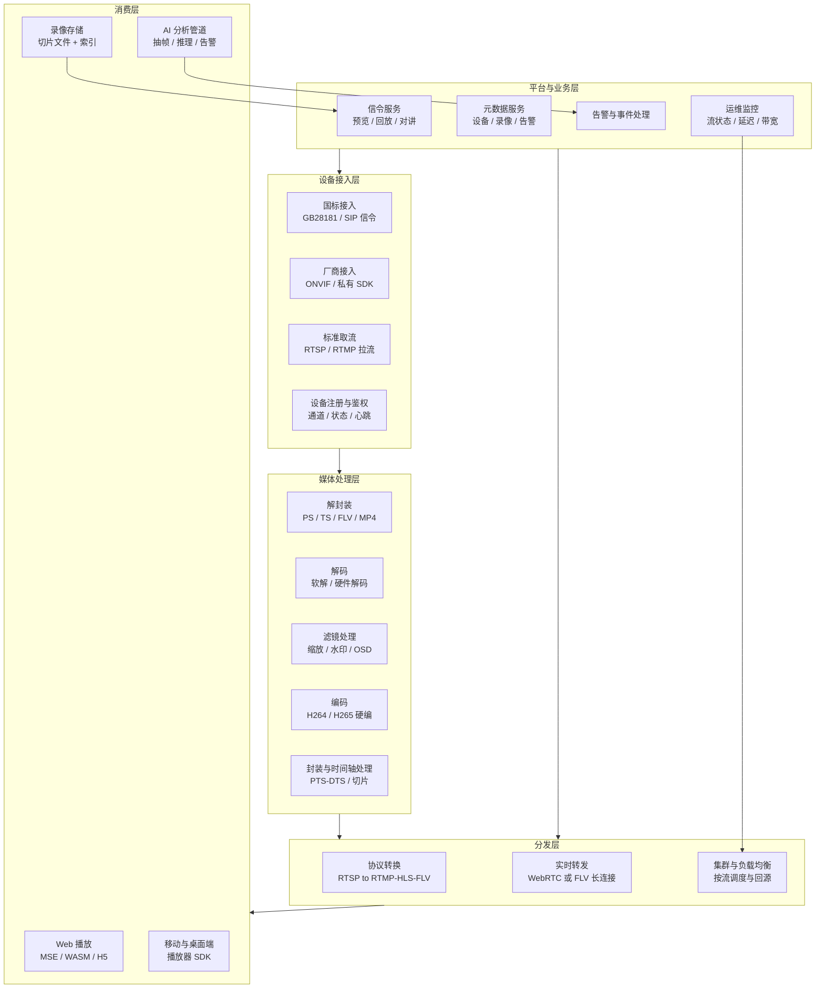
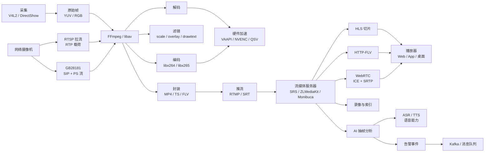
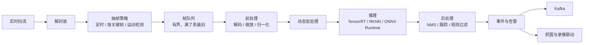
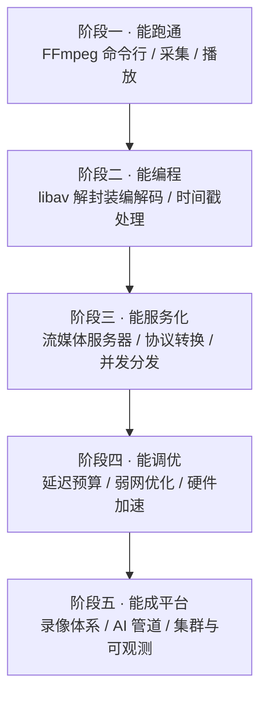

# 07 · 音视频与流媒体

> 数据基础：16 份 JD 聚合去重 | 薪资均值 20-33K | 学历主流：本科 | 经验主流：5 年以上
> 内容已去除公司信息，保留技术事实。
> 本篇为四个方向中展开最细的一份，面向**智能视频平台**建设者。

---

## 一、方向定位

这个方向的核心职责是**把连续的媒体数据，从采集端可靠、低延迟、可回放地送到消费端**——消费端可能是人（播放器），也可能是算法（AI 分析）。

它的难点不在"能不能播"，而在三件事同时成立：**延迟可控、弱网不卡、录像可查**。这也是为什么这个方向普遍要求 5 年以上经验——它几乎要把网络、系统、编解码、前端四条线全部串起来。

### 1.1 高频技术统计（按出现篇数）

| 技术/能力 | 出现篇数 | 占本方向比例 | 解读 |
|-----------|---------|-------------|------|
| C++ | 8 | 50% | 采集、转码、服务端主力语言 |
| Java | 7 | 44% | 平台侧业务与信令服务 |
| 性能优化 | 6 | 38% | 延迟、吞吐、内存是三大指标 |
| ASR / 语音识别 | 5 | 31% | 语音能力是重要分支 |
| RTSP | 5 | 31% | 设备取流的事实标准 |
| TTS / 语音合成 | 4 | 25% | 与 ASR 配套形成对话闭环 |
| 流媒体 | 4 | 25% | 方向主标签 |
| Docker | 4 / 6 | 25% / 38% | 服务容器化交付 |
| 高并发 | 3 / 4 | 19% / 25% | 多路并发取流与分发 |
| WebSocket | 3 / 4 | 19% / 25% | 实时信令与推送 |
| GB28181 | 3 | 19% | 国内视频监控联网的强制标准 |
| ONVIF | 3 | 19% | 跨厂商设备接入标准 |
| MySQL | 4 / 6 | 25% / 38% | 设备、录像、告警等元数据 |
| Redis | 3 / 5 | 19% / 31% | 会话、状态、限流 |
| Kafka | 3 | 19% | 告警与分析结果的消息管道 |
| 大模型 | 4 | 25% | 用于内容理解与智能摘要 |

### 1.2 细分技术二次统计

对 16 份 JD 正文做细粒度扫描后，可以看到岗位标签之外的真实技术分布：

| 细分技术项 | 出现篇数 | 占比 | 说明 |
|-----------|---------|------|------|
| 编解码 | 5 | 31% | 核心能力，软硬编都要懂 |
| 摄像头 / 视频采集 | 4 | 25% | 设备接入的起点 |
| 封装格式 | 4 | 25% | MP4 / TS / FLV / PS 等 |
| 延迟 | 4 | 25% | 低延迟是主要优化目标 |
| 转码 | 3 | 19% | 码率、分辨率、编码格式转换 |
| 推流 / 拉流 | 3 / 2 | 19% / 13% | 上行与下行链路 |
| 回放 | 3 | 19% | 录像检索与 Seek |
| H.264 / H.265 | 各 3 | 19% | 主流编码标准 |
| FFmpeg | 2 | 13% | 事实标准工具链 |
| RTMP | 2 | 13% | 上行推流与低延迟分发 |
| WebRTC | 2 | 13% | 亚秒级实时通信 |
| 索引 | 2 | 13% | 录像切片与检索 |
| 低延迟 | 2 | 13% | 首帧与端到端延迟 |
| 内存 | 4 | 25% | 多路流的内存管理 |
| GStreamer | 1 | 6% | 另一条 pipeline 工具链 |
| ZLMediaKit | 1 | 6% | 常见开源流媒体服务器 |
| SIP | 1 | 6% | GB28181 的信令基础 |
| 拥塞控制 | 1 | 6% | WebRTC/弱网优化核心 |
| HTTP-FLV | 1 | 6% | Web 低延迟播放方案 |
| 多线程 / 线程池 / 异步 | 2 / 1 / 2 | 13% / 6% / 13% | 并发模型基础 |

**一句话总结**：这个方向真正的门槛是**全链路的延迟与可靠性预算**——每一段链路能吃多少毫秒、丢多少包、占多少内存，必须心里有数。

---


### 完整技术栈清单（全量抽取 · 基于本方向 16 篇 JD）

> 下表由 JD 全文穷举抽取生成，数字为**出现该术语的 JD 篇数**，用于补齐正文未展开的细分技术项。

| 类别 | 技术栈（数字为出现篇数） |
|------|------------------------|
| **语言** | C++(8)、Java(7)、Python(4)、Kotlin(3)、Go(2)、Shell(2)、Rust(2)、SQL(1)、Dart(1)、Swift(1) |
| **后端框架** | Spring(2)、MyBatis(1)、FastAPI(1)、SpringBoot(1)、Django(1)、Flask(1)、Spring MVC(1) |
| **前端框架与UI** | Flutter(3) |
| **移动端** | Android(6)、iOS(3)、Kotlin(3)、Framework(2)、App开发(2)、鸿蒙(1)、Swift(1) |
| **数据库与存储** | MySQL(4)、Redis(3)、Elasticsearch(1)、Milvus(1)、SQLite(1) |
| **消息与中间件** | RabbitMQ(2)、MQTT(2)、Kafka(1)、RocketMQ(1)、Nacos(1) |
| **云容器与DevOps** | Docker(4)、流水线(2)、容器化(1)、Nginx(1)、灰度发布(1) |
| **大数据与数据平台** | 埋点(2)、批处理(1)、用户画像(1) |
| **AI与机器学习** | ASR(5)、大模型(4)、TTS(4)、Agent(2)、RAG(2)、Claude(2)、LLM(2)、Prompt(2)、GPU(2)、语音识别(2)、Whisper(2)、LangChain(1)、DeepSeek(1)、微调(1)、多模态(1)、模型部署(1)、PyTorch(1)、OpenCV(1)、Llama(1)、vLLM(1) |
| **音视频与流媒体** | 编解码(7)、RTSP(5)、GB28181(3)、ONVIF(3)、转码(3)、回放(2)、WebRTC(2)、推流(2)、FFmpeg(2)、RTMP(2)、拉流(2)、SIP(1)、帧率(1)、预览(1)、GStreamer(1)、HTTP-FLV(1)、拥塞控制(1)、ZLMediaKit(1)、多路(1)、对讲(1) |
| **嵌入式与硬件** | 嵌入式(5)、蓝牙(3)、WiFi(3)、中断(2)、固件(2)、Yocto(2)、OpenWrt(2)、SPI(1)、I2C(1)、串口(1)、Modbus(1)、ARM(1)、RTOS(1)、OTA(1)、单片机(1)、PCB(1)、原理图(1)、LoRa(1)、ROS(1)、FreeRTOS(1) |
| **桌面与客户端** | 客户端(1) |
| **协议与接口** | SDK(5)、HTTP(3)、WebSocket(3)、RESTful(2)、TCP(2)、JSON(2)、Webhook(1)、FTP(1)、JWT(1)、SNMP(1)、断线重连(1)、SMTP(1) |
| **安全与合规** | 合规(5)、TLS(1)、SSL(1)、RBAC(1)、防火墙(1)、国密(1)、审计日志(1)、网闸(1) |
| **工程化与质量** | 设计文档(4)、技术文档(3)、Git(3)、重构(2)、日志(2)、编码规范(2)、单元测试(1)、GitHub(1)、接口文档(1)、灰度(1)、CMake(1)、压测(1)、Gradle(1) |
| **架构与设计** | 性能优化(6)、架构设计(5)、方案设计(4)、高并发(3)、微服务(2)、高可用(2)、技术选型(2)、异步(2)、分片(2)、多线程(1)、SaaS(1)、限流(1)、抽象(1)、锁(1)、重试(1)、降级(1)、熔断(1)、对账(1)、多租户(1)、超时(1) |
| **业务领域** | 支付(2)、定制化(2)、实施(1)、MES(1)、供应链(1)、电商(1)、金融(1)、教育(1) |
| **软技能** | 团队协作(4)、英语(4)、规划(3)、沟通能力(2)、跨部门(2)、文档编写(2)、需求分析(1)、责任心(1)、培训(1) |

---

## 二、参考架构图

一套智能视频平台的分层结构。注意"AI 分析"与"录像"是两条独立的消费链路，不要把它们耦合进分发主链路。



### 解读

1. **接入层要解决的是"设备千奇百怪"**：GB28181 用于国标平台级联，ONVIF 用于跨厂商发现与取流，私有 SDK 兜底。三者应在内部统一为同一种媒体模型。
2. **媒体处理层区分转封装与转码**：只换容器不动码流叫转封装，开销极低；改分辨率、码率、编码格式才需要转码，开销高。**能转封装就别转码**，这是性能优化的第一原则。
3. **分发层要做到协议无关**：内部统一成帧级抽象，出口再转成 RTMP/HLS/FLV/WebRTC，避免 N × M 的协议转换复杂度。
4. **AI 分析必须旁路**：抽帧分析不应阻塞实时分发链路，否则算法抖动会直接影响观看体验。
5. **录像与实时流分离**：实时走内存/转发，录像走文件/对象存储，两者共享索引但互不阻塞。

---

## 三、技术栈关联图



### 说明

- **三条入口汇聚到 FFmpeg**：本地采集、网络取流、国标接入，最终都归一为统一的帧流。
- **硬件加速是分叉点**：有无 GPU/NPU 决定了是走 VAAPI/NVENC 还是纯软件，也决定了单机能承载的路数。
- **流媒体服务器是枢纽**：向下游同时产出 HLS（兼容性好、延迟高）、HTTP-FLV（延迟中等）、WebRTC（亚秒级）。
- **录像与 AI 是旁路消费**：都不应影响主转发链路。

---

## 四、核心能力矩阵

| 能力项 | 出现率 | 关键要点 | 常见追问 |
|--------|-------|---------|---------|
| 采集与设备接入 | 25% | V4L2/DirectShow、RTSP 取流、SDK 对接、断线重连 | 设备频繁掉线怎么定位？ |
| 编解码 | 31% | H264/H265 结构、GOP、码率控制、硬编硬解 | CBR 和 VBR 怎么选？ |
| FFmpeg 工程能力 | 13% 显式 | 命令行参数、libav 编程、滤镜链、时间轴 | 如何用 FFmpeg 做秒级切片？ |
| 封装与时间戳 | 25% | PTS/DTS、timebase 转换、MP4/TS/FLV/PS | 音画不同步怎么修？ |
| 传输协议 | 31% | RTSP/RTMP/HLS/GB28181/WebRTC | RTSP 和 RTMP 的适用场景？ |
| 低延迟优化 | 25% | 首帧时间、GOP 缓存、缓冲策略、协议选择 | 如何把延迟从 3s 降到 500ms？ |
| 高并发分发 | 25% | 连接管理、零拷贝转发、回源、集群 | 单机千路如何规划？ |
| 录像与检索 | 19% | 切片策略、索引结构、Seek 精度 | 如何实现秒级定位？ |
| AI 分析管道 | 19% | 抽帧策略、批处理、前后处理加速 | 如何避免算法拖慢实时流？ |
| 语音能力 | 31% / 25% | ASR/TTS、VAD、回声消除 | 实时对话链路怎么搭？ |

---

## 五、关键实现要点

### 5.1 采集：V4L2 与 DirectShow

**Linux 侧 V4L2** 是标准采集接口，关键流程：

```
open(/dev/video0) → VIDIOC_QUERYCAP    查询能力
                  → VIDIOC_S_FMT       设置分辨率与像素格式，如 YUYV/MJPEG
                  → VIDIOC_REQBUFS     申请缓冲队列
                  → VIDIOC_QBUF        缓冲入队
                  → VIDIOC_STREAMON    启动采集
      循环：VIDIOC_DQBUF 取帧 → 处理 → VIDIOC_QBUF 归还
```

要点：
- **优先用 MMAP 模式**，避免 `read()` 方式的内存拷贝；
- **选择相机原生输出格式**：若相机支持 MJPEG/H264 直出，直接采集压缩流可大幅降低 USB 带宽与 CPU；
- **缓冲区数量一般取 4**，太少容易丢帧，太多增加延迟；
- **采集与处理分离线程**：采集线程只做 DQBUF + 入队到无锁队列，避免处理耗时导致丢帧。

**Windows 侧 DirectShow** 用 Filter Graph 模型：Source Filter → Transform Filter → Renderer Filter，通过 Sample Grabber 回调拿帧；新一代可用 MediaFoundation。

### 5.2 FFmpeg：滤镜与转码参数

**转封装（零转码，开销极低）：**

```bash
ffmpeg -i input.mp4 -c copy -f flv rtmp://server/live/stream
```

**转码 + 缩放 + 码率控制：**

```bash
ffmpeg -i rtsp://cam/1 \
  -vf "scale=1280:720,fps=25,drawtext=text='%{localtime}':x=10:y=10:fontsize=24:fontcolor=white" \
  -c:v libx264 -preset veryfast -tune zerolatency \
  -b:v 1500k -maxrate 1800k -bufsize 3000k \
  -g 50 -keyint_min 50 -sc_threshold 0 \
  -c:a aac -b:a 128k -ar 44100 \
  -f flv rtmp://server/live/stream
```

参数要点：

| 参数 | 作用 |
|------|------|
| `-preset veryfast` | 编码速度与压缩率权衡，直播用 veryfast/ultrafast |
| `-tune zerolatency` | 关闭编码延迟缓冲，直播必开 |
| `-b:v / -maxrate / -bufsize` | 码率控制，buffer 一般为码率的 2 倍 |
| `-g / -keyint_min` | GOP 大小，影响首帧时间与 Seek 精度 |
| `-sc_threshold 0` | 关闭场景切换自动插关键帧，保持 GOP 稳定 |
| `-vf` | 滤镜链，顺序敏感 |

**常用滤镜**：`scale`（缩放）、`fps`（帧率）、`overlay`（水印/画中画）、`drawtext`（文字 OSD）、`crop`（裁剪）、`hflip/vflip`（翻转）、`concat`（拼接）。

### 5.3 硬件编解码

| 平台 | 接口 | FFmpeg 参数示例 |
|------|------|----------------|
| NVIDIA | NVENC / NVDEC | `-c:v h264_nvenc` |
| Intel | QSV | `-c:v h264_qsv` |
| Linux 通用 | VAAPI | `-vaapi_device /dev/dri/renderD128 -vf format=nv12,hwupload -c:v h264_vaapi` |
| Apple | VideoToolbox | `-c:v h264_videotoolbox` |
| Android | MediaCodec | `-c:v h264_mediacodec` |

要点：
1. **硬编的并发路数有上限**：消费级 GPU 常限制在 2-5 路，超出需核算或改用软编；
2. **显存是隐形瓶颈**：硬解码的帧存在显存，多路并发会先耗尽显存而非 GPU 算力；
3. **零拷贝链路**：`hwupload` → 硬编 → 硬解 → `hwdownload`，避免显存与主存之间来回拷贝；
4. **必须有软编兜底**：硬编失败或不支持时自动降级，否则整路流中断。

### 5.4 封装格式与时间戳

| 容器 | 特点 | 典型场景 |
|------|------|---------|
| MP4 | 索引在尾部，需 moov 前置才支持边下边播 | 点播、录像文件 |
| TS | 固定 188 字节包，抗丢包 | HLS、广播 |
| FLV | 结构简单，tag 组织 | RTMP、HTTP-FLV |
| PS | 节目流 | GB28181 国标流 |
| WebM | 开放格式 | Web 端录制 |

**PTS/DTS 与音画同步**：

- **DTS**：解码时间戳，决定何时送入解码器；
- **PTS**：显示时间戳，决定何时呈现；
- 有 B 帧时，PTS ≠ DTS，因为解码顺序与显示顺序不同。

**timebase 转换是最高频的坑**：不同层（`AVStream`、`AVCodecContext`）的 timebase 不同，必须显式转换：

```cpp
// 从流的 timebase 转到输出的 timebase
pkt.pts = av_rescale_q(pkt.pts, in_stream->time_base, out_stream->time_base);
pkt.dts = av_rescale_q(pkt.dts, in_stream->time_base, out_stream->time_base);
pkt.duration = av_rescale_q(pkt.duration, in_stream->time_base, out_stream->time_base);
```

**同步策略（三选一）**：
1. 音频为主时钟（最常用，人耳对音频卡顿更敏感）；
2. 视频为主时钟；
3. 外部系统时钟（多端同步场景）。

**音视频不同步排查顺序**：时间戳是否正确生成 → timebase 是否一致 → 是否有 B 帧导致 PTS/DTS 混乱 → 缓冲队列是否积压 → 渲染时钟是否漂移。

### 5.5 协议：RTSP / RTMP / GB28181

**RTSP**（设备取流事实标准，UDP/TCP 承载 RTP）：

```
OPTIONS → DESCRIBE → SETUP → PLAY → (RTP/RTCP 传输) → TEARDOWN
```

- `DESCRIBE` 返回 SDP，描述媒体类型、编码、负载类型；
- `SETUP` 协商传输方式（UDP 或 TCP  interleaved）；
- 靠 RTCP 做同步与质量反馈；
- 工程要点：**UDP 丢包时切 TCP**，弱网环境优先 TCP 模式。

**RTMP**（上行推流主流）：
- 基于 TCP，默认 1935 端口；
- 握手 → 建立 NetConnection → 创建 NetStream → publish/play；
- 延迟通常 1-3 秒；
- 要点：`chunk size` 设置影响分包效率，`GOP cache` 影响首帧时间。

**GB28181**（国内视频监控联网标准）：
- 信令基于 SIP：注册 → 目录查询 → 实时点播 Invite → 200 OK → 媒体流（PS over RTP）→ Bye；
- 媒体流封装为 **PS（Program Stream）**，需注意 PS 头的解析与码流重组；
- 支持级联：下级平台注册到上级平台，转发信令与媒体；
- 工程要点：**SIP 信令与媒体流必须分离处理**，信令可靠性靠重传，媒体流靠缓冲。

| 协议 | 延迟量级 | 兼容性 | 适用场景 |
|------|---------|-------|---------|
| RTSP | 低，几百毫秒 | 设备端好，Web 端差 | 设备取流、内网预览 |
| RTMP | 中，1-3 秒 | 推流端好，Web 需 Flash 或转协议 | 上行推流 |
| HTTP-FLV | 中，1-3 秒 | Web 端好 | Web 直播 |
| HLS | 高，5-20 秒 | 最好，全平台 | 兼容性优先的点直播 |
| WebRTC | 极低，亚秒 | 现代浏览器原生 | 实时通话、低延迟监控 |

### 5.6 WebRTC：拥塞控制与 ICE/TURN

WebRTC 是亚秒级实时通信的主流方案，两块核心：

**(1) ICE 打洞与 TURN 中继**

```
收集候选地址：主机候选 → STUN 反射候选 → TURN 中继候选
        ↓
   按优先级配对与连通性检查
        ↓
   选出最佳候选对，建立 DTLS + SRTP 加密通道
```

- **STUN**：获取公网映射地址，实现大多数情况下的 P2P 直连；
- **TURN**：对称型 NAT 或严格防火墙下无法直连时，通过服务器中继，**代价是带宽成本**；
- 工程要点：生产环境**必须部署 TURN**，否则约 10%-20% 的用户会连不上。

**(2) 拥塞控制**

- **GCC（Google Congestion Control）**：基于延迟梯度检测链路拥塞，结合丢包率估计可用带宽；
- 带宽估计结果驱动：编码器码率调整、帧率调整、分辨率调整；
- 抗丢包手段：**NACK**（丢包重传，适合低延迟）、**FEC**（前向纠错，冗余换可靠）、**PLI/FIR**（请求关键帧）、**JitterBuffer**（抖动缓冲，抗抖动但增加延迟）。

**关键权衡**：JitterBuffer 越大越流畅但延迟越高。实时通话用自适应抖动缓冲，监控场景可容忍稍高延迟换取流畅。

### 5.7 低延迟优化与首帧时间

端到端延迟拆解：

| 环节 | 典型耗时 | 优化手段 |
|------|---------|---------|
| 采集 | 1-2 帧 | 缩短曝光、减少缓冲数 |
| 编码 | 1 帧 - 数十毫秒 | `-tune zerolatency`、关闭 B 帧、硬编 |
| 网络传输 | 可变 | 就近接入、UDP/QUIC、拥塞控制 |
| 服务端缓存 | GOP 大小决定 | 关闭 GOP cache 或按关键帧起播 |
| 解码 | 数毫秒 | 硬解、减少参考帧 |
| 渲染缓冲 | 数十毫秒 | 减小 JitterBuffer |

**首帧时间优化的核心**：
1. **GOP cache**：服务端缓存最近一个 GOP，客户端接入立即下发，实现秒开；但这会增加约一个 GOP 的延迟；
2. **关键帧起播**：客户端从最近的 IDR 帧开始解码，避免花屏；
3. **协议与参数**：减少握手往返、复用连接、预建立会话；
4. **DNS 与就近接入**：用 HTTPDNS、边缘节点减少建连时间。

**延迟与流畅的取舍**：没有"又快又不卡"的万能解。实时对讲追求 <400ms，可接受偶尔卡顿；录像回放追求流畅，可接受 2-3 秒起播延迟。**先明确场景指标，再做优化。**

### 5.8 录像切片与索引

**切片策略**：

| 策略 | 优点 | 缺点 |
|------|------|------|
| 定时切片，如 5 分钟 | 索引简单、文件可控 | 起播需 Seek 到关键帧 |
| 按关键帧切片 | 无缝拼接、Seek 精确 | 文件时长不固定 |
| 固定大小切片 | 存储均衡 | 检索需换算 |

**索引结构设计**：
- 记录每个切片的：设备 ID、通道、开始/结束 UTC 时间、关键帧位置表（文件偏移 + PTS）、文件大小、编码参数；
- 索引与切片文件分离存储，索引落数据库便于检索与聚合；
- Seek 时用二分查找定位切片，再用关键帧位置表精确定位。

**可靠性要点**：
1. **写入原子性**：先写临时文件，写完后原子改名，避免读到半截文件；
2. **覆盖策略**：按容量或天数循环覆盖，覆盖前确认索引同步清理；
3. **断电保护**：定时刷盘 + 索引延迟落库，重启后做一致性校验；
4. **时间基准统一用 UTC**，展示时再转本地时区，避免跨时区与夏令时混乱。

### 5.9 AI 抽帧分析管道



关键设计点：

1. **抽帧策略决定算力消耗**：固定间隔抽帧最简单；运动检测预筛能显著降低无效推理；
2. **有界队列 + 丢弃最旧**：宁可丢帧也不能让队列无限积压，否则延迟会持续恶化；
3. **动态批处理**：在超时窗口内攒批，兼顾延迟与 NPU 利用率；
4. **与实时流解耦**：AI 分析旁路消费，分析卡顿不影响观看；
5. **结果去重与跟踪**：同一目标连续帧会产生重复告警，需做目标跟踪与抑制窗口；
6. **抓图与录像联动**：告警时保存前后若干秒的录像片段，便于事后复核。

---

## 六、典型职责归纳（去重合并）

- 负责音视频采集模块开发：本地设备采集、网络摄像机取流、多协议接入适配。
- 负责转码与媒体处理：基于 FFmpeg 或 GStreamer 实现转码、转封装、滤镜、截图与切片。
- 设计并实现流媒体分发服务：RTSP/RTMP/HLS/HTTP-FLV/WebRTC 的接入与转发。
- 负责国标平台对接：GB28181 信令交互、PS 流解析、平台级联与设备管理。
- 实现录像子系统：录像计划、切片存储、索引构建、检索与秒级回放 Seek。
- 负责低延迟与性能优化：首帧时间、端到端延迟、弱网抗抖动、单机并发路数。
- 构建 AI 分析管道：视频抽帧、模型推理、目标跟踪、告警事件与消息分发。
- 负责语音能力集成：ASR/TTS、实时音频链路、回声消除与降噪处理。
- 负责服务容器化与集群部署：Docker 镜像、负载均衡、回源策略与容量规划。
- 建设可观测能力：流状态监控、延迟与卡顿指标、带宽统计与故障告警。
- 编写技术方案、接口文档与联调规范，支撑前端、算法与硬件团队协作。

---

## 七、进阶路径建议



每阶段产出物建议：一条能播放的流 → 一个转码小工具 → 支持多协议的转发服务 → 有延迟指标的优化报告 → 可支撑多路设备的完整视频平台。

---

## 八、常见考察点清单

1. **PTS 和 DTS 的区别？什么时候不相等？**
   DTS 决定解码顺序，PTS 决定显示顺序。存在 B 帧时，因为需要后向参考，解码顺序与显示顺序不一致，两者不等。

2. **音画不同步怎么排查？**
   按序检查：时间戳生成是否正确 → 各层 timebase 是否一致 → 是否存在 B 帧 → 缓冲队列是否积压 → 渲染时钟是否漂移。通常以音频为主时钟。

3. **RTSP 和 RTMP 怎么选？**
   RTSP 适合设备侧取流与内网预览，延迟低；RTMP 适合上行推流，延迟中等但生态成熟。Web 端播放需转成 HTTP-FLV 或 HLS。

4. **HLS 延迟为什么大，怎么优化？**
   因为要等切片生成再下载，一个切片通常 2-10 秒。优化方向：缩短切片时长、使用 LHLS 的部分切片、或直接改用 HTTP-FLV/WebRTC。

5. **GB28181 的媒体流是什么封装？**
   PS（Program Stream）over RTP，常见载荷类型 96。需要解析 PS 头并重组码流，注意 RTP 分包与 PS 包边界不对齐的情况。

6. **WebRTC 连不上怎么办？**
   依次排查：ICE 候选是否收集完整 → STUN 是否可达 → 是否需要 TURN 中继 → 防火墙端口是否放行 → 信令交换是否正确。生产环境必须部署 TURN。

7. **弱网下如何保证流畅？**
   组合使用：自适应码率（依据带宽估计）、NACK 重传、FEC 冗余、动态帧率/分辨率、自适应 JitterBuffer、关键帧请求。

8. **如何降低首帧时间？**
   GOP cache 下发、关键帧起播、减少握手往返、连接复用、就近接入与 HTTPDNS、预建立会话。

9. **硬编和软编怎么选？**
   硬编省 CPU、吞吐高，但有并发路数限制、画质略差、参数调优空间小；软编灵活、画质好，但 CPU 消耗大。通常硬编为主 + 软编兜底。

10. **多路流内存暴涨怎么排查？**
    检查解码帧缓冲是否释放、队列是否有界、是否存在零拷贝失效导致的重复拷贝、是否有流泄漏未关闭。用 heap profiler 对比快照定位。

11. **录像如何实现秒级定位？**
    索引记录每个切片的起止时间与关键帧偏移表，Seek 时二分定位切片，再按关键帧偏移精确定位文件位置。

12. **AI 分析影响实时流怎么办？**
    将抽帧分析改为旁路消费，队列设上界并丢弃最旧帧，推理与转发分离进程或线程，必要时降采样或降低抽帧频率。

---

## 九、与其他方向的连接

- **与 C++ 系统软件**：采集、转码、推流模块多用 C++ 实现，复用其内存管理与多线程能力。
- **与嵌入式 Linux 与边缘计算**：边缘盒子承担取流、硬件编解码与端侧推理，是视频平台的算力下沉部分。
- **与机器人与智能硬件**：机器人视觉、无人机图传本质上是低延迟视频链路 + 感知分析。
- **与 AI 大模型应用**：视觉结果经由大模型做语义化摘要与检索，形成"看得见"到"看得懂"的闭环。
- **与 Go 云原生高并发**：流媒体调度、设备接入网关、信令服务常由 Go 承担高并发连接管理。
- **与前端与全栈**：Web 端播放涉及 MSE、WASM 解码、Canvas 渲染与自适应码率，是体验的最后一公里。
