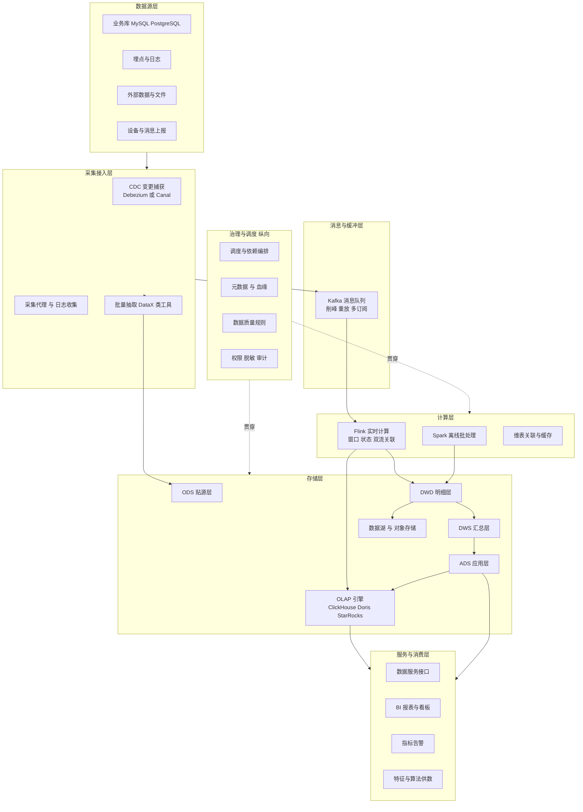
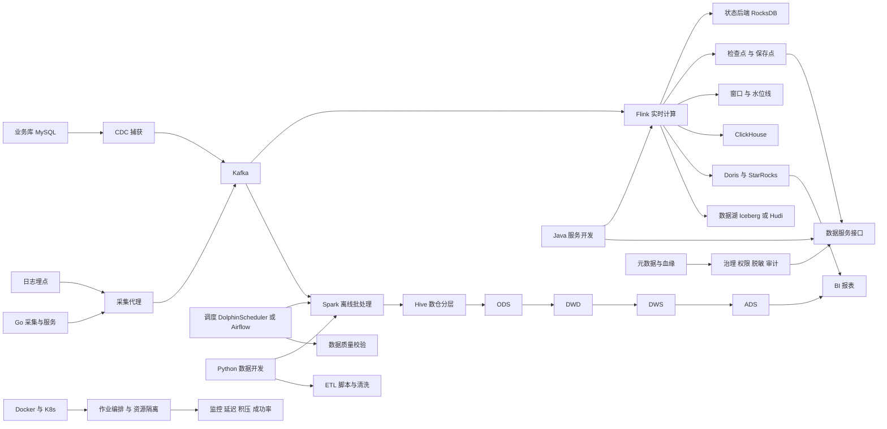
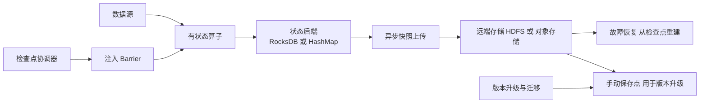
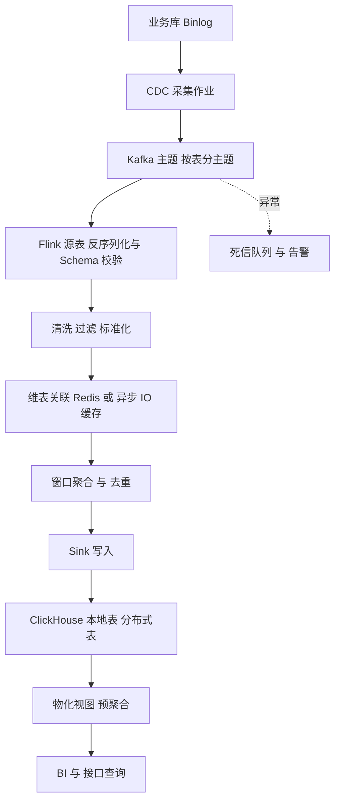
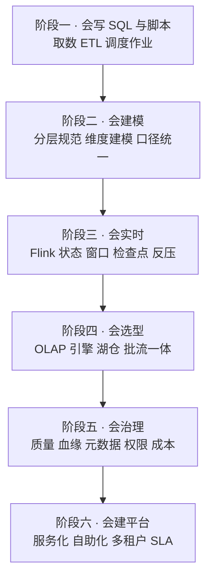

# 09 · 数据平台与实时计算

> 数据基础：14 份 JD 聚合去重 | 薪资均值 20-33K | 学历主流：本科 | 经验主流：3-5 年
> 内容已去除公司信息，保留技术事实。

---

## 一、方向定位

样本量虽是九个方向中最少的，薪资均值却是最高的一档——说明这类岗位**供给少、要求复合**：既要会写工程代码（Python/Java/Go），又要懂分布式计算，还要能承担数据治理这种偏"管理+工程"的活。

| 技术/能力 | 出现篇数 | 占本方向比例 | 解读 |
|-----------|---------|-------------|------|
| Python | 10 | 71% | 数据开发、脚本、调度与算法衔接的主力 |
| Java | 9 | 64% | Flink/Spark 与数据服务的主要实现语言 |
| Docker | 8 | 57% | 平台化交付的基线 |
| MySQL | 7 | 50% | 业务库即数据源，CDC 的起点 |
| K8s / Kubernetes | 5 | 36% | 计算与调度任务的容器化编排 |
| Go | 5 | 36% | 数据服务与采集代理的常用语言 |
| ClickHouse | 3 | 21% | 实时 OLAP 查询的主力引擎 |
| 高并发 | 4 | 29% | 采集与查询两端都有并发压力 |
| 微服务 | 4 | 29% | 数据服务平台化后按服务拆分 |
| Redis | 4 | 29% | 维表缓存、去重状态、加速查询 |

对同批 JD 做二次细粒度扫描（n=14），可以看到明确的大数据组件分布：

| 细分技术点 | 出现篇数 | 解读 |
|-----------|---------|------|
| Flink | 6 | 实时计算的事实标准，本方向最高频组件 |
| Spark | 5 | 离线批处理与大规模清洗的主引擎 |
| 数仓 / 数据仓库建设 | 4 | 明确要求建仓而非写临时脚本 |
| ETL / ELT | 4 | 多源接入与加工是日常主体工作 |
| 指标与口径管理 | 4 | 数据价值最终落在口径一致的指标上 |
| 任务调度 | 4 | Airflow、DolphinScheduler 类工具 |
| Kafka | 3 | 实时链路的消息主干 |
| 数据质量 | 3 | 校验规则、异常定位与闭环 |
| 实时计算关键词 | 3 | 秒级/分钟级延迟成为显式要求 |
| 分层命名 ODS/DWD/ADS | 3 | 已按标准分层方法论描述 |
| 元数据 / 血缘 | 2 | 平台化治理能力的标志 |
| 数据治理 | 2 | 权限、生命周期、合规 |
| Doris / Druid / StarRocks | 3 | OLAP 引擎的多种选型并存 |
| 数据湖 Iceberg / Hudi | 1 | 湖仓一体仍在早期渗透 |
| 脱敏 / 加密 / 审计 | 1 | 合规要求明确的岗位才提 |

**一句话总结**：这个方向的门槛在"全链路"——数据怎么进来、怎么分层、怎么算准、怎么查得快、怎么保证口径一致与可追溯。

---

### 完整技术栈清单（全量抽取 · 基于本方向 14 篇 JD）

> 下表由 JD 全文穷举抽取生成，数字为**出现该术语的 JD 篇数**，用于补齐正文未展开的细分技术项。

| 类别 | 技术栈（数字为出现篇数） |
|------|------------------------|
| **语言** | Python(10)、Java(9)、SQL(7)、Go(4)、C++(1)、C#(1)、Golang(1)、C语言(1)、Lua(1) |
| **后端框架** | Spring(4)、Spring Boot(3)、Spring Cloud(3)、MyBatis(2)、FastAPI(1)、Django(1)、Flask(1)、RPC(1)、Dubbo(1) |
| **前端框架与UI** | React(2)、Vue(1)、Vue3(1)、ECharts(1)、Three.js(1)、WebGL(1)、SVG(1) |
| **数据库与存储** | MySQL(7)、Redis(4)、MongoDB(3)、ClickHouse(3)、PostgreSQL(2)、SQL Server(2)、Doris(2)、Oracle(1)、向量数据库(1)、MinIO(1)、HBase(1)、InfluxDB(1)、对象存储(1)、时序数据库(1) |
| **消息与中间件** | Kafka(3)、RocketMQ(2)、RabbitMQ(1) |
| **云容器与DevOps** | Docker(8)、容器化(5)、K8s(5)、Kubernetes(3)、CI/CD(1)、Jenkins(1)、GitLab CI(1) |
| **大数据与数据平台** | Flink(6)、ETL(5)、Spark(5)、BI(3)、数据质量(3)、元数据(3)、报表(2)、Hadoop(2)、数据治理(2)、数据仓库(2)、血缘(2)、实时计算(2)、Hive(1)、Storm(1)、Trino(1)、Iceberg(1)、Hudi(1)、Airflow(1)、OLAP(1)、Superset(1) |
| **AI与机器学习** | Agent(5)、大模型(4)、智能体(4)、RAG(3)、Claude(3)、MCP(3)、LangChain(2)、Prompt(2)、微调(2)、LLM(1)、多模态(1)、OpenCV(1)、知识图谱(1) |
| **音视频与流媒体** | 低延迟(1)、WebRTC(1) |
| **嵌入式与硬件** | 嵌入式(2)、CAN(2)、SPI(1)、I2C(1)、运动控制(1)、Modbus(1)、ARM(1)、电源(1)、OTA(1)、传感器(1)、5G(1)、PID(1) |
| **桌面与客户端** | Qt(1)、OpenGL(1)、MFC(1)、桌面应用(1) |
| **协议与接口** | WebSocket(1)、REST(1)、开放平台(1)、OpenAPI(1)、CAS(1)、Protobuf(1) |
| **安全与合规** | 合规(1)、等保(1)、数据加密(1)、脱敏(1) |
| **工程化与质量** | Git(3)、重构(3)、技术文档(2)、日志(2)、单元测试(1)、GitHub(1)、SVN(1)、敏捷(1)、GitLab(1)、压力测试(1)、容量规划(1) |
| **架构与设计** | 架构设计(7)、性能优化(4)、微服务(4)、高并发(4)、多线程(3)、高可用(3)、限流(2)、设计模式(2)、方案设计(1)、技术选型(1)、抽象(1)、锁(1)、中台(1)、重试(1)、幂等(1)、低延迟(1)、对账(1)、分库分表(1)、分片(1)、容灾(1) |
| **业务领域** | ERP(4)、供应链(4)、财务(4)、电商(4)、库存(4)、订单(2)、实施(1)、WMS(1)、CRM(1)、金融(1)、物流(1)、风控(1)、教育(1)、产品化(1)、物联网平台(1)、智慧城市(1)、车联网(1)、政务(1) |
| **软技能** | 规划(4)、沟通能力(4)、需求分析(4)、跨部门(2)、团队协作(1)、责任心(1)、培训(1)、文档编写(1) |

---

## 二、参考架构图

批流并存的典型数据平台。注意治理与调度是纵向贯穿的两条线，而不是某一层的附属功能。

**解读**：
- 采集层要优先选 CDC 而非定时全量抽数，能同时降低业务库压力与延迟；
- 计算层的两条腿（Flink 实时 + Spark 离线）在多数团队仍长期共存；
- OLAP 引擎既承接实时写入也承接应用层结果，选型直接决定查询体验；
- 治理与调度是纵向能力，缺了它们，层数再多也只是"一堆表"。

---

## 三、技术栈关联图

**说明**：图中最关键的是 `Kafka → Flink → OLAP` 这条主干。Kafka 提供可重放能力，Flink 提供有状态计算，OLAP 提供交互式查询，三者组合覆盖了绝大多数实时需求。

---

## 四、核心能力矩阵

| 能力项 | 出现率 | 关键要点 | 常见追问 |
|--------|-------|---------|---------|
| 实时计算 Flink | 43% | 窗口、水位线、状态、检查点、反压、并行度 | 数据迟到怎么处理？ |
| 离线批处理 Spark | 36% | 分区、Shuffle、数据倾斜、小文件、执行计划 | Shuffle 慢怎么定位和优化？ |
| 数仓建模 | 29% | 分层规范、维度建模、缓慢变化维、口径统一 | 为什么要分这么多层？ |
| 数据接入 CDC/ETL | 29% | 增量同步、全量初始化、Schema 变更、断点续传 | 表结构变了同步会怎样？ |
| OLAP 引擎 | 21%+ | 引擎选型、排序键、分区、物化视图、写入批次 | 为什么查询突然变慢了？ |
| 精确一次与幂等 | 中高 | 两阶段提交、幂等写入、去重键、端到端语义边界 | 真能做到端到端精确一次吗？ |
| 调度与依赖 | 29% | DAG 编排、重跑、补数、跨周期依赖、告警 | 上游迟到下游怎么办？ |
| 数据质量与治理 | 21% | 规则体系、血缘、元数据、SLA、权责与闭环 | 指标对不上怎么查？ |
| 平台工程化 | 50%+ | Docker/K8s、服务化、代码规范、CI/CD | 作业怎么做到自助发布？ |
| SQL 与性能调优 | 57% | 执行计划、索引、分区裁剪、谓词下推 | 一条慢 SQL 怎么调优？ |

---

## 五、关键实现要点

### 5.1 Lambda 还是 Kappa：按"重放成本"决策

| 维度 | Lambda | Kappa |
|------|--------|-------|
| 结构 | 批流两套代码，结果合并 | 只有一套流代码，靠重放修正 |
| 一致性 | 双路结果对齐成本高 | 单一逻辑，天然一致 |
| 修正历史数据 | 跑批覆盖即可 | 需从消息中间件重放历史 |
| 前提 | 无特殊要求 | 消息保留期足够长、计算逻辑可重复执行 |
| 适用 | 历史数据量大、逻辑复杂、批为主 | 实时为主、保留期可控、逻辑幂等 |

现实中的折中方案是**流批一体**：用同一套 SQL/API 描述逻辑，由引擎决定批模式还是流模式执行（Flink 批流一体、Spark Structured Streaming 的思路），再辅以湖存储（Iceberg/Paimon/Hudi）提供可回溯的历史。这要求存储层支持 Upsert 与时间旅行，否则重放仍然困难。

### 5.2 Flink 状态与 Checkpoint：稳定运行的地基

关键配置与经验：

- **状态后端**：大状态必须选 RocksDB（增量检查点 + 堆外内存），HashMap 只适合小状态与测试；开启增量检查点可把每次快照成本从分钟级降到秒级。
- **检查点参数**：间隔按"可接受的重算时长"设置（常用 1~5 分钟），`checkpointTimeout` 留足上传余量，`minPauseBetweenCheckpoints` 防止连续快照拖慢处理，`tolerableFailedCheckpoints` 允许偶发失败但要有告警。
- **对齐与非对齐**：反压严重时对齐检查点会因 Barrier 迟迟不能对齐而超时，此时启用非对齐检查点（把在途数据一并快照），代价是状态体积变大。
- **Savepoint 与升级**：版本升级、并行度调整、逻辑变更都要走 Savepoint，且要保证算子 UID 稳定（`uid()` 显式指定），否则状态无法匹配恢复。
- **状态膨胀**：给状态设 TTL，避免无限累积；Key 设计要避免热点（高基数但分布不均的 key 会造成单并发卡死）。
- **反压定位**：从下游往上游查，看是哪一算子的处理速率成为瓶颈，常见原因是外部维表查询同步阻塞、Sink 写入慢、GC 或序列化开销。

### 5.3 数仓分层：ODS / DWD / DWS / ADS

| 层 | 职责 | 关键约定 |
|----|------|---------|
| ODS 贴源层 | 原样落地，保留原始细节与变更 | 只做格式转换与清洗，不改业务语义；保留分区与同步时间 |
| DWD 明细层 | 统一口径的最细粒度事实与维度 | 做维度退化、枚举标准化、去重、关联维表 |
| DWS 汇总层 | 面向主题的轻度/中度汇总 | 按通用粒度预聚合，避免每个需求从明细重算 |
| ADS 应用层 | 面向具体报表与接口 | 允许冗余与宽表，追求查询快 |
| DIM 维度层 | 一致维度 | 缓慢变化维处理、维度快照、主数据统一 |

方法论要点：

- 分层的价值不在层数多，而在**依赖方向单一**与**口径唯一**：上层只能依赖下层，同名指标只在某一层定义一次；
- 维度建模优先选星型模型，事实表存度量与外键，维度表存属性，减少不必要的雪花化；
- 缓慢变化维要显式选择策略：覆盖、拉链（记生效起止时间）、快照表，选择错了会导致历史报表口径漂移；
- 明细层保留"可追溯"字段（来源、批次、同步时间），出问题才能回溯到源头。

### 5.4 Kafka → Flink → ClickHouse 实时链路

链路细节：

- **Schema 演进**：DDL 变更是最常见的故障源，采集端要能识别新增列并同步下游，删除/改类型必须走人工评审；
- **维表关联**：用异步 IO + 缓存避免同步查询阻塞，维表更新要考虑缓存失效时机（延迟一致 vs 强一致）；
- **写入 ClickHouse**：必须批量写（单批几千到几万行），避免逐行插入产生大量小 part；`ReplacingMergeTree` 配合版本字段处理更新，或用 `CollapsingMergeTree` 处理增删；
- **副本与分布式**：用 Distributed 表做查询入口，本地表存数据；写入端直写本地表避免二次分发造成的倾斜；
- **可观测**：Kafka 消费延迟（Lag）、Flink 检查点时长与失败率、ClickHouse 写入 part 数与合并积压，这三个指标必须常驻看板。

### 5.5 幂等与精确一次语义

先把语义边界说清楚：

- Flink 内部的精确一次依赖**检查点 + 可重放源 + 事务/幂等 Sink**，三者缺一不可；
- 端到端精确一次要求 Sink 支持事务或幂等写入，否则只能是"至少一次 + 下游去重"；
- 幂等写入的三种实现：
  1. **主键覆盖**：目标表以支持 Upsert 的引擎（ClickHouse ReplacingMergeTree、Doris Unique Key、HBase、支持 `ON DUPLICATE KEY` 的库）承载，按主键 + 版本号保留最新；
  2. **事务提交**：两阶段提交 Sink（如 Kafka 事务、支持 XA 的库），检查点完成后才提交；
  3. **去重表**：写入前查已处理标识（如 Redis 或去重表），适合无法改造目标表的场景，代价是额外查询开销。

实践建议：优先选"主键覆盖 + 版本字段"，因为它对运维最友好——重复跑只会覆盖成同一结果，天然可重放。同时为作业配上**最大乱序容忍度**（水位线与延迟数据处理策略），迟到数据要么进侧输出流单独处理，要么触发下游重算窗口。

### 5.6 数据质量与治理

- **质量规则分层**：表级（行数波动、空值率、主键唯一）、字段级（枚举、范围、格式）、跨表级（主外键一致、汇总与明细对齐）、时效级（产出时间、延迟）；
- **执行位置**：实时链路做轻量校验，重校验放在批处理完成后，避免拖慢实时；
- **阻断策略**：严重规则失败直接阻断下游并告警，轻微规则只告警不阻断，分级是可持续的前提；
- **血缘与影响分析**：采集 SQL 解析结果建立表级/字段级血缘，上游变更时自动计算影响面；
- **口径治理**：指标必须有唯一定义、唯一计算位置、唯一负责人，禁止同名不同义；
- **生命周期**：冷热分层与过期清理，既控成本也降低合规风险；敏感字段脱敏与访问审计留痕。

### 5.7 查询与存储优化要点

- ClickHouse 性能的关键是 `ORDER BY` 键设计：把最常用的过滤与分组字段放前面，基数过低或过高都不适合放首位；
- 分区按时间（通常按天），避免过多分区导致元数据膨胀；
- 大表避免 `SELECT *`，只取需要的列，利用列式存储与谓词下推；
- 高频固定查询用物化视图预聚合，代价是写入放大；
- 数据倾斜的处理：Spark 侧用加盐、广播 join、两阶段聚合；Flink 侧用 key 打散二次聚合、或调整 keyBy 粒度；
- 小文件问题：写入侧控制批大小与滚动策略，离线侧定期 compaction，湖表靠引擎自动合并。

---

## 六、典型职责归纳（去重合并）

- 盘点核心数据源，负责数据接入、同步、清洗、加工、转换与数据服务的基础建设。
- 负责数仓分层与建模：ODS/DWD/DWS/ADS 规范落地，维度建模与缓慢变化维处理。
- 建设实时链路：CDC 采集、消息缓冲、Flink 计算、OLAP 写入与查询优化。
- 负责离线批处理作业开发：ETL/ELT、宽表构建、回补与重跑机制。
- 设计调度与依赖：DAG 编排、跨周期依赖、补数流程、失败重试与告警升级。
- 建设数据质量体系：规则定义、异常定位、问题闭环与质量报表。
- 负责元数据、血缘、指标口径与权限管理，推动数据治理与合规使用。
- 承担平台工程化：服务化接口、容器化部署、资源隔离、监控与容量规划。
- 支撑业务与 AI 场景：为 BI、报表、特征工程与算法供数，参与数据管道建设。

---

## 七、进阶路径建议

每个阶段都要有对应产出物：可用的作业 → 一套规范分层 → 稳定的实时链路 → 有依据的选型决策 → 可量化的数据质量体系 → 可自助使用的数据平台。

---

## 八、常见考察点清单

1. **Lambda 和 Kappa 怎么选？**（看重放成本：消息保留期与逻辑幂等是否满足；现实多采用流批一体 + 湖存储的折中）
2. **Flink 状态越来越大怎么办？**（设 TTL、控制 key 粒度、RocksDB 增量检查点、排查无效 key 与重复数据、必要时拆分算子）
3. **检查点频繁失败如何排查？**（看超时还是对齐失败：反压严重上非对齐检查点；上传慢优化远端存储与增量快照；Buffer 不足调内存与网络缓冲）
4. **数据迟到怎么处理？**（水位线与允许延迟、侧输出流收集迟到数据、定时回补重算窗口、实时与离线结果对账）
5. **真能做到端到端精确一次吗？**（可以，但需可重放源 + 检查点 + 事务或幂等 Sink 三者齐备；否则退化为至少一次 + 下游去重）
6. **ClickHouse 查询突然变慢？**（看是否小批次写入导致 part 过多未合并、是否排序键未命中、是否分区裁剪失效、是否大表全字段扫描）
7. **数仓为什么要分层，层越多越好吗？**（分层的目的是单一依赖与口径唯一，层数是手段不是目标，过深会增加链路延迟与维护成本）
8. **指标对不上怎么排查？**（先对口径定义，再对时间边界与去重逻辑，再对数据源变更与迟到数据，最后用血缘定位到具体作业）
9. **数据倾斜怎么发现和处理？**（观察各并发处理量与耗时分布；Spark 用加盐与广播 join，Flink 用 key 打散二次聚合或调整 keyBy）
10. **上游迟到导致下游空跑怎么办？**（依赖检查 + 数据就绪标记，就绪后再触发；或用数据版本快照保证读取一致性，避免读到半批数据）
11. **CDC 同步遇到表结构变更怎么处理？**（采集端识别 DDL 并同步元数据，新增列可自动兼容，改类型/删列需人工评审与下游联动，关键表要求变更窗口）
12. **数据平台怎么衡量做得好不好？**（覆盖度、时效达成率、质量合格率、故障恢复时长、自助取数占比与存储成本）

---

## 九、与其他方向的连接

- **与 AI 大模型应用工程**：RAG 的知识来源、Embedding 的增量更新、Agent 的数据工具都依赖本方向的数据管道与调度能力。
- **与 Python 工程化与算法服务**：特征工程、样本生成与效果指标回流是双向依赖，Python 是数据开发的主力语言之一。
- **与 Java/Go 后端**：数据服务通常以 Java/Go 服务形式对外提供，业务库的 CDC 采集也要求与后端约定变更规范。
- **与前端与全栈**：埋点方案、指标看板与 BI 可视化是数据的消费端，契约需要在埋点设计阶段就对齐。
- **与嵌入式与边缘计算**：设备数据上报的采集、清洗与上云链路，本质是本方向在边缘场景下的延伸。
