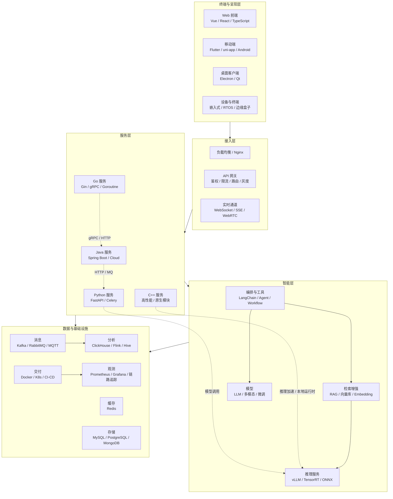

# JD 技术图谱全景

> 职位描述分类、应用场景、项目路线和架构图请先阅读：[12-职位描述分类与项目落地地图](./12-职位描述分类与项目落地地图.md)。

> **数据基础**：243 份真实招聘职位描述（JD）全文抽取，2026-10-18 采集、10-19 合并。
> **规模**：532 个技术/能力术语 + 253 个产品/系统/平台，去重合并后共 **612 个统一实体**（其中 161 项既是技术也是产品）。
> **已去除公司信息**：JD 原文摘录中的公司名统一替换为〔公司〕。
> **本篇由原《00-技术图谱总览》《11-JD技术栈全景术语表》《12-JD产品全景与技术要求图谱》三份合并去重而成**，
> 术语与产品维度重叠的实体（如 MySQL、Docker、Kafka）已合并为单一条目并标注类型。

---

## 一、数据来源与口径

| 项目 | 说明 |
|------|------|
| JD 总数 | 243 份（职位收藏，已剔除失效与噪声条目） |
| 抽取方式 | 自建词典全文扫描；英文术语用词边界正则，避免 Go/Google 之类误匹配 |
| 术语维度 | 532 项，18 个类别（语言、框架、中间件、架构、安全……） |
| 产品维度 | 253 项，11 个类别（企业系统、AI 平台、流媒体、工业硬件……） |
| 去重规则 | 同名实体合并，篇数取最大，类型标注为『技术』『产品』或『技术·产品』 |
| 共现分析 | 统计与某实体出现在同一份 JD 中的技术词，用于推断『还要会什么』 |

---

## 二、三个核心判断

**1. AI 已从加分项变成基线要求**

`大模型 / Agent / RAG / Prompt` 共出现在 33% 的 JD 中，且 AI 类 JD 里同时要求 Python + Docker + MySQL + Redis 的比例很高。
企业要的不是算法研究员，而是**能把模型接进业务系统的工程角色**。

**2. 工程底座高度趋同**

高并发 46%、数据库 45%、中间件 33%、云原生 25%。无论岗位叫 Java 工程师还是 AI 全栈，
落到考核层面都是同一套：微服务拆分、消息队列削峰、缓存一致性、容器化交付、可观测性。

**3. 底层能力重新值钱**

C/C++ 28%、嵌入式 20%、音视频 11%、机器人 13%，薪资中位数不低于纯应用层，
且集中在硬件/智造产业带——端侧算力、边缘推理、设备接入是共同抓手。

---

## 三、方向分布速览

| 方向 | JD 篇数 | 薪资均值 | 学历主流 | 经验主流 |
|------|--------|---------|---------|---------|
| AI 大模型应用工程 | 59 | 19-31K | 本科 | 3-5 年 |
| Go 云原生与高并发 | 69 | 20-32K | 本科 | 5 年以上 |
| Java 微服务后端 | 56 | 17-28K | 本科 | 5 年以上 |
| 前端与全栈 | 51 | 18-29K | 本科 | 5 年以上 |
| C/C++ 系统软件 | 40 | 18-31K | 本科 | 3-5 年 |
| Python 工程化与算法服务 | 31 | 19-29K | 本科 | 5 年以上 |
| 嵌入式 Linux 与边缘计算 | 30 | 19-32K | 本科 | 5 年以上 |
| 音视频与流媒体 | 16 | 20-33K | 本科 | 5 年以上 |
| 数据平台与实时计算 | 14 | 20-33K | 本科 | 3-5 年 |
| 机器人与智能硬件 | 14 | 20-35K | 本科 | 3 年以上 |

> 一个 JD 常横跨多个方向（如 AI 全栈同时命中 AI、前端、云原生），故各方向篇数之和大于 243。

**后续专项补充（未计入上述原始统计）**：[11 · 硬件工程师与充电桩硬件设计](11-硬件工程师与充电桩硬件设计.md)，基于两份指定 JD，覆盖通用硬件、SoC/MCU、交流充电控制、EMC、认证与量产。

---

## 四、全局技术关联图

### 三个关键连接点

| 连接 | 说明 | JD 中的信号 |
|------|------|------------|
| Go ⇄ Java | 两套服务共存，通过 gRPC 或 REST 互通而非一次性重写 | Go 类 JD 中 49 篇同时出现 Java |
| Python ⇄ 推理服务 | Python 负责编排与数据，重算力交给 vLLM / TensorRT | AI 类 JD 中 FastAPI 与 vLLM 高频共现 |
| C++ ⇄ 边缘设备 | 端侧受算力功耗约束，量化模型常由 C++ 运行时加载 | 嵌入式 JD 中 RTOS 与模型量化同时出现 |

---

## 五、统一实体总排行 Top 150

> 术语与产品已去重合并：**类型列**标注该实体属于技术、产品，还是两者兼具。

| # | 实体 | 篇数 | 占比 | 类型 | 所属类别 |
|---|------|------|------|------|----------|
| 1 | **Java** | 106 | 43% | 技术 | 语言 |
| 2 | **MySQL** | 92 | 37% | 技术·产品 | 数据库与存储、中间件与基础设施 |
| 3 | **Python** | 88 | 36% | 技术 | 语言 |
| 4 | **架构设计** | 84 | 34% | 技术 | 架构与设计 |
| 5 | **Redis** | 69 | 28% | 技术·产品 | 数据库与存储、中间件与基础设施 |
| 6 | **Linux** | 64 | 26% | 产品 | 操作系统与运行时 |
| 7 | **性能优化** | 62 | 25% | 技术 | 架构与设计 |
| 8 | **C++** | 58 | 23% | 技术 | 语言 |
| 9 | **Docker** | 58 | 23% | 技术·产品 | 云容器与DevOps、中间件与基础设施 |
| 10 | **SQL** | 54 | 22% | 技术 | 语言 |
| 11 | **大模型** | 53 | 21% | 技术 | AI与机器学习 |
| 12 | **Spring** | 49 | 20% | 技术 | 后端框架 |
| 13 | **规划** | 48 | 19% | 技术 | 软技能 |
| 14 | **微服务** | 47 | 19% | 技术 | 架构与设计 |
| 15 | **团队协作** | 46 | 18% | 技术 | 软技能 |
| 16 | **Agent** | 45 | 18% | 技术 | AI与机器学习 |
| 17 | **ERP** | 43 | 17% | 技术·产品 | 业务领域、企业业务系统 |
| 18 | **高并发** | 42 | 17% | 技术 | 架构与设计 |
| 19 | **方案设计** | 42 | 17% | 技术 | 架构与设计 |
| 20 | **沟通能力** | 38 | 15% | 技术 | 软技能 |
| 21 | **Go** | 36 | 14% | 技术 | 语言 |
| 22 | **技术文档** | 36 | 14% | 技术 | 工程化与质量 |
| 23 | **RAG** | 35 | 14% | 技术 | AI与机器学习 |
| 24 | **RESTful** | 35 | 14% | 技术 | 协议与接口 |
| 25 | **需求分析** | 35 | 14% | 技术 | 软技能 |
| 26 | **React** | 34 | 13% | 技术·产品 | 前端框架与UI、前端与低代码产品 |
| 27 | **PostgreSQL** | 34 | 13% | 技术·产品 | 数据库与存储、中间件与基础设施 |
| 28 | **嵌入式** | 34 | 13% | 技术 | 嵌入式与硬件 |
| 29 | **责任心** | 34 | 13% | 技术 | 软技能 |
| 30 | **实施** | 32 | 13% | 技术 | 业务领域 |
| 31 | **CI/CD** | 31 | 12% | 技术 | 云容器与DevOps |
| 32 | **多线程** | 31 | 12% | 技术 | 架构与设计 |
| 33 | **TCP** | 30 | 12% | 技术 | 协议与接口 |
| 34 | **Spring Boot** | 29 | 11% | 技术 | 后端框架 |
| 35 | **Claude** | 29 | 11% | 技术·产品 | AI与机器学习、AI平台与工具 |
| 36 | **Git** | 29 | 11% | 技术·产品 | 工程化与质量、开发与协作工具 |
| 37 | **培训** | 29 | 11% | 技术 | 软技能 |
| 38 | **合规** | 27 | 11% | 技术 | 安全与合规 |
| 39 | **重构** | 27 | 11% | 技术 | 工程化与质量 |
| 40 | **MES** | 27 | 11% | 技术·产品 | 业务领域、企业业务系统 |
| 41 | **Vue** | 26 | 10% | 技术·产品 | 前端框架与UI、前端与低代码产品 |
| 42 | **高可用** | 26 | 10% | 技术 | 架构与设计 |
| 43 | **供应链** | 26 | 10% | 技术 | 业务领域 |
| 44 | **单元测试** | 25 | 10% | 技术 | 工程化与质量 |
| 45 | **Cursor** | 25 | 10% | 产品 | AI平台与工具 |
| 46 | **APP** | 25 | 10% | 产品 | 前端与低代码产品 |
| 47 | **容器化** | 24 | 9% | 技术 | 云容器与DevOps |
| 48 | **日志** | 24 | 9% | 技术 | 工程化与质量 |
| 49 | **知识库** | 24 | 9% | 产品 | AI平台与工具 |
| 50 | **Kafka** | 23 | 9% | 技术·产品 | 消息与中间件、中间件与基础设施 |
| 51 | **技术选型** | 23 | 9% | 技术 | 架构与设计 |
| 52 | **跨部门** | 23 | 9% | 技术 | 软技能 |
| 53 | **智能体** | 22 | 9% | 技术 | AI与机器学习 |
| 54 | **HTTP** | 22 | 9% | 技术 | 协议与接口 |
| 55 | **Codex** | 22 | 9% | 产品 | AI平台与工具 |
| 56 | **C#** | 21 | 8% | 技术 | 语言 |
| 57 | **MyBatis** | 21 | 8% | 技术 | 后端框架 |
| 58 | **Claude Code** | 21 | 8% | 产品 | AI平台与工具 |
| 59 | **Node.js** | 20 | 8% | 技术 | 语言 |
| 60 | **LLM** | 20 | 8% | 技术 | AI与机器学习 |
| 61 | **财务** | 20 | 8% | 技术 | 业务领域 |
| 62 | **电商** | 20 | 8% | 技术 | 业务领域 |
| 63 | **WebSocket** | 19 | 7% | 技术 | 协议与接口 |
| 64 | **WMS** | 19 | 7% | 技术·产品 | 业务领域、企业业务系统 |
| 65 | **库存** | 19 | 7% | 技术 | 业务领域 |
| 66 | **文档编写** | 19 | 7% | 技术 | 软技能 |
| 67 | **Spring Cloud** | 18 | 7% | 技术 | 后端框架 |
| 68 | **LangChain** | 18 | 7% | 技术·产品 | AI与机器学习、AI平台与工具 |
| 69 | **Prompt** | 18 | 7% | 技术 | AI与机器学习 |
| 70 | **英语** | 18 | 7% | 技术 | 软技能 |
| 71 | **FastAPI** | 17 | 6% | 技术 | 后端框架 |
| 72 | **Android** | 17 | 6% | 技术·产品 | 移动端、操作系统与运行时 |
| 73 | **Oracle** | 17 | 6% | 技术·产品 | 数据库与存储、中间件与基础设施 |
| 74 | **Kubernetes** | 17 | 6% | 技术·产品 | 云容器与DevOps、中间件与基础设施 |
| 75 | **K8s** | 17 | 6% | 技术 | 云容器与DevOps |
| 76 | **SPI** | 17 | 6% | 技术 | 嵌入式与硬件 |
| 77 | **代码评审** | 17 | 6% | 技术 | 工程化与质量 |
| 78 | **SaaS** | 17 | 6% | 技术 | 架构与设计 |
| 79 | **异步** | 17 | 6% | 技术 | 架构与设计 |
| 80 | **TypeScript** | 16 | 6% | 技术 | 语言 |
| 81 | **RabbitMQ** | 16 | 6% | 技术·产品 | 消息与中间件、中间件与基础设施 |
| 82 | **SDK** | 16 | 6% | 技术 | 协议与接口 |
| 83 | **订单** | 16 | 6% | 技术 | 业务领域 |
| 84 | **学习能力** | 16 | 6% | 技术 | 软技能 |
| 85 | **Golang** | 15 | 6% | 技术 | 语言 |
| 86 | **SQL Server** | 15 | 6% | 技术·产品 | 数据库与存储、中间件与基础设施 |
| 87 | **MongoDB** | 15 | 6% | 技术·产品 | 数据库与存储、中间件与基础设施 |
| 88 | **MQTT** | 15 | 6% | 技术·产品 | 消息与中间件、中间件与基础设施 |
| 89 | **报表** | 15 | 6% | 技术 | 大数据与数据平台 |
| 90 | **I2C** | 15 | 6% | 技术 | 嵌入式与硬件 |
| 91 | **设计文档** | 15 | 6% | 技术 | 工程化与质量 |
| 92 | **限流** | 15 | 6% | 技术 | 架构与设计 |
| 93 | **抽象** | 15 | 6% | 技术 | 架构与设计 |
| 94 | **支付** | 15 | 6% | 技术 | 业务领域 |
| 95 | **上位机** | 15 | 6% | 产品 | 前端与低代码产品 |
| 96 | **JVM** | 15 | 6% | 产品 | 操作系统与运行时 |
| 97 | **设计模式** | 14 | 5% | 技术 | 架构与设计 |
| 98 | **锁** | 14 | 5% | 技术 | 架构与设计 |
| 99 | **Copilot** | 14 | 5% | 产品 | AI平台与工具 |
| 100 | **C语言** | 13 | 5% | 技术 | 语言 |
| 101 | **JavaScript** | 13 | 5% | 技术 | 语言 |
| 102 | **SpringBoot** | 13 | 5% | 技术 | 后端框架 |
| 103 | **向量数据库** | 13 | 5% | 技术 | 数据库与存储 |
| 104 | **MCP** | 13 | 5% | 技术 | AI与机器学习 |
| 105 | **串口** | 13 | 5% | 技术 | 嵌入式与硬件 |
| 106 | **CAN** | 13 | 5% | 技术 | 嵌入式与硬件 |
| 107 | **运动控制** | 13 | 5% | 技术 | 嵌入式与硬件 |
| 108 | **Qt** | 13 | 5% | 技术 | 桌面与客户端 |
| 109 | **客户端** | 13 | 5% | 技术·产品 | 桌面与客户端、前端与低代码产品 |
| 110 | **GitHub** | 13 | 5% | 技术·产品 | 工程化与质量、开发与协作工具 |
| 111 | **抗压** | 13 | 5% | 技术 | 软技能 |
| 112 | **Nginx** | 12 | 4% | 技术·产品 | 云容器与DevOps、中间件与基础设施 |
| 113 | **Modbus** | 12 | 4% | 技术 | 嵌入式与硬件 |
| 114 | **集成测试** | 12 | 4% | 技术 | 工程化与质量 |
| 115 | **接口文档** | 12 | 4% | 技术 | 工程化与质量 |
| 116 | **Django** | 11 | 4% | 技术 | 后端框架 |
| 117 | **Flutter** | 11 | 4% | 技术·产品 | 前端框架与UI、前端与低代码产品 |
| 118 | **BI** | 11 | 4% | 技术·产品 | 大数据与数据平台、数据与BI产品 |
| 119 | **ARM** | 11 | 4% | 技术 | 嵌入式与硬件 |
| 120 | **电源** | 11 | 4% | 技术 | 嵌入式与硬件 |
| 121 | **中台** | 11 | 4% | 技术 | 架构与设计 |
| 122 | **重试** | 11 | 4% | 技术 | 架构与设计 |
| 123 | **CRM** | 11 | 4% | 技术·产品 | 业务领域、企业业务系统 |
| 124 | **OA** | 11 | 4% | 技术·产品 | 业务领域、企业业务系统 |
| 125 | **PLM** | 11 | 4% | 技术·产品 | 业务领域、企业业务系统 |
| 126 | **项目管理** | 11 | 4% | 技术 | 业务领域 |
| 127 | **出差** | 11 | 4% | 技术 | 软技能 |
| 128 | **数据采集** | 11 | 4% | 产品 | IoT与边缘平台 |
| 129 | **流水线** | 10 | 4% | 技术 | 云容器与DevOps |
| 130 | **DeepSeek** | 10 | 4% | 技术·产品 | AI与机器学习、AI平台与工具 |
| 131 | **微调** | 10 | 4% | 技术 | AI与机器学习 |
| 132 | **多模态** | 10 | 4% | 技术 | AI与机器学习 |
| 133 | **RTOS** | 10 | 4% | 技术 | 嵌入式与硬件 |
| 134 | **中断** | 10 | 4% | 技术 | 嵌入式与硬件 |
| 135 | **OTA** | 10 | 4% | 技术 | 嵌入式与硬件 |
| 136 | **蓝牙** | 10 | 4% | 技术·产品 | 嵌入式与硬件、IoT与边缘平台 |
| 137 | **金蝶** | 10 | 4% | 技术·产品 | 业务领域、信创与国产化 |
| 138 | **金融** | 10 | 4% | 技术 | 业务领域 |
| 139 | **内核** | 10 | 4% | 产品 | 操作系统与运行时 |
| 140 | **移动端** | 9 | 3% | 技术 | 移动端 |
| 141 | **DevOps** | 9 | 3% | 技术 | 云容器与DevOps |
| 142 | **数据同步** | 9 | 3% | 技术 | 大数据与数据平台 |
| 143 | **模型部署** | 9 | 3% | 技术 | AI与机器学习 |
| 144 | **GPU** | 9 | 3% | 技术 | AI与机器学习 |
| 145 | **编解码** | 9 | 3% | 技术 | 音视频与流媒体 |
| 146 | **单片机** | 9 | 3% | 技术·产品 | 嵌入式与硬件、工业与硬件产品 |
| 147 | **PCB** | 9 | 3% | 技术 | 嵌入式与硬件 |
| 148 | **固件** | 9 | 3% | 技术 | 嵌入式与硬件 |
| 149 | **接口对接** | 9 | 3% | 技术 | 协议与接口 |
| 150 | **权限控制** | 9 | 3% | 技术 | 安全与合规 |

---

## 六、技术栈全景（18 个类别 · 532 项）

> 按技术/能力维度分类。带 ★ 者同时被归类为产品，其产品侧信息见第七部分。

### 语言（19 项）

| 术语 | 篇数 | 占比 | 标记 |
|------|------|------|------|
| Java | 106 | 43% | |
| Python | 88 | 36% | |
| C++ | 58 | 23% | |
| SQL | 54 | 22% | |
| Go | 36 | 14% | |
| C# | 21 | 8% | |
| Node.js | 20 | 8% | |
| TypeScript | 16 | 6% | |
| Golang | 15 | 6% | |
| C语言 | 13 | 5% | |
| JavaScript | 13 | 5% | |
| Shell | 6 | 2% | |
| Kotlin | 5 | 2% | |
| PHP | 4 | 1% | |
| Rust | 3 | 1% | |
| Lua | 3 | 1% | |
| Dart | 3 | 1% | |
| Swift | 2 | 0% | |
| LabVIEW | 1 | 0% | ★ |

### 后端框架（23 项）

| 术语 | 篇数 | 占比 | 标记 |
|------|------|------|------|
| Spring | 49 | 20% | |
| Spring Boot | 29 | 11% | |
| MyBatis | 21 | 8% | |
| Spring Cloud | 18 | 7% | |
| FastAPI | 17 | 6% | |
| SpringBoot | 13 | 5% | |
| Django | 11 | 4% | |
| gRPC | 8 | 3% | ★ |
| Gin | 7 | 2% | |
| Flask | 7 | 2% | |
| RPC | 7 | 2% | |
| Dubbo | 6 | 2% | ★ |
| Spring MVC | 5 | 2% | |
| MyBatis-Plus | 5 | 2% | |
| NestJS | 4 | 1% | |
| Hibernate | 3 | 1% | |
| JPA | 2 | 0% | |
| Netty | 2 | 0% | ★ |
| Celery | 2 | 0% | |
| Express | 2 | 0% | |
| Echo | 1 | 0% | |
| go-zero | 1 | 0% | |
| Fastify | 1 | 0% | |

### 前端框架与UI（27 项）

| 术语 | 篇数 | 占比 | 标记 |
|------|------|------|------|
| React | 34 | 13% | ★ |
| Vue | 26 | 10% | ★ |
| Flutter | 11 | 4% | ★ |
| Next.js | 6 | 2% | |
| 低代码 | 6 | 2% | ★ |
| jQuery | 4 | 1% | |
| Vite | 4 | 1% | |
| 小程序 | 4 | 1% | ★ |
| H5 | 4 | 1% | ★ |
| Vue3 | 3 | 1% | |
| Element UI | 3 | 1% | ★ |
| Ant Design | 3 | 1% | ★ |
| 组件化 | 3 | 1% | |
| Webpack | 2 | 0% | |
| Electron | 2 | 0% | ★ |
| Tauri | 2 | 0% | ★ |
| ECharts | 2 | 0% | ★ |
| Three.js | 2 | 0% | ★ |
| 响应式 | 2 | 0% | |
| Nuxt | 1 | 0% | |
| ESLint | 1 | 0% | |
| uni-app | 1 | 0% | ★ |
| WebGL | 1 | 0% | |
| SVG | 1 | 0% | |
| 微前端 | 1 | 0% | ★ |
| qiankun | 1 | 0% | ★ |
| 拖拽 | 1 | 0% | |

### 移动端（13 项）

| 术语 | 篇数 | 占比 | 标记 |
|------|------|------|------|
| Android | 17 | 6% | ★ |
| 移动端 | 9 | 3% | |
| iOS | 8 | 3% | ★ |
| Kotlin | 5 | 2% | |
| Framework | 4 | 1% | |
| App开发 | 3 | 1% | |
| 鸿蒙 | 3 | 1% | ★ |
| Swift | 2 | 0% | |
| React Native | 2 | 0% | |
| Uniapp | 2 | 0% | |
| Jetpack | 1 | 0% | |
| JNI | 1 | 0% | |
| APK | 1 | 0% | |

### 数据库与存储（21 项）

| 术语 | 篇数 | 占比 | 标记 |
|------|------|------|------|
| MySQL | 92 | 37% | ★ |
| Redis | 69 | 28% | ★ |
| PostgreSQL | 34 | 13% | ★ |
| Oracle | 17 | 6% | ★ |
| SQL Server | 15 | 6% | ★ |
| MongoDB | 15 | 6% | ★ |
| 向量数据库 | 13 | 5% | |
| Elasticsearch | 8 | 3% | ★ |
| Milvus | 7 | 2% | |
| pgvector | 5 | 2% | |
| SQLite | 4 | 1% | |
| ClickHouse | 4 | 1% | ★ |
| Doris | 2 | 0% | ★ |
| Neo4j | 2 | 0% | |
| MinIO | 2 | 0% | ★ |
| HBase | 1 | 0% | |
| InfluxDB | 1 | 0% | |
| 对象存储 | 1 | 0% | ★ |
| S3 | 1 | 0% | |
| 时序数据库 | 1 | 0% | |
| 图数据库 | 1 | 0% | |

### 消息与中间件（14 项）

| 术语 | 篇数 | 占比 | 标记 |
|------|------|------|------|
| Kafka | 23 | 9% | ★ |
| RabbitMQ | 16 | 6% | ★ |
| MQTT | 15 | 6% | ★ |
| RocketMQ | 7 | 2% | ★ |
| Nacos | 4 | 1% | ★ |
| 定时任务 | 3 | 1% | |
| NATS | 2 | 0% | |
| Prometheus | 2 | 0% | ★ |
| Grafana | 2 | 0% | ★ |
| OpenTelemetry | 2 | 0% | ★ |
| ZooKeeper | 1 | 0% | ★ |
| XXL-JOB | 1 | 0% | ★ |
| Sentinel | 1 | 0% | ★ |
| Loki | 1 | 0% | ★ |

### 云容器与DevOps（30 项）

| 术语 | 篇数 | 占比 | 标记 |
|------|------|------|------|
| Docker | 58 | 23% | ★ |
| CI/CD | 31 | 12% | |
| 容器化 | 24 | 9% | |
| Kubernetes | 17 | 6% | ★ |
| K8s | 17 | 6% | |
| Nginx | 12 | 4% | ★ |
| 流水线 | 10 | 4% | |
| DevOps | 9 | 3% | |
| 灰度发布 | 7 | 2% | |
| 回滚 | 5 | 2% | |
| 资源调度 | 5 | 2% | |
| Jenkins | 4 | 1% | ★ |
| GitHub Actions | 3 | 1% | |
| 自动化部署 | 3 | 1% | |
| Helm | 2 | 0% | ★ |
| Istio | 2 | 0% | ★ |
| Service Mesh | 2 | 0% | |
| GitLab CI | 2 | 0% | |
| Terraform | 2 | 0% | ★ |
| Ingress | 2 | 0% | |
| 镜像 | 2 | 0% | |
| K3s | 1 | 0% | ★ |
| Envoy | 1 | 0% | ★ |
| ArgoCD | 1 | 0% | ★ |
| API网关 | 1 | 0% | ★ |
| Kong | 1 | 0% | ★ |
| APISIX | 1 | 0% | ★ |
| Operator | 1 | 0% | |
| 持续交付 | 1 | 0% | |
| 弹性伸缩 | 1 | 0% | |

### 大数据与数据平台（29 项）

| 术语 | 篇数 | 占比 | 标记 |
|------|------|------|------|
| 报表 | 15 | 6% | |
| BI | 11 | 4% | ★ |
| 数据同步 | 9 | 3% | |
| ETL | 7 | 2% | |
| Hadoop | 6 | 2% | |
| Flink | 6 | 2% | |
| 埋点 | 6 | 2% | |
| Spark | 5 | 2% | |
| 数据治理 | 5 | 2% | |
| 数据质量 | 5 | 2% | |
| 数据中台 | 3 | 1% | ★ |
| 元数据 | 3 | 1% | |
| 批处理 | 3 | 1% | |
| Hive | 2 | 0% | |
| 数据仓库 | 2 | 0% | ★ |
| 血缘 | 2 | 0% | |
| CDC | 2 | 0% | |
| 实时计算 | 2 | 0% | |
| Storm | 1 | 0% | |
| Trino | 1 | 0% | |
| Iceberg | 1 | 0% | |
| Hudi | 1 | 0% | |
| Airflow | 1 | 0% | ★ |
| OLAP | 1 | 0% | |
| Tableau | 1 | 0% | ★ |
| Superset | 1 | 0% | ★ |
| 离线计算 | 1 | 0% | |
| 流处理 | 1 | 0% | |
| 用户画像 | 1 | 0% | ★ |

### AI与机器学习（61 项）

| 术语 | 篇数 | 占比 | 标记 |
|------|------|------|------|
| 大模型 | 53 | 21% | |
| Agent | 45 | 18% | |
| RAG | 35 | 14% | |
| Claude | 29 | 11% | ★ |
| 智能体 | 22 | 9% | |
| LLM | 20 | 8% | |
| LangChain | 18 | 7% | ★ |
| Prompt | 18 | 7% | |
| MCP | 13 | 5% | |
| DeepSeek | 10 | 4% | ★ |
| 微调 | 10 | 4% | |
| 多模态 | 10 | 4% | |
| 模型部署 | 9 | 3% | |
| GPU | 9 | 3% | |
| LangGraph | 8 | 3% | ★ |
| PyTorch | 8 | 3% | |
| OpenCV | 8 | 3% | |
| ASR | 8 | 3% | |
| Llama | 6 | 2% | ★ |
| vLLM | 6 | 2% | ★ |
| Dify | 6 | 2% | ★ |
| 提示词 | 6 | 2% | |
| Embedding | 6 | 2% | |
| LlamaIndex | 5 | 2% | ★ |
| Coze | 5 | 2% | ★ |
| TensorFlow | 5 | 2% | |
| 算力 | 5 | 2% | |
| GPT | 4 | 1% | ★ |
| Qwen | 4 | 1% | ★ |
| Gemini | 4 | 1% | ★ |
| LoRA | 4 | 1% | |
| 幻觉 | 4 | 1% | |
| OCR | 4 | 1% | ★ |
| TTS | 4 | 1% | |
| 通义千问 | 3 | 1% | ★ |
| 知识图谱 | 3 | 1% | |
| TensorRT | 3 | 1% | |
| 评测集 | 3 | 1% | |
| 语音识别 | 3 | 1% | ★ |
| NLP | 3 | 1% | |
| n8n | 2 | 0% | ★ |
| 模型量化 | 2 | 0% | |
| 推理加速 | 2 | 0% | |
| 推理优化 | 2 | 0% | |
| 目标检测 | 2 | 0% | |
| Whisper | 2 | 0% | |
| NPU | 2 | 0% | |
| 文心一言 | 1 | 0% | ★ |
| ChatGLM | 1 | 0% | |
| Ollama | 1 | 0% | ★ |
| P-Tuning | 1 | 0% | |
| Transformer | 1 | 0% | |
| ONNX | 1 | 0% | |
| ONNX Runtime | 1 | 0% | |
| 模型评估 | 1 | 0% | |
| YOLO | 1 | 0% | |
| 语义分割 | 1 | 0% | |
| 语音合成 | 1 | 0% | ★ |
| 自然语言处理 | 1 | 0% | |
| CUDA | 1 | 0% | |
| 显存 | 1 | 0% | |

### 音视频与流媒体（27 项）

| 术语 | 篇数 | 占比 | 标记 |
|------|------|------|------|
| 编解码 | 9 | 3% | |
| 低延迟 | 8 | 3% | |
| RTSP | 5 | 2% | ★ |
| 回放 | 4 | 1% | |
| 丢包 | 4 | 1% | |
| WebRTC | 3 | 1% | ★ |
| GB28181 | 3 | 1% | ★ |
| ONVIF | 3 | 1% | ★ |
| 转码 | 3 | 1% | |
| 推流 | 3 | 1% | |
| FFmpeg | 2 | 0% | ★ |
| RTMP | 2 | 0% | ★ |
| SIP | 2 | 0% | |
| 硬编 | 2 | 0% | |
| 帧率 | 2 | 0% | |
| 拉流 | 2 | 0% | |
| 预览 | 2 | 0% | |
| GStreamer | 1 | 0% | ★ |
| HTTP-FLV | 1 | 0% | |
| 切片 | 1 | 0% | |
| DTS | 1 | 0% | |
| 拥塞控制 | 1 | 0% | |
| ZLMediaKit | 1 | 0% | ★ |
| SRS | 1 | 0% | ★ |
| 多路 | 1 | 0% | |
| 对讲 | 1 | 0% | ★ |
| 云台 | 1 | 0% | ★ |

### 嵌入式与硬件（67 项）

| 术语 | 篇数 | 占比 | 标记 |
|------|------|------|------|
| 嵌入式 | 34 | 13% | |
| SPI | 17 | 6% | |
| I2C | 15 | 6% | |
| 串口 | 13 | 5% | |
| CAN | 13 | 5% | |
| 运动控制 | 13 | 5% | |
| Modbus | 12 | 4% | |
| ARM | 11 | 4% | |
| 电源 | 11 | 4% | |
| RTOS | 10 | 4% | |
| 中断 | 10 | 4% | |
| OTA | 10 | 4% | |
| 蓝牙 | 10 | 4% | ★ |
| 单片机 | 9 | 3% | ★ |
| PCB | 9 | 3% | |
| 固件 | 9 | 3% | |
| PLC | 8 | 3% | ★ |
| WiFi | 8 | 3% | |
| 电机 | 8 | 3% | |
| 原理图 | 8 | 3% | |
| RS485 | 7 | 2% | |
| 传感器 | 7 | 2% | ★ |
| RS232 | 6 | 2% | |
| STM32 | 5 | 2% | ★ |
| 4G | 5 | 2% | ★ |
| 5G | 5 | 2% | ★ |
| EtherCAT | 4 | 1% | |
| LoRa | 4 | 1% | ★ |
| ROS | 4 | 1% | |
| 示波器 | 4 | 1% | ★ |
| Yocto | 3 | 1% | ★ |
| OpenWrt | 3 | 1% | ★ |
| 伺服 | 3 | 1% | ★ |
| PID | 3 | 1% | |
| AGV | 3 | 1% | ★ |
| 逆变器 | 3 | 1% | ★ |
| 储能 | 3 | 1% | ★ |
| FreeRTOS | 2 | 0% | ★ |
| Zephyr | 2 | 0% | ★ |
| 交叉编译 | 2 | 0% | |
| 瑞芯微 | 2 | 0% | ★ |
| RK3588 | 2 | 0% | ★ |
| CANopen | 2 | 0% | |
| GPIO | 2 | 0% | |
| DMA | 2 | 0% | |
| CoAP | 2 | 0% | |
| IMU | 2 | 0% | ★ |
| ROS2 | 2 | 0% | |
| SLAM | 2 | 0% | |
| 路径规划 | 2 | 0% | |
| 数字孪生 | 2 | 0% | |
| 光伏 | 2 | 0% | ★ |
| 烧录 | 2 | 0% | |
| Linux驱动 | 1 | 0% | |
| U-Boot | 1 | 0% | ★ |
| 设备树 | 1 | 0% | |
| 全志 | 1 | 0% | ★ |
| Jetson | 1 | 0% | ★ |
| LwM2M | 1 | 0% | |
| ZigBee | 1 | 0% | ★ |
| GPS | 1 | 0% | ★ |
| 激光雷达 | 1 | 0% | ★ |
| AMR | 1 | 0% | ★ |
| 机械臂 | 1 | 0% | ★ |
| 充电桩 | 1 | 0% | ★ |
| BMS | 1 | 0% | ★ |
| 万用表 | 1 | 0% | ★ |

### 桌面与客户端（11 项）

| 术语 | 篇数 | 占比 | 标记 |
|------|------|------|------|
| Qt | 13 | 5% | |
| 客户端 | 13 | 5% | ★ |
| .NET | 6 | 2% | |
| WPF | 5 | 2% | |
| OpenGL | 4 | 1% | |
| MFC | 3 | 1% | |
| 安装包 | 2 | 0% | |
| QWidget | 1 | 0% | |
| QML | 1 | 0% | |
| WinForms | 1 | 0% | |
| 桌面应用 | 1 | 0% | ★ |

### 协议与接口（30 项）

| 术语 | 篇数 | 占比 | 标记 |
|------|------|------|------|
| RESTful | 35 | 14% | |
| TCP | 30 | 12% | |
| HTTP | 22 | 9% | |
| WebSocket | 19 | 7% | |
| SDK | 16 | 6% | |
| 接口对接 | 9 | 3% | |
| REST | 8 | 3% | |
| gRPC | 8 | 3% | ★ |
| UDP | 7 | 2% | |
| JSON | 6 | 2% | |
| HTTPS | 5 | 2% | |
| 开放平台 | 5 | 2% | |
| GraphQL | 3 | 1% | |
| Webhook | 3 | 1% | |
| FTP | 3 | 1% | |
| WebService | 3 | 1% | |
| 长连接 | 3 | 1% | |
| SSE | 2 | 0% | |
| OAuth2 | 2 | 0% | |
| JWT | 2 | 0% | |
| SSO | 2 | 0% | |
| SNMP | 2 | 0% | |
| OpenAPI | 2 | 0% | |
| 断线重连 | 2 | 0% | |
| CAS | 1 | 0% | |
| SMTP | 1 | 0% | |
| Protobuf | 1 | 0% | |
| SOAP | 1 | 0% | |
| Swagger | 1 | 0% | ★ |
| 心跳 | 1 | 0% | |

### 安全与合规（19 项）

| 术语 | 篇数 | 占比 | 标记 |
|------|------|------|------|
| 合规 | 27 | 11% | |
| 权限控制 | 9 | 3% | |
| HTTPS | 5 | 2% | |
| 等保 | 4 | 1% | ★ |
| TLS | 3 | 1% | |
| SSL | 3 | 1% | |
| RBAC | 3 | 1% | |
| 防火墙 | 3 | 1% | |
| 数据加密 | 3 | 1% | |
| 脱敏 | 2 | 0% | |
| 隐私保护 | 2 | 0% | |
| 国密 | 1 | 0% | |
| 密钥管理 | 1 | 0% | |
| 审计日志 | 1 | 0% | |
| 敏感信息 | 1 | 0% | |
| 渗透 | 1 | 0% | |
| 漏洞扫描 | 1 | 0% | |
| 网闸 | 1 | 0% | |
| 防泄密 | 1 | 0% | |

### 工程化与质量（39 项）

| 术语 | 篇数 | 占比 | 标记 |
|------|------|------|------|
| 技术文档 | 36 | 14% | |
| Git | 29 | 11% | ★ |
| 重构 | 27 | 11% | |
| 单元测试 | 25 | 10% | |
| 日志 | 24 | 9% | |
| 代码评审 | 17 | 6% | |
| 设计文档 | 15 | 6% | |
| GitHub | 13 | 5% | ★ |
| 集成测试 | 12 | 4% | |
| 接口文档 | 12 | 4% | |
| 灰度 | 9 | 3% | |
| 监控告警 | 8 | 3% | |
| 复盘 | 8 | 3% | |
| 编码规范 | 7 | 2% | |
| SVN | 5 | 2% | ★ |
| CMake | 5 | 2% | ★ |
| 压测 | 5 | 2% | |
| Maven | 3 | 1% | ★ |
| 覆盖率 | 3 | 1% | |
| 敏捷 | 3 | 1% | |
| Jira | 3 | 1% | ★ |
| GitLab | 2 | 0% | ★ |
| 压力测试 | 2 | 0% | |
| 性能测试 | 2 | 0% | |
| Selenium | 2 | 0% | ★ |
| Playwright | 2 | 0% | ★ |
| 容量规划 | 2 | 0% | |
| 技术债 | 2 | 0% | |
| Gradle | 1 | 0% | ★ |
| Make | 1 | 0% | |
| JUnit | 1 | 0% | |
| pytest | 1 | 0% | |
| Cypress | 1 | 0% | ★ |
| Confluence | 1 | 0% | ★ |
| TAPD | 1 | 0% | ★ |
| 禅道 | 1 | 0% | ★ |
| SLA | 1 | 0% | |
| SLO | 1 | 0% | |
| 故障演练 | 1 | 0% | |

### 架构与设计（51 项）

| 术语 | 篇数 | 占比 | 标记 |
|------|------|------|------|
| 架构设计 | 84 | 34% | |
| 性能优化 | 62 | 25% | |
| 微服务 | 47 | 19% | |
| 高并发 | 42 | 17% | |
| 方案设计 | 42 | 17% | |
| 多线程 | 31 | 12% | |
| 高可用 | 26 | 10% | |
| 技术选型 | 23 | 9% | |
| SaaS | 17 | 6% | |
| 异步 | 17 | 6% | |
| 限流 | 15 | 6% | |
| 抽象 | 15 | 6% | |
| 设计模式 | 14 | 5% | |
| 锁 | 14 | 5% | |
| 中台 | 11 | 4% | |
| 重试 | 11 | 4% | |
| 降级 | 9 | 3% | |
| 幂等 | 9 | 3% | |
| 低延迟 | 8 | 3% | |
| 负载均衡 | 8 | 3% | ★ |
| 熔断 | 7 | 2% | |
| 对账 | 7 | 2% | |
| 模块化 | 7 | 2% | |
| 分布式事务 | 6 | 2% | |
| 多租户 | 6 | 2% | |
| 分库分表 | 5 | 2% | |
| 分片 | 5 | 2% | |
| 超时 | 5 | 2% | |
| 容灾 | 5 | 2% | |
| 并发编程 | 5 | 2% | |
| 补偿 | 4 | 1% | |
| 解耦 | 4 | 1% | |
| GC | 4 | 1% | |
| 事件驱动 | 3 | 1% | |
| 读写分离 | 3 | 1% | |
| 边缘计算 | 3 | 1% | |
| 灾备 | 3 | 1% | |
| DDD | 2 | 0% | |
| 线程池 | 2 | 0% | |
| Serverless | 2 | 0% | |
| 无锁 | 2 | 0% | |
| 单体 | 1 | 0% | |
| SOA | 1 | 0% | |
| 领域建模 | 1 | 0% | |
| Saga | 1 | 0% | |
| 主从 | 1 | 0% | |
| 缓存穿透 | 1 | 0% | |
| 削峰 | 1 | 0% | |
| UML | 1 | 0% | |
| 时序图 | 1 | 0% | |
| 内存优化 | 1 | 0% | |

### 业务领域（35 项）

| 术语 | 篇数 | 占比 | 标记 |
|------|------|------|------|
| ERP | 43 | 17% | ★ |
| 实施 | 32 | 13% | |
| MES | 27 | 11% | ★ |
| 供应链 | 26 | 10% | |
| 财务 | 20 | 8% | |
| 电商 | 20 | 8% | |
| WMS | 19 | 7% | ★ |
| 库存 | 19 | 7% | |
| 订单 | 16 | 6% | |
| 支付 | 15 | 6% | |
| CRM | 11 | 4% | ★ |
| OA | 11 | 4% | ★ |
| PLM | 11 | 4% | ★ |
| 项目管理 | 11 | 4% | |
| 金蝶 | 10 | 4% | ★ |
| 金融 | 10 | 4% | |
| 物流 | 9 | 3% | |
| 医疗 | 9 | 3% | |
| 风控 | 8 | 3% | ★ |
| SAP | 7 | 2% | |
| 教育 | 6 | 2% | |
| 定制化 | 6 | 2% | |
| 用友 | 5 | 2% | ★ |
| 保险 | 5 | 2% | ★ |
| 智能制造 | 5 | 2% | |
| 产品化 | 5 | 2% | |
| HR | 3 | 1% | |
| 物联网平台 | 3 | 1% | ★ |
| 智慧城市 | 2 | 0% | ★ |
| 车联网 | 2 | 0% | ★ |
| 人力资源 | 1 | 0% | |
| HIS | 1 | 0% | ★ |
| 政务 | 1 | 0% | ★ |
| 新能源 | 1 | 0% | |
| 工业4.0 | 1 | 0% | |

### 软技能（16 项）

| 术语 | 篇数 | 占比 | 标记 |
|------|------|------|------|
| 规划 | 48 | 19% | |
| 团队协作 | 46 | 18% | |
| 沟通能力 | 38 | 15% | |
| 需求分析 | 35 | 14% | |
| 责任心 | 34 | 13% | |
| 培训 | 29 | 11% | |
| 跨部门 | 23 | 9% | |
| 文档编写 | 19 | 7% | |
| 英语 | 18 | 7% | |
| 学习能力 | 16 | 6% | |
| 抗压 | 13 | 5% | |
| 出差 | 11 | 4% | |
| 复盘 | 8 | 3% | |
| 带团队 | 2 | 0% | |
| owner | 2 | 0% | |
| 主动性 | 1 | 0% | |

---

## 七、产品全景与技术要求（11 个类别 · 253 项）

> 关联技术列 = 与该产品在同一批 JD 中共同出现的技术词（共现篇数），反映做这个产品通常还要会什么。
> 带 ★ 者同时在技术栈表中出现。

### 企业业务系统（37 项）

| 产品/系统 | 篇数 | 关联技术栈（共现篇数） | 标记 |
|----------|------|----------------------|------|
| **ERP** | 43 | Python(24)、MySQL(24)、Java(21)、SQL(21)、MES(18)、财务(17)、WMS(17)、Agent(16)、架构设计(16)、供应链(16) | ★ |
| **MES** | 27 | ERP(18)、WMS(12)、SQL(11)、MySQL(11)、实施(11)、规划(11)、Java(10)、Python(9)、供应链(8)、PLM(8) | ★ |
| **WMS** | 19 | ERP(17)、MES(12)、MySQL(9)、实施(9)、库存(9)、规划(9)、SQL(8)、供应链(8)、跨部门(7)、Java(6) | ★ |
| **CRM** | 11 | Java(6)、MySQL(6)、实施(6)、Python(4)、ERP(4)、MES(4)、供应链(4)、订单(4)、PLM(4)、沟通能力(4) | ★ |
| **PLM** | 11 | MES(8)、ERP(7)、实施(6)、财务(6)、规划(6)、跨部门(6)、WMS(5)、Java(4)、合规(4)、供应链(4) | ★ |
| **OA** | 11 | ERP(10)、MES(7)、财务(7)、SQL(6)、供应链(6)、Python(5)、Agent(5)、实施(5)、跨部门(5)、Java(4) | ★ |
| **风控** | 8 | MySQL(5)、架构设计(5)、高并发(5)、高可用(5)、Java(4)、Redis(4)、大模型(4)、微服务(4)、Python(3)、SQL(3) | ★ |
| **保险** | 5 | Python(3)、串口(3)、TCP(3)、SDK(3)、架构设计(3)、规划(3)、C++(2)、Flutter(2)、Electron(2)、Tauri(2) | ★ |
| **支付系统** | 4 | 支付(4)、Go(3)、Redis(3)、架构设计(3)、性能优化(3)、微服务(3)、高并发(3)、Golang(2)、React(2)、Flutter(2) | |
| **OMS** | 3 | Java(3)、MySQL(3)、订单(3)、Python(2)、MyBatis(2)、React(2)、Vue(2)、RESTful(2)、重构(2)、代码评审(2) | |
| **QMS** | 3 | MES(3)、WMS(3)、SQL(2)、C#(2)、Vue(2)、SQL Server(2)、接口对接(2)、方案设计(2)、ERP(2)、实施(2) | |
| **社交** | 3 | MySQL(3)、Redis(3)、Java(2)、Spring(2)、RESTful(2)、性能优化(2)、高并发(2)、多线程(2)、Go(1)、Dart(1) | |
| **储能** | 3 | CAN(2)、逆变器(2)、光伏(2)、接口文档(2)、Java(1)、C语言(1)、Spring(1)、Spring Boot(1)、SpringBoot(1)、React(1) | ★ |
| **SRM** | 2 | ERP(2)、MES(2)、WMS(2)、库存(2)、金蝶(2)、SQL(1)、C#(1)、Vue(1)、jQuery(1)、ECharts(1) | |
| **APS** | 2 | MySQL(2)、Redis(2)、ERP(2)、实施(2)、MES(2)、WMS(2)、Python(1)、C++(1)、SQL(1)、C#(1) | |
| **进销存** | 2 | 沟通能力(2)、Java(1)、SQL(1)、Spring(1)、Spring Boot(1)、Spring Cloud(1)、RPC(1)、MySQL(1)、Redis(1)、Oracle(1) | |
| **养老** | 2 | 医疗(2)、保险(2)、Java(1)、Python(1)、SQL(1)、Go(1)、C#(1)、Node.js(1)、React(1)、Vue(1) | |
| **智慧城市** | 2 | Java(2)、Python(2)、React(2)、Docker(2)、大模型(2)、Agent(2)、智能体(2)、WebSocket(2)、Go(1)、TypeScript(1) | ★ |
| **安防** | 2 | Java(2)、Kotlin(2)、RTSP(2)、C++(1)、Dart(1)、Swift(1)、Flutter(1)、Android(1)、iOS(1)、App开发(1) | |
| **证券** | 2 | Java(2)、架构设计(2)、性能优化(2)、高可用(2)、容灾(2)、规划(2)、沟通能力(2)、C++(1)、SQL(1)、Go(1) | |
| **车联网** | 2 | OTA(2)、Java(1)、Python(1)、C++(1)、Go(1)、Spring(1)、Spring Boot(1)、Django(1)、Flask(1)、MySQL(1) | ★ |
| **光伏** | 2 | 储能(2)、Java(1)、C语言(1)、Spring(1)、Spring Boot(1)、SpringBoot(1)、React(1)、Vue(1)、Flutter(1)、小程序(1) | ★ |
| **实验室** | 2 | Java(1)、Python(1)、Go(1)、Golang(1)、React(1)、Vue(1)、Three.js(1)、WebGL(1)、MongoDB(1)、Docker(1) | |
| **财务系统** | 1 | Java(1)、Python(1)、SQL(1)、Go(1)、Spring(1)、Spring Boot(1)、MyBatis(1)、Spring Cloud(1)、MySQL(1)、Redis(1) | |
| **客服系统** | 1 | Java(1)、Python(1)、C++(1)、MySQL(1)、PostgreSQL(1)、MongoDB(1)、大模型(1)、RAG(1)、微调(1)、多模态(1) | |
| **直播** | 1 | SQL(1)、Go(1)、Golang(1)、Lua(1)、gRPC(1)、Gin(1)、React(1)、Flutter(1)、H5(1)、iOS(1) | |
| **即时通讯** | 1 | Java(1)、SQL(1)、Lua(1)、Spring(1)、Spring Cloud(1)、RPC(1)、Dubbo(1)、MySQL(1)、Redis(1)、PostgreSQL(1) | |
| **HIS** | 1 | Java(1)、Python(1)、Go(1)、Docker(1)、容器化(1)、回滚(1)、自动化部署(1)、大模型(1)、Agent(1)、RAG(1) | ★ |
| **EMR** | 1 | Java(1)、Python(1)、Go(1)、Docker(1)、容器化(1)、回滚(1)、自动化部署(1)、大模型(1)、Agent(1)、RAG(1) | |
| **政务** | 1 | Java(1)、Python(1)、向量数据库(1)、Flink(1)、Spark(1)、大模型(1)、Agent(1)、RAG(1)、智能体(1)、LangChain(1) | ★ |
| **溯源** | 1 | Python(1)、C++(1)、C#(1)、FastAPI(1)、RPC(1)、Framework(1)、MySQL(1)、Redis(1)、PostgreSQL(1)、Oracle(1) | |
| **银行核心** | 1 | Java(1)、Spring(1)、Spring Boot(1)、MySQL(1)、Redis(1)、Claude(1)、MCP(1)、微服务(1)、高并发(1)、高可用(1) | |
| **充电桩** | 1 | Claude(1)、算力(1)、NPU(1)、嵌入式(1)、电源(1)、蓝牙(1)、PCB(1)、原理图(1)、RS485(1)、STM32(1) | ★ |
| **BMS** | 1 | CAN(1)、Modbus(1)、RS485(1)、逆变器(1)、储能(1)、等保(1)、技术文档(1)、接口文档(1)、单体(1) | ★ |
| **EMS** | 1 | CAN(1)、Modbus(1)、RS485(1)、逆变器(1)、储能(1)、BMS(1)、等保(1)、技术文档(1)、接口文档(1)、单体(1) | |
| **电子病历** | 1 | Java(1)、Python(1)、Go(1)、Docker(1)、容器化(1)、回滚(1)、自动化部署(1)、大模型(1)、Agent(1)、RAG(1) | |
| **题库** | 1 | 向量数据库(1)、镜像(1)、批处理(1)、大模型(1)、Agent(1)、RAG(1)、LLM(1)、LangChain(1)、模型部署(1)、GPU(1) | |

### 工业与硬件产品（28 项）

| 产品/系统 | 篇数 | 关联技术栈（共现篇数） | 标记 |
|----------|------|----------------------|------|
| **单片机** | 9 | 嵌入式(6)、C++(4)、SPI(3)、I2C(3)、RTOS(3)、原理图(3)、TCP(3)、C语言(2)、ARM(2)、RS485(2) | ★ |
| **PLC** | 8 | C#(7)、MySQL(6)、TCP(6)、C++(5)、运动控制(5)、Modbus(5)、MES(5)、SQL(4)、SQL Server(4)、串口(3) | ★ |
| **传感器** | 7 | C++(6)、嵌入式(6)、运动控制(4)、Python(2)、C#(2)、OpenCV(2)、ARM(2)、WiFi(2)、STM32(2)、PID(2) | ★ |
| **STM32** | 5 | 嵌入式(4)、C++(3)、ARM(3)、CAN(2)、运动控制(2)、电源(2)、蓝牙(2)、RS485(2)、传感器(2)、团队协作(2) | ★ |
| **示波器** | 4 | SPI(2)、I2C(2)、单片机(2)、TCP(2) | ★ |
| **AGV** | 3 | Java(2)、Python(2)、C++(2)、MySQL(2)、WMS(2)、规划(2)、SQL(1)、C#(1)、Spring(1)、SQL Server(1) | ★ |
| **伺服** | 3 | 电机(3)、C++(2)、运动控制(2)、Modbus(2)、EtherCAT(2)、责任心(2)、出差(2)、Python(1)、C#(1)、C语言(1) | ★ |
| **工业相机** | 3 | C#(3)、串口(3)、运动控制(3)、TCP(3)、C++(2)、Modbus(2)、PLC(2)、SDK(2)、多线程(2)、MES(2) | |
| **逆变器** | 3 | CAN(2)、储能(2)、C语言(1)、嵌入式(1)、SPI(1)、I2C(1)、Modbus(1)、ARM(1)、电源(1)、电机(1) | ★ |
| **西门子** | 2 | Java(2)、C++(2)、设计文档(2)、团队协作(2)、Python(1)、SQL(1)、C#(1)、JavaScript(1)、jQuery(1)、MySQL(1) | |
| **步进电机** | 2 | C++(2)、电机(2)、C#(1)、低延迟(1)、嵌入式(1)、串口(1)、CAN(1)、运动控制(1)、ARM(1)、RTOS(1) | |
| **IMU** | 2 | C++(2)、运动控制(2)、传感器(2)、ROS2(2)、Python(1)、Redis(1)、PyTorch(1)、目标检测(1)、低延迟(1)、嵌入式(1) | ★ |
| **瑞芯微** | 2 | 架构设计(2)、Python(1)、C++(1)、Android(1)、Framework(1)、SQLite(1)、Docker(1)、模型部署(1)、OpenCV(1)、ASR(1) | ★ |
| **RK3588** | 2 | Jetpack(1)、Claude(1)、算力(1)、NPU(1)、DTS(1)、嵌入式(1)、SPI(1)、I2C(1)、CAN(1)、电源(1) | ★ |
| **三菱** | 1 | Java(1)、Python(1)、C++(1)、SQL(1)、C#(1)、MySQL(1)、SQL Server(1)、OpenCV(1)、OCR(1)、串口(1) | |
| **欧姆龙** | 1 | Java(1)、Python(1)、C++(1)、SQL(1)、C#(1)、MySQL(1)、SQL Server(1)、OpenCV(1)、OCR(1)、串口(1) | |
| **LabVIEW** | 1 | Python(1)、报表(1)、运动控制(1)、Modbus(1)、电机(1)、RS232(1)、EtherCAT(1)、伺服(1)、TCP(1)、接口文档(1) | ★ |
| **万用表** | 1 | 嵌入式(1)、串口(1)、Modbus(1)、单片机(1)、RS485(1)、RS232(1)、4G(1)、示波器(1)、TCP(1)、UDP(1) | ★ |
| **AMR** | 1 | Python(1)、C++(1)、嵌入式(1)、ROS(1)、AGV(1)、SLAM(1)、路径规划(1)、Git(1)、CMake(1)、性能优化(1) | ★ |
| **机械臂** | 1 | Python(1)、C++(1)、Redis(1)、PyTorch(1)、目标检测(1)、运动控制(1)、传感器(1)、ROS(1)、IMU(1)、ROS2(1) | ★ |
| **变频器** | 1 | C++(1)、C语言(1)、嵌入式(1)、运动控制(1)、Modbus(1)、电机(1)、EtherCAT(1)、伺服(1)、CANopen(1)、客户端(1) | |
| **海康** | 1 | C#(1)、OCR(1)、串口(1)、运动控制(1)、TCP(1)、SDK(1)、医疗(1)、保险(1)、责任心(1)、培训(1) | |
| **激光雷达** | 1 | Python(1)、C++(1)、Redis(1)、PyTorch(1)、目标检测(1)、运动控制(1)、传感器(1)、ROS(1)、IMU(1)、ROS2(1) | ★ |
| **Jetson** | 1 | Jetpack(1)、DTS(1)、SPI(1)、I2C(1)、CAN(1)、中断(1)、EtherCAT(1)、示波器(1)、RK3588(1)、GPIO(1) | ★ |
| **全志** | 1 | Android(1)、Framework(1)、固件(1)、瑞芯微(1)、客户端(1)、SDK(1)、架构设计(1)、性能优化(1) | ★ |
| **充电桩** | 1 | Claude(1)、算力(1)、NPU(1)、嵌入式(1)、电源(1)、蓝牙(1)、PCB(1)、原理图(1)、RS485(1)、STM32(1) | ★ |
| **BMS** | 1 | CAN(1)、Modbus(1)、RS485(1)、逆变器(1)、储能(1)、等保(1)、技术文档(1)、接口文档(1)、单体(1) | ★ |
| **仪表** | 1 | C#(1)、C语言(1)、I2C(1)、ARM(1)、电机(1)、RS485(1)、RS232(1)、WPF(1)、技术文档(1)、方案设计(1) | |

### AI平台与工具（37 项）

| 产品/系统 | 篇数 | 关联技术栈（共现篇数） | 标记 |
|----------|------|----------------------|------|
| **Claude** | 29 | Python(21)、Java(16)、Agent(16)、MySQL(15)、Spring(13)、Redis(13)、Docker(13)、Spring Boot(12)、大模型(12)、RAG(11) | ★ |
| **Cursor** | 25 | Python(18)、Claude(17)、Java(16)、MySQL(16)、Redis(13)、Agent(13)、大模型(11)、Go(10)、Spring(10)、Docker(10) | |
| **知识库** | 24 | RAG(21)、Python(19)、大模型(19)、Agent(19)、Java(11)、Docker(10)、LangChain(10)、架构设计(9)、ERP(9)、规划(9) | |
| **Codex** | 22 | Claude(18)、Python(15)、Agent(13)、Java(12)、MySQL(12)、Spring(10)、Redis(9)、Docker(9)、RAG(9)、架构设计(9) | |
| **Claude Code** | 21 | Claude(21)、Python(14)、MySQL(14)、Java(13)、Agent(13)、Redis(12)、Spring(11)、Spring Boot(10)、Docker(10)、React(9) | |
| **LangChain** | 18 | Python(16)、RAG(16)、大模型(15)、Agent(15)、智能体(10)、Prompt(10)、Java(9)、向量数据库(9)、Docker(9)、架构设计(9) | ★ |
| **Copilot** | 14 | Python(9)、Claude(9)、Java(8)、MySQL(8)、GitHub(7)、Redis(6)、Go(5)、React(5)、Prompt(5)、重构(5) | |
| **DeepSeek** | 10 | 大模型(8)、Agent(8)、Python(7)、RAG(7)、LLM(6)、架构设计(6)、Java(5)、Docker(5)、Redis(4)、向量数据库(4) | ★ |
| **LangGraph** | 8 | Python(8)、Agent(8)、RAG(6)、智能体(6)、大模型(5)、LangChain(5)、MCP(5)、FastAPI(4)、MySQL(4)、Docker(4) | ★ |
| **Dify** | 6 | Python(6)、大模型(6)、RAG(6)、Agent(5)、Java(4)、智能体(4)、LangChain(4)、Coze(4)、向量数据库(3)、MCP(3) | ★ |
| **vLLM** | 6 | 大模型(5)、Agent(4)、RAG(4)、Python(3)、FastAPI(3)、Redis(3)、PostgreSQL(3)、向量数据库(3)、Milvus(3)、Docker(3) | ★ |
| **Llama** | 6 | 大模型(6)、RAG(6)、Agent(5)、Python(4)、向量数据库(4)、Milvus(4)、LLM(4)、LangChain(4)、DeepSeek(4)、Qwen(4) | ★ |
| **智能客服** | 6 | Java(4)、Python(4)、大模型(4)、RAG(4)、C++(3)、MySQL(3)、微调(3)、多模态(3)、架构设计(3)、实施(3) | |
| **Coze** | 5 | Python(4)、大模型(4)、Agent(4)、RAG(4)、Dify(4)、Java(3)、智能体(3)、MCP(3)、LangGraph(3)、C#(2) | ★ |
| **LlamaIndex** | 5 | 大模型(5)、RAG(5)、LangChain(5)、Agent(4)、架构设计(4)、Java(3)、Python(3)、FastAPI(3)、向量数据库(3)、Docker(3) | ★ |
| **GPT** | 4 | 大模型(3)、RAG(3)、Prompt(3)、微调(3)、多模态(3)、Java(2)、Python(2)、FastAPI(2)、Agent(2)、智能体(2) | ★ |
| **Gemini** | 4 | Java(3)、Python(3)、Go(3)、CI/CD(3)、架构设计(3)、高并发(3)、Spring(2)、Redis(2)、Kafka(2)、Docker(2) | ★ |
| **Qwen** | 4 | Milvus(4)、大模型(4)、Agent(4)、RAG(4)、DeepSeek(4)、Llama(4)、Python(3)、向量数据库(3)、LLM(3)、LangChain(3) | ★ |
| **OCR** | 4 | Python(3)、Java(2)、C++(2)、SQL(2)、C#(2)、FastAPI(2)、MySQL(2)、Docker(2)、大模型(2)、Agent(2) | ★ |
| **通义千问** | 3 | Java(3)、MySQL(3)、大模型(3)、Agent(3)、DeepSeek(3)、RESTful(3)、Python(2)、Redis(2)、RAG(2)、技术文档(2) | ★ |
| **ChatGPT** | 3 | MySQL(2)、Claude(2)、重构(2)、架构设计(2)、高并发(2)、Java(1)、SQL(1)、Go(1)、Spring(1)、Redis(1) | |
| **数字人** | 3 | 大模型(2)、Agent(2)、Claude(2)、智能体(2)、RESTful(2)、规划(2)、Java(1)、Python(1)、Go(1)、Golang(1) | |
| **语音识别** | 3 | Docker(3)、Java(2)、Python(2)、大模型(2)、LLM(2)、模型部署(2)、ASR(2)、Git(2)、编码规范(2)、架构设计(2) | ★ |
| **n8n** | 2 | Java(2)、Python(2)、C#(2)、大模型(2)、Agent(2)、RAG(2)、智能体(2)、MCP(2)、LangGraph(2)、Dify(2) | ★ |
| **Trae** | 2 | Python(2)、C++(2)、Flutter(2)、Electron(2)、Tauri(2)、CI/CD(2)、流水线(2)、灰度发布(2)、CDC(2)、Claude(2) | |
| **Windsurf** | 2 | Java(2)、Python(2)、Go(2)、Prompt(2)、Node.js(1)、Golang(1)、React(1)、Vue(1)、Next.js(1)、Redis(1) | |
| **豆包** | 2 | 大模型(2)、DeepSeek(2)、Java(1)、Python(1)、SQL(1)、Spring(1)、Spring Boot(1)、MyBatis(1)、Spring Cloud(1)、MyBatis-Plus(1) | |
| **Ollama** | 1 | Java(1)、Python(1)、TypeScript(1)、Spring(1)、Spring Boot(1)、Spring Cloud(1)、FastAPI(1)、React(1)、Vue3(1)、MySQL(1) | ★ |
| **FastGPT** | 1 | Python(1)、Go(1)、Golang(1)、Vue3(1)、向量数据库(1)、Docker(1)、Hive(1)、大模型(1)、Agent(1)、RAG(1) | |
| **通义灵码** | 1 | Java(1)、Python(1)、TypeScript(1)、Spring(1)、Spring Boot(1)、Spring Cloud(1)、FastAPI(1)、React(1)、Vue3(1)、MySQL(1) | |
| **CodeBuddy** | 1 | Java(1)、SQL(1)、C#(1)、Spring(1)、MySQL(1)、Oracle(1)、SQL Server(1)、报表(1)、.NET(1)、REST(1) | |
| **文心一言** | 1 | Java(1)、Python(1)、C++(1)、Go(1)、Golang(1)、FastAPI(1)、Django(1)、gRPC(1)、Gin(1)、MySQL(1) | ★ |
| **讯飞星火** | 1 | Java(1)、Shell(1)、Spring(1)、SpringBoot(1)、Spring MVC(1)、MySQL(1)、Redis(1)、Kafka(1)、RabbitMQ(1)、RocketMQ(1) | |
| **智谱** | 1 | Java(1)、Python(1)、SQL(1)、MySQL(1)、大模型(1)、Agent(1)、RAG(1)、DeepSeek(1)、通义千问(1)、RESTful(1) | |
| **AI助手** | 1 | Java(1)、Python(1)、Go(1)、Node.js(1)、JavaScript(1)、Django(1)、React(1)、Vue(1)、向量数据库(1)、Agent(1) | |
| **语音合成** | 1 | Java(1)、Python(1)、Node.js(1)、JavaScript(1)、Spring(1)、Spring Boot(1)、FastAPI(1)、Django(1)、Flask(1)、NestJS(1) | ★ |
| **推荐系统** | 1 | Java(1)、Spring(1)、Spring Boot(1)、MyBatis(1)、Spring Cloud(1)、MyBatis-Plus(1)、MySQL(1)、Redis(1)、大模型(1)、Agent(1) | |

### 数据与BI产品（15 项）

| 产品/系统 | 篇数 | 关联技术栈（共现篇数） | 标记 |
|----------|------|----------------------|------|
| **BI** | 11 | ERP(9)、SQL(7)、Python(6)、报表(6)、财务(6)、Java(5)、大模型(5)、供应链(5)、电商(5)、WMS(5) | ★ |
| **看板** | 7 | Python(5)、ERP(5)、电商(5)、SQL(4)、库存(4)、规划(4)、Java(3)、BI(3)、开放平台(3)、架构设计(3) | |
| **ClickHouse** | 4 | Java(3)、限流(3)、Python(2)、SQL(2)、MySQL(2)、PostgreSQL(2)、Doris(2)、Docker(2)、ETL(2)、元数据(2) | ★ |
| **数据中台** | 3 | MySQL(3)、Redis(3)、架构设计(3)、中台(3)、Java(2)、Golang(2)、单元测试(2)、方案设计(2)、设计模式(2)、培训(2) | ★ |
| **Doris** | 2 | Java(2)、Python(2)、SQL(2)、ClickHouse(2)、ETL(2)、元数据(2)、性能优化(2)、限流(2)、财务(2)、库存(2) | ★ |
| **数据仓库** | 2 | Java(2)、Python(2)、SQL(2)、MySQL(2)、Docker(2)、ETL(2)、供应链(2)、财务(2)、需求分析(2)、Go(1) | ★ |
| **监控平台** | 2 | Python(1)、TypeScript(1)、FastAPI(1)、React(1)、MySQL(1)、Redis(1)、PostgreSQL(1)、向量数据库(1)、pgvector(1)、Docker(1) | |
| **Tableau** | 1 | Python(1)、SQL(1)、BI(1)、大模型(1)、DeepSeek(1)、日志(1)、英语(1) | ★ |
| **Superset** | 1 | Java(1)、Python(1)、SQL(1)、FastAPI(1)、PostgreSQL(1)、ClickHouse(1)、Doris(1)、MinIO(1)、对象存储(1)、ETL(1) | ★ |
| **StarRocks** | 1 | Java(1)、Python(1)、SQL(1)、FastAPI(1)、PostgreSQL(1)、ClickHouse(1)、Doris(1)、MinIO(1)、对象存储(1)、ETL(1) | |
| **Airflow** | 1 | Java(1)、Python(1)、SQL(1)、FastAPI(1)、PostgreSQL(1)、ClickHouse(1)、Doris(1)、MinIO(1)、对象存储(1)、ETL(1) | ★ |
| **报表平台** | 1 | Java(1)、Python(1)、SQL(1)、Go(1)、Spring(1)、Spring Boot(1)、MyBatis(1)、Spring Cloud(1)、MySQL(1)、Redis(1) | |
| **大屏** | 1 | Java(1)、Python(1)、Go(1)、Golang(1)、React(1)、Vue(1)、Three.js(1)、WebGL(1)、MongoDB(1)、Docker(1) | |
| **用户画像** | 1 | Milvus(1)、流水线(1)、灰度发布(1)、批处理(1)、大模型(1)、Agent(1)、RAG(1)、LLM(1)、Prompt(1)、DeepSeek(1) | ★ |
| **埋点系统** | 1 | Python(1)、Node.js(1)、React(1)、Next.js(1)、MySQL(1)、Redis(1)、Docker(1)、容器化(1)、埋点(1)、GitHub(1) | |

### 音视频与监控产品（15 项）

| 产品/系统 | 篇数 | 关联技术栈（共现篇数） | 标记 |
|----------|------|----------------------|------|
| **RTSP** | 5 | C++(4)、编解码(3)、ONVIF(3)、Java(2)、Kotlin(2)、WebRTC(2)、GB28181(2)、拉流(2)、HTTP(2)、SDK(2) | ★ |
| **WebRTC** | 3 | Java(2)、RTSP(2)、WebSocket(2)、Python(1)、C++(1)、Go(1)、Golang(1)、Kotlin(1)、Dart(1)、Swift(1) | ★ |
| **GB28181** | 3 | Java(2)、C++(2)、MySQL(2)、RTSP(2)、性能优化(2)、SQL(1)、Kotlin(1)、Redis(1)、Elasticsearch(1)、RabbitMQ(1) | ★ |
| **ONVIF** | 3 | C++(3)、编解码(3)、RTSP(3)、拉流(2)、Java(1)、Kotlin(1)、WebRTC(1)、GB28181(1)、转码(1)、推流(1) | ★ |
| **IPC** | 3 | C++(2)、SDK(2)、架构设计(2)、多线程(2)、异步(2)、责任心(2)、Java(1)、C#(1)、Kotlin(1)、Dart(1) | |
| **FFmpeg** | 2 | 转码(2)、SDK(2)、Java(1)、C++(1)、Shell(1)、Spring(1)、SpringBoot(1)、Spring MVC(1)、MySQL(1)、Redis(1) | ★ |
| **RTMP** | 2 | 转码(2)、Java(1)、C++(1)、Spring(1)、MyBatis(1)、iOS(1)、MySQL(1)、Redis(1)、Docker(1)、容器化(1) | ★ |
| **ZLMediaKit** | 1 | Java(1)、MySQL(1)、Redis(1)、Elasticsearch(1)、RabbitMQ(1)、MQTT(1)、Nacos(1)、Docker(1)、回放(1)、GB28181(1) | ★ |
| **SRS** | 1 | MQTT(1)、丢包(1)、SPI(1)、CAN(1)、电源(1)、中断(1)、4G(1)、5G(1)、合规(1)、TLS(1) | ★ |
| **GStreamer** | 1 | C++(1)、编解码(1)、RTSP(1)、ONVIF(1)、转码(1)、推流(1)、FFmpeg(1)、RTMP(1)、拉流(1)、HTTP-FLV(1) | ★ |
| **OBS** | 1 | SQL(1)、Go(1)、Golang(1)、Lua(1)、gRPC(1)、Gin(1)、React(1)、Flutter(1)、H5(1)、iOS(1) | |
| **对讲** | 1 | Java(1)、Kotlin(1)、Dart(1)、Swift(1)、Flutter(1)、Android(1)、iOS(1)、App开发(1)、埋点(1)、RTSP(1) | ★ |
| **云台** | 1 | Java(1)、Kotlin(1)、Dart(1)、Swift(1)、Flutter(1)、Android(1)、iOS(1)、App开发(1)、埋点(1)、RTSP(1) | ★ |
| **NVR** | 1 | C++(1)、编解码(1)、RTSP(1)、ONVIF(1)、转码(1)、推流(1)、FFmpeg(1)、RTMP(1)、拉流(1)、GStreamer(1) | |
| **播放器** | 1 | Java(1)、Kotlin(1)、Dart(1)、Swift(1)、Flutter(1)、Android(1)、iOS(1)、App开发(1)、埋点(1)、RTSP(1) | |

### IoT与边缘平台（11 项）

| 产品/系统 | 篇数 | 关联技术栈（共现篇数） | 标记 |
|----------|------|----------------------|------|
| **数据采集** | 11 | 架构设计(8)、Python(6)、C++(5)、MySQL(4)、Redis(4)、Claude(4)、Qt(4)、TCP(4)、性能优化(4)、方案设计(4) | |
| **蓝牙** | 10 | 嵌入式(6)、WiFi(5)、C++(4)、MQTT(4)、OTA(4)、固件(4)、TCP(4)、方案设计(4)、HTTP(3)、WebSocket(3) | ★ |
| **4G** | 5 | 嵌入式(4)、5G(3)、TCP(3)、C++(2)、MQTT(2)、丢包(2)、SPI(2)、电源(2)、蓝牙(2)、单片机(2) | ★ |
| **5G** | 5 | SPI(3)、4G(3)、C++(2)、MQTT(2)、丢包(2)、嵌入式(2)、I2C(2)、CAN(2)、RTOS(2)、中断(2) | ★ |
| **LoRa** | 4 | Agent(4)、微调(4)、Python(3)、LangChain(3)、Java(2)、Go(2)、Django(2)、向量数据库(2)、大模型(2)、RAG(2) | ★ |
| **物联网平台** | 3 | Java(2)、Spring(2)、MySQL(2)、Redis(2)、Kafka(2)、Docker(2)、容器化(2)、TCP(2)、技术文档(2)、接口文档(2) | ★ |
| **RTU** | 2 | C++(2)、串口(2)、Modbus(2)、TCP(2)、Java(1)、Python(1)、SQL(1)、C#(1)、MySQL(1)、SQL Server(1) | |
| **设备管理平台** | 1 | Python(1)、C++(1)、Go(1)、Node.js(1)、TypeScript(1)、Rust(1)、RPC(1)、MySQL(1)、Redis(1)、PostgreSQL(1) | |
| **ZigBee** | 1 | Java(1)、Go(1)、Golang(1)、Redis(1)、MongoDB(1)、Kafka(1)、MQTT(1)、低延迟(1)、OTA(1)、蓝牙(1) | ★ |
| **定位模块** | 1 | Python(1)、C++(1)、嵌入式(1)、ROS(1)、AGV(1)、SLAM(1)、路径规划(1)、AMR(1)、Git(1)、CMake(1) | |
| **GPS** | 1 | Flutter(1)、Android(1)、iOS(1)、App开发(1)、鸿蒙(1)、MQTT(1)、编解码(1)、蓝牙(1)、WiFi(1)、TCP(1) | ★ |

### 中间件与基础设施（39 项）

| 产品/系统 | 篇数 | 关联技术栈（共现篇数） | 标记 |
|----------|------|----------------------|------|
| **MySQL** | 92 | Java(62)、Redis(58)、Spring(42)、SQL(41)、架构设计(41)、Docker(36)、Python(35)、微服务(34)、高并发(32)、性能优化(30) | ★ |
| **Redis** | 69 | MySQL(58)、Java(49)、Spring(39)、Docker(39)、架构设计(35)、微服务(34)、高并发(30)、Python(28)、SQL(28)、PostgreSQL(27) | ★ |
| **Docker** | 58 | Redis(39)、Java(37)、MySQL(36)、Python(33)、架构设计(31)、CI/CD(26)、微服务(26)、Spring(24)、Agent(23)、PostgreSQL(22) | ★ |
| **PostgreSQL** | 34 | Redis(27)、MySQL(25)、Docker(22)、Java(19)、Python(19)、CI/CD(17)、SQL(14)、架构设计(14)、RESTful(13)、微服务(13) | ★ |
| **Kafka** | 23 | Redis(22)、Java(20)、MySQL(17)、架构设计(17)、Docker(16)、Spring(15)、微服务(14)、PostgreSQL(11)、高并发(11)、RabbitMQ(10) | ★ |
| **Oracle** | 17 | MySQL(16)、SQL(12)、Java(9)、Redis(9)、ERP(9)、架构设计(7)、MES(7)、Spring(6)、SQL Server(6)、供应链(6) | ★ |
| **Kubernetes** | 17 | Docker(17)、Redis(14)、Java(13)、架构设计(13)、MySQL(12)、微服务(10)、高并发(10)、Python(9)、PostgreSQL(9)、Kafka(9) | ★ |
| **RabbitMQ** | 16 | Redis(16)、Java(15)、MySQL(15)、Docker(15)、Spring(13)、微服务(12)、Spring Boot(10)、Kafka(10)、架构设计(9)、SQL(8) | ★ |
| **SQL Server** | 15 | SQL(15)、MySQL(14)、Java(9)、ERP(8)、C#(6)、Spring(6)、Oracle(6)、MES(6)、Redis(5)、架构设计(5) | ★ |
| **MongoDB** | 15 | MySQL(13)、Redis(13)、Java(11)、架构设计(9)、高并发(9)、微服务(8)、Spring(7)、PostgreSQL(7)、Docker(7)、SQL(6) | ★ |
| **MQTT** | 15 | MySQL(8)、Redis(8)、HTTP(7)、Java(6)、TCP(6)、方案设计(5)、Python(4)、Android(4)、Docker(4)、嵌入式(4) | ★ |
| **Nginx** | 12 | Java(8)、Redis(8)、SQL(7)、Spring(7)、Docker(7)、Python(6)、Spring Boot(6)、MySQL(5)、CI/CD(5)、大模型(5) | ★ |
| **Elasticsearch** | 8 | Java(8)、Redis(7)、MySQL(6)、Docker(6)、架构设计(6)、微服务(5)、Python(4)、Spring(4)、Kafka(4)、RabbitMQ(4) | ★ |
| **gRPC** | 8 | Redis(7)、PostgreSQL(7)、MySQL(6)、Docker(6)、RESTful(6)、架构设计(6)、Go(5)、CI/CD(5)、性能优化(5)、微服务(5) | ★ |
| **负载均衡** | 8 | Java(8)、Spring(6)、架构设计(6)、MySQL(5)、Redis(5)、Docker(5)、CI/CD(5)、微服务(5)、SQL(4)、Spring Boot(4) | ★ |
| **RocketMQ** | 7 | Java(7)、MySQL(7)、Redis(7)、Spring(6)、Docker(6)、Kafka(5)、RabbitMQ(5)、微服务(5)、MyBatis(4)、Vue(4) | ★ |
| **Dubbo** | 6 | Java(6)、MySQL(6)、Redis(6)、Spring(5)、微服务(5)、SQL(4)、Docker(4)、容器化(4)、架构设计(4)、Spring Cloud(3) | ★ |
| **Nacos** | 4 | Java(4)、Docker(4)、Spring(3)、Spring Boot(3)、MySQL(3)、Redis(3)、RESTful(3)、Git(3)、微服务(3)、Python(2) | ★ |
| **Jenkins** | 4 | Java(4)、Docker(4)、Vue(3)、MySQL(3)、Redis(3)、CI/CD(3)、架构设计(3)、高可用(3)、SQL(2)、Spring(2) | ★ |
| **Prometheus** | 2 | Node.js(2)、TypeScript(2)、Redis(2)、PostgreSQL(2)、Kafka(2)、Grafana(2)、OpenTelemetry(2)、Docker(2)、Kubernetes(2)、LLM(2) | ★ |
| **Grafana** | 2 | Node.js(2)、TypeScript(2)、Redis(2)、PostgreSQL(2)、Kafka(2)、Prometheus(2)、OpenTelemetry(2)、Docker(2)、Kubernetes(2)、LLM(2) | ★ |
| **OpenTelemetry** | 2 | Node.js(2)、TypeScript(2)、Redis(2)、PostgreSQL(2)、Kafka(2)、Prometheus(2)、Grafana(2)、Docker(2)、Kubernetes(2)、LLM(2) | ★ |
| **Netty** | 2 | Java(2)、Spring(2)、Hibernate(2)、MySQL(2)、多线程(2)、jQuery(1)、H5(1)、Redis(1)、Docker(1)、K8s(1) | ★ |
| **Istio** | 2 | Go(2)、TypeScript(2)、MySQL(2)、Redis(2)、RabbitMQ(2)、Docker(2)、CI/CD(2)、容器化(2)、K8s(2)、Service Mesh(2) | ★ |
| **Helm** | 2 | Go(2)、Redis(2)、PostgreSQL(2)、Kafka(2)、NATS(2)、Docker(2)、CI/CD(2)、K8s(2)、LLM(2)、架构设计(2) | ★ |
| **GitLab** | 2 | MySQL(2)、Redis(2)、PostgreSQL(2)、Kafka(2)、Docker(2)、CI/CD(2)、容器化(2)、Kubernetes(2)、K8s(2)、GitLab CI(2) | ★ |
| **Terraform** | 2 | Go(2)、MySQL(2)、Redis(2)、Docker(2)、CI/CD(2)、容器化(2)、Kubernetes(2)、DevOps(2)、GitHub Actions(2)、RESTful(2) | ★ |
| **MinIO** | 2 | Java(2)、Python(2)、SQL(2)、Spring(1)、Spring Boot(1)、MyBatis(1)、FastAPI(1)、Vue(1)、Element UI(1)、Three.js(1) | ★ |
| **ZooKeeper** | 1 | Java(1)、Dubbo(1)、MySQL(1)、Redis(1)、Elasticsearch(1)、Kafka(1)、Docker(1)、容器化(1)、Kubernetes(1)、数据中台(1) | ★ |
| **Sentinel** | 1 | Java(1)、SQL(1)、Spring(1)、Spring Boot(1)、MyBatis(1)、Spring Cloud(1)、Spring MVC(1)、MyBatis-Plus(1)、MySQL(1)、Redis(1) | ★ |
| **Loki** | 1 | Go(1)、Node.js(1)、TypeScript(1)、gRPC(1)、NestJS(1)、Express(1)、Fastify(1)、MySQL(1)、Redis(1)、PostgreSQL(1) | ★ |
| **XXL-JOB** | 1 | Java(1)、SQL(1)、Spring(1)、Spring Boot(1)、MyBatis(1)、Spring Cloud(1)、Spring MVC(1)、MyBatis-Plus(1)、MySQL(1)、Redis(1) | ★ |
| **Kong** | 1 | Go(1)、Gin(1)、Redis(1)、PostgreSQL(1)、ClickHouse(1)、Kafka(1)、NATS(1)、Docker(1)、CI/CD(1)、K8s(1) | ★ |
| **APISIX** | 1 | Go(1)、Gin(1)、Redis(1)、PostgreSQL(1)、ClickHouse(1)、Kafka(1)、NATS(1)、Docker(1)、CI/CD(1)、K8s(1) | ★ |
| **Envoy** | 1 | Go(1)、Gin(1)、Redis(1)、PostgreSQL(1)、ClickHouse(1)、Kafka(1)、NATS(1)、Docker(1)、CI/CD(1)、K8s(1) | ★ |
| **K3s** | 1 | Java(1)、C++(1)、Go(1)、TypeScript(1)、Spring(1)、Spring Boot(1)、MyBatis(1)、Spring Cloud(1)、Gin(1)、MyBatis-Plus(1) | ★ |
| **ArgoCD** | 1 | Go(1)、Node.js(1)、TypeScript(1)、gRPC(1)、NestJS(1)、Express(1)、Fastify(1)、MySQL(1)、Redis(1)、PostgreSQL(1) | ★ |
| **对象存储** | 1 | Java(1)、Python(1)、SQL(1)、FastAPI(1)、PostgreSQL(1)、ClickHouse(1)、Doris(1)、MinIO(1)、ETL(1)、Flink(1) | ★ |
| **API网关** | 1 | Java(1)、Python(1)、Go(1)、Golang(1)、Redis(1)、容器化(1)、大模型(1)、Prompt(1)、日志(1)、监控告警(1) | ★ |

### 前端与低代码产品（23 项）

| 产品/系统 | 篇数 | 关联技术栈（共现篇数） | 标记 |
|----------|------|----------------------|------|
| **React** | 34 | Python(24)、Java(23)、Vue(21)、Docker(21)、MySQL(19)、Redis(17)、Agent(17)、架构设计(17)、Node.js(14)、RAG(13) | ★ |
| **Vue** | 26 | Java(21)、React(21)、MySQL(16)、Python(15)、架构设计(14)、Redis(13)、Docker(12)、SQL(10)、Node.js(9)、Spring(9) | ★ |
| **APP** | 25 | Java(17)、Redis(13)、MySQL(12)、Spring(11)、Python(9)、Android(9)、性能优化(9)、React(8)、RESTful(8)、Spring Boot(7) | |
| **上位机** | 15 | TCP(9)、C++(7)、C#(7)、串口(7)、Qt(6)、架构设计(6)、Python(5)、运动控制(5)、技术文档(5)、SPI(4) | |
| **客户端** | 13 | C++(8)、SDK(6)、性能优化(6)、MySQL(5)、架构设计(5)、责任心(5)、Java(4)、Python(4)、Android(4)、Redis(4) | ★ |
| **Flutter** | 11 | 单元测试(7)、性能优化(7)、Android(6)、iOS(6)、SDK(6)、架构设计(6)、CI/CD(5)、方案设计(5)、抽象(5)、支付(5) | ★ |
| **管理后台** | 7 | Docker(6)、Redis(5)、Java(4)、TypeScript(4)、React(4)、Python(3)、Spring(3)、Vue(3)、MySQL(3)、PostgreSQL(3) | |
| **低代码** | 6 | ERP(6)、SQL(5)、MySQL(5)、Redis(4)、MES(4)、供应链(4)、Java(3)、Python(3)、Oracle(3)、RESTful(3) | ★ |
| **小程序** | 4 | Java(4)、Spring(3)、Spring Boot(3)、MyBatis(2)、Vue(2)、MySQL(2)、Redis(2)、架构设计(2)、性能优化(2)、微服务(2) | ★ |
| **H5** | 4 | Java(3)、Spring(3)、支付(3)、Spring Boot(2)、React(2)、Flutter(2)、移动端(2)、MySQL(2)、Redis(2)、单元测试(2) | ★ |
| **Ant Design** | 3 | Java(3)、React(3)、移动端(3)、单元测试(3)、Python(2)、TypeScript(2)、Spring(2)、Spring Boot(2)、FastAPI(2)、Vue(2) | ★ |
| **Element UI** | 3 | Vue(3)、Java(2)、SQL(2)、Spring(2)、Spring Boot(2)、MySQL(2)、Redis(2)、MQTT(2)、Claude(2)、方案设计(2) | ★ |
| **Electron** | 2 | Python(2)、C++(2)、Flutter(2)、Tauri(2)、CI/CD(2)、流水线(2)、灰度发布(2)、CDC(2)、Claude(2)、提示词(2) | ★ |
| **Tauri** | 2 | Python(2)、C++(2)、Flutter(2)、Electron(2)、CI/CD(2)、流水线(2)、灰度发布(2)、CDC(2)、Claude(2)、提示词(2) | ★ |
| **简道云** | 2 | Java(2)、Python(2)、SQL(2)、Go(2)、Spring(2)、Spring Boot(2)、MyBatis(2)、Spring Cloud(2)、MySQL(2)、Redis(2) | |
| **ECharts** | 2 | SQL(2)、SQL Server(2)、库存(2)、Java(1)、Python(1)、C#(1)、React(1)、Vue(1)、jQuery(1)、Vue3(1) | ★ |
| **Three.js** | 2 | Java(2)、Python(2)、Vue(2)、Docker(2)、WebSocket(2)、SQL(1)、Go(1)、Golang(1)、Spring(1)、Spring Boot(1) | ★ |
| **uni-app** | 1 | Java(1)、Python(1)、SpringBoot(1)、React(1)、Vue(1)、App开发(1)、MySQL(1)、Redis(1)、大模型(1)、Agent(1) | ★ |
| **微前端** | 1 | Java(1)、Python(1)、C++(1)、Node.js(1)、TypeScript(1)、JavaScript(1)、FastAPI(1)、Flask(1)、React(1)、Vue(1) | ★ |
| **qiankun** | 1 | Java(1)、Python(1)、C++(1)、Node.js(1)、TypeScript(1)、JavaScript(1)、FastAPI(1)、Flask(1)、React(1)、Vue(1) | ★ |
| **公众号** | 1 | Java(1)、SQL(1)、Spring(1)、Spring Boot(1)、MyBatis(1)、Dubbo(1)、小程序(1)、MySQL(1)、Redis(1)、Oracle(1) | |
| **桌面应用** | 1 | C++(1)、C#(1)、C语言(1)、实时计算(1)、OpenCV(1)、嵌入式(1)、运动控制(1)、传感器(1)、PID(1)、Qt(1) | ★ |
| **组态软件** | 1 | C++(1)、SQL(1)、C#(1)、MySQL(1)、SQL Server(1)、Modbus(1)、PLC(1)、Qt(1)、TCP(1)、架构设计(1) | |

### 信创与国产化（10 项）

| 产品/系统 | 篇数 | 关联技术栈（共现篇数） | 标记 |
|----------|------|----------------------|------|
| **金蝶** | 10 | SQL(7)、MySQL(7)、ERP(7)、实施(6)、SQL Server(5)、用友(5)、Java(4)、C#(4)、Oracle(4)、MES(4) | ★ |
| **用友** | 5 | 金蝶(5)、MySQL(4)、ERP(4)、SAP(4)、SQL(3)、Oracle(3)、实施(3)、Python(2)、C#(2)、FastAPI(2) | ★ |
| **等保** | 4 | 大模型(2)、合规(2)、架构设计(2)、高可用(2)、实施(2)、供应链(2)、规划(2) | ★ |
| **麒麟** | 3 | C++(3)、MySQL(3)、TCP(3)、SQL(2)、Modbus(2)、Qt(2)、技术文档(2)、架构设计(2)、方案设计(2)、多线程(2) | |
| **鸿蒙** | 3 | 方案设计(3)、文档编写(3)、Android(2)、iOS(2)、TCP(2)、WebSocket(2)、技术文档(2)、需求分析(2)、Java(1)、Python(1) | ★ |
| **国产操作系统** | 2 | C++(2)、MySQL(2)、Qt(2)、TCP(2)、架构设计(2)、需求分析(2)、培训(2)、SQL(1)、C#(1)、鸿蒙(1) | |
| **飞腾** | 1 | C++(1)、SQL(1)、MySQL(1)、Nginx(1)、RTSP(1)、GB28181(1)、SIP(1)、拥塞控制(1)、Modbus(1)、TCP(1) | |
| **鲲鹏** | 1 | C++(1)、SQL(1)、MySQL(1)、Nginx(1)、RTSP(1)、GB28181(1)、SIP(1)、拥塞控制(1)、Modbus(1)、TCP(1) | |
| **浪潮** | 1 | Java(1)、Python(1)、FastAPI(1)、SpringBoot(1)、大模型(1)、RAG(1)、Claude(1)、智能体(1)、LangChain(1)、Prompt(1) | |
| **信创** | 1 | Python(1)、Go(1)、Golang(1)、Vue3(1)、向量数据库(1)、Docker(1)、Hive(1)、大模型(1)、Agent(1)、RAG(1) | |

### 操作系统与运行时（17 项）

| 产品/系统 | 篇数 | 关联技术栈（共现篇数） | 标记 |
|----------|------|----------------------|------|
| **Linux** | 64 | 性能优化(26)、MySQL(25)、架构设计(25)、Java(24)、C++(22)、Docker(20)、Redis(19)、Python(18)、SQL(17)、大模型(16) | |
| **Android** | 17 | Java(9)、性能优化(8)、Flutter(6)、iOS(6)、WebSocket(6)、Python(5)、C++(5)、RESTful(5)、SDK(5)、合规(5) | ★ |
| **JVM** | 15 | Java(15)、MySQL(13)、Redis(12)、多线程(12)、Spring(11)、微服务(11)、架构设计(10)、SQL(8)、Spring Boot(8)、MyBatis(7) | |
| **内核** | 10 | C++(5)、嵌入式(5)、SPI(5)、中断(5)、I2C(4)、性能优化(4)、英语(4)、Android(3)、GPU(3)、编解码(3) | |
| **iOS** | 8 | Flutter(6)、Android(6)、Java(4)、Redis(4)、PostgreSQL(4)、Docker(4)、RESTful(4)、WebSocket(4)、SDK(4)、单元测试(4) | ★ |
| **Windows** | 8 | 架构设计(6)、C++(5)、Qt(5)、TCP(4)、规划(4)、MySQL(3)、串口(3)、客户端(3)、UDP(3)、单元测试(3) | |
| **Docker容器** | 4 | MySQL(4)、Docker(4)、Redis(3)、CI/CD(3)、容器化(3)、性能优化(3)、高并发(3)、Java(2)、Go(2)、流水线(2) | |
| **麒麟** | 3 | C++(3)、MySQL(3)、TCP(3)、SQL(2)、Modbus(2)、Qt(2)、技术文档(2)、架构设计(2)、方案设计(2)、多线程(2) | |
| **鸿蒙** | 3 | 方案设计(3)、文档编写(3)、Android(2)、iOS(2)、TCP(2)、WebSocket(2)、技术文档(2)、需求分析(2)、Java(1)、Python(1) | ★ |
| **Yocto** | 3 | C++(3)、嵌入式(3)、团队协作(3)、Java(2)、Rust(2)、Android(2)、Framework(2)、GPU(2)、编解码(2)、中断(2) | ★ |
| **OpenWrt** | 3 | C++(3)、嵌入式(3)、架构设计(3)、技术选型(3)、英语(3)、Java(2)、Rust(2)、Android(2)、Framework(2)、GPU(2) | ★ |
| **Ubuntu** | 2 | Java(2)、C++(2)、Rust(2)、Android(2)、Framework(2)、GPU(2)、编解码(2)、嵌入式(2)、中断(2)、Yocto(2) | |
| **FreeRTOS** | 2 | C++(2)、嵌入式(2)、编解码(1)、低延迟(1)、RTSP(1)、WebRTC(1)、ONVIF(1)、帧率(1)、拉流(1)、CAN(1) | ★ |
| **Zephyr** | 2 | C++(2)、嵌入式(2)、ARM(2)、RTOS(2)、低延迟(1)、SPI(1)、I2C(1)、CAN(1)、运动控制(1)、电机(1) | ★ |
| **虚拟机** | 2 | Java(2)、C++(2)、Rust(2)、Android(2)、Framework(2)、GPU(2)、编解码(2)、嵌入式(2)、中断(2)、Yocto(2) | |
| **统信** | 1 | C++(1)、SQL(1)、C#(1)、MySQL(1)、SQL Server(1)、Modbus(1)、PLC(1)、Qt(1)、TCP(1)、架构设计(1) | |
| **U-Boot** | 1 | Jetpack(1)、DTS(1)、SPI(1)、I2C(1)、CAN(1)、中断(1)、EtherCAT(1)、示波器(1)、RK3588(1)、GPIO(1) | ★ |

### 开发与协作工具（21 项）

| 产品/系统 | 篇数 | 关联技术栈（共现篇数） | 标记 |
|----------|------|----------------------|------|
| **Git** | 29 | MySQL(19)、Java(16)、Docker(15)、Redis(14)、RESTful(13)、单元测试(12)、Python(11)、性能优化(11)、CI/CD(10)、大模型(10) | ★ |
| **GitHub** | 13 | Docker(8)、Python(7)、MySQL(7)、Redis(7)、Java(6)、Go(6)、Node.js(6)、React(6)、Vue(5)、PostgreSQL(5) | ★ |
| **SVN** | 5 | Git(4)、Java(2)、Vue(2)、MySQL(2)、Redis(2)、Docker(2)、Jenkins(2)、嵌入式(2)、SPI(2)、I2C(2) | ★ |
| **CMake** | 5 | 嵌入式(5)、C++(4)、Git(4)、OpenCV(3)、TCP(3)、Python(2)、SQLite(2)、ASR(2)、RTOS(2)、ROS(2) | ★ |
| **Jenkins** | 4 | Java(4)、Docker(4)、Vue(3)、MySQL(3)、Redis(3)、CI/CD(3)、架构设计(3)、高可用(3)、SQL(2)、Spring(2) | ★ |
| **Maven** | 3 | Java(3)、MyBatis(3)、MySQL(3)、Redis(3)、Docker(3)、Git(3)、SQL(2)、Spring(2)、Spring Boot(2)、Spring MVC(2) | ★ |
| **Jira** | 3 | Git(2)、Java(1)、MyBatis(1)、Vue(1)、Android(1)、MySQL(1)、Redis(1)、Oracle(1)、MongoDB(1)、MQTT(1) | ★ |
| **GitLab** | 2 | MySQL(2)、Redis(2)、PostgreSQL(2)、Kafka(2)、Docker(2)、CI/CD(2)、容器化(2)、Kubernetes(2)、K8s(2)、GitLab CI(2) | ★ |
| **Selenium** | 2 | Python(2)、MySQL(2)、Redis(2)、Agent(2)、单元测试(2)、架构设计(2)、ERP(2)、供应链(2)、库存(2)、订单(2) | ★ |
| **Playwright** | 2 | Java(2)、Python(2)、React(2)、Vue(2)、Agent(2)、Claude(2)、提示词(2)、RESTful(2)、Git(2)、重构(2) | ★ |
| **Gradle** | 1 | Java(1)、Kotlin(1)、Dart(1)、Swift(1)、Flutter(1)、Android(1)、iOS(1)、App开发(1)、埋点(1)、RTSP(1) | ★ |
| **Confluence** | 1 | Android(1)、RTOS(1)、Git(1)、Jira(1)、禅道(1)、项目管理(1) | ★ |
| **TAPD** | 1 | Java(1)、SQL(1)、C#(1)、Spring(1)、MySQL(1)、Oracle(1)、SQL Server(1)、报表(1)、.NET(1)、REST(1) | ★ |
| **禅道** | 1 | Android(1)、RTOS(1)、Git(1)、Jira(1)、Confluence(1)、项目管理(1) | ★ |
| **Postman** | 1 | Java(1)、Python(1)、SQL(1)、Go(1)、Node.js(1)、React(1)、Vue(1)、MySQL(1)、Redis(1)、RESTful(1) | |
| **Swagger** | 1 | Java(1)、Python(1)、SQL(1)、Go(1)、Node.js(1)、React(1)、Vue(1)、MySQL(1)、Redis(1)、RESTful(1) | ★ |
| **Cypress** | 1 | Java(1)、Python(1)、Go(1)、Node.js(1)、React(1)、Vue(1)、Next.js(1)、响应式(1)、Docker(1)、CI/CD(1) | ★ |
| **Figma** | 1 | Java(1)、Python(1)、Go(1)、Node.js(1)、React(1)、Vue(1)、Next.js(1)、响应式(1)、Docker(1)、CI/CD(1) | |
| **Axure** | 1 | MQTT(1)、丢包(1)、SRS(1)、SPI(1)、CAN(1)、电源(1)、中断(1)、4G(1)、5G(1)、合规(1) | |
| **VSCode** | 1 | C++(1)、Lua(1)、客户端(1)、性能优化(1)、责任心(1) | |
| **IntelliJ IDEA** | 1 | Java(1)、Python(1)、MySQL(1)、TCP(1)、HTTP(1)、WebSocket(1)、REST(1)、UDP(1)、重构(1)、微服务(1) | |

---

## 八、重点实体深挖（Top 24 · 含 JD 要求摘录）

> 给出定位说明 + 关联技术 + JD 原文要求摘录（公司名已替换为〔公司〕）。

### 1. MySQL　`92 篇 / 37%`　—— 技术·产品

**定位**：关系型数据库主力，考察表设计、索引优化、慢查询定位、事务与锁。

**关联技术栈**：Java(62)、Redis(58)、Spring(42)、SQL(41)、架构设计(41)、Docker(36)、Python(35)、微服务(34)、高并发(32)、性能优化(30)、PostgreSQL(25)、大模型(25)

**JD 要求摘录**：
- AGV软件开发 Java, C++, C, MySQL, Spring 【岗位职责】 1、参与软件系统功能的需求调研、分析及设计工作，根据客户需求完成AGV产品二次开发的功能定制； 2、参与WMS、WCS…
- AI 全栈开发工程师 Java, 大数据经验, 来自 SpringCloud, MySQL, Redis 岗位职责 1. 负责无人机、卫星遥感数据处理及AI算法研发，落地目标检测、地物分类、语义分割、变化检测、异常识别等遥感智能解译能力；…

### 2. 架构设计　`84 篇 / 34%`　—— 技术

**定位**：高级岗位核心要求，考察分层与边界、取舍论证、演进路径与稳定性设计。

### 3. Redis　`69 篇 / 28%`　—— 技术·产品

**定位**：缓存与分布式基础设施，考察缓存穿透击穿雪崩、分布式锁、过期策略、数据结构选型。

**关联技术栈**：MySQL(58)、Java(49)、Spring(39)、Docker(39)、架构设计(35)、微服务(34)、高并发(30)、Python(28)、SQL(28)、PostgreSQL(27)、Spring Boot(25)、RESTful(23)

**JD 要求摘录**：
- AI全栈工程师 Nginx, PostgreSQL, Redis, Linux开发/部署经验, 发, Python 【岗位职责】 1.基于 Python FastAPI 与现有 Agent 框架二次开发，实现工具调…
- ERP智能体开发工程师 C#, C++, PyTorch, PostgreSQL, MySQL, Redis, Selenium, 架构设计经验 一、岗位背景 这不是一个“调API搭Demo”的岗位，也不是把SAP/Oracle的现成接口包装一下。 我们是一…

### 4. Linux　`64 篇 / 26%`　—— 产品

**定位**：服务端与嵌入式共同底座，考察系统原理、性能工具、网络与内核参数调优。

**关联技术栈**：性能优化(26)、MySQL(25)、架构设计(25)、Java(24)、C++(22)、Docker(20)、Redis(19)、Python(18)、SQL(17)、大模型(16)、嵌入式(16)、Git(14)

**JD 要求摘录**：
- AI全栈工程师 Nginx, PostgreSQL, Redis, Linux开发/部署经验, 发, Python 【岗位职责】 1.基于 Python FastAPI 与现有 Agent 框架二次开发，实现工具调用、多轮上下文…
- IT经理/主管 企业内部IT技术支持, IT技术支持经验, 防火墙, MySQL/Oracle, Linux, 大数据运维经验, 网络规划与架构, 办公室0-1建设 【岗位职责】 一、IT基础架构0-1搭建与运维 - 规划公司网络、机房、门禁监控、会议系统等…

### 5. 性能优化　`62 篇 / 25%`　—— 技术

**定位**：通用硬要求，考察瓶颈定位方法、压测、缓存与异步化、容量评估。

### 6. Docker　`58 篇 / 23%`　—— 技术·产品

**定位**：交付标准形态，考察镜像分层与瘦身、多阶段构建、健康检查、日志与资源限制。

**关联技术栈**：Redis(39)、Java(37)、MySQL(36)、Python(33)、架构设计(31)、CI/CD(26)、微服务(26)、Spring(24)、Agent(23)、PostgreSQL(22)、RESTful(22)、React(21)

**JD 要求摘录**：
- 由调度等经验。 3.有用户系统、鉴权、计费、限流、风控、日志审计相关经验。 4.有高并发、高可用系统开发经验。 5.有 Docker、CI/CD、监控告警体系建设经验…
- AI架构工程师 团队管理经验 分布式经验, Docker, MySQL, Redis, 架构设计经验 岗位职责： 1. 负责 AI 应用全栈开发，涵盖前端交互、后端服务与数据链路全流程 2. 基于 Pyt…

### 7. 大模型　`53 篇 / 21%`　—— 技术

**定位**：智能能力底座，考察模型选型、Prompt/RAG/Agent、成本与私有化部署。

### 8. 微服务　`47 篇 / 19%`　—— 技术

**定位**：主流服务形态，考察拆分边界、治理组件、分布式事务与可观测性。

### 9. ERP　`43 篇 / 17%`　—— 技术·产品

**定位**：企业核心业务系统，考察多租户、权限体系、单据流转、库存与财务核算、第三方平台对接。

**关联技术栈**：Python(24)、MySQL(24)、Java(21)、SQL(21)、MES(18)、财务(17)、WMS(17)、Agent(16)、架构设计(16)、供应链(16)、Redis(15)、大模型(14)

**JD 要求摘录**：
- 能够阅读和修改现有项目源码，审查生成代码、定位问题并验证结果，对所负责模块的交付质量负责。 【加分项】 1.制造业 / ERP / MES 项目经验； 2.大数据平台建设经验； 3.知识图谱 / 本体建模经验； 私有模型部署与调优经验。…
- ERP实施工师 文档, 来自 解决方案, kanzhun, 实施 1.实施.操作过集团模式ERP 、WMS 、BI.系统 2.制造业.熟悉工厂生…

### 10. React　`34 篇 / 13%`　—— 技术·产品

**定位**：前端主框架，考察渲染机制、状态管理、性能优化、组件设计。

**关联技术栈**：Python(24)、Java(23)、Vue(21)、Docker(21)、MySQL(19)、Redis(17)、Agent(17)、架构设计(17)、Node.js(14)、RAG(13)、TypeScript(12)、PostgreSQL(12)

**JD 要求摘录**：
- 全栈工程师 Node.js, React, 计算机/软件工程相关专业, 算, 业, 前端开发经验 全栈工程师（Web / App） 岗位职责 负责 Web / App 的全栈开发，能独立完成…
- 任务规划、Tool Use与Function Calling项目经验。 6. 具备一定的前端开发能力，了解Vue.js或React等主流前端框架。…

### 11. PostgreSQL　`34 篇 / 13%`　—— 技术·产品

**定位**：关系型数据库第二主力，考察 JSONB、窗口函数、执行计划、扩展与向量检索。

**关联技术栈**：Redis(27)、MySQL(25)、Docker(22)、Java(19)、Python(19)、CI/CD(17)、SQL(14)、架构设计(14)、RESTful(13)、微服务(13)、Spring(12)、React(12)

**JD 要求摘录**：
- AI全栈工程师 Nginx, PostgreSQL, Redis, Linux开发/部署经验, 发, Python 【岗位职责】 1.基于 Python FastAPI 与现有 Agent…
- ERP智能体开发工程师 C#, C++, PyTorch, PostgreSQL, MySQL, Redis, Selenium, 架构设计经验 一、岗位背景 这不是一个“调API搭Demo”的岗位，也不是把SAP/Or…

### 12. 嵌入式　`34 篇 / 13%`　—— 技术

**定位**：软硬结合领域，考察交叉编译、驱动/RTOS、资源受限下的稳定性设计。

### 13. Claude　`29 篇 / 11%`　—— 技术·产品

**定位**：AI 编码助手，考察把 AI 工具嵌入研发流程并提高交付质量的能力。

**关联技术栈**：Python(21)、Java(16)、Agent(16)、MySQL(15)、Spring(13)、Redis(13)、Docker(13)、Spring Boot(12)、大模型(12)、RAG(11)、React(10)、CI/CD(10)

**JD 要求摘录**：
- 全栈工程师（智能体方向） Golang, 智能体, Hive, Docker, RAG, 大模型, Claude Code/Codex, Python 岗位职责： 1. 设计与开发智能体系统：任务规划、工具调用、记忆管理、权限控制、数据隔离、执行链路追踪等；…
- 备良好沟通与跨团队协作能力。 【加分项】 具备AI软件开发常识，深入理解和实践需求生成代码而非代码补全模式。 具备扎实的claude code编码能力优先。…

### 14. Git　`29 篇 / 11%`　—— 技术·产品

**定位**：版本管理基础，考察分支策略、代码评审、提交规范、冲突与回滚。

**关联技术栈**：MySQL(19)、Java(16)、Docker(15)、Redis(14)、RESTful(13)、单元测试(12)、Python(11)、性能优化(11)、CI/CD(10)、大模型(10)、日志(10)、SQL(9)

**JD 要求摘录**：
- oid/Linux/RTOS系统架构，集成环境和工具，熟悉IPD开发流程； 4、熟练使用Jira、Confluence、Git、禅道、Project等工具； 5、具有海外运营商项目管理或客户支持经验优先。…
- 高级工程师 Jenkins, Maven, GIT, 多线程, kanzhun, SVN 一、主要职能： 1、 负责系统应用软件需求分析和整体设计工作，并组织团队开发； 2、 参与各研发团队的需求分析工作…

### 15. MES　`27 篇 / 11%`　—— 技术·产品

**定位**：制造执行系统，考察工单工序报工、设备数据采集、与 ERP/PLC/SCADA 集成。

**关联技术栈**：ERP(18)、WMS(12)、SQL(11)、MySQL(11)、实施(11)、规划(11)、Java(10)、Python(9)、供应链(8)、PLM(8)、培训(8)、C#(7)

**JD 要求摘录**：
- IT主管 家用电器, ERP运维, 鼎捷ERP 岗位职责: 1. 负责公司REP/MES/WMS系统的日常运维与监控，保障系统稳定、安全、高效运行。 2. 及时响应并处理系统故障、服务中断及性能问题，确保业务连续性。 3. 执行系统部…
- Java开发高级工程师 MES开发经验 Java, 微服务经验, SpringCloud, MySQL, Redis, MES 岗位职责： 1、负责项目的系统分析、功…

### 16. Vue　`26 篇 / 10%`　—— 技术·产品

**定位**：前端主框架，考察响应式原理、组合式 API、路由与状态管理、构建工程化。

**关联技术栈**：Java(21)、React(21)、MySQL(16)、Python(15)、架构设计(14)、Redis(13)、Docker(12)、SQL(10)、Node.js(9)、Spring(9)、Spring Boot(8)、Agent(8)

**JD 要求摘录**：
- 全栈大模型开发工程师 Java, 后端开发经验, 全栈侧重后端, Vue, 英语读写能力良好, Python, 全栈项目经验 本岗位薪资结构：底薪+行为绩效 1、 为节省双方时间，投递前请仔细阅读jd 2、 本岗位扩招仅1人…
- gent调度与任务规划、Tool Use与Function Calling项目经验。 6. 具备一定的前端开发能力，了解Vue.js或React等主流前端框架。…

### 17. Cursor　`25 篇 / 10%`　—— 产品

**定位**：AI 编程工具，考察 AI 辅助下的需求拆解、代码生成、审查与重构闭环。

**关联技术栈**：Python(18)、Claude(17)、Java(16)、MySQL(16)、Redis(13)、Agent(13)、大模型(11)、Go(10)、Spring(10)、Docker(10)、架构设计(9)、Spring Boot(8)

**JD 要求摘录**：
- 用主流AI开发工具进行实际研发的经验,包括但不下限于Claude Code,Codex、Gemini、Copilot、 Cursor等。 8.能够结合AI工具完成需求分析、方案设计、全栈开发、联调测试、代码优化、问题排查和文档编写…
- 接、设备联网、工厂数字化经验；熟悉QT界面框架或C#/WPF混合编程（C++/CLI或IPC通信）；熟悉AI编程工具链（Cursor/Copilot等），具备AI辅助开发实战经验。…

### 18. APP　`25 篇 / 10%`　—— 产品

**关联技术栈**：Java(17)、Redis(13)、MySQL(12)、Spring(11)、Python(9)、Android(9)、性能优化(9)、React(8)、RESTful(8)、Spring Boot(7)、Flutter(7)、Docker(7)

**JD 要求摘录**：
- app开发工程师 深圳·宝安区·西乡, ] 职位名称：APP开发工程师 岗位职责 负责安卓、iOS、鸿蒙等平台APP的设计、开发与维护； 负责无线WiFi、蓝牙…
- 全栈开发工程师 深圳·福田区·车公庙, ] 负责场外交易移动端 App 的整体技术方案设计，涵盖前端（App 端）与后端服务 1. 前端：开发场交易核心界面（下单、持仓、行情、资⾦、询报价、开户等） 2. 后端：设计并实现账…

### 19. 知识库　`24 篇 / 9%`　—— 产品

**定位**：RAG 落地形态，考察文档接入、切片与检索、权限隔离、效果评测。

**关联技术栈**：RAG(21)、Python(19)、大模型(19)、Agent(19)、Java(11)、Docker(10)、LangChain(10)、架构设计(9)、ERP(9)、规划(9)、MySQL(8)、向量数据库(8)

**JD 要求摘录**：
- 态模型做用户图像理解、虚拟形象/场景图生成； - 按产品节奏排优先级，不一次性堆全部能力。 6. 负责 RAG 与知识库： - 搭建混合检索（向量+B M25）、Rerank 重排、Query 改写的完整链路，支撑角色世界观、产品知识、用户长期记忆的召回； -…

### 20. Kafka　`23 篇 / 9%`　—— 技术·产品

**定位**：消息与流管道，考察分区与消费组、顺序与幂等、积压治理、与流计算衔接。

**关联技术栈**：Redis(22)、Java(20)、MySQL(17)、架构设计(17)、Docker(16)、Spring(15)、微服务(14)、PostgreSQL(11)、高并发(11)、RabbitMQ(10)、Python(9)、SQL(9)

**JD 要求摘录**：
- 架构师 JVM, Java, Kafka, Redis, 架构设计经验, kanzhun 岗位职责： 1.架构设计与规划： 负责公司核心业务系统的技术架构设计（包括微服务拆分、接口定义、数据…
- 资深 java 研发工程师 Java, 微服务经验, SpringCloud, MySQL, Kafka, MyBatis, Redis, MongoDB 岗位职责： 1. 主导学习平板及学伴APP后端核心研发工作，覆盖多模态交互、教育资源调度、学情…

### 21. Codex　`22 篇 / 9%`　—— 产品

**关联技术栈**：Claude(18)、Python(15)、Agent(13)、Java(12)、MySQL(12)、Spring(10)、Redis(9)、Docker(9)、RAG(9)、架构设计(9)、方案设计(9)、Spring Boot(8)

**JD 要求摘录**：
- 靠性及数据一致性等常见问题。 6、具备良好的沟通协作能力、责任心及线上故障排查能力。 7、熟悉 AI 辅助编程工具（如 Codex、Cursor 等），能够将其用于编码、测试及问题排查提效。 加分项： 具备性能优化、高扩展性架构设计经验者优先。…

### 22. Claude Code　`21 篇 / 8%`　—— 产品

**关联技术栈**：Claude(21)、Python(14)、MySQL(14)、Java(13)、Agent(13)、Redis(12)、Spring(11)、Spring Boot(10)、Docker(10)、React(9)、大模型(8)、RAG(8)

**JD 要求摘录**：
- 全栈工程师（智能体方向） Golang, 智能体, Hive, Docker, RAG, 大模型, Claude Code/Codex, Python 岗位职责： 1. 设计与开发智能体系统：任务规划、工具调用、记忆管理、权限控制、数据隔离、执行链路追踪等；…
- 备良好沟通与跨团队协作能力。 【加分项】 具备AI软件开发常识，深入理解和实践需求生成代码而非代码补全模式。 具备扎实的claude code编码能力优先。…

### 23. WMS　`19 篇 / 7%`　—— 技术·产品

**定位**：仓储管理系统，考察库位与批次、出入库策略、库内作业、与 AGV/输送线对接。

**关联技术栈**：ERP(17)、MES(12)、MySQL(9)、实施(9)、库存(9)、规划(9)、SQL(8)、供应链(8)、跨部门(7)、Java(6)、Python(6)、架构设计(6)

**JD 要求摘录**：
- IT主管 家用电器, ERP运维, 鼎捷ERP 岗位职责: 1. 负责公司REP/MES/WMS系统的日常运维与监控，保障系统稳定、安全、高效运行。 2. 及时响应并处理系统故障、服务中断及性能问题，确保业务连续性。 3. 执行系统部署、配置…
- 较强的学习能⼒、沟通能力和团队协作意识，能适应快速迭代的开发节奏，抗压性强。 - 硬性条件需要有跨境电商相关工作经验，如WMS、OMS 非诚勿扰。…

### 24. LangChain　`18 篇 / 7%`　—— 技术·产品

**定位**：大模型编排框架，考察链式调用、工具注册、记忆与检索整合、调试与可观测。

**关联技术栈**：Python(16)、RAG(16)、大模型(15)、Agent(15)、智能体(10)、Prompt(10)、Java(9)、向量数据库(9)、Docker(9)、架构设计(9)、LLM(7)、性能优化(7)

**JD 要求摘录**：
- L/NoSQL、支付对接 5. 熟悉 Docker、K8s、AWS / 阿里云、CI/CD、微服务 6. 了解 LLM、LangChain、RAG 等大模型技术优先 7. 强产品思维、领导力、沟通与问题处理能力，中英文流利…
- 开发工程师 Java, 要求数据开发经验, 求, LangChain, MySQL/SQL Server, 非外包类, 实时数仓开发经验, 计算机相关专业 岗位职责： 1、负责AI问数平台及AI智能体的全流程开…

---

## 九、典型产品组合场景

| 场景 | 产品组合 | 关键技术 | 常见职责 |
|------|---------|---------|---------|
| 智能制造一体化 | ERP + MES + WMS + SCADA/PLC | Java/Spring、工业总线、数据采集、报表 | 打通计划-执行-仓储链路，设备联网与报工 |
| 企业 AI 知识平台 | 知识库 + 大模型 + 向量库 + Dify/Coze | Python、RAG、Agent、权限隔离、评测 | 文档接入、检索优化、问答与流程自动化 |
| 实时视频平台 | FFmpeg + WebRTC + RTSP/GB28181 + 流媒体服务器 | C++/Go、编解码、低延迟、录像索引、AI 抽帧 | 采集转码分发、录像回放、智能分析 |
| 物联网设备接入 | EMQX/MQTT + 边缘网关 + TDengine + 规则引擎 | Go/Java、高并发长连接、时序存储、OTA | 设备接入、数据上行、指令下发、远程运维 |
| 数据中台与 BI | Flink/Spark + Doris/ClickHouse + 调度 + BI 工具 | SQL、实时链路、分层建模、数据质量 | 离线实时管道、指标体系、看板交付 |
| 跨境电商与零售 SaaS | 商城 + 订单 + 支付 + 会员 + 多租户 | Java/Go、分布式事务、幂等对账、第三方 API | 交易链路、库存同步、平台对接、高并发保障 |
| 本地化 AI 算力平台 | 本地大模型 + vLLM/Ollama + GPU 服务器 + 容器编排 | 显存规划、量化、并发排队、监控 | 私有化部署、推理性能与成本优化 |

---

## 十、怎么用这份文档

1. **看方向**：第三节确认目标方向规模与薪资，第四节确认它在整张技术网络中的位置。
2. **查差距**：第六、七节当检查清单，能讲清楚的打勾，讲不清的就是补短板方向。
3. **补细节**：第八节每个重点实体都附了关联技术栈，那就是面试会往外延伸提问的范围。
4. **对简历**：项目经验尽量挂上高频产品名（ERP/MES/知识库/流媒体等），匹配度会明显提升。
5. **注意占比**：占比高＝通用底座，几乎必考；占比低＝细分方向，命中即加分。

---

> 配套文档：01-10 为十个技术方向的深度文档（架构图 + 能力矩阵 + 实现要点 + 考察点），本篇为它们的总索引与数据底座。
# JD 技术图谱全景

> 职位描述分类、应用场景、项目路线和架构图请先阅读：[12-职位描述分类与项目落地地图](./12-职位描述分类与项目落地地图.md)。
