# 01 · AI 大模型应用工程

> 数据基础：59 份 JD 聚合去重 | 薪资均值 19-31K | 学历主流：本科 | 经验主流：3-5 年
> 内容已去除公司信息，保留技术事实。
> 专项增补：结合本地算力部署与优化岗位，新增整机选型验证、GPU 运行环境、量化与推理性能、行业 PoC 和交付规范。原有样本规模及词频未重算；后续容量估算和配置示例不代表已在指定硬件上完成验证。
> 陪伴产品增补：依据 AI 技术总监岗位，扩展长期记忆、人设与偏好对齐、主动交互、多模态、数据评测闭环及团队建设。样本统计仍不变；产品架构和实施计划为建议，不代表来源公司已采用的方案。
> Agent 基础设施增补：依据 Agent 架构师岗位，补充公司级运行时、PD 分离、投机解码、多租户容量、SLO、成本与资源池化。统计口径不变；容量数字和演进路线为教学示例，非实测能力承诺。

**零基础入口：[打开可缩放的 HTML 入门教程](01-AI大模型应用工程.html)**。该页面对应独立的《AI 大模型零基础教程》，并非本文的完整镜像；图形可放大查看。HTML 需要联网加载渲染库。`node JD/build-ai-guide.cjs` 用于更新入门教程页面，不会把本文的新增工程专题同步进去。

**落地方案入口**：[技术选择](#十一大模型应用的技术选择) · [ERP Agent 实战](#十二erp-订单异常处理-agent-落地方案) · [上线与验收](#十三实施计划评测与上线验收)。后续工程建议是方案示例，不属于前述 JD 统计结果。

**本地算力专题**：[需求与指标](#十四本地-ai-算力整机从需求到指标) → 硬件与显存 → GPU 环境 → 量化与引擎 → 性能调优 → 整机验收 → 行业 PoC 与交付。建议先读基础概念，再看具体参数，避免只凭模型大小采购硬件。

**AI 陪伴专题**：[产品与架构](#二十二ai-陪伴产品从会回答到持续服务) → 长期记忆 → 人设与微调 → 主动交互 → 语音视觉 → 评测闭环 → 团队与实施，适合在掌握基础 Agent 后继续学习。

**Agent 基础设施专题**：[平台架构](#二十九公司级-agent-基础设施从应用到共享平台) → 推理进阶 → 运行时 → 容量与资源池 → 稳定性 → 成本与演进。建议先读第十二节的单任务案例，再学习多业务共享平台。

---

## 一、方向定位

这一方向的核心职责不是训练模型，而是**把模型能力接进业务系统并保证它稳定、可控、可维护**。

从 JD 的词频分布可以清楚看到它的工程属性：

| 技术/能力 | 出现篇数 | 占本方向比例 | 解读 |
|-----------|---------|-------------|------|
| Python | 44 | 75% | 主力语言，负责编排、数据处理与服务封装 |
| 大模型相关关键词 | 43 | 73% | 已不再是差异化能力，而是岗位基线 |
| Agent / 智能体 | 41 | 69% | 需求重心从"问答"转向"能执行任务的智能体" |
| RAG / 检索增强 | 35 | 59% | 事实性回答的主流解法 |
| Java | 33 | 56% | 大量岗位要求把 AI 能力嵌入既有 Java 业务系统 |
| Docker | 27 | 46% | 私有化部署是刚需 |
| MySQL | 23 | 39% | 业务数据才是 RAG 的真正数据源 |
| Go | 22 | 37% | 高并发场景下用 Go 承载推理网关/流式接口 |
| Redis | 19 | 32% | 会话缓存、结果缓存、限流计数 |
| React / Vue | 31 合计 | 53% | AI 能力需要可被使用的前端入口 |
| 向量数据库 | 13 | 22% | 专业检索链路才会引入 |
| CI/CD | 15 | 25% | 提示词版本化、评测、灰度发布 |

**一句话总结**：这个方向真正的门槛在"工程闭环"——数据怎么进来、模型怎么接、结果怎么校验、成本怎么控制、出问题怎么排查。

---


### 完整技术栈清单（全量抽取 · 基于本方向 59 篇 JD）

> 下表由 JD 全文穷举抽取生成，数字为**出现该术语的 JD 篇数**，用于补齐正文未展开的细分技术项。

| 类别 | 技术栈（数字为出现篇数） |
|------|------------------------|
| **语言** | Python(44)、Java(33)、Go(18)、SQL(13)、Node.js(10)、TypeScript(8)、Golang(6)、C++(5)、JavaScript(5)、C#(3)、Shell(2)、PHP(1)、Dart(1) |
| **后端框架** | Spring(12)、FastAPI(12)、Spring Boot(10)、Spring Cloud(8)、MyBatis(5)、Django(4)、SpringBoot(3)、gRPC(3)、Flask(3)、Gin(2)、RPC(2)、Spring MVC(2)、NestJS(2)、Celery(2)、MyBatis-Plus(1)、Express(1)、Fastify(1) |
| **前端框架与UI** | React(18)、Vue(10)、Next.js(4)、Vue3(3)、Vite(2)、Ant Design(2)、组件化(2)、Flutter(1)、低代码(1)、H5(1)、Webpack(1)、ECharts(1)、Three.js(1)、响应式(1)、ESLint(1)、uni-app(1)、WebGL(1)、微前端(1)、qiankun(1)、拖拽(1) |
| **移动端** | 移动端(4)、Android(1)、iOS(1)、Framework(1)、App开发(1)、React Native(1)、Uniapp(1) |
| **数据库与存储** | MySQL(23)、Redis(19)、PostgreSQL(14)、向量数据库(13)、Milvus(7)、pgvector(5)、Oracle(4)、Elasticsearch(3)、MongoDB(2)、ClickHouse(2)、Neo4j(2)、SQL Server(1)、Doris(1)、图数据库(1) |
| **消息与中间件** | Kafka(8)、RabbitMQ(6)、RocketMQ(3)、NATS(2)、Prometheus(2)、Grafana(2)、OpenTelemetry(2)、MQTT(1)、Nacos(1)、Loki(1) |
| **云容器与DevOps** | Docker(27)、CI/CD(15)、容器化(9)、K8s(9)、Kubernetes(7)、Nginx(6)、流水线(6)、回滚(3)、DevOps(2)、灰度发布(2)、自动化部署(2)、Helm(2)、资源调度(1)、Jenkins(1)、GitHub Actions(1)、Istio(1)、Service Mesh(1)、GitLab CI(1)、Terraform(1)、Ingress(1) |
| **大数据与数据平台** | BI(6)、报表(5)、ETL(3)、批处理(3)、Hadoop(2)、Flink(2)、Spark(2)、数据质量(2)、元数据(2)、数据仓库(2)、数据同步(1)、埋点(1)、数据治理(1)、Hive(1)、实时计算(1)、Storm(1)、OLAP(1)、Tableau(1)、用户画像(1) |
| **AI与机器学习** | 大模型(43)、Agent(41)、RAG(35)、智能体(19)、Claude(18)、LLM(18)、LangChain(18)、Prompt(17)、MCP(12)、DeepSeek(10)、微调(10)、多模态(9)、LangGraph(8)、模型部署(7)、Llama(6)、vLLM(6)、Dify(6)、Embedding(6)、GPU(5)、PyTorch(5) |
| **音视频与流媒体** | 低延迟(4)、回放(2)、硬编(2)、丢包(1)、WebRTC(1)、转码(1)、FFmpeg(1)、预览(1)、切片(1) |
| **嵌入式与硬件** | LoRa(4)、中断(2)、嵌入式(1)、串口(1)、电源(1)、蓝牙(1)、固件(1)、WiFi(1)、5G(1)、数字孪生(1) |
| **桌面与客户端** | 客户端(2) |
| **协议与接口** | RESTful(15)、HTTP(7)、WebSocket(7)、SDK(4)、HTTPS(4)、gRPC(3)、接口对接(2)、REST(2)、JSON(2)、开放平台(2)、Webhook(2)、SSE(2)、SSO(2)、TCP(1)、OAuth2(1)、JWT(1) |
| **安全与合规** | 合规(12)、权限控制(5)、HTTPS(4)、等保(2)、RBAC(2)、数据加密(2)、脱敏(2)、隐私保护(2)、SSL(1)、防火墙(1)、密钥管理(1)、审计日志(1)、敏感信息(1) |
| **工程化与质量** | 日志(13)、重构(10)、技术文档(9)、Git(9)、单元测试(8)、监控告警(6)、GitHub(5)、代码评审(4)、集成测试(3)、灰度(3)、压测(3)、设计文档(2)、接口文档(2)、复盘(2)、敏捷(2)、压力测试(2)、Selenium(2)、Playwright(2)、编码规范(1)、覆盖率(1) |
| **架构与设计** | 架构设计(27)、性能优化(13)、微服务(13)、高并发(13)、SaaS(12)、技术选型(9)、限流(8)、高可用(7)、异步(7)、抽象(6)、方案设计(5)、多线程(5)、锁(5)、重试(5)、降级(4)、低延迟(4)、模块化(4)、多租户(4)、负载均衡(3)、熔断(3) |
| **业务领域** | ERP(16)、实施(12)、供应链(10)、电商(10)、财务(9)、库存(8)、MES(5)、WMS(4)、订单(4)、OA(4)、产品化(4)、金融(3)、物流(3)、医疗(3)、风控(3)、支付(2)、CRM(2)、PLM(2)、金蝶(2)、SAP(2) |
| **软技能** | 规划(15)、团队协作(13)、培训(10)、需求分析(9)、沟通能力(8)、跨部门(7)、责任心(6)、学习能力(4)、英语(3)、复盘(2)、文档编写(1)、抗压(1)、出差(1)、带团队(1)、owner(1) |

---

## 二、参考架构图

企业级大模型应用平台的典型分层结构。注意其中"业务数据接入"与"结果校验"两块，是区别于 Demo 的关键。


<details>
<summary>查看 Mermaid 源码（兼容支持 Mermaid 的软件）</summary>

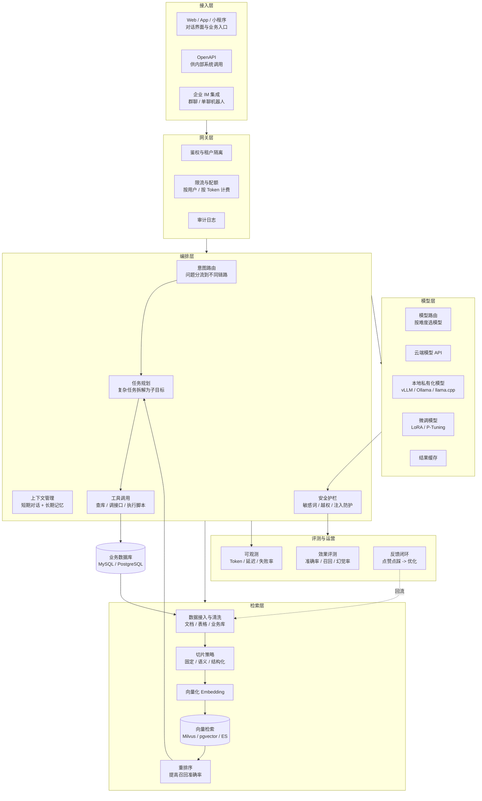

</details>

---

## 三、技术栈关联图

以下保留节点与箭头关系，拆成五张子图便于阅读。箭头表示原图中的关联或依赖，并非全部都是执行先后顺序；点击图片可打开大图。

### 3.1 开发语言与服务入口

[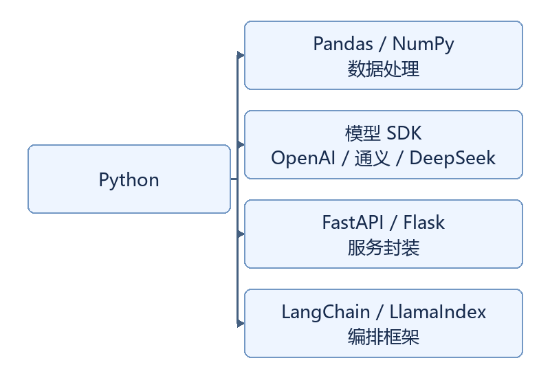](./images/ai-architecture/architecture-02-relations-1.svg)

### 3.2 编排、检索与工具

[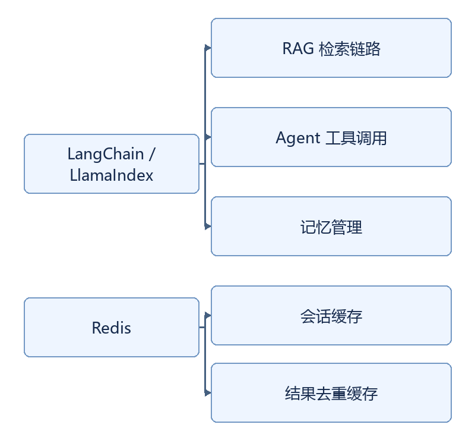](./images/ai-architecture/architecture-02-relations-2.svg)

### 3.3 RAG 检索链路的依赖

[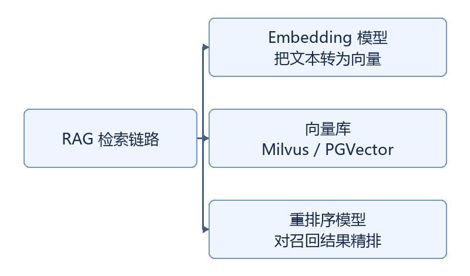](./images/ai-architecture/architecture-02-relations-3.svg)

### 3.4 Agent、业务系统与前端

[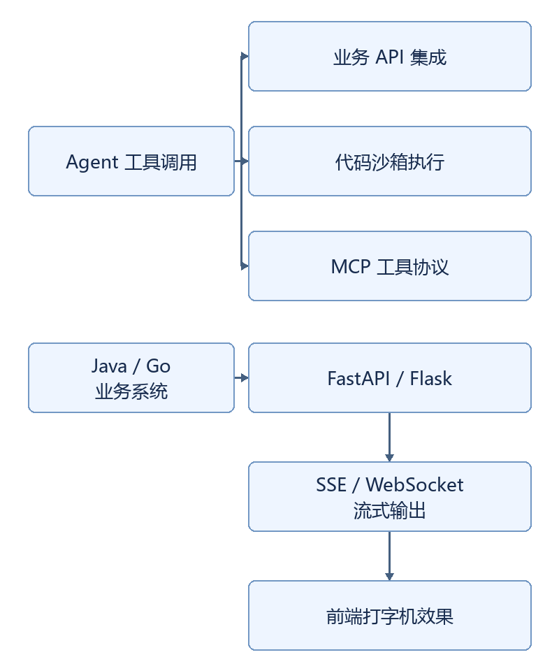](./images/ai-architecture/architecture-02-relations-4.svg)

### 3.5 私有化部署与监控

[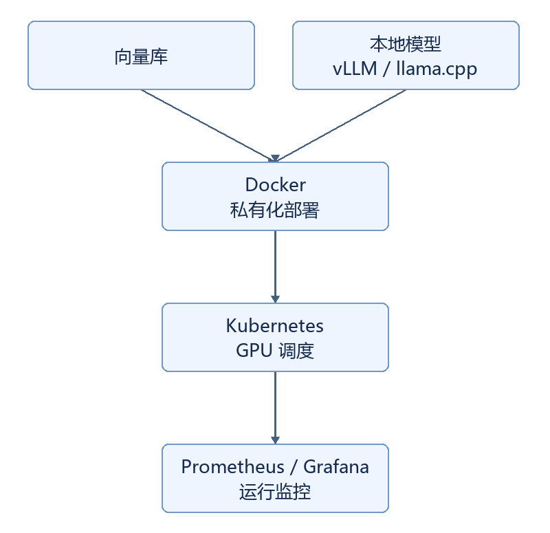](./images/ai-architecture/architecture-02-relations-5.svg)

[下载原始 Mermaid 关系源码](./images/ai-architecture/architecture-02-source.mmd)

---

## 四、核心能力矩阵

| 能力项 | 出现率 | 关键要点 | 常见追问 |
|--------|-------|---------|---------|
| Prompt 工程与设计 | 高 | 结构化提示模板、少样本示例、系统提示分层、版本管理 | 怎么让输出稳定在某个 JSON 结构上？ |
| RAG 检索链路 | 59% | 切片策略、混合检索（向量+关键词）、重排序、元数据过滤 | 召回不准怎么定位是切分问题还是模型问题？ |
| Agent / 工作流编排 | 69% | 任务拆解、工具注册、循环控制、超时与重试、人工兜底 | 多轮工具调用失败后如何降级？ |
| 模型微调 | 中 | LoRA/P-Tuning、数据构造、评测集设计、灾难遗忘规避 | 什么情况下选择微调而不是 RAG？ |
| 推理服务化 | 46% | vLLM/Ollama、批处理与流式、并发控制、GPU 显存管理 | 如何提升单机吞吐并控制首字延迟？ |
| 数据处理与 ETL | 中 | 文档解析（PDF/扫描件）、表格抽取、增量更新、脏数据治理 | 增量更新的向量如何失效？ |
| 成本控制 | 高 | Token 计量、缓存复用、小模型兜底、路由策略 | 同样功能如何把调用成本降一半？ |
| 安全与合规 | 中 | 提示注入防护、敏感数据脱敏、私有化部署、审计留痕 | 如何防止模型被诱导输出系统提示？ |
| 评测体系 | 高 | 构建评测集、自动化打分、A/B、幻觉率监控 | 效果变好了还是变差了，怎么量化？ |
| 工程交付 | 25%+ | Docker 镜像、CI/CD、灰度发布、回滚 | 提示词改动如何灰度上线？ |

---

## 五、关键实现要点

### 5.1 RAG：决定效果的四个环节

```
数据质量 → 切片策略 → 检索策略 → 重排序 → 提示组织
   ↑           ↑           ↑          ↑         ↑
  最重要      业务相关    向量+关键词  性价比高   控制结构
```

1. **切片比模型更能决定上限**：按语义/标题层级切，避免把表格切断；每条切片携带标题、来源、时间等元数据便于过滤。
2. **混合检索几乎必做**：纯向量检索对专有名词、型号、编号不敏感，应与 BM25 类关键词检索融合再做 RRF 排序。
3. **重排序（Rerank）性价比最高**：召回 top-50 后用交叉编码模型精排出 top-5，准确率提升明显于成本增加。
4. **答案必须带引用**：输出到前端时附原文片段与来源链接，既便于用户核验也便于定位召回问题。

### 5.2 Agent：让它别失控

- **明确工具边界**：每个工具要有清晰的入参 schema、幂等保证、超时时间，禁止无约束的任意操作。
- **规划与执行分离**：先产出可执行计划（Plan），再逐步执行（Execute），失败时回溯到计划层重试而不是原地死循环。
- **设置步数与预算上限**：最大步数、最大 Token、最长耗时三重闸门，超限转人工或返回兜底答案。
- **关键操作加确认**：下单、转账、删库类高危动作必须二次确认（Human-in-the-loop）。

### 5.3 推理服务化：性能与成本的平衡


<details>
<summary>查看 Mermaid 源码（兼容支持 Mermaid 的软件）</summary>

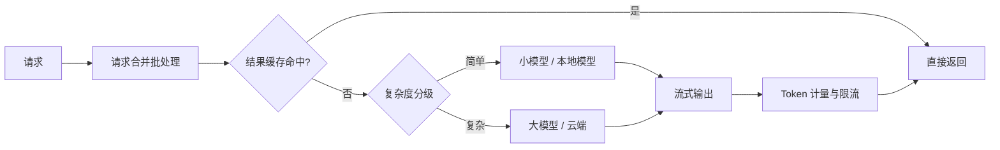

</details>

常用组合：`vLLM` 做连续批处理 + PagedAttention 提吞吐；`llama.cpp/GGUF` 做 CPU 或轻量 GPU 场景；`TensorRT-LLM` 做极致推理性能；`Ollama` 做开发自测与小规模私有化。

### 5.4 提示词工程：像管代码一样管理

- 提示词进 Git，带版本号与变更说明；
- 建立离线评测集（≥100 条真实问题），每次改动跑回归；
- 需要程序消费的功能性输出用 JSON Schema 约束，并在服务端校验，配合有上限的重试修正机制；
- 系统提示、用户提示、示例提示分层组织，避免互相污染。

---

## 六、部署形态对照

| 形态 | 适用场景 | 关键技术 | 主要风险 |
|------|---------|---------|---------|
| 云端 API | 快速验证、公网业务 | SDK 接入、流式、重试 | 数据出境合规、成本随量增长 |
| 本地私有化 | 政务/医疗/制造内网 | vLLM、GPU 服务器、容器编排 | 显存规划、并发排队、运维门槛 |
| 混合路由 | 大部分生产企业 | 敏感数据走本地、通用问答走云端 | 路由策略复杂度、结果一致性 |
| 边缘轻量 | 工控机、边缘盒子 | 量化模型、llama.cpp、TFLite | 算力受限、模型能力下降 |

---

## 七、典型职责归纳（去重合并）

- 负责大模型应用的需求拆解、技术选型与方案设计，确定 RAG / 微调 / 提示工程的组合方式。
- 搭建知识库流水线：文档解析、切片、向量化、增量更新、权限隔离与效果评测。
- 实现 Agent 编排：任务规划、工具/插件注册、业务 API 接入、异常兜底与人工接管。
- 封装模型服务：流式接口、批处理、并发控制、Token 计量、灰度发布。
- 建设评测与观测：评测集、自动化打分、幻觉监控、调用链路追踪、成本看板。
- 负责安全合规：敏感数据脱敏、注入防护、审计留痕、私有化部署方案落地。
- 与业务团队协作，把 AI 能力嵌入既有 Java/Go/Python 系统，而不是另起炉灶。

---

## 八、进阶路径建议


<details>
<summary>查看 Mermaid 源码（兼容支持 Mermaid 的软件）</summary>

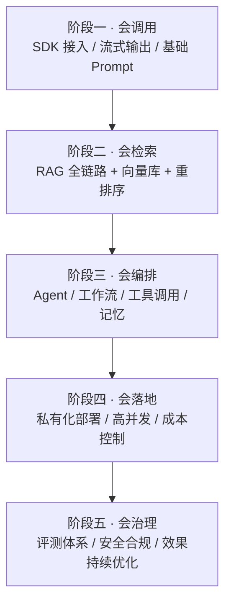

</details>

每个阶段都要有对应产出物：Demo → 可用的知识库问答 → 能执行任务的智能体 → 生产级服务 → 可量化效果的运营闭环。

---

## 九、常见考察点清单

1. RAG 召回不准，你的排查顺序是什么？（数据源 → 切片 → 向量模型 → 检索策略 → 重排序 → 提示）
2. 什么时候用微调，什么时候用 RAG？（知识更新频率 vs 行为格式定制）
3. 如何把一次对话的成本降到十分之一？（缓存、路由、小模型、裁剪上下文、批处理）
4. 模型输出不稳定怎么办？（Schema 约束、少样本、低温、重试修正、投票）
5. 私有化部署需要考虑哪些事？（显存、并发、模型格式、更新机制、监控、备份）
6. 怎样证明你的 AI 功能真的有用？（离线评测集 + 在线 A/B + 幻觉率/采纳率指标）
7. Agent 死循环怎么办？（步数上限、重复检测、回溯、降级、人工兜底）
8. 提示词如何做版本管理和灰度？（进 Git、挂开关、按比例分流、回滚预案）

---

## 十、与其他方向的连接

- **与 Go/Java 后端**：AI 能力必须嵌入既有业务系统，通常通过 HTTP 或 MQ 解耦；流式结果需要 WebSocket/SSE 支持。
- **与数据平台**：RAG 的数据源往往来自数仓，Embedding 的增量更新依赖 CDC 与调度作业。
- **与前端**：对话界面的流式渲染、markdown 解析、代码高亮、引用溯源都影响体验。
- **与嵌入式**：本地算力部署涉及 GPU/边缘设备、模型量化与运行时优化。

---

## 十一、大模型应用的技术选择

### 11.1 从业务需求反推技术

| 业务需求 | 优先方案 | 交付物与边界 |
|----------|----------|--------------|
| 分类、提取字段、生成摘要 | 提示词 + 结构化输出 | JSON Schema、字段校验、失败样本；先建立简单基线 |
| 查制度、产品手册、售后规则 | RAG + 引用 | 可定位的原文证据、权限过滤、文档更新机制 |
| 查询订单、库存、物流 | Tool Calling + 业务 API | 实时事实通过业务系统获得，不依靠模型记忆 |
| 固定步骤审批、对账 | 确定性工作流，局部节点使用模型 | 分支和写入由代码控制，结果可复现 |
| 步骤不固定，需要根据查询结果继续调查 | 单 Agent + 受控工具 + 状态机 | 允许有限循环，保留执行记录和终止条件 |
| 长期稳定的术语、格式、行为定制 | 基线不足后评估 SFT / LoRA | 训练、验证、测试集隔离；与提示词方案对照评测 |
| 多种独立专业任务可并行完成 | 单 Agent 不足后再评估多 Agent | 明确各自输入输出、共享状态、汇总责任和总预算 |

RAG 提供证据，工具调用访问系统，工作流管理步骤，Agent 在受控范围内选择下一步。这些能力可以组合。微调不能保证记住最新库存，也不能代替权限控制。

### 11.2 模型能力如何选、如何验

- **生成模型**：用同一批真实任务比较中文业务理解、工具选择、参数正确率、结构化输出成功率、延迟和单任务成本。模型大小与榜单排名只能作为候选参考。
- **Embedding 模型**：测试中文、型号、订单编号、同义词的召回效果；文档向量与查询向量使用兼容模型。更换模型或维度通常需要重建索引，并通过新旧索引切换发布。
- **Reranker**：只对召回候选排序，不能找回根本没召回的文档。候选数量、输入长度和推理时间需要一起压测。
- **多模态模型**：适用于截图、扫描件、图文表格；关键金额、日期、订单号仍需类型校验、原图引用与必要的人工复核。
- **部署模型**：先验证模型许可证、硬件兼容与业务评测，再决定 API 或自部署。权重显存粗估为参数量乘每参数字节数；实际还需 KV Cache、激活和运行时开销，不能仅按权重大小采购 GPU。

低温度不代表输出确定；JSON 合法也不代表事实正确。生成完成、Schema 校验、业务规则校验、权限校验应分别记录结果。模型拒答、输出截断和工具参数非法都要有明确分支。

### 11.3 上下文、记忆与 RAG 的工程细节

1. **上下文预算**：预留输出 Token 和工具结果空间；保留系统规则、当前目标、最近必要消息与相关证据，压缩历史摘要。摘要不能作为金额、权限或审批状态的唯一来源。
2. **分层记忆**：任务状态存 PostgreSQL；短期会话可缓存到 Redis；用户偏好必须标记来源、更新时间、租户与有效期，支持查看和删除。不要把所有历史聊天无限写进提示词。
3. **文档治理**：每个片段保存 `tenant_id / doc_id / version / section / source_url / updated_at / acl`。初始可试 300～800 Token、约 10%～20% 重叠，再按文档结构与评测调整；表格应保留表头和单位。
4. **检索链路**：查询归一化 → 权限过滤 → 关键词与向量并行召回 → RRF 融合 → 重排 → 按预算组装证据 → 生成带引用答案。不能只在答案显示时过滤越权内容；全文索引与向量索引都要执行权限限制。
5. **更新与失效**：通过文档版本和内容哈希做增量更新；删除或撤权后同步清理全文索引、向量索引与缓存。切换 Embedding 时保留旧索引回滚能力，避免混合不同向量空间。
6. **无证据处理**：召回分数的阈值需按模型与数据标定；证据不足就补问、再次检索或明确无法确认。不要让模型把推测包装成企业制度。

---

## 十二、ERP 订单异常处理 Agent 落地方案

### 12.1 先做一个可验收的业务闭环

**目标用户**：客服、订单运营。**输入示例**：“订单 SO-20261021-001 为什么还没发货？按制度给出处理建议，需要的话创建异常工单。”

**第一期范围**：读取订单、库存、物流与发货规则，输出有证据的异常原因和建议；创建工单前展示草稿并由具备权限的用户确认。订单状态、金额、退款和库存扣减仍由原业务服务处理。

**成功产出**：可追溯的异常分类、业务查询快照时间、规则引用、可操作建议，以及确认后返回的真实工单 ID。查询失败时返回失败原因，不能生成虚构物流状态或工单号。

### 12.2 推荐架构与框架取舍

首期可用 **FastAPI + LangGraph + PostgreSQL/pgvector + Redis + 原有 Java/Go 业务 API + 模型网关**。LangGraph 管理状态、暂停与恢复；较简单的固定流程可以直接用代码状态机。沿用已有全文检索设施；没有时先评估 PostgreSQL 全文检索及中文分词方案，确有需求再引入 Elasticsearch。

| 组件 | 职责 | 首期取舍 |
|------|------|----------|
| Web 工作台 | 展示进度、证据、工单草稿、确认与取消 | SSE 展示事件；页面断线不等于任务取消 |
| API / 网关 | SSO、租户身份、配额、任务创建 | 身份来自服务端会话，不接受模型提供的身份 |
| 状态编排器 | 意图分流、工具循环、人工确认、失败分支 | 显式节点与持久化检查点，限制模型可见工具 |
| 工具适配层 | 参数验证、授权、超时、审计、结果规范化 | 复用业务 API，模型不能直接持有数据库凭据 |
| RAG 服务 | 检索制度、返回版本与引用 | 先满足权限、更新与可追溯性，再优化召回 |
| 任务 Worker | 执行较长任务、重试和恢复 | 任务持久化；明确租约、心跳、取消与并发限制 |
| 观测与评测 | Trace、成本、工具结果、回归集 | 贯通 `trace_id / run_id / tool_call_id` |

Dify 适合较快验证表单、知识库和可视化流程，但仍需验证权限、发布版本、审计与恢复能力。LangChain 的工具适配、LlamaIndex 的数据检索能力按需使用，不必全部引入。MCP 是工具与资源的接入协议，不负责业务授权、审批或幂等；已有稳定 API 可以直接封装成工具。


<details>
<summary>查看 Mermaid 源码（兼容支持 Mermaid 的软件）</summary>

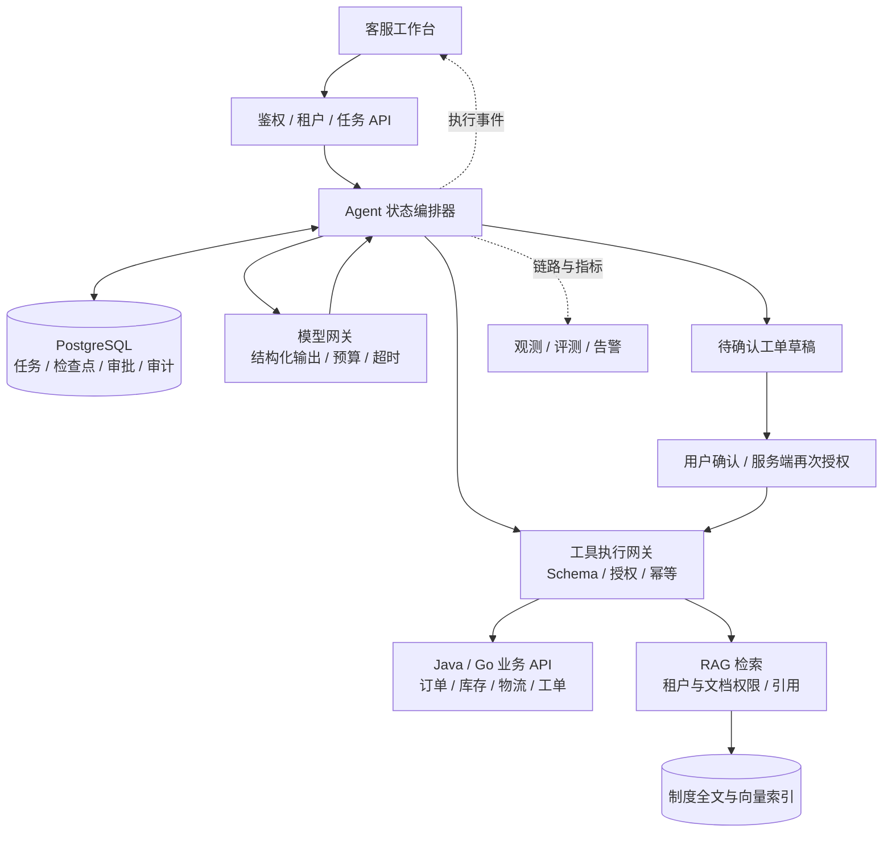

</details>

### 12.3 一次任务的完整执行过程

1. **建立身份和任务**：服务端解析用户、租户、角色，生成 `run_id`，校验订单访问范围。订单号缺失或歧义时进入补问状态。
2. **只读调查**：调用订单接口，再按需要查库存、物流；独立查询可并行，但设置并发上限。记录数据来源和查询时间，脱敏后交给模型。
3. **检索规则**：按订单地区、商品类型、业务日期和文档权限检索发货制度，保留实际生效版本；实时库存与物流以业务 API 为准。
4. **形成建议**：模型输出异常类型、证据引用、建议和工单草稿。服务端校验枚举、必填字段、引用 ID 是否属于本次证据，以及金额等字段是否来自可信结果。
5. **暂停等待确认**：持久化草稿、草稿哈希、订单版本、请求人、有效期。用户拒绝则结束或修改草稿；对话中的“已批准”不能代替确认接口事件。
6. **确认后执行**：确认接口验证当前用户权限、草稿哈希和有效期，重新查询订单版本；若状态发生变化则重新生成草稿并确认。工具网关用持久化的幂等键提交工单。
7. **返回真实结果**：以业务 API 返回的工单 ID 和状态作为完成依据。网络超时导致结果未知时，先按幂等键查询执行结果，再决定是否重试。


<details>
<summary>查看 Mermaid 源码（兼容支持 Mermaid 的软件）</summary>

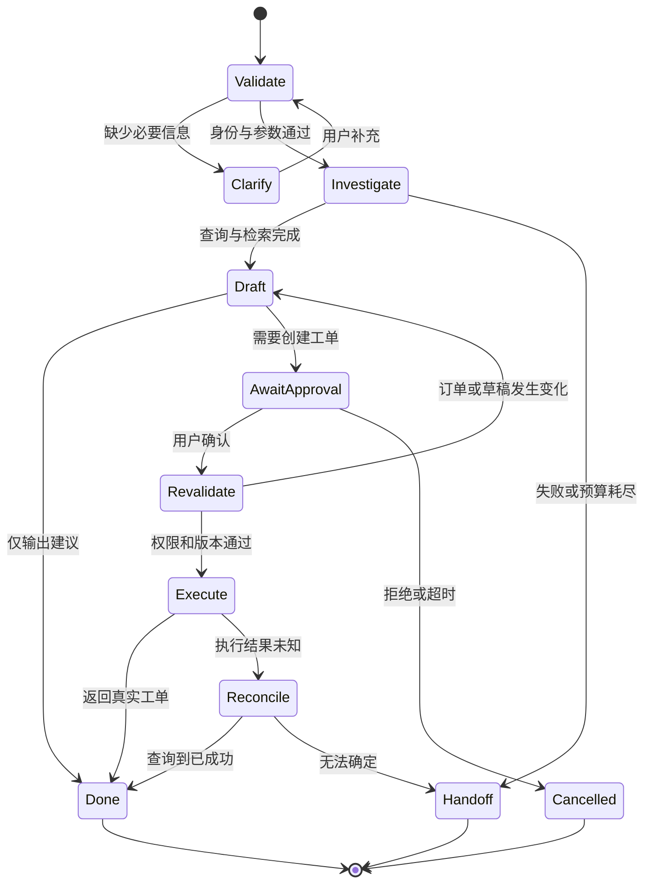

</details>

### 12.4 工具契约：模型提议，服务端执行

首期只开放 `get_order`、`get_inventory`、`get_shipment`、`search_policy`、`create_exception_ticket`。读工具与写工具分组；写工具仅在确认后允许执行。不要提供任意 SQL、任意 URL 请求或任意 Shell 工具。

以下是自有工具注册表的契约示例，`execution_policy` 由工具网关解释，并非模型 API 的通用字段：

```json
{
  "name": "create_exception_ticket",
  "description": "为已核实的订单异常创建工单",
  "input_schema": {
    "type": "object",
    "properties": {
      "order_id": {"type": "string", "minLength": 1},
      "category": {"type": "string", "enum": ["stock_shortage", "shipment_delay", "other"]},
      "summary": {"type": "string", "minLength": 1, "maxLength": 500}
    },
    "required": ["order_id", "category", "summary"],
    "additionalProperties": false
  },
  "execution_policy": {
    "permission": "ticket:create",
    "approval_required": true,
    "timeout_ms": 5000,
    "idempotency_required": true
  }
}
```

`tenant_id`、操作者、审批凭据与幂等键由服务端注入，不让模型填写。工具返回统一为 `ok / data / error_code / retryable / source / observed_at`；向模型返回经过裁剪和脱敏的数据，完整响应按保留策略记录在受控存储。

幂等键示例：`tenant_id + run_id + approved_action_id`。业务端为该键建立唯一约束并复用首次结果；相同键但参数哈希不同应拒绝。客户端重发请求不能依靠 Redis 临时锁保证业务只执行一次。

### 12.5 状态、接口与恢复设计

| 数据对象 | 必要字段 | 作用 |
|----------|----------|------|
| `agent_runs` | run_id、tenant_id、user_id、status、deadline、budget、prompt_version、model_version | 任务主记录与预算 |
| `agent_steps` | run_id、step_no、node、tool_call_id、input_hash、result_ref、latency、error_code | 追踪与故障定位；工具调用唯一去重 |
| `agent_approvals` | action_id、draft_hash、order_version、approver、expires_at、status | 防止草稿修改后复用旧审批 |
| `tool_executions` | idempotency_key、args_hash、status、business_result_id | 重复投递与结果未知时的核对 |
| `knowledge_chunks` | doc_id、version、tenant_id、acl、content_hash、source、embedding_version | 权限、增量更新与引用 |

建议 API：`POST /agent/runs` 创建任务，`GET /agent/runs/{id}` 查询状态，`GET /agent/runs/{id}/events` 订阅 SSE，`POST /agent/runs/{id}/approvals` 确认或拒绝，`POST /agent/runs/{id}/cancel` 请求取消。所有接口都校验租户与对象级权限。

事件至少包含 `event_id / run_id / type / timestamp / payload`，类型可为 `status`、`tool_started`、`tool_finished`、`approval_required`、`completed`、`failed`。通过持久化事件和 `Last-Event-ID` 恢复显示；不要把模型的流式文本当成最终业务执行结果。

Worker 重启后从检查点恢复，但恢复节点可能再次执行：因此写入必须幂等。通过任务租约和乐观版本防止两个 Worker 同时推进同一任务；外部业务动作不能只靠检查点实现“恰好一次”。取消只阻止后续步骤，已经提交的业务动作需查询状态并走业务补偿流程。

### 12.6 受控执行循环与故障处理

以下为编排逻辑伪代码，展示控制责任，不是可直接运行的 SDK 示例：

```text
加载任务、服务端身份、检查点和累计预算
while 任务处于运行状态:
    检查取消、deadline、最大步数和剩余预算
    选取当前状态允许的工具，预留本次最大输出预算
    请求模型生成结构化决策，并累计实际消耗
    若要求补问: 持久化状态并返回
    若输出最终结果: 校验证据与业务字段，通过后完成
    若请求工具:
        验证工具白名单、参数 Schema、对象级权限
        若为写操作且无绑定当前草稿的有效审批: 暂停等待确认
        执行前再次验证权限、审批、版本和取消状态
        用稳定幂等键执行，保存结果，再写检查点
        将裁剪后的工具结果加入下一轮上下文
    若重复调用相同工具与参数且无新信息: 终止并转人工
预算耗尽或不可恢复失败: 保留已完成结果与明确失败原因
```

| 故障 | 处理策略 |
|------|----------|
| 模型 429、临时 5xx | 有上限的指数退避与抖动；遵循服务端重试提示；计入总 deadline |
| 工具参数格式错误 | 返回字段错误供模型修正，最多尝试有限次数；业务权限错误不得通过改写参数绕过 |
| 只读工具超时 | 可重试一次或返回部分结果，并标明缺失数据 |
| 写工具超时 | 标记结果未知，按幂等键核对；禁止盲目换键重试 |
| 文档夹带“忽略规则”等指令 | 文档与工具输出作为不可信数据；实际工具授权始终由服务端强制执行 |
| 工具连续返回相同失败 | 重复检测、终止循环、输出人工接管所需的上下文 |
| 主模型不可用 | 仅在任务语义与能力兼容、且仍满足数据策略时降级；写操作保留原审批要求 |

首期可试最大 8 次模型决策、单次只读工具 3 秒、交互执行总时长 60 秒、审批有效期 15 分钟；这些是起始配置，需要压测调整。交互执行 deadline 与人工等待时限分开管理，恢复时重新分配执行预算，同时保留全任务累计成本上限。

---

## 十三、实施计划、评测与上线验收

### 13.1 四周试点计划

以下按业务 API 已具备、少量试点用户、有后端与业务人员协作估算；接口和数据权限尚未准备好时应先安排依赖建设。

| 阶段 | 工作内容 | 可审查的产出 |
|------|----------|--------------|
| 第 1 周：定义与基线 | 选择单一场景、梳理权限、收集脱敏案例、固定评价口径 | 需求边界、工具契约、至少 100 条测试样本、普通工作流基线 |
| 第 2 周：只读闭环 | 接订单与物流 API、制度检索、模型结构化输出、证据展示 | 可用的异常分析助手、Trace、错误分类报告 |
| 第 3 周：可控写入 | 工单草稿、审批、幂等、检查点、断线恢复与取消 | 沙箱环境工单闭环；超时、重放、重启故障演练记录 |
| 第 4 周：评测与灰度 | 业务验收、并发压测、成本测量、小范围试点 | 验收报告、值班告警、回滚方案与试点结果 |

### 13.2 不只评答案，还要评业务完成情况

评测集按订单类型、异常类型、权限角色、制度版本分层；包含正常、信息不足、证据冲突、越权、提示注入、工具超时、重复确认、订单状态变化和执行结果未知案例。开发集用于调参，锁定测试集用于发布验收，避免用同一批样本反复优化后宣称泛化效果。

| 指标 | 计算方式 | 示例验收目标 |
|------|----------|--------------|
| 任务成功率 | 达成预定义业务结果的任务数 / 可执行任务数 | 试点目标 ≥90%，同时报告样本数与分层结果 |
| 工具选择与参数正确率 | 正确调用数 / 被评估调用数 | 单独报告选错工具、字段错误、缺少查询 |
| 引用支持率 | 被引用证据实际支持的事实数 / 抽检事实数 | 关键事实逐条核验，不只检查是否有链接 |
| 检索 Recall@k | 前 k 个候选命中的标注相关片段数 / 标注相关片段总数 | 按文档类型比较；切片变更后重新核对标注 |
| 未授权写入 / 重复工单 | 故障与权限测试中的违规业务动作数 | 测试集内必须为 0；不代表生产风险绝对为 0 |
| P95 延迟 | 95% 任务完成所需时间 | 分开报告首事件、只读任务、写入执行；排除并单列人工等待 |
| 单成功任务成本 | 全部任务成本（含失败与重试）/ 成功任务数 | 与人工处理基线、业务收益共同确定上限 |
| 人工接管率 | 转人工任务数 / 总任务数 | 区分正常审批与异常接管，不盲目追求越低越好 |

模型裁判可辅助初筛，但需用人工标注校准；金额、工单 ID、是否真实创建等优先使用确定性检查。记录模型、提示词、工具 Schema、知识库版本，才有条件复现退化原因。

### 13.3 成本与性能如何估算

```text
单任务模型成本 = Σ(输入 Token × 输入单价 + 输出 Token × 输出单价)
单成功任务总成本 = (模型 + 检索/重排 + 基础设施 + 失败重试成本) / 成功任务数
平均在途任务数 ≈ 每秒到达任务数 × 平均执行时长（稳定状态下的估算）
```

单价按供应商的实际计费单位换算；缓存输入、推理 Token 等特殊项按账单口径单独统计。并发估算还需考虑突发、工具并行、排队和模型速率限制，并用实际压测验证。

优化顺序建议：减少无效循环 → 裁剪工具结果与历史 → 缓存有权限且可接受时效的数据 → 为简单任务采用通过评测的小模型 → 优化检索 → 再考虑自部署。涉及订单实时状态和权限的缓存必须带租户、授权范围和版本，不能跨用户直接复用。

### 13.4 发布、回滚与交付清单

- **发布包**：代码、提示词、模型配置、工具 Schema、检索配置分别有版本，并保存为同一发布清单；秘钥由服务端密钥设施管理。
- **灰度**：先使用脱敏回放和沙箱；影子流量只做只读比较，禁止复制真实写操作。随后按试点租户逐步开放创建工单能力。
- **运行观测**：每次任务记录总耗时、模型调用次数、Token、工具错误、审批等待、业务结果；日志按权限和保留期管理，不记录密钥或无必要的完整个人信息。
- **止损与回滚**：工具白名单和写入开关可独立关闭；回滚到已验证的发布清单，同时保留待处理任务与旧版状态兼容。回滚代码不会撤销已创建的工单。
- **最终交付**：架构图、接口与工具文档、可运行部署配置、数据权限矩阵、评测集与报告、故障演练记录、监控看板、人工接管和回滚操作说明。

**值得展示的项目成果**：用户提交订单问题后，系统完成实时调查与规则检索，返回可核验建议；用户确认后只创建一次真实工单；遇到超时、重启或订单变化时能恢复、核对或明确转人工。这样的闭环比单纯展示一段对话更能证明 Agent 的工程落地能力。

---

## 十四、本地 AI 算力整机：从需求到指标

来源：[AI 系统工程师（本地算力部署与优化方向）JD](<职位描述/AI 系统工程师（本地算力部署与优化方向）｜帝迈生物｜f755a5d05c3a7d110nx63dm0EVdU.md>)。本岗位强调“硬件整机 + 本地推理 + 行业交付”，与只接入云端模型 API 的应用开发职责不同。

### 14.1 先用容易理解的话认识几个词

**显存容量**决定 GPU 能同时容纳多少权重、缓存和运行数据；**显存带宽**影响 GPU 从显存读取数据的速度；**算力**描述特定精度和运算条件下的计算能力。三者相关但不能互相替代。

**Prefill（预填充）**处理输入上下文并形成生成所需状态；**Decode（解码生成）**逐步产生输出 Token。输入长、输出长、用户多，会以不同方式消耗计算、显存和调度资源。

**TTFT（首 Token 时间）**是请求开始到第一个输出 Token 的时间；**吞吐**是单位时间完成的工作量。多人总共每秒输出 400 Token，不等于每个人都能每秒看到 400 Token。

### 14.2 JD 新增知识对应表

| 岗位明确提及 | 本文展开 | 需要交付的证据 |
|--------------|----------|----------------|
| GPU、主板、电源、散热与供应商方案 | 第十五节硬件与容量规划 | BOM、兼容性和拓扑、资源余量 |
| Linux、CUDA、驱动与显存管理 | 第十六节运行环境 | 版本矩阵、启动与恢复测试 |
| AWQ/GPTQ/FP8、多个推理引擎 | 第十七节量化与选型 | 质量、显存、延迟和吞吐对照 |
| KV Cache、批处理、并发与采样 | 第十八节性能调优 | 锁定负载和参数的基准报告 |
| 压力、温升、噪声与长期运行 | 第十九节整机验收 | 条件明确的测量和故障记录 |
| RAG、多 Agent、行业 PoC、预装镜像 | 第二十、二十一节 | 业务验收、可复现配置与交付手册 |

### 14.3 把“快一点”改成能测试的条件

JD 中的“70B、400 tokens/s、TTFT≤1s、显存≥192GB、TDP≤600W、噪音≤50dB”是规格示例，不是已经验证的配置。以下问题必须先确认：

- 哪个模型和版本，密集模型还是 MoE，权重和 KV Cache 使用什么精度？
- 输入、输出各多少 Token，并发和到达速率多少，是否包含 RAG 与 Agent？
- 400 tokens/s 指单请求、所有请求输出合计，还是含输入 Token 的统计？
- TTFT 从客户端还是服务器开始计时，是否包含排队、网络和冷启动，要求 P50 还是 P95？
- 600W 指 GPU 功率上限、某器件 TDP，还是整机墙插功耗？50dB 是否为 dB(A)，测量距离、背景噪声和负载是什么？

未明确条件前不能判断这些指标能否同时满足，更不能仅由“显存够了”推导出速度达标。

---

## 十五、硬件与容量规划：显存能放下只是第一步

### 15.1 先估权重，再留运行空间

```text
权重字节数粗估 ≈ 参数量 × 每参数位数 / 8
所需运行显存 ≈ 权重 + KV Cache + 激活/工作区 + 通信缓冲 + 框架开销与余量
```

以名义 70B 参数为例，FP16/BF16 权重粗估约 140GB 十进制字节，理想 4-bit 约 35GB。换算成 GiB 后数字不同；量化比例因子、未量化层、格式和运行时开销还会增加实际占用。

MoE 即使每个 Token 仅激活部分参数，也不代表全部专家权重都不需要存储。权重卸载到 CPU 可缓解 GPU 容量，但数据搬运可能明显影响速度，应单独压测。

### 15.2 KV Cache 为什么随并发和上下文增长

KV Cache 保存注意力计算使用的键和值，避免每次生成都完全重算历史。对常见 Transformer，可用以下关系理解数量级：

```text
单序列 KV 字节粗估
≈ 2 × 层数 × KV头数 × 每头维度 × 缓存Token数 × 每元素字节数
```

常见 GQA/MQA 模型的 KV 头数与查询头数不同，不能直接拿总隐藏维度套公式。混合注意力、滑动窗口、缓存量化、跨卡切分及特定模型架构还会改变实际内存布局。

多序列的缓存需求随实际活跃 Token 增加，还需考虑分配块、前缀共享、预留和框架策略。最大上下文不等于所有并发请求都能同时跑到该长度，必须验证极端组合。

### 15.3 整机选型清单

| 部件 | 核对内容 | 常见误区 |
|------|----------|----------|
| GPU | 型号、显存、带宽、精度和内核支持、功率与散热形式 | 只看峰值 TOPS 或显存总和 |
| CPU / 内存 | 分词、预处理、检索、NUMA、内存容量与带宽 | 只买 GPU，忽略 RAG 和加载内存 |
| 主板 / 机箱 | 实际 PCIe 通道、插槽电气规格、卡尺寸、间距与风道 | 物理 x16 插槽就认为一定有 x16 带宽 |
| GPU 互联 | PCIe/NVLink、P2P、CPU 跨插槽路径、拓扑 | 多卡显存自动合成一块无代价大显存 |
| 电源 | 整机持续功耗、瞬态、接口、线缆与余量 | 把 GPU TDP 之和当作整机峰值 |
| 存储 | 模型加载、索引、日志、空间与耐久性 | 只按模型权重大小准备磁盘 |
| 网络 | 对外服务、远程运维、多机通信与带宽 | 多机推理只需网络连通即可 |

张量并行会引入通信，卡数增加不保证单请求更快。同容量 GPU 组合可能因拓扑和带宽产生明显差异；消费级卡也不能默认具备 NVLink、ECC 或相同的 P2P 支持。

### 15.4 建立可复制的配置矩阵

每行记录：完整 BOM、模型版本与哈希、量化格式、引擎和驱动版本、并行配置、上下文、并发、输入输出分布、显存峰值、P95 TTFT/TPOT、输出吞吐、质量分数、墙插功耗及噪声测量条件。

矩阵中的每一行都应来自实测。不同硬件不能只按显存比例线性外推性能；未测试的组合标成候选，而不是承诺档位。

---

## 十六、Linux 与 NVIDIA 运行环境：建立兼容基线

### 16.1 驱动、CUDA、框架不是同一层

宿主机驱动负责与 GPU 交互；容器或环境中可能包含 CUDA 用户态库、PyTorch、推理引擎及编译扩展。是否需要安装完整 CUDA Toolkit 取决于是否编译相关组件，不能默认“能运行模型就必须装全部开发工具”。

`nvidia-smi` 显示的 CUDA 版本通常反映驱动可支持的相关能力，并不证明当前 Python 环境实际安装了相同版本 Toolkit。需核对驱动、容器运行时、CUDA 用户态库、框架和 GPU 架构的兼容关系。

### 16.2 从硬件可见到模型可用逐层验证

可按目标系统权限运行只读检查：

```bash
nvidia-smi
nvidia-smi -L
nvidia-smi topo -m
```

随后确认容器内可见 GPU，再做框架小计算、目标模型加载、一次短请求和一次长上下文请求。多卡还需验证通信、设备顺序及运行参数，不因单卡成功就判定多卡可用。

避免为了排查就无条件给服务容器特权权限。服务配置、模型目录、持久化数据和日志目录分开管理，推理管理端口、模型 API 与运维入口按需限制访问。

### 16.3 固定版本并保留恢复路径

预装镜像记录 OS、内核、驱动、容器运行时、镜像摘要和模型清单；首次开机完成硬件识别、模型校验与健康自检。镜像中不能预埋客户通用密码或生产密钥。

驱动与内核升级可能影响兼容性，先在同配置验证，再逐步发布。保留旧版镜像、符号和配置；回退前确认数据与索引版本可兼容。离线交付还需准备依赖包、模型许可和完整性校验材料。

---

## 十七、量化与推理引擎：同时比较质量、容量与速度

### 17.1 量化不是单一开关

量化可作用于权重、激活或 KV Cache，不同部分精度可以不同。降低位宽通常减少部分内存和传输开销，但能否加速取决于硬件、内核、模型形状与调度；并不是位数越低越快。

| 技术 | 主要理解方式 | 核对点 |
|------|--------------|--------|
| AWQ | 常见的激活感知权重量化路线 | 校准数据、权重格式、分组及引擎内核支持 |
| GPTQ | 常见的训练后权重量化路线 | 实现变体、格式、量化配置和模型兼容性 |
| FP8 | 一类浮点低精度表示及相关运行方案 | 权重/激活/KV具体用在哪里、缩放与硬件支持 |
| GGUF 等模型文件格式 | llama.cpp 生态常见的权重存储与元数据格式 | 格式不是一种固定量化算法，具体量化类型需另查 |

量化格式不能任意互换，下载某个“4-bit 模型”不代表所有引擎都支持。来源可信、基础模型许可、转换过程和文件哈希同样需要记录。

### 17.2 用业务样本检查量化损失

对比基础精度与候选量化模型在中文术语、字段提取、工具参数、长上下文、数值和拒答上的表现。校准集要覆盖目标业务且不污染独立测试集。

量化前后使用相同提示词、采样与输入；记录随机性和允许误差。只看通用 benchmark 或困惑度，不足以判断医疗报告字段、制造故障代码等业务是否可用。

### 17.3 推理引擎怎样选

| 引擎 | 可评估的方向 | 需要验证 |
|------|--------------|----------|
| vLLM | 多用户服务、缓存管理与连续批处理 | 模型、量化、并行和版本兼容 |
| TensorRT-LLM | NVIDIA GPU 上的专门优化 | GPU 架构、构建/部署流程和版本矩阵 |
| SGLang | 生成服务及前缀复用等优化场景 | 实际模型、调度功能与缓存隔离策略 |
| llama.cpp | CPU、混合卸载、轻量本地部署及多种后端 | 格式、硬件后端、卸载和服务并发配置 |

这不是固定排名。用同一负载与质量约束比较，再结合团队维护能力、升级成本和许可做选择。不同引擎参数名称和含义不同，不直接复制另一套参数就上线。

---

## 十八、性能调优：先测清，再改一个变量

### 18.1 常用指标及计量边界

| 指标 | 含义 | 报告时必须说明 |
|------|------|----------------|
| TTFT | 请求到首输出 Token 的时间 | 客户端/服务端、是否含排队和冷启动 |
| TPOT / ITL | 每输出 Token 时间或相邻 Token 间隔 | 具体定义、计算方式、是否剔除首 Token |
| 输出吞吐 | 单位时间输出 Token 数 | 单请求还是整体、时间窗口、成功与失败如何计入 |
| 请求吞吐 | 单位时间完成请求数 | 长度分布、并发、到达模型及错误率 |
| 端到端时延 | 请求到完成的时间 | 是否包含检索、重排、工具与网络 |
| 达标吞吐 | 同时满足延迟与质量约束的有效处理量 | 约束条件与失败比例 |

报告 P50/P95 等分位数、样本数和持续时间，不能用平均值掩盖少量长时间卡顿。若截断输出来提高“速度”，也需计入任务完成质量。

### 18.2 基准测试要固定哪些条件

```text
硬件与软件版本固定
→ 模型、分词器与精度固定
→ 输入/输出长度及采样条件固定
→ 冷启动、预热、稳态分别测
→ 逐步提高并发或到达速率
→ 记录延迟、吞吐、错误、显存、功耗与质量
```

闭环压测（完成后再发）和开放到达率压测（按计划持续发）表现不同，后者更容易揭示排队风险。两种均应说明；压测客户端不能成为瓶颈。

前缀缓存开启时，要区分真实复用和每次完全相同提示词带来的理想命中。跨用户缓存还需验证权限和隔离，不为高跑分牺牲数据边界。

### 18.3 按瓶颈选择措施

| 现象 | 先检查 | 可尝试措施及代价 |
|------|--------|------------------|
| 首 Token 慢 | 输入长度、排队、prefill、冷加载 | 限制输入、分块预填充、容量隔离；具体依引擎支持 |
| 生成慢 | 带宽、通信、解码批量、频率和温度 | 合适量化、调整并行、减少不必要拷贝；测质量和功耗 |
| 并发升高后 OOM | KV 占用、最大长度、批预算与其他进程 | 限制活跃序列和Token预算，留显存余量 |
| 吞吐高但尾延迟差 | 批调度、长短请求混跑、排队 | 公平调度、队列上限、按负载分组；可能降低峰值吞吐 |
| GPU 利用率低 | CPU 分词、检索、磁盘、网络和锁 | 优化完整管线，避免只调 GPU 参数 |
| 多卡反而变慢 | 拓扑、通信、模型切分和批量 | 比较单卡/多卡策略；容量收益不等于时延收益 |

最大上下文、活跃序列、批 Token 预算和 KV 配置需要联动验证。提高显存利用目标会压缩其他任务与突发余量，不能越接近 100% 越好。

温度、top-p、最大输出长度等采样参数影响质量、输出长度和部分性能表现。性能比较时保持一致；业务上缩短无效回答是优化，但应与同条件引擎性能区别报告。

### 18.4 优化记录应可以复现

每次只改变少量可解释变量，保存前后配置、原始结果和失败原因，重复必要样本验证稳定性。性能目标达成后再跑质量回归，避免把“输出变短或能力退化”当作纯加速收益。

---

## 十九、整机验证：模型能回答，不等于整机可交付

### 19.1 将压力测试分层

| 层次 | 内容 | 观察证据 |
|------|------|----------|
| 硬件识别 | GPU、内存、磁盘、拓扑和固件 | BOM 与实际设备一致 |
| 单部件测试 | GPU 计算、显存、带宽、存储等 | 工具、版本、时长、错误和温度 |
| 联合负载 | 推理、检索、网络和存储同时运行 | 整机资源、功率、延迟与故障 |
| 长期运行 | 持续典型及峰值业务负载 | 内存/显存增长、错误、热降频和服务稳定性 |
| 故障恢复 | 进程重启、网络中断、磁盘不足等 | 告警、恢复时间、任务和索引完整性 |

可按硬件支持评估 NVIDIA DCGM 等诊断监控工具及厂商测试程序。最大负载测试前确认供电、散热和设备额定条件，由具备相应条件的人员执行；工具“通过”不等于所有潜在缺陷被排除。

JD 中的“7×24 小时”需在验收协议中明确是否为连续 168 小时、负载如何分配及中断规则。168 小时无故障是测试证据，不是多年寿命保证。

### 19.2 功耗、温升和噪声怎样测

**功耗**区分 GPU 传感器报告与整机墙插测量，记录空闲、稳态、峰值与平均能耗；若要评价效率，可在相同质量和延迟条件下比较每任务能耗。

**温升**记录环境温度、进出风条件、机箱布局、GPU/CPU/显存等可观测部件温度及频率变化。低噪声风扇策略可能导致高温降频，必须同时看性能和热稳定性。

**噪声**使用合适仪器，约定 dB(A) 等计权、测点距离和方向、背景噪声、房间条件及负载。不能用不同距离的测量结果直接比较，也不能把多个噪声源的分贝简单相加。

### 19.3 常见故障按证据定位

| 问题 | 排查方向 |
|------|----------|
| GPU 不可见 | 供电与插槽、驱动加载、内核日志、容器设备映射 |
| CUDA 或扩展加载失败 | 驱动/用户态库/框架/编译架构与版本兼容 |
| 模型加载 OOM | 权重格式、运行工作区、其他进程、跨卡分配与缓存预留 |
| 长请求才 OOM | 实际 KV、上下文、批预算与并发组合 |
| 越跑越慢 | 热降频、队列积压、内存增长、缓存/索引和后台写入 |
| GPU 错误或随机重启 | 保存系统与 GPU 错误日志，结合电源、温度、链路和供应商诊断 |

记录复现负载、时间、环境和处理动作，再推动供应商整改。不要每次重启后清空日志，把现象消失当成根因已解决。

---

## 二十、整机上的 RAG 与多 Agent：共享资源也要有预算

### 20.1 不只有生成模型占显存

Embedding、重排、OCR、多模态模型及多个生成服务都可能争抢同一 GPU；向量库和文档处理还消耗 CPU、内存、磁盘。分别可运行，不代表同时运行还能满足整机指标。

应评估模型常驻、按需加载或独立资源部署等选择，明确加载延迟。为批量入库和在线问答设不同队列与资源优先级，避免导入文档把正在使用的交互服务拖慢。

### 20.2 多 Agent 的吞吐不等于模型裸测吞吐

一次业务任务可能包括多次生成、检索、重排和工具等待。多个 Agent 并发还会重复上下文、扩大 KV 与请求数量，调度器应设置任务级模型调用数、总 Token、并发、时长及费用或资源上限。

采用有界队列、公平调度、取消和超时，区分可并行的只读任务与必须有序或审批的写任务。只有在端到端成功率、延迟和成本有收益时再增加 Agent 数量。

### 20.3 三套结果分别报告

1. **模型基准**：固定输入输出下的推理性能。
2. **RAG 基准**：检索、重排、引用与生成的质量和延迟。
3. **业务任务基准**：Agent 完成任务的成功率、工具错误、人工等待、总耗时与资源消耗。

不能用模型基准的 400 tokens/s 承诺所有行业任务都能以同样速度完成。

---

## 二十一、行业 PoC 与标准化交付

### 21.1 PoC 先定义客户问题

PoC 是在明确范围和条件下证明方案可行，而不是只展示模型能聊天。先问数据能否出网、资料类型、人数和高峰、业务失败代价、响应目标、离线条件及维护方式。

| 场景 | 可验证任务示例 | 验收重点 |
|------|----------------|----------|
| 政企 | 内部制度问答 | 文档权限、引用、离线依赖与更新 |
| 金融 | 报告字段提取和研究辅助 | 数字口径、时点、依据及审计 |
| 医疗 | 授权资料检索与文书辅助 | 敏感数据、术语、人工复核和明确用途边界 |
| 教育 | 课程资料问答 | 来源、适龄内容、不同角色权限 |
| 制造 | 设备手册与故障知识查询 | 型号版本、错误代码、工具接入与时效 |

这些是场景例子，不能因为 JD 来源公司名称就推断产品已用于诊断等医疗用途。本地部署也不会自动满足所有数据与行业合规要求。

### 21.2 真实硬件上的实施顺序


<details>
<summary>查看 Mermaid 源码（兼容支持 Mermaid 的软件）</summary>

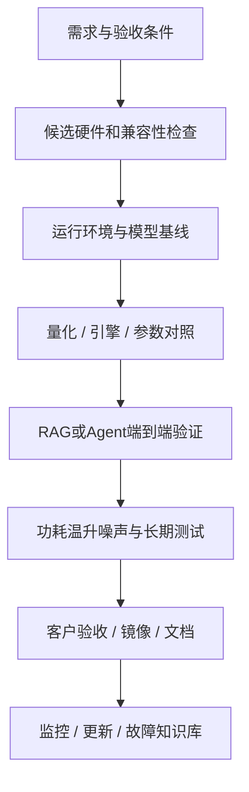

</details>

先用授权或脱敏样本建立基线；验收数据由客户与实施团队共同确认，留出未参与调优的测试部分。达不到承诺时，明确是缩小上下文/并发、换模型精度、升级硬件还是调整需求，不能只替换统计口径。

### 21.3 标准交付包

- **硬件档案**：BOM、序列号、固件与 BIOS 相关设置、拓扑及质保信息。
- **软件基线**：OS、驱动、容器镜像摘要、引擎、模型/分词器/量化配置和许可证。
- **业务配置**：知识库、权限、工具白名单、资源预算、数据与缓存保留策略。
- **测试报告**：负载、长度分布、采样参数、样本数、质量、延迟吞吐、功耗噪声与异常记录。
- **操作说明**：开机自检、服务访问、授权、备份恢复、离线更新、回退、监控与日志采集。

“开箱即用”应由未参与搭建的人按手册在交付配置上验证。恢复出厂与备份恢复也要说明客户数据和密钥如何处理，不能把系统重装当作数据已安全恢复。

### 21.4 学习顺序与面试准备

建议：**Linux与GPU基础 → 模型权重与KV估算 → 单模型服务 → 量化对照 → 并发基准 → 硬件拓扑与热功耗 → RAG/Agent整机负载 → 行业交付。**

重点能解释：显存够为何仍很慢；单请求速度与总吞吐的差别；长上下文如何影响 KV；多卡为何不一定加速；FP8 与 4-bit 权重量化为何不能混为一谈；低噪声、低功耗与高吞吐如何共同验证。

一个可信项目应拿出“模型—精度—硬件—负载—质量—性能”的实测矩阵、一次瓶颈定位过程，以及可复现的镜像与验收报告，而不是只有一张速度截图。

---

## 二十二、AI 陪伴产品：从会回答到持续服务

来源：[AI 技术总监（大模型应用方向）JD](<职位描述/AI 技术总监（大模型应用方向）｜亿龙电器｜89dd708d3954f1560nNz39W5EFRX.md>)。岗位关注有长期记忆、多模态和主动行动能力的陪伴产品，并要求技术负责人同时管理模型效果、推理成本和线上稳定性。

### 22.1 与一次性问答有什么不同

一次性问答重点是当前答案正确；长期陪伴还要关注：几天后能否记住用户允许保存的偏好，是否把不同人的信息混在一起，语气是否稳定，提醒是否合时宜，以及用户是否可以控制和删除记忆。

例如用户说“工作日晚间九点后不要提醒”，系统需要把它作为可修改的约束保存，而不只是把这句话暂时放进聊天窗口。下次主动消息应检查该约束；用户改成“十点以后”时，旧规则要更新而非同时生效。

### 22.2 新增职责与已有内容怎样衔接

| JD 明确要求 | 新增专题 | 与现有章节的区别 |
|-------------|----------|------------------|
| 长期记忆、画像、摘要与向量库 | 第二十三节 | 讨论记忆写入、更新、撤回，不只是检索文档 |
| System Prompt、角色 LoRA、DPO | 第二十四节 | 讨论跨轮次行为和训练数据，而不重复量化部署 |
| 主动对话、剧情推进、情绪感知 | 第二十五节 | 增加触发、许可、频控与交互状态 |
| ASR、情感 TTS、声音克隆、视觉 | 第二十六节 | 增加实时音视频链路和授权边界 |
| 自建评测、Bad Case、灰度与 A/B | 第二十七节 | 同时评长期对话与用户体验 |
| 算法、后端、数据团队和指标责任 | 第二十八节 | 讨论小团队的交付顺序和决策机制 |

### 22.3 一套可逐步建设的架构


<details>
<summary>查看 Mermaid 源码（兼容支持 Mermaid 的软件）</summary>

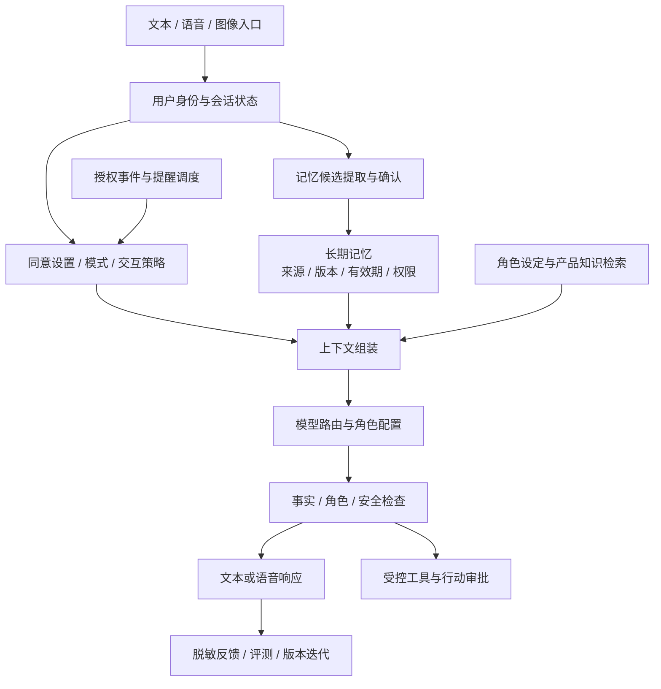

</details>

起步时先用固定角色、文本对话和显式偏好记忆，不必同时训练多个模型、构建复杂剧情和支持所有模态。

---

## 二十三、长期记忆：重点是生命周期，不只是向量库

### 23.1 四类信息分开管理

| 信息 | 示例 | 推荐处理 |
|------|------|----------|
| 短期上下文 | 最近几轮对话、当前问题 | 按 Token 预算保留，任务结束后按策略清理 |
| 会话摘要 | 今天讨论过的目标和待办 | 标注来源和摘要版本，不作为原始事实的唯一依据 |
| 长期用户记忆 | 用户明确允许保存的偏好、长期目标 | 可查看、修改、删除，设置有效期与权限 |
| 角色/世界观知识 | 虚拟角色背景、剧情状态 | 与用户真实经历分开存储和召回 |

“用户在剧情中扮演医生”不能写成现实职业；“模型猜用户可能失眠”不能写成已确诊疾病。向量相似度只说明语义相关，不证明内容真实或当前有效。

### 23.2 记忆写入流程

建议流程：提取候选 → 判断是否值得记忆 → 检查来源与许可 → 结构化校验 → 去重/冲突判断 → 必要时请求用户确认 → 持久化和建索引。

记录至少包括：`memory_id / user_id / tenant_id / type / content / source_ref / observed_at / valid_from / expires_at / status / version / consent_ref`。推断性内容还需显式标记性质，不把模型置信度当作客观真实性概率。

敏感信息应遵循产品适用的数据规则，默认少存；用户随口提到的所有细节都永久保存，通常既无必要也难维护。

### 23.3 更新、冲突与遗忘

用户说“我现在改为夜班”，旧的作息偏好可能失效。区分替换、并存、临时变化和需要补问；保留版本关系，而不是让两个互相矛盾的向量片段同时长期参与回答。

删除记忆时同步处理主记录、向量索引、摘要、缓存和其他派生数据；备份保留及最终删除时间也应有明确策略。不能只删界面上的一行，却在摘要中继续使用同一内容。

### 23.4 召回时先过滤，再排序

按用户、租户、权限、角色、有效期与状态限制候选，再结合相关性、时效和业务优先级排序。Milvus、Qdrant 等可作为向量检索候选，结构化约束仍需数据库或可靠元数据支持。

角色知识、产品知识与用户记忆可分别检索，再按优先级组合。Query 改写不能把原问题中的否定、对象和时间改掉；混合检索与重排需用真实多轮样本评估，不能只测单次检索命中。

### 23.5 怎么评记忆质量

测试“正确记住”“不乱记”“只记该用户”“更新后用新值”“删除后不再使用”。覆盖跨天、长对话、同名人物、否定句和剧情角色等场景。

例如用户先说“我喜欢咖啡”，后说“最近停止喝咖啡，请别再推荐”，下一周的建议应遵循新的约束。仅在向量库里检索到旧句子，不能算记忆功能成功。

---

## 二十四、人设一致性与微调：让行为稳定且可纠正

### 24.1 人设漂移不只是提示词不够长

漂移可能来自上下文截断、冲突记忆、检索错角色、工具结果污染、模型能力不足或训练偏差。先定位原因，再决定是否微调；不能把所有问题都交给角色 LoRA。

角色设定应拆成稳定身份、语气、知识边界、交互规则和可变剧情状态。安全与事实要求优先于角色表演，角色也不应假装自己真的具有医生资质、真实感知或用户未授权的数据访问能力。

### 24.2 三层控制各自负责什么

| 层次 | 作用 | 局限 |
|------|------|------|
| System Prompt 与状态约束 | 声明角色、风格、模式和当前任务 | 不能保证模型始终遵守，冲突和超长上下文仍会影响 |
| SFT / 角色 LoRA 等 | 通过样本学习较稳定的回应风格和行为 | 依赖数据质量，不能代替最新事实或权限控制 |
| 输出检查与后处理 | 检查禁用行为、字段、引用、格式等 | 简单替换词不能纠正复杂语义，必要时重生成或转明确兜底 |

SFT 是监督训练方式；LoRA、QLoRA 是参数高效适配路线，二者不是同一层级的互斥选项。用 LoRA 做 SFT 是常见组合。

### 24.3 DPO 数据如何构造

DPO 是使用偏好对直接优化策略的一类方法，不等于必须训练奖励模型并进行 PPO 式在线强化学习。样本可包含同一段上下文，以及较优和较差两个回应。

例如同一用户表达疲惫，较优答案尊重情绪、提供适度建议并保留选择；较差答案可能过度诊断、答非所问或用内疚感迫使用户继续聊天。标注应明确比较维度，而不是一律偏爱更长、更热情的答案。

保留标注规则、分歧和人工复核。模型打分可以辅助，但需检查长度、风格和自偏好等偏差。训练和测试按用户/会话等分组，避免同一对话改写后泄漏到两侧。

### 24.4 训练体系与模型选型

JD 列举的模型家族和版本属于来源岗位的候选例子，不是当前性能排名。比较中文、多轮、角色、推理、工具调用、长上下文、成本与具体权重许可证，不能按家族名称默认所有版本可商用。

LLaMA-Factory、Axolotl 可作为训练工作流工具；DeepSpeed 等偏向分布式训练与内存优化能力，它们不是完全同类的互斥替代品。按模型与版本核对支持，记录数据、模板、分词器、基础模型及适配器依赖。

路由到小模型或蒸馏模型前也要验证角色和安全回归。蒸馏需要合规数据与训练流程，并非把路由开关设为“小模型”就自动拥有教师能力。

---

## 二十五、主动交互与情绪回应：行动需要明确触发和许可

### 25.1 主动不等于模型在后台随意决定

可由已授权的待办时间、用户订阅事件或明确产品规则触发。调度器先检查时区、安静时段、频率、最近交互、用户模式与退订状态，再决定是否生成和发送。

```text
事件到达 → 校验订阅和当前权限 → 频控及安静时段
→ 检查相关记忆是否仍有效 → 生成候选内容
→ 规则检查 → 发送并去重 → 记录反馈或取消
```

一次通知要有稳定事件标识、有效期和发送状态，处理重复事件、设备离线与重试。通知已发出不等于用户读到，停止提醒也不等于删除了所有相关数据，两者应分开管理。

### 25.2 情绪感知是带不确定性的推断

文本、语音语调或图像可以提供线索，但不能可靠地读出一个人的真实心理状态。应允许用户纠正，使用“听起来你可能有些疲惫”之类可撤回的表达，而不是把推断写成诊断或永久标签。

健康、睡眠等场景明确服务范围，不声称能替代专业诊疗。遇到风险内容按既定产品策略响应，相关政策、专业支持与当地适用要求需在上线前落实。

### 25.3 剧情推进与真实行动分开

虚拟故事中的情节状态可以更新到角色世界观；现实中的发消息、预约、下单、修改健康计划等需要真实工具、权限和必要确认。模型说“我已为你安排”不是执行证据。

使用现有第十二节的工具白名单、幂等、超时和审批机制。重要外部动作不因角色设定而降低授权要求。

### 25.4 未成年人模式与用户自主权

模式选择和适用人群识别需结合实际产品要求设计，不能只在提示词中加“适合儿童”。内容策略、通知时间、数据保存、语音和图像权限、投诉与人工处理都需要相应控制。

允许暂停主动互动、退出角色、查看和删除记忆。留存和时长增长不应依赖恐吓、内疚、隔离现实关系或伪造紧急状态等方式。

---

## 二十六、多模态交互：先把实时链路接顺

### 26.1 语音不是加一个 TTS 按钮

**ASR**把语音转成文字；**TTS**把文字合成为语音；**VAD**帮助判断语音活动。连续对话还需要处理说话轮次、静音、噪声、打断和播放状态。


<details>
<summary>查看 Mermaid 源码（兼容支持 Mermaid 的软件）</summary>

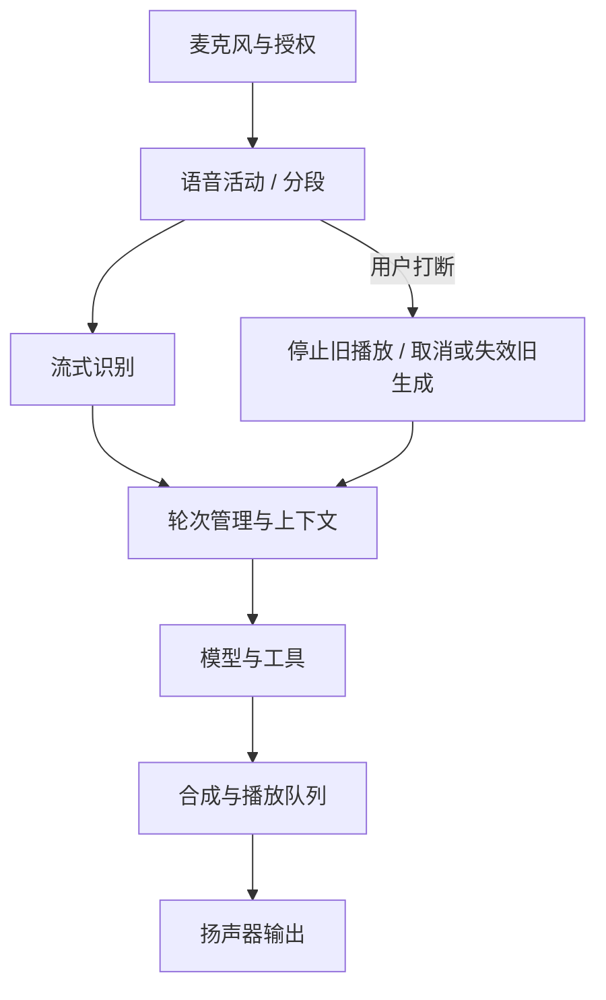

</details>

ASR 的中间结果可能反复修订，不能每次修订都立即执行一次工具。重要操作在识别稳定并确认后处理。每轮带 `turn_id`，用户打断后丢弃旧轮次晚到的音频，防止过时回答继续播放。

### 26.2 延迟要测到可听见

记录采集/端点检测、ASR、模型首输出、TTS 首音频、网络与播放缓冲。文本 TTFT 很低，不代表语音首响应就快；按句分段合成可降低等待，但过碎会影响韵律与上下文。

FunASR、Whisper 类识别工具，CosyVoice、GPT-SoVITS 类语音方案是 JD 提及的候选方向，需核对实时能力、语言、硬件、许可证与具体版本，而非认为同类模型都能直接互换。

### 26.3 情感 TTS 与声音克隆

语气、速度与韵律需与文本和场景匹配，避免把严肃回应读成过分欢快。声音克隆需取得适当授权，明确使用范围、样本保存、撤回和删除机制；不能默认拿到录音就拥有可用于克隆和商用的权利。

将声纹或样本与普通聊天记录分开控制访问。测试声音自然度、可懂度、专有词读音和不同设备播放，而不只听一个演示句子。

### 26.4 视觉理解与图像生成是不同能力

Qwen-VL、GLM-4V 类模型可作为图像理解候选；虚拟形象或场景生成通常需要合适的图像生成能力，不能由“支持看图”推断“支持生成图”。

上传图片前明确权限和用途，处理文件大小、方向、格式和敏感内容。图像中的文字或提示属于不可信输入；看图推断也需要不确定性，不能据照片给出确定医疗诊断。

可以先支持用户主动上传单张图，再评估连续摄像头；后者涉及更高的隐私、带宽和实时计算成本，不宜默认持续采集。

---

## 二十七、评测与数据闭环：长期对话不能只测单轮答案

### 27.1 建立分层评价体系

| 维度 | 测什么 | 例子 |
|------|--------|------|
| 人设一致性 | 身份、语气、角色知识和边界 | 长对话或工具调用后不混成另一个角色 |
| 记忆正确性 | 写入、召回、更新、删除和隔离 | 改了偏好后不再使用旧值，不串用户 |
| 情感恰当性 | 是否理解情境、尊重选择、避免过度推断 | 用户拒绝建议后不纠缠 |
| 安全与权限 | 越狱、内容、敏感数据和工具授权 | 文档注入不能触发越权动作 |
| 交互流畅度 | 补问、话题衔接、重复与语音打断 | 用户改口后能及时切换 |
| 工程性能 | 尾延迟、错误、资源与单任务成本 | 混合长短对话下仍满足服务目标 |

MT-Bench、AlpacaEval 等可提供多轮或偏好评测思路，不能直接当作陪伴产品的完整验收集。自建场景应覆盖短、中、长会话，跨天、记忆冲突、拒绝互动和异常工具结果。

### 27.2 Bad Case 回流不是把所有日志拿去训练

按告知、许可和保留规则抽样，最小化和脱敏，再分类为检索、记忆、提示、模型、工具或产品策略问题。检索错了先修索引，权限错了先修服务，不把所有问题转成 SFT 样本。

标注输入、期望行为、证据、错误类型和审核状态；偏好对还要记录比较理由。训练集与冻结回归集隔离，避免用线上原始对话自动训练并立即上线。

### 27.3 A/B 实验要有质量与体验护栏

明确按用户等合适单位分组，避免同一用户角色和记忆在实验组间反复切换。记录模型、提示词、记忆策略、语音版本等暴露信息，区分新老用户和使用场景，并预先定义观察窗口、样本量和停止条件。

除留存、轮次和时长，还应看满意度、通知拒绝、投诉、错误记忆、人工处理、成本和安全事件。聊得更久可能是更有价值，也可能是系统反复答错，不能单凭时长判断改善。

### 27.4 灰度和回退覆盖整个对话系统

代码、模型、适配器、Prompt、角色设定、索引、记忆 schema 和策略配置形成发布清单。先离线回归、再小范围验证，观察异常后可单独关闭主动提醒、记忆写入或某类工具。

模型回退不自动撤销错误记忆和已发送通知。需要识别本次版本产生的派生数据，按规则修复或失效，保留审计并避免重放外部副作用。

---

## 二十八、技术负责人视角：分阶段交付与团队协作

### 28.1 同时管理效果、成本和稳定性

效果包括事实、角色、记忆及用户体验；成本应看完整成功会话或任务，而不只看单 Token；稳定性包括延迟、可用性、恢复和数据正确性。设定基本护栏后比较方案，不为降成本而接受串用户记忆等缺陷。

推理部署和量化参考第十四至二十一节。角色 LoRA 切换、长上下文、语音与多用户记忆会改变实际负载，需要重新测量；前缀/KV 复用也要遵守用户和权限隔离。

### 28.2 小团队按责任分工

| 责任 | 主要工作 | 协作契约 |
|------|----------|----------|
| 算法与训练 | 模型选型、数据实验、SFT/DPO、质量评测 | 模型与模板版本、能力限制、回归结果 |
| 后端与平台 | 会话、记忆、工具、权限、推理和观测 | API/schema、时限、错误与恢复机制 |
| 数据与评测 | 授权数据、标注、样本版本、回归集 | 来源、标签规则、访问和删除策略 |
| 产品与相关专业支持 | 使用场景、模式、通知和风险处置 | 验收标准、用户控制和升级流程 |

JD 的 3–8 人团队规模是岗位设想，不是通用配员标准。人数少可以兼任，但关键数据访问、发布和质量问题仍需明确负责人，必要专业支持也不能省略。

### 28.3 从文本伙伴到多模态的实施路线

| 阶段 | 交付范围 | 验收重点 |
|------|----------|----------|
| 1：文本基线 | 单角色、基本上下文、只读知识检索 | 角色与事实、多轮流畅、性能基线 |
| 2：可控记忆 | 显式偏好、摘要、查询修改删除 | 更新冲突、权限隔离、遗忘验证 |
| 3：训练迭代 | 确有必要时做 SFT/LoRA，再评估 DPO | 基线对照、长对话与安全回归 |
| 4：主动与工具 | 授权提醒、简单工具、频控和确认 | 退订、过期、重复、时区与副作用 |
| 5：语音 | ASR/TTS、轮次和打断 | 首音频延迟、噪声、误识别和旧音频停止 |
| 6：视觉与扩展 | 主动上传图像、更多场景和角色 | 权限、质量、数据与资源预算 |

这是顺序建议，不是固定工期；每阶段先确认数据、硬件、产品规则和团队依赖。训练没有证明优于基线时，可以继续使用提示词与检索方案交付。

### 28.4 最终验收与面试准备

演示同一用户跨天更新偏好、删除后不再召回、不同用户隔离、角色受干扰后仍遵守边界、用户打断语音、主动提醒退订及工具超时核对。提交质量报告、成本与尾延迟、版本清单、失败案例和回退记录。

面试重点能解释：长期记忆与聊天历史有什么不同；人设漂移怎样定位；DPO 数据为何不能只按文案长短标注；主动互动如何尊重用户；语音 TTFT 为何不同于文本 TTFT；为何留存和时长必须与质量、拒绝和投诉一起看。

技术负责人的成果既包括亲手跑通系统，也包括让团队能重复验证、维护和迭代它，而不是只依靠一个人的临场调参。

---

## 二十九、公司级 Agent 基础设施：从应用到共享平台

来源：[Agent 架构师 JD](<职位描述/Agent架构师｜某大型知名互联网上市公司｜a2e52ae16dd9e07d0nJz3Nm1FFdX.md>)。该岗位从单一应用扩展到多业务线、千万级调用的端到端基础设施；这不意味着每个 Agent 项目都需要同样规模。

### 29.1 平台化解决什么问题

当多个团队分别实现模型调用、重试、工具授权和计费，很容易出现各自重复建设、版本难管、配额相互争抢。共享平台提供稳定契约，业务团队保留自己的领域规则、任务目标和验收标准。

| JD 新增重点 | 本文位置 | 与已有内容的衔接 |
|-------------|----------|------------------|
| 公司级请求、上下文、推理、工具与执行架构 | 第二十九节 | 从第十二节单任务扩展到多业务平台 |
| PD 分离、投机解码、批调度技术路线 | 第三十节 | 在第十七、十八节引擎与性能基础上深入 |
| 高并发运行时、短路、缓存和恢复 | 第三十一节 | 将任务正确性变成可复用机制 |
| 千万级容量、资源池与弹性 | 第三十二节 | 区分业务请求、模型调用与 Token 负载 |
| SLO、降级、观测与混沌演练 | 第三十三节 | 建立生产可靠性目标和验证方法 |
| 成本治理、技术决策与演进 | 第三十四节 | 按业务成果衡量平台价值 |

### 29.2 控制面、运行时与推理数据面

**控制面**管理应用定义、版本、权限、模型目录、配额和发布；**运行时**执行具体任务，管理状态、步骤与工具；**推理数据面**承载模型请求与 Token 生成。三者可先在少量服务中实现，职责清晰后再按瓶颈拆分。


<details>
<summary>查看 Mermaid 源码（兼容支持 Mermaid 的软件）</summary>

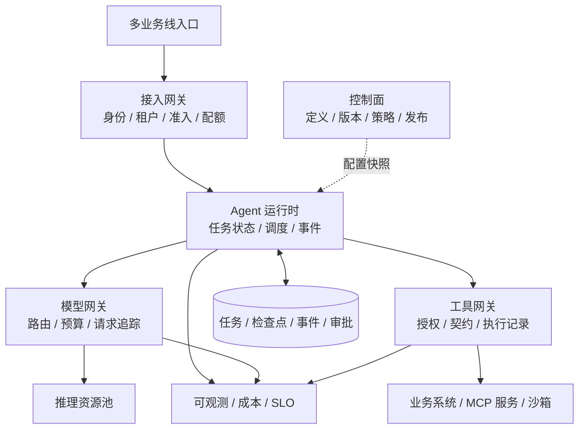

</details>

每次任务使用确定的配置快照，包括 Agent 定义、模型策略、Prompt、工具和权限版本。不能让一个执行到一半的任务无感切到完全不同的工具契约。

### 29.3 Function Calling、MCP、Tools、Skills 分别在哪

Function Calling/Tool Use 让模型表达调用工具的意图；Tool 是可执行功能及其契约；MCP 是连接工具和资源的协议；Skills 在不同平台中常指任务指导与配套资源，其加载、执行和信任模型依具体实现而定，不是统一的授权协议。

平台应统一工具元数据、输入输出 schema、身份传递、风险类别、超时、幂等、审计和版本。接入 MCP 或加载 Skill 并不会自动获得可信权限，指令与工具输出也不能绕过服务端授权。

---

## 三十、推理架构进阶：优化前先理解代价

### 30.1 连续批处理与分块预填充

**连续批处理**允许调度器在生成过程中让已完成序列退出、新序列进入，减少等整批完成的空闲。它提升资源利用的潜力，也需要限制活跃序列、Token 预算和排队。

**Chunked Prefill（分块预填充）**将长输入处理拆成较小块，与其他请求的生成交错调度，缓解长 Prompt 干扰正在生成的请求。块大小和调度策略会影响首 Token、Token 间隔及整体吞吐，不能只看一个指标。

PagedAttention 等分页式 KV 管理减少部分内存碎片和分配浪费，但不会让真实 KV 数据消失。最大上下文和并发仍受显存与计算约束。

### 30.2 PD 分离是什么

**PD 分离**是把 Prefill 与 Decode 放到可独立配置和调度的资源中。Prefill 与 Decode 的计算和带宽特征不同，分离有机会减轻干扰并各自扩容，但引入 KV 传输、路由、资源协调和失败恢复。


<details>
<summary>查看 Mermaid 源码（兼容支持 Mermaid 的软件）</summary>

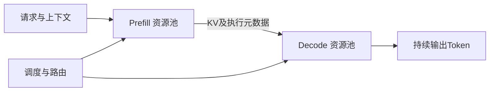

</details>

是否跨 GPU、跨节点及如何传输取决于实现。先测 KV 大小、传输带宽、拓扑和队列，再比较与同资源不分离方案的达标吞吐。网络慢、请求较短或资源较小时，复杂度和传输开销可能抵消收益。

恢复时还需判断 KV 是否完整、模型和格式是否兼容、旧资源是否已释放。不能把不同模型、适配器或不兼容版本的 KV 随意搬到另一节点继续生成。

### 30.3 投机解码与蒸馏不同

**投机解码**常由较便宜的草稿机制提出多个候选 Token，再由目标模型验证，以减少逐 Token 执行的部分开销。收益取决于候选接受率、草稿成本、验证开销、批量和硬件。

在满足相应算法假设和实现条件时，可保持目标采样分布；近似变体及实现差异需单独验证，不能宣称所有投机方法都完全无质量变化。结构化输出、工具调用、不同采样与负载也要回归。

**蒸馏**则通过训练让较小模型学习教师行为，之后可独立承担部分请求。它可能改变能力和错误分布，与运行时验证草稿不是同一机制；训练数据使用权和教师输出许可也需确认。

### 30.4 前缀缓存、结果缓存与语义缓存

| 缓存 | 复用什么 | 命中与风险 |
|------|----------|------------|
| 前缀/KV缓存 | 已处理前缀的部分计算状态 | 依赖Token、模型、模板、适配器和引擎语义；需隔离权限 |
| 精确结果缓存 | 受控条件下完全相同任务的结果 | key 应包含影响答案的版本、身份范围、资料及工具状态 |
| 语义缓存 | 相近问题的候选答案 | 相似不等于可互换，金额、否定、时间和用户差异尤其敏感 |

语义缓存优先用于可验证、低时效风险内容，命中后仍可检查实体、版本和证据。实时订单、私人记忆、审批和资金动作不能因为语义相似就复用别人的答案或执行结果。

---

## 三十一、Agent 运行时：把执行责任收进平台

### 31.1 运行时需要保存哪些状态

除 `run_id` 和聊天记录外，还需任务定义版本、步骤及依赖、累计预算、工具调用、待审批动作、已完成产物、事件游标、租约/执行代次和终止原因。模型上下文可由这些信息组装，不能把一段自然语言摘要当作全部任务事实。

长任务用持久化队列和 Worker 推进，同步入口只负责创建、查询和订阅事件。Worker 有界并发、租约和心跳；旧 Worker 恢复后需通过执行代次等规则阻止过期写入。

### 31.2 DAG、并发和短路求值

独立只读查询可并行；有依赖或业务写入则按明确顺序处理。将工作表达为节点和依赖，检查扇出上限、失败传播和总预算，避免每个子 Agent 都自行开启无限并发。

**短路求值**是条件已经决定结果后不再执行无意义步骤。例如权限检查失败直接结束，不继续检索；已找到足够且合格的证据时可取消额外可选查询。

取消不能撤销已经发生的外部动作。短路策略也不能跳过必要审批、账务核对或必须完成的补偿；子任务取消、资源释放与实际执行结果需分别记录。

### 31.3 请求合并不等于业务请求合并

相同租户和权限范围内，同时读取同一份不可变资源，可用 singleflight 等合并进行中的查询。但调用者退出不应无条件取消其他人仍需的共享结果，应设计独立等待与执行生命周期。

模型侧批处理通常仍保留每个请求的上下文和结果边界，不是把多个用户的私有 Prompt 拼在一起。写操作更不能仅靠文本相同就合并，需要业务幂等和授权。

### 31.4 流式返回与上下文压缩

流式事件应包含任务、步骤、事件序号和类型，区分进度、候选文本、待审批及最终结果。断线可从事件游标恢复显示，不要把播放器式的“文本已显示”当成任务持久化完成。

上下文压缩优先保留当前目标、约束、有效证据和必要近期对话，旧步骤存结构化结果与来源。压缩摘要要可追溯，不能丢掉否定、单位、权限和审批条件。

### 31.5 检查点与恢复不保证副作用只发生一次

工具返回成功后、写检查点前宕机，恢复可能再次执行该工具。解决方式依赖稳定幂等键、业务唯一约束、执行账本及结果核对，不是仅“每一步存一次状态”。

任务回放区分只读重算、历史展示和真实重执行。复现故障时使用工具记录或沙箱，禁止把线上历史流量直接重放为真实下单、发送通知等动作。

---

## 三十二、千万级调用：容量规划与资源池化

### 32.1 先定义“调用”的统计单位

日均一千万次若指一天合计一千万次，则平均约 `10,000,000 / 86,400 ≈ 116 次/秒`。日均值无法说明峰值；还要看地域时段、突发、任务时长和重试。

一次业务任务可能有多次模型调用和工具调用。假设业务峰值是平均的 8 倍、每任务平均 3 次模型调用，那么无重试的模型请求约为 `116 × 8 × 3 ≈ 2,784 次/秒`。这是教学估算，8 倍与 3 次不是岗位实测值。

再按输入与输出长度分布、生成时长、质量要求和路由比例转成负载。输出 Token/s、输入处理 Token/s、活跃序列数和 KV 峰值应分别估算，不能只用请求 QPS 选 GPU。

### 32.2 用实测服务曲线估副本

```text
平均在途请求数 ≈ 到达率 × 平均停留时间（稳定状态、口径一致）
候选副本数 ≈ 目标峰值工作量 / 单副本在SLO内的有效容量，再计入冗余与余量
```

单副本容量来自目标混合负载压测，而不是厂商峰值吞吐。队列过载后系统不再稳定，不能继续用简单平均公式证明无限排队可行。

分模型、长短上下文、在线/批量、租户与优先级建立容量表，并验证节点或可用区故障后的剩余容量。冗余系数依恢复目标、部署边界和风险确定。

### 32.3 GPU 资源池不是显存自动共享

资源池负责设备分配、放置、配额和回收。多实例并发、硬件分区或其他共享方式依设备与软件支持，可能存在隔离、碎片和干扰问题；Kubernetes 申请到 GPU 也不等于获得稳定的模型服务能力。

多卡模型需考虑拓扑感知放置、成组资源与通信域。训推混部还需控制训练抢占、内存与网络影响，避免离线任务破坏在线尾延迟；不能只看 GPU 总利用率变高。

### 32.4 弹性需要为加载和预热留时间

模型下载、加载、通信初始化与预热可能很慢。扩容指标可组合队列长度及年龄、请求/Token 负载、显存和延迟；CPU HPA 不能完整反映推理瓶颈。

保留适当热容量，限制扩容抖动；缩容先停止新请求、排空活跃序列和任务，再释放资源。先确认就绪和路由更新，再向新节点放流量。

### 32.5 多业务隔离与准入

按业务和租户设置请求、并发、输入长度、输出预算、工具及总任务预算。交互请求和离线批量走不同队列或资源策略；采用可解释的公平与优先级规则，避免一个业务耗尽所有资源。

接近容量时可以拒绝、限速、转异步或采用经验证的降级模型，而不是无上限接入后集体超时。准入还要考虑长请求预估资源，不只统计当前请求数。

---

## 三十三、SLO、降级与故障演练：让稳定性可以验证

### 33.1 从用户可感知的结果定义 SLI

**SLI**是测量指标，**SLO**是目标，**错误预算**是目标允许的失败额度。区分模型服务可用、工具可用与业务任务完成，不能仅以网关返回 200 统计成功。

| 对象 | 可选SLI | 需要说明 |
|------|---------|----------|
| 对话推理 | 成功率、首Token和Token间隔 | 是否包含排队、是否截断、窗口和样本 |
| Agent任务 | 达成目标比例、完成时间 | 用户取消、合法拒绝、人工审批如何分类 |
| 工具 | 调用成功、结果未知、延迟 | 传输成功与业务成功分开 |
| 平台数据 | 事件持久化与恢复完整性 | 丢事件和重复副作用不能被普通成功率掩盖 |

例如 30 天窗口的 99.9% 时间可用性对应约 43.2 分钟允许不可用，但请求型成功率的预算应按请求数计算，不能直接换算成同一段停机时间。具体目标由业务确定，并制定消耗过快时的发布与容量行动。

### 33.2 分级降级需要兼容性约束

可以依次减少非关键检索或可选步骤、使用受控缓存、切换通过评测的模型、转异步或人工。每种降级都标明损失与适用范围，不返回伪造的“已完成”。

故障切换需核对模型工具 schema、上下文长度、输出结构、数据地域与隐私规则。已经产生部分输出或调用工具时，整段自动重试可能造成语义重复或副作用，需要运行时参与恢复。

### 33.3 全链路观测避免成本和错误失联

串联 `trace_id / tenant_id / app_id / run_id / step_id / model_request_id / tool_call_id`，记录模型版本、Token、排队、生成、缓存、重试与终止原因。异步任务用适当关联或 span link 保留因果关系。

敏感 Prompt 和工具结果按许可、访问和保留策略采集；指标标签不直接放无限增长的 run_id 或原始用户文本，避免高基数拖垮监控。

### 33.4 混沌演练先定义边界和预期

| 故障注入 | 验证问题 |
|----------|----------|
| 模型节点退出或超时 | 请求可否受控失败或切换，是否出现重试风暴 |
| 工具慢或结果未知 | 是否隔离线程/并发，写操作是否被重复执行 |
| Worker写检查点前后退出 | 是否恢复任务、核对副作用并阻止旧Worker推进 |
| 队列重复与短时不可用 | 事件是否丢失，去重和积压恢复是否有效 |
| 租户突发或长Prompt集中到达 | 其他业务是否仍获资源，准入是否生效 |

先在隔离环境验证，再按授权范围小规模演练，设置停止条件和回退。保留预期、观测、恢复时间及修复项；不要只写“服务自动重启成功”就判定全链路可用。

---

## 三十四、成本治理与演进：架构决策要有证据

### 34.1 从单Token成本到单位业务产出

```text
单位成功任务成本
=（模型/算力 + 检索工具 + 网络存储 + 失败重试 + 约定范围的运维成本）
  / 达到质量要求的成功任务数
```

统一成本边界，区分边际成本和含闲置资源的实际分摊。小模型便宜但多轮纠错、转大模型和人工接管增加时，整任务可能更贵；GPU 利用率高但用户大量超时也不是成本优化成功。

### 34.2 大小模型路由怎么验证

路由可根据任务类型、上下文、风险与已验证的质量特征决定，不只看问题字数。用固定样本比较准确性、成功率、尾延迟和成本，保留低置信或能力不足时的升级路径。

若先用小模型再升级，需计入两次成本和延迟；对重要工具执行，升级不能改变审批与权限。路由器本身也要版本化和回归。

### 34.3 用架构决策记录减少反复争论

每项关键决策记录问题与约束、候选方案、压测/质量证据、总成本、失败模式、选择理由、责任人和重新评估条件。例如 PD 分离先在某类长输入高并发负载试点，而不是宣布全平台立即迁移。

算法负责模型与质量边界，平台负责资源和服务能力，业务负责领域成功条件，共同确认接口和版本。共享平台提供规范与可观测，不替业务团队猜所有状态含义。

### 34.4 从单业务到公司级的演进路线

| 阶段 | 交付范围 | 进入下一阶段的依据 |
|------|----------|--------------------|
| 1：可靠单任务 | 受控工具、持久化状态、审批、基本观测 | 正确性与恢复用例通过 |
| 2：共享网关 | 模型目录、鉴权、配额、成本与版本 | 多业务契约和隔离可验证 |
| 3：运行时平台 | 调度、事件、检查点、缓存及工具接入规范 | 真正减少重复建设且不牺牲业务能力 |
| 4：规模与SLO | 负载建模、资源池、公平准入、降级演练 | 峰值和故障条件下仍满足目标 |
| 5：专项加速 | 按证据选择PD分离、投机解码、蒸馏等 | 同资源同质量下有可持续收益 |

日均千万级是结果规模，不能用一张架构图直接证明。完整验收应包含负载分布、峰值和故障压测、任务成功率、尾延迟、成本、跨租户隔离及可复现发布清单。

### 34.5 学习与面试准备

建议顺序：**单Agent正确性 → 分布式任务与事件 → 模型网关与配额 → 推理调度 → 容量与GPU资源 → SLO与故障演练 → 成本路由与专项加速。**

重点讲清：日调用量为何不能直接决定GPU数量；PD分离何时值得做；投机解码为何依赖接受率和验证成本；检查点为何不能保证外部动作只执行一次；语义相似为何不能等同缓存可复用；共享平台如何防止某条业务线占满资源。

项目材料应展示一条真实任务的端到端Trace、一份可复现容量报告、一次故障恢复和成本对照，以及有明确取舍的架构决策记录。

