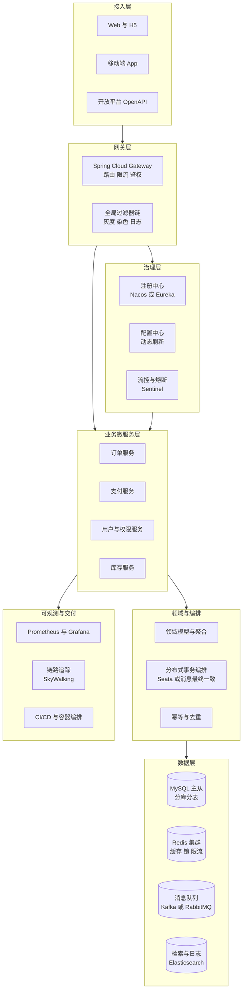
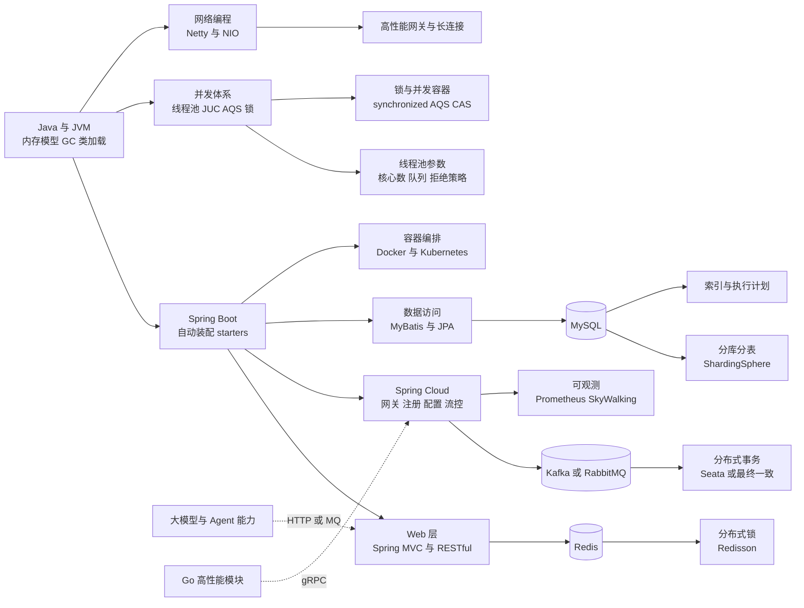
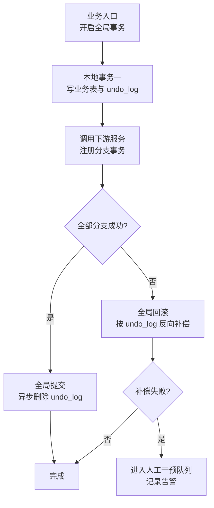
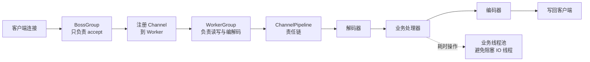
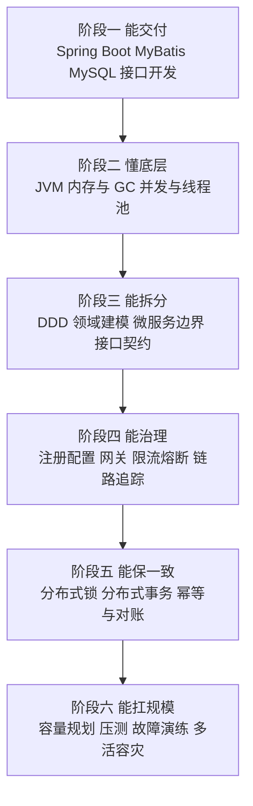
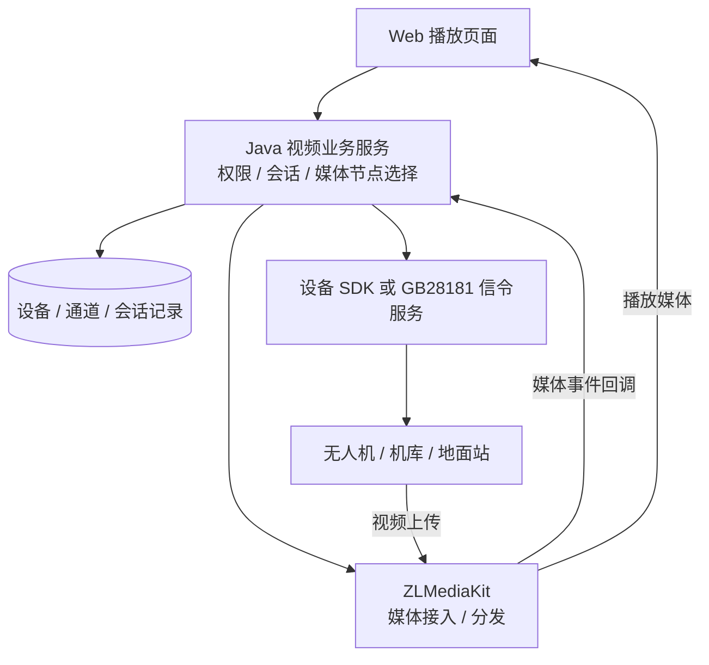
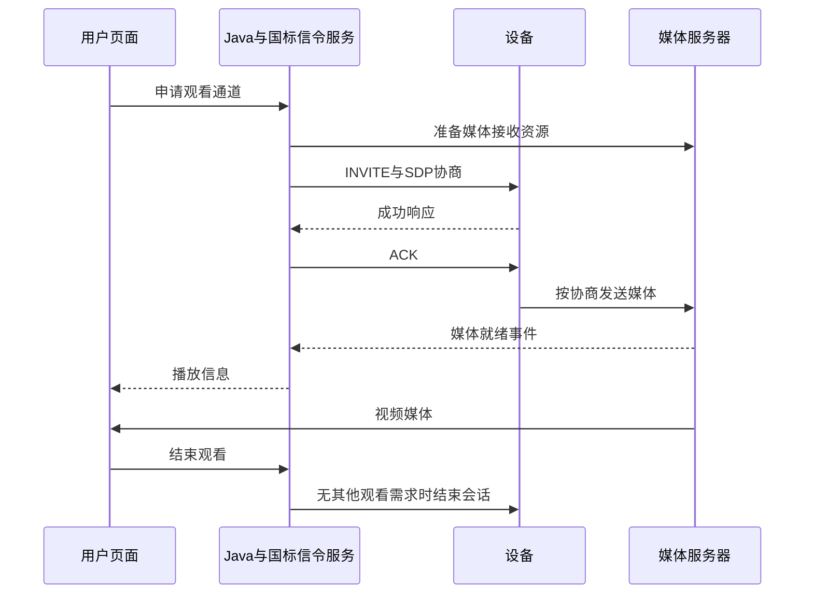
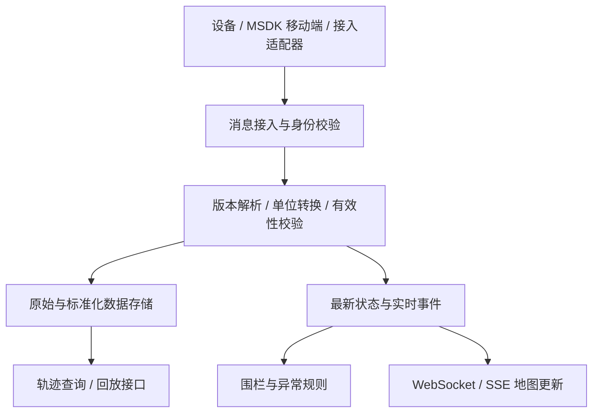
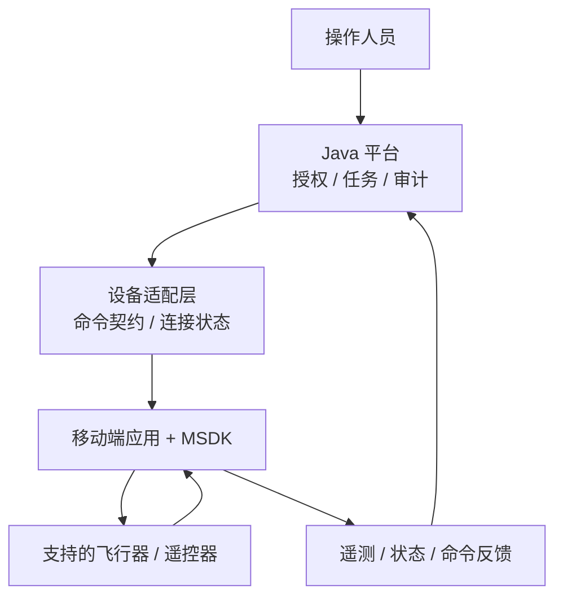

# 03 · Java 微服务后端架构

> 配套学习：[Java 语言零基础到微服务实战](./03-Java语言零基础到微服务实战.md)，包含 GitHub 资料、原理、可运行练习及订单、企业集成、无人机与 AI 项目路线。

> 数据基础：56 份 JD 聚合去重 | 薪资均值 17-28K | 学历主流：本科 | 经验主流：5 年以上
> 内容已去除公司信息，保留技术事实。
> 专项增补：依据新增无人机 Java 岗位“技能要求第 4 项”，补充 ZLMediaKit、GB28181 与实时视频推流播放。原样本数量及词频未重新统计；后文协议选择和架构为实施建议，不代表岗位逐项要求。
> 后续增补：依据同一岗位第 5、6 项，补充 GeoServer/GIS、轨迹与围栏、火点标绘、WPML 航线、MSDK 接入和飞行任务调度。统计数据仍沿用原口径；SDK 与航线能力需按实际设备、固件及版本核对。

**无人机专题阅读顺序**：第十一至十六节学习视频；第十七至十九节学习地图、遥测和轨迹；第二十至二十二节学习航线、设备接入及任务调度；第二十三节给出综合实践与验收。

---

## 一、方向定位

这一方向的核心职责不是"会用 Spring Boot 写接口"，而是**在既有业务复杂度之上，用微服务的方式把系统拆得开、连得上、扛得住、改得动**。

Java 是本批 JD 中体量最大、要求最"深"的方向：它同时考核语言底层（JVM、多线程）与架构上层（服务治理、分布式一致性），是典型的"两头都硬"岗位。

| 技术/能力 | 出现篇数 | 占本方向比例 | 解读 |
|-----------|---------|-------------|------|
| Java | 56 | 100% | 岗位基线语言，无例外 |
| MySQL | 45 | 80% | 关系型主存储，索引与事务是核心考点 |
| Redis | 43 | 77% | 缓存、分布式锁、限流、会话 |
| 微服务 | 32 | 57% | 拆分、治理、注册发现是日常背景 |
| Spring Boot | 29 | 52% | 事实标准开发框架 |
| Docker | 26 | 46% | 容器化交付已普及 |
| MyBatis | 21 | 38% | 国内主流 ORM，SQL 可控性优先 |
| 高并发 | 19 | 34% | 与多线程构成能力分水岭 |
| Go | 19 | 34% | 多语言协同，Go 承载高性能模块 |
| Python | 18 | 32% | 脚本化与 AI 侧协同 |
| Spring Cloud | 18 | 32% | 微服务全家桶，治理能力载体 |
| 多线程 | 17 | 30% | JMM、锁、线程池是必考项 |
| Kafka | 16 | 29% | 异步解耦与事件驱动 |
| RESTful | 16 | 29% | 对外接口主流风格 |
| JVM | 15 | 27% | 内存模型、GC、调优，高级岗硬门槛 |
| 性能优化 | 15 | 27% | 从 SQL 到 JVM 到架构的全栈优化 |
| Vue | 13 | 23% | 全栈化要求 |
| PostgreSQL | 13 | 23% | 与 MySQL 互补，GIS/JSONB 场景 |
| RabbitMQ | 13 | 23% | 轻量异步与延迟队列场景 |
| Git | 13 | 23% | 协作与分支管理 |
| React | 12 | 21% | 前后端协同 |
| 大模型 | 12 | 21% | AI 能力嵌入既有 Java 业务系统 |

**补充抽样统计**（可回溯子样 58 篇，用于补充上表 Top 之外的细项）：并发相关表述 25 篇约 43%、调优 16 篇约 27%、CI/CD 11 篇约 18%、单元测试 9 篇约 15%、锁 8 篇约 13%、限流 5 篇约 8%、幂等 5 篇约 8%、分库分表 2 篇、MVCC 与索引优化各 2 篇、Netty 1 篇。

**城市与薪资侧写**：样本以深圳为主（南山区占子样 23/58），广州天河、海珠、黄埔与深圳宝安、龙岗次之，另有佛山岗位；薪资可统计样本 58 条，低端均值 17.8K、高端均值 28.6K，上探到 70K 档位。

**一句话总结**：这个方向的门槛在"深度 + 体系"——**向下要能讲清 JVM 内存与线程模型、能调线程池和 GC；向上要能设计服务拆分、保证分布式一致性、建立可观测与发布体系。** 只会 CRUD 和只会背八股，都过不了。

---


### 完整技术栈清单（全量抽取 · 基于本方向 56 篇 JD）

> 下表由 JD 全文穷举抽取生成，数字为**出现该术语的 JD 篇数**，用于补齐正文未展开的细分技术项。

| 类别 | 技术栈（数字为出现篇数） |
|------|------------------------|
| **语言** | Java(56)、SQL(28)、Python(18)、Go(7)、JavaScript(7)、TypeScript(4)、C++(3)、Node.js(3)、Kotlin(2)、Golang(1)、Shell(1)、PHP(1)、Lua(1)、Dart(1)、Swift(1) |
| **后端框架** | Spring(45)、Spring Boot(29)、MyBatis(21)、Spring Cloud(18)、SpringBoot(13)、Dubbo(6)、FastAPI(5)、Django(5)、Spring MVC(5)、MyBatis-Plus(5)、RPC(4)、Flask(3)、Hibernate(3)、gRPC(2)、Gin(2)、NestJS(2)、JPA(2)、Netty(2)、Celery(2)、Express(1) |
| **前端框架与UI** | React(12)、Vue(12)、jQuery(3)、Vite(3)、小程序(3)、H5(3)、Flutter(2)、Next.js(2)、低代码(2)、Element UI(2)、Ant Design(2)、Vue3(1)、组件化(1)、Webpack(1)、Three.js(1)、响应式(1)、Nuxt(1)、uni-app(1) |
| **移动端** | 移动端(6)、Android(4)、iOS(3)、Kotlin(2)、App开发(1)、鸿蒙(1)、Swift(1)、React Native(1)、Uniapp(1) |
| **数据库与存储** | MySQL(45)、Redis(43)、PostgreSQL(13)、MongoDB(8)、Oracle(6)、SQL Server(5)、Elasticsearch(4)、pgvector(2)、Milvus(1)、ClickHouse(1)、MinIO(1)、HBase(1)、InfluxDB(1)、时序数据库(1) |
| **消息与中间件** | Kafka(16)、RabbitMQ(13)、RocketMQ(7)、MQTT(3)、Nacos(3)、定时任务(1)、ZooKeeper(1)、XXL-JOB(1)、Sentinel(1) |
| **云容器与DevOps** | Docker(26)、CI/CD(12)、容器化(11)、Kubernetes(10)、K8s(8)、Nginx(7)、DevOps(6)、流水线(4)、资源调度(3)、Jenkins(3)、灰度发布(1)、自动化部署(1)、Istio(1)、Service Mesh(1)、GitLab CI(1)、Ingress(1)、镜像(1)、K3s(1)、Operator(1)、持续交付(1) |
| **大数据与数据平台** | 报表(3)、BI(3)、数据同步(3)、Hadoop(3)、ETL(2)、Flink(2)、Spark(1)、数据质量(1)、数据中台(1)、Hive(1)、数据仓库(1)、离线计算(1) |
| **AI与机器学习** | Claude(13)、大模型(12)、Agent(10)、RAG(6)、LLM(4)、智能体(3)、Prompt(3)、MCP(3)、多模态(3)、模型部署(3)、LangChain(2)、微调(2)、ASR(2)、DeepSeek(1)、LangGraph(1)、PyTorch(1)、OpenCV(1)、vLLM(1)、Dify(1)、提示词(1) |
| **音视频与流媒体** | 低延迟(2)、转码(2)、FFmpeg(1)、RTMP(1)、硬编(1) |
| **嵌入式与硬件** | CAN(1)、OTA(1)、WiFi(1)、ROS(1)、储能(1)、CoAP(1)、数字孪生(1)、光伏(1) |
| **桌面与客户端** | 客户端(3)、.NET(2) |
| **协议与接口** | RESTful(16)、WebSocket(6)、HTTP(5)、TCP(4)、GraphQL(3)、接口对接(2)、gRPC(2)、JSON(2)、HTTPS(2)、长连接(2)、SDK(1)、开放平台(1)、Webhook(1)、FTP(1)、WebService(1)、SSE(1)、OAuth2(1)、JWT(1)、CAS(1)、Protobuf(1) |
| **安全与合规** | HTTPS(2)、RBAC(2)、合规(1)、权限控制(1)、SSL(1) |
| **工程化与质量** | 重构(14)、Git(11)、单元测试(11)、代码评审(8)、技术文档(7)、集成测试(6)、日志(5)、设计文档(5)、接口文档(5)、编码规范(5)、Maven(3)、SVN(2)、压测(2)、GitHub(1)、灰度(1)、复盘(1)、敏捷(1)、Jira(1)、GitLab(1)、Selenium(1) |
| **架构与设计** | 微服务(32)、架构设计(26)、高并发(19)、多线程(17)、性能优化(15)、方案设计(15)、高可用(10)、异步(10)、锁(7)、技术选型(6)、限流(6)、抽象(6)、设计模式(6)、负载均衡(6)、SaaS(5)、降级(5)、幂等(5)、熔断(5)、分布式事务(5)、分库分表(5) |
| **业务领域** | ERP(11)、电商(7)、订单(6)、支付(6)、实施(5)、金融(5)、物流(5)、MES(4)、供应链(4)、风控(4)、WMS(3)、库存(3)、医疗(3)、PLM(2)、物联网平台(2)、财务(1)、CRM(1)、OA(1)、项目管理(1)、金蝶(1) |
| **软技能** | 团队协作(15)、沟通能力(14)、需求分析(11)、责任心(11)、规划(9)、学习能力(7)、培训(6)、文档编写(5)、跨部门(4)、抗压(3)、出差(2)、owner(2)、英语(1)、复盘(1) |

---

## 二、参考架构图

一套典型的 Spring Cloud 微服务参考架构。注意"分布式一致性"与"治理与可观测"两块，是把"一堆 Spring Boot 应用"变成"可运营的微服务体系"的关键。



### 架构解读

1. **网关是唯一入口**：路由、鉴权、限流、灰度染色都在这里完成。把横切关注点收在网关，业务服务才能保持"只关心业务"。
2. **治理层提供运行时的"神经系统"**：注册中心负责服务发现，配置中心负责动态下发，Sentinel 负责流控熔断。这一层缺失，微服务就会退化为"一堆互相写死 IP 的应用"。
3. **业务层按领域边界拆分**：拆分的依据是**业务边界与数据所有权**，而不是代码量。一个服务拥有自己的数据，跨服务只能通过接口或事件，这是微服务能独立演进的前提。
4. **领域层收敛分布式复杂度**：分布式事务、幂等、补偿都在这里统一处理。业务代码里直接写"先调 A 再调 B 出错就回滚 A"是事故温床。
5. **数据层要分开看待**：MySQL 解决一致性，Redis 解决性能，MQ 解决解耦与削峰，ES 解决检索。混用会导致一致性与性能双双失控。
6. **可观测与交付决定迭代速度**：没有链路追踪，跨服务排查只能靠猜；没有 CI/CD 与灰度，发布就是赌博。

---

## 三、技术栈关联图



### 说明

- **JVM 是底**：内存区域划分、对象生命周期、GC 算法与回收器选择，决定了服务的延迟特征与稳定性上限。
- **Spring Boot 是骨架**：自动装配降低了使用门槛，但也要求工程师理解"为什么这么配"，否则出问题时无从下手。
- **并发体系是分水岭**：JMM（可见性/原子性/有序性）、`synchronized` 与 `AQS` 的实现、`ThreadPoolExecutor` 的七个参数，是区分中级与高级的关键。
- **数据一致性是微服务的核心难题**：本地事务 → 分布式锁 → 分布式事务/最终一致，是递进关系，能用前者解决就别上后者。
- **可观测与编排是运营基础**：微服务把"单体内的调用"变成了"网络调用"，没有追踪和指标，系统就是黑盒。

---

## 四、核心能力矩阵

| 能力项 | 出现率 | 关键要点 | 常见追问 |
|--------|-------|---------|---------|
| Java 语言与 JVM | 100% / 27% | 内存区域、对象创建与回收、类加载、GC 算法与回收器 | 一个对象从创建到回收经历了什么？ |
| 并发与多线程 | 30%+ | JMM、`volatile`、`synchronized`、AQS、CAS、线程池 | 线程池队列满了会怎样？ |
| Spring 生态 | 52% Boot | IOC/AOP、循环依赖、事务传播、自动装配原理 | Bean 的生命周期与循环依赖怎么解决？ |
| 微服务治理 | 57% / 32% Cloud | 注册发现、配置中心、网关、限流熔断、链路追踪 | 服务雪崩怎么防？ |
| 数据存储与 SQL | 80% MySQL | 索引结构、执行计划、事务隔离、锁、慢查询治理 | 为什么这条 SQL 没走索引？ |
| 缓存体系 | 77% Redis | 数据结构选型、穿透/击穿/雪崩、一致性、热 key | 缓存和数据库一致性怎么保证？ |
| 分布式一致性 | 中 | 分布式锁、Seata AT/TCC/Saga、消息最终一致、幂等 | 分布式事务为什么不用 XA？ |
| 消息中间件 | 29% Kafka | 分区与顺序、重复消费、积压、可靠投递 | 怎么保证消息不丢失且不重复？ |
| 性能调优 | 27% | JVM 参数、GC 日志、线程池、SQL、缓存命中率 | Full GC 频繁怎么排查？ |
| 容器与交付 | 46% Docker | 镜像构建、健康检查、优雅停机、CI/CD、灰度 | 发布时如何做到无损？ |
| 工程规范 | 23% Git | 分支模型、单测、日志规范、错误码、代码评审 | 如何保证重构不出问题？ |
| AI 能力集成 | 21% | 模型调用、流式输出、工具编排、权限隔离 | 怎么把 AI 能力接入存量业务？ |
| 无人机实时视频（专项增补） | 本次未统计 | ZLMediaKit、GB28181、播放会话、媒体鉴权、网络穿透与排障 | 设备在线但画面黑屏，应从哪一段排查？ |

---

## 五、关键实现要点

### 5.1 JVM 内存模型与调优

**内存区域划分**：堆（新生代 Eden/Survivor + 老年代）、元空间、虚拟机栈、本地方法栈、程序计数器、直接内存。调优主要围绕堆与元空间。

**对象回收判定**：可达性分析（GC Roots），不是引用计数。`GC Roots` 包括栈帧局部变量、静态字段、常量、JNI 引用等。

**主流回收器选择**：

| 回收器 | 特点 | 适用 |
|-------|------|------|
| G1 | 区域化、可预测停顿 | 默认选择，堆 4G~64G |
| ZGC | 亚毫秒停顿、着色指针 | 大堆、极低延迟要求 |
| Parallel | 吞吐优先 | 离线任务、批处理 |

**关键参数（`JDK 8` 与 `JDK 11+` 有差异，下表为 `JDK 11+`）**：

```
-Xms4g -Xmx4g                  # 堆大小固定，避免动态扩缩容抖动
-XX:MaxMetaspaceSize=512m      # 元空间上限，防类加载泄漏
-XX:+UseG1GC
-XX:MaxGCPauseMillis=200       # G1 软目标，非硬保证
-XX:+HeapDumpOnOutOfMemoryError
-XX:HeapDumpPath=/data/dump
-Xlog:gc*:file=/data/logs/gc.log:time,uptime:filecount=10,filesize=64m
```

排查套路：
1. `jstat -gcutil <pid> 1000` 看各区占用与 GC 次数趋势；
2. `jmap -histo:live <pid>` 快速看对象分布；
3. OOM 时依赖 `HeapDump`，用 MAT 定位支配树根节点；
4. CPU 高但 GC 正常 → `top -H` + `jstack` 找热点线程栈。

**最常见的三类 JVM 问题**：① 元空间增长（动态代理、热部署、类加载器泄漏）；② 老年代缓慢上涨（缓存无上限、ThreadLocal 未清理）；③ 直接内存溢出（Netty 池化未释放或 `-XX:MaxDirectMemorySize` 未设）。

### 5.2 线程池：七个参数与四个拒绝策略

```java
ThreadPoolExecutor pool = new ThreadPoolExecutor(
    8,                              // corePoolSize
    32,                             // maximumPoolSize
    60L, TimeUnit.SECONDS,          // keepAliveTime
    new ArrayBlockingQueue<>(2000), // 有界队列，禁止用无界
    new ThreadFactoryBuilder()
        .setNameFormat("biz-pool-%d").build(), // 必须命名
    new CallerRunsPolicy()          // 拒绝策略：调用方执行，天然背压
);
```

核心认知：

- **执行顺序不是"先扩容到 max 再入队"**，而是：核心线程未满 → 建核心线程；核心满了 → 入队列；队列满了 → 建非核心线程直到 max；都满了 → 拒绝策略。
- **必须用有界队列**：`Executors.newCachedThreadPool` 与 `newFixedThreadPool` 底层是无界队列，生产禁用。
- **必须自定义 `ThreadFactory`**：线程池里抛异常时，`pool-1-thread-3` 这种名字基本等于无法定位。
- **拒绝策略选择**：`CallerRunsPolicy` 让调用线程自己干活，变相降低提交速率，是最温和的背压；`AbortPolicy` 抛异常适合必须快速失败的场景。
- **参数估算**：CPU 密集型 ≈ 核数或核数 + 1；IO 密集型 ≈ 核数 × 等待时间/计算时间比。实际以压测为准。
- **禁用 `ThreadLocal` 传递线程池上下文**：线程池复用线程会导致上下文串号，应使用 `TransmittableThreadLocal`。

### 5.3 分布式锁：从 SETNX 到 Redisson

演进路径与坑点：

| 方案 | 问题 | 修正 |
|------|------|------|
| `SETNX` 不加过期 | 宕机后死锁 | 必须加过期时间 |
| `SETNX` + `EXPIRE` 两步 | 非原子，中间宕机死锁 | 用 `SET key val NX EX 30` 一条命令 |
| 固定过期时间 | 业务未执行完锁先失效 | 引入看门狗自动续期 |
| 误删别人的锁 | A 超时后删了 B 的锁 | value 存唯一标识，用 Lua 校验后删除 |
| 主从切换 | 主节点锁未同步即宕机 | 多节点 Redlock（有争议）或对一致性要求高的场景改用数据库/etcd |

生产推荐直接使用 **Redisson**：`RLock` 自带看门狗续期、可重入、公平/非公平选项。核心原则：**锁的粒度要小、必须带超时、必须可重入、必须能观测持有时长。**

### 5.4 分布式事务：Seata 与消息最终一致性



方案选型：

| 方案 | 一致性 | 性能 | 侵入性 | 适用 |
|------|-------|------|-------|------|
| 本地事务 + 幂等重试 | 最终 | 高 | 低 | **首选**，能通过设计规避就别上分布式事务 |
| 消息最终一致 | 最终 | 高 | 中 | 跨服务异步场景主流 |
| Seata AT | 弱隔离的最终一致 | 中 | 低（靠 undo_log） | 快速落地、容忍短暂脏读 |
| TCC | 强 | 中 | 高（要写三套接口） | 资金、交易核心链路 |
| Saga | 最终 | 高 | 中 | 长事务、业务流程编排 |

**消息最终一致性的三个必备件**：

1. **本地消息表或事务消息**：保证"业务操作成功"与"消息一定能发出"原子化；
2. **消费端幂等**：唯一键去重表或 Redis `SETNX`，重复消费无副作用；
3. **对账与补偿**：定时任务扫描长时间未完成的状态，主动回查上游。

### 5.5 MyBatis 与数据层优化

- **优先使用 `#{}`**：`${}` 是字符串拼接，有 SQL 注入风险，只可用于动态表名/排序字段且需白名单校验。
- **警惕 N+1 查询**：`association`/`collection` 的嵌套查询容易产生 N+1，用 `JOIN` + `resultMap` 嵌套结果映射替代，或显式批量查询后内存组装。
- **合理开启二级缓存**：二级缓存以 namespace 为单位，跨表更新易产生脏数据；读多写少且更新集中时可开，否则宁可依赖 Redis。
- **批量操作走 `BATCH` 执行器**：`ExecutorType.BATCH` + 分批提交，比循环单条插入快一个量级；注意每批控制在 500~1000 条，避免 SQL 过长与锁持有过久。
- **分页用真分页**：大偏移量 `LIMIT 1000000, 20` 会扫描大量行，改用"上一页最大 ID"游标分页。
- **连接池参数**：`maximumPoolSize` 并非越大越好，一般设为 `CPU 核数 × 2 + 磁盘数` 量级，配合 `connectionTimeout` 与 `maxLifetime` 防止被数据库侧断连。

### 5.6 Netty 与 Reactor 模型



要点：

1. **Reactor 三层**：Boss 接收连接、Worker 处理 I/O、业务线程池处理耗时逻辑。**绝不能在 NIO 线程里做数据库调用等阻塞操作**，否则一个慢查询会拖垮整组连接。
2. **零拷贝**：`CompositeByteBuf` 合并多个 buffer、`FileRegion` 做文件传输，减少内存拷贝次数。
3. **背压与水位**：`ChannelOption.WRITE_BUFFER_WATER_MARK` 设置高/低水位，配合 `channel.isWritable()` 判断，防止写缓冲无限堆积导致 OOM。
4. **内存泄漏检测**：`ResourceLeakDetector` 设置为 `PARANOID` 用于调试；`ByteBuf` 必须成对 `release`，推荐 `SimpleChannelInboundHandler`（自动释放）。
5. **心跳与空闲检测**：`IdleStateHandler` 处理死连接，避免半开连接耗尽资源。

### 5.7 Spring Cloud 治理：超时、重试与熔断的协同

| 组件 | 职责 | 关键配置 |
|------|------|---------|
| Gateway | 路由、鉴权、限流 | 路由断言、过滤器、局部限流 |
| Nacos | 注册发现 + 配置 | 命名空间隔离、灰度配置 |
| OpenFeign | 声明式调用 | `connectTimeout`、`readTimeout`、重试器 |
| Sentinel | 流控、熔断、降级 | QPS/并发阈值、慢调用比例、熔断恢复时长 |
| LoadBalancer | 负载均衡 | 轮询、随机、权重、区域优先 |

三条硬性经验：

1. **超时必须逐层收敛**：Gateway 超时 > Feign 超时 > 下游服务自身超时。Ribbon/LoadBalancer 的重试次数要计入总预算。
2. **熔断与重试不能同时激进**：下游已经在熔断了，上游还在重试，等于雪上加霜。原则是**重试只在最外层做一次，且只对幂等接口**。
3. **降级要有兜底数据**：`FallbackFactory` 里要能拿到异常原因，返回可用的默认值或缓存值，而不是简单抛错。

---

## 六、典型业务场景

| 业务场景 | 技术特征 | 关键技术组合 | 常见难点 |
|---------|---------|-------------|---------|
| 电商订单与交易 | 高一致性、峰值明显 | 本地事务 + 幂等 + MQ 削峰 + 分布式锁 | 超卖、重复下单、状态机混乱 |
| 支付与对账 | 资金安全、可追溯 | TCC 或消息最终一致 + 幂等表 + 定时对账 | 部分成功、回退补偿 |
| 库存与秒杀 | 瞬时极高并发 | Redis 预扣 + 异步落库 + 限流 + 令牌桶 | 热点行锁、缓存一致性 |
| ERP / MES / WMS | 业务复杂、长流程 | 领域建模 + 工作流引擎 + 事务编排 | 长事务、跨模块一致性 |
| 权限与组织架构 | 多租户、细粒度 | RBAC/ABAC + 数据权限 + 单点登录 | 权限模型膨胀、性能 |
| 设备接入与 IoT | 海量长连接、高频小包 | Netty + MQTT + 时序存储 + 批量写 | 连接稳定性、数据积压 |
| 无人机实时视频 | 设备推流、多人观看、弱网与低延迟 | Java 会话编排 + ZLMediaKit；按设备能力对接 GB28181 或其他协议 | 信令成功但无媒体、编码不兼容、鉴权与媒体节点路由 |
| 内容与社交 | 读多写少、关系复杂 | 多级缓存 + 异步写入 + 检索 | 缓存一致性、粉丝关系 |
| AI 能力嵌入 | 流式、异步、权限隔离 | SSE/WebSocket + 异步任务 + 审计 | 超时、Token 计量、合规 |

### 部署形态对照

| 形态 | 适用场景 | 关键技术 | 主要风险 |
|------|---------|---------|---------|
| 传统虚拟机 | 存量系统、稳定业务 | 多实例 + 负载均衡 + 手工/脚本发布 | 环境漂移、扩容慢、回滚慢 |
| 容器化单机 | 中小规模、引入容器初期 | Docker + compose | 无自愈、无弹性 |
| Kubernetes | 主流生产形态 | Deployment、Service、Ingress、HPA | 资源规划、探针误杀、JVM 容器感知 |
| 服务网格 | 多语言、治理需求复杂 | Sidecar 流量治理、mTLS、可观测 | 运维复杂度、性能开销 |

> JVM 容器化特别提示：务必使用 `JDK 11+`（或 `JDK 8u191+`）并设置 `-XX:MaxRAMPercentage`，否则 JVM 会按宿主机内存而非 cgroup 限制来分配堆。

---

## 七、典型职责归纳（去重合并）

- 负责业务系统的架构设计、服务拆分与核心模块编码，基于 Spring Boot / Spring Cloud 交付微服务。
- 主导数据库设计：表结构、索引、分库分表方案与慢 SQL 治理，保障数据层性能与一致性。
- 设计并实现高并发链路：多级缓存、异步化、削峰填谷、限流熔断降级与幂等机制。
- 负责 JVM 与性能调优：内存与 GC 参数、线程池配置、连接池调优、压测与瓶颈定位。
- 负责分布式一致性方案落地：分布式锁、分布式事务或消息最终一致性、补偿与对账。
- 建设服务治理体系：注册发现、配置中心、网关路由、链路追踪与熔断流控规则。
- 推动 DevOps 落地：容器镜像构建、CI/CD 流水线、健康检查、优雅停机、灰度与回滚。
- 建设可观测与告警：指标埋点、日志规范、链路采样、告警分级与值班响应机制。
- 参与需求评审与技术选型，输出技术方案、接口文档与排期评估。
- 负责线上问题排查与故障处理，组织复盘并沉淀故障案例与排查手册。
- 与前端、测试、产品协同，推动自动化测试与代码评审规范落地。
- 探索 AI 能力在既有业务系统中的集成路径，包括模型调用、工具编排与权限隔离。

---

## 八、进阶路径建议



| 阶段 | 产出物 | 验收标准 |
|------|-------|---------|
| 一 | 一套完整业务接口 | 有分层、有单测、有接口文档 |
| 二 | 一份 JVM 调优报告 | 有 GC 日志分析与参数依据 |
| 三 | 一份服务拆分方案 | 有边界划分依据与数据所有权 |
| 四 | 一套治理配置 | 有限流熔断规则与追踪串联 |
| 五 | 一个一致性方案 | 有幂等设计、补偿与对账机制 |
| 六 | 一次全链路压测 | 有瓶颈清单与扩容预案 |

---

## 九、常见考察点清单

1. **JVM 内存区域有哪些？哪些会 OOM？**
   堆（对象实例）、元空间（类元数据）、虚拟机栈（栈帧）、本地方法栈、程序计数器、直接内存。堆、元空间、栈、直接内存都可能溢出，各自原因不同：堆是对象太多或泄漏，元空间是类加载泄漏，栈是递归过深，直接内存是 NIO/Netty 未释放。

2. **对象什么时候进入老年代？**
   ① 年龄达到阈值（默认 15）；② 大对象直接分配（`-XX:PretenureSizeThreshold`）；③ Survivor 中同龄对象总大小超过一半则年龄大于等于该年龄的对象直接晋升；④ 空间分配担保失败。

3. **G1 和 CMS 的核心区别？**
   CMS 是"标记-清除"，追求低延迟但有碎片、有并发模式失败风险；G1 是"标记-整理 + 区域化"，把堆切成 Region，可预测停顿，通过回收收益高的区域控制停顿时间。CMS 在 JDK 9 被废弃，G1 是默认选择。

4. **CPU 飙高怎么排查？**
   `top` 找进程 → `top -Hp <pid>` 找线程 → `jstack <pid>` 把线程 ID 转 16 进制匹配栈 → 定位热点方法。若发现大量 GC 线程，则转 GC 日志分析；若有 BLOCKED 线程，则看锁竞争。

5. **`volatile` 能做什么、不能做什么？**
   能保证可见性与禁止指令重排，**不保证复合操作的原子性**（如 `i++`）。典型场景：状态标志位、双重检查锁定的单例。底层通过内存屏障实现。

6. **`synchronized` 与 `ReentrantLock` 怎么选？**
   优先 `synchronized`（JVM 内置、自动释放、有锁升级优化）；需要可中断、可超时、公平锁、多个条件变量时用 `ReentrantLock`。AQS 是后者的核心，用 `volatile state` + CAS + CLH 队列实现。

7. **线程池参数怎么定？队列用什么？**
   核心数按负载类型估算（CPU 密集 ≈ N，IO 密集 ≈ N × 等待/计算比），队列**必须用有界队列**，拒绝策略按业务语义选（快速失败或调用方执行）。必须自定义线程名，方便排查。

8. **分布式锁怎么避免误删和死锁？**
   死锁：加锁必须带过期时间，用一条 `SET key val NX EX 30` 保证原子性。误删：value 存唯一请求标识，删除时用 Lua 脚本比对后再删。续期：用 Redisson 看门狗。主从切换场景要评估 Redlock 或改用强一致存储。

9. **缓存与数据库一致性怎么保证？**
   常规方案是"更新数据库 → 删除缓存"，而不是更新缓存；删除失败要重试（走 MQ）。容忍短暂不一致时用 TTL 兜底；强一致场景用分布式锁串行化或监听 binlog 做异步补偿。核心认知：**不要追求绝对一致，要追求可收敛。**

10. **分布式事务怎么选型？**
    先问能不能用最终一致。能通过"本地事务 + 可靠消息 + 消费幂等 + 定时对账"解决的，就不上 Seata/TCC。资金核心链路才考虑 TCC。Seata AT 模式侵入低但有全局锁与脏读窗口，适合快速落地。

11. **慢 SQL 怎么定位？**
    ① 开慢查询日志或用 APM 抓取；② `EXPLAIN` 看 `type`、`key`、`rows`、`Extra`；③ 检查索引失效场景：函数包裹、隐式类型转换、`LIKE '%x'`、最左前缀不满足、`OR` 连接、数据倾斜导致优化器误判；④ 看是否回表过多，考虑覆盖索引。

12. **微服务雪崩怎么防止？**
    四道防线：① 超时控制且逐层收敛；② 限流（网关与服务双端）；③ 熔断（错误率/慢调用比例触发，半开恢复）；④ 降级（非核心功能关闭，兜底数据）。再加资源隔离（线程池/信号量）避免单一依赖耗尽全局资源。

---

## 十、与其他方向的连接

- **与 Go 云原生与高并发服务**：本方向 JD 中 Go 出现 19 篇约 34%，现实中是"Java 承载核心业务、Go 承载网关与高性能模块"的混合架构，两者共享注册中心、消息队列与可观测体系，跨语言靠 gRPC 或 MQ。
- **与 AI 大模型应用工程**：大模型出现 12 篇约 21%，典型形态是把模型能力嵌入既有 Java 业务系统——Java 负责权限、数据与事务边界，AI 侧负责推理与编排，通过 HTTP 或 MQ 解耦。
- **与前端与全栈**：Vue 23%、React 21%，要求后端理解接口契约、错误码语义、SSE/WebSocket 的前端消费方式，以及前后端超时与重试的协同，避免互相放大故障。
- **与数据平台与实时计算**：业务数据经 CDC 进入数仓，Java 侧要理解 binlog、幂等与最终一致的边界，避免业务库与分析库职责混淆。
- **与嵌入式与边缘计算**：设备接入侧与云端 Java 平台配合，Java 负责设备影子、指令下发与数据处理，边缘侧负责采集与协议转换。

---

## 十一、无人机实时视频入门：先分清基本概念

来源：[Java 高级软件工程师（无人机方向）JD](职位描述/Java高级软件工程师（J无人机方向）｜某大型互联网公司｜05a736c727bdb3a50nB709S8FlZS.md)，“技能要求”第 4 项：熟悉视频流媒体服务，如 ZLMediaKit、GB28181，能完成无人机实时视频推流与播放。

### 11.1 视频怎样从无人机到浏览器

可以把链路理解为“摄像头拍摄 → 编码压缩 → 网络上传 → 媒体服务器接入和分发 → 播放器解码显示”。Java 后端主要管理谁能看、看哪台设备、何时开关流，以及状态和故障；通常不直接搬运每一帧视频。

**推流**：设备主动把视频发送到指定入口。**拉流**：服务器或播放器主动从已有地址获取视频。**播放**：客户端收到媒体后完成解码与显示。获取到一个播放地址不等于视频已经可播。

### 11.2 ZLMediaKit 与 GB28181 不是同一类东西

**ZLMediaKit** 是媒体服务器软件，可按构建、配置与版本支持 RTSP、RTMP、WebRTC、HLS 等媒体能力，以及部分 GB28181 媒体接收相关能力。

**GB/T 28181** 是视频监控联网相关国家标准，包含基于 SIP 的信令和媒体传输约定。实际接入要核对设备支持的标准版本、传输模式及厂商差异。

两者可以组合：Java 侧或独立接入服务处理设备注册、目录和点播信令，ZLMediaKit 承担对应媒体接收与分发。不能只启动媒体服务器就认为已经实现完整 GB28181 平台；完整接入还需 SIP、设备状态、会话管理等能力。

### 11.3 编码、封装、传输分别是什么

| 概念 | 作用 | 常见例子 |
|------|------|----------|
| 编码 | 压缩图像或音频 | H.264、H.265；AAC、Opus |
| 封装 | 将压缩后的数据组织起来 | MP4、FLV、MPEG-TS、PS |
| 传输或播放协议 | 约定如何发送、接收或播放 | RTSP/RTP、RTMP、WebRTC、HLS |

**协议转换或重新封装不等于转码**。把同一份 H.264 数据从一种封装转到另一种，通常比解码再编码便宜；把浏览器不支持的编码变成支持的编码，则可能需要转码及额外 CPU/GPU。

例如设备输出 H.265，媒体服务能接收到，不代表所有浏览器都能解码。必须核对编码、profile、音频格式、浏览器、播放器和媒体服务器的共同支持范围。

### 11.4 常用协议怎么选

| 协议 | 典型用途 | 注意点 |
|------|----------|--------|
| RTSP / RTP | 摄像头或设备接入、服务器拉流 | 普通浏览器通常不能直接用 video 标签播放 RTSP |
| RTMP | 某些设备或 SDK 的上传入口 | 通常不作为现代浏览器直接播放方案 |
| WebRTC | 交互式低延迟观看 | 需协商、ICE 和合适的网络路径；不是天然可穿透所有网络 |
| HTTP-FLV | 部分监控 Web 播放场景 | 需要匹配的播放器和浏览器能力，不是所有环境都支持 |
| HLS | 较广泛的播放与分发场景 | 常规分片引入缓冲；低延迟变体需链路各端支持 |
| GB28181 | 设备或平台按国标互联 | 同时关注信令、媒体传输、标准版本与设备兼容性 |

没有协议在所有场景都最好。先确认无人机、机库或地面站究竟支持什么入口，再决定服务端和播放器方案；不能从“无人机平台”直接推断其必定支持 GB28181。

---

## 十二、Java 与媒体服务的协作架构

### 12.1 控制面和媒体面分开

**控制面**处理登录、权限、设备、点播请求、会话、状态和审计。**媒体面**处理视频接收、协议适配、分发与录制。将高带宽媒体与普通业务 JSON 请求分开，有利于独立扩容和故障定位。



图中省略了代理、NAT 和可选转码组件。GB28181 信令可由 Java 模块或独立组件承担，关键是责任清晰，不要求所有功能放在同一进程。

### 12.2 最小数据模型

| 对象 | 关键字段 | 说明 |
|------|----------|------|
| 设备与通道 | tenant_id、device_id、channel_id、capabilities | 一台设备可能有可见光、红外等多个通道 |
| 媒体节点 | node_id、接入地址、播放地址、负载、健康状态 | 内网管理地址和外网播放地址通常不同 |
| 源流任务 | source_id、stream_key、node_id、generation、status | 表示实际接入的一路源流 |
| 观看会话 | session_id、user_id、source_id、expires_at、status | 多名用户可以共享一路源流，但权限各自校验 |

`stream_key` 应由服务端映射到设备与通道，避免让用户传任意拉流地址或任意流名访问资源。拉流地址如由外部输入，还需防范访问内网地址等 SSRF 风险。

### 12.3 建议的业务接口

```text
POST   /video/sessions             申请观看指定设备通道
GET    /video/sessions/{id}        查询准备状态与短期播放凭据
DELETE /video/sessions/{id}        结束当前用户的观看会话
```

申请接口可以先返回 `202 + session_id + PREPARING`，前端通过轮询或事件更新获知 `PLAYABLE`。如果源流已经存在且可用，可以直接复用。关闭一个观看会话不能直接切断其他人仍在观看的源流。

调用媒体管理 API 时设置超时，校验业务返回码与字段，不只看 HTTP 200。具体端点、参数和 Hook 字段应按锁定的 ZLMediaKit 版本核对，避免把示意接口当成可直接复制的官方 API。

---

## 十三、跑通推流与播放：两条典型链路

### 13.1 设备主动推流

1. 用户申请观看，Java 校验租户、设备、通道与当前用户权限。
2. 选择健康且有容量的媒体节点，分配流标识和有限期发布凭据。
3. 通过设备支持的 SDK 或接口发送开流请求，明确入口地址、协议和参数。
4. 媒体服务器收到源流并识别轨道后，通知业务服务；业务还需确认所需播放协议与编码可用。
5. Java 生成该用户的短期播放凭据，前端使用匹配播放器加载。
6. 记录播放器首帧、错误与停止事件；设备断流时更新状态并受控重试。

设备对“开流指令”返回成功只表示指令层面接受或执行，不能直接等同于浏览器已经看到画面。状态应区分设备接受、媒体到达、可播放和客户端首帧。

### 13.2 GB28181 点播

概念流程为：设备注册与保活 → 获取通道信息 → 平台发起 SIP INVITE/SDP 协商 → 设备响应、平台 ACK → 设备按协商发送媒体 → 媒体服务器处理并提供播放 → 结束时按会话发送 BYE 并清理资源。

媒体通常涉及 RTP 承载，常见 PS 封装及对应音视频编码；TCP/UDP、主动或被动模式、载荷与编码需按标准版本和双方能力核对。



要关联业务会话、SIP Call-ID、媒体节点、接收端口与 SSRC 等标识，避免同一通道多次点播产生串流或资源泄漏。SIP 注册正常只说明信令链路可用，不能证明媒体地址和端口可达。

### 13.3 状态机与重试

推荐区分 `REQUESTED → PREPARING → PLAYABLE → CLOSED`，并支持 `FAILED / EXPIRED / INTERRUPTED` 等明确分支。实际状态及转移条件由业务定义。

媒体回调可能重复、晚到或丢失。用节点、流标识和本次启动代次关联，持久化有效状态，忽略旧代次回调，并定期查询媒体节点进行核对。不能只依靠一个 Redis 标记或一次回调维持永久在线状态。

多人同时申请一路流时，应原子地创建或复用源流任务，防止重复开流。观看者数量可通过会话租约、心跳与过期回收维护；页面崩溃时不能依赖关闭请求必定送达。

---

## 十四、鉴权与部署：地址可用还不够

### 14.1 发布与播放分别鉴权

发布鉴权决定“谁可以向这个流标识上传视频”；播放鉴权决定“哪个用户可以观看哪个通道”。媒体服务器提供的相关 Hook 或鉴权机制，需要结合版本配置接入业务校验。

凭据应限定用途、资源和有效期；不要把媒体管理密钥直接发给浏览器。URL 参数可能出现在日志或历史记录中，需要短有效期、日志脱敏及 HTTPS 等措施。已建立的连接是否在凭据过期后终止，需要额外策略，不能默认自动断开。

回调接口应限制来源并验证约定的身份信息，进行字段校验和防重放处理；失联时默认行为要明确。不要因为隐藏了播放地址，就认为完成了权限控制。

### 14.2 Docker 和 Kubernetes 的常见误区

媒体服务除管理和播放 HTTP 端口外，还可能需要 RTP、RTSP、WebRTC 等相应 TCP/UDP 端口或范围。具体以启用协议与配置为准；只映射一个 HTTP 端口，页面可以打开但媒体仍可能不通。

容器内地址、宿主机地址、负载均衡地址与公网地址不能混用。SDP 或播放地址里宣告了不可达的内网 IP 时，信令成功也可能黑屏。

WebRTC 还需理解 ICE 候选、STUN 与 TURN；TURN 是否可用以及如何集成取决于实际媒体实现和客户端流程，不能假设添加一台 TURN 就解决全部网络问题。HTTPS 页面也要避免混合内容，信令、媒体证书和外部地址按方案配置。

Kubernetes 普通 HTTP Ingress 不能自动代理所有 UDP 媒体流；需验证负载均衡、端口暴露、NAT、连接归属及媒体地址宣告。不要把业务网关当作默认的视频字节转发器。

### 14.3 媒体节点扩容与故障恢复

流接入哪个节点，播放就要路由到有该流的节点，或者配置受控的跨节点拉流/分发；普通随机轮询可能把用户送到没有源流的节点。

节点宕机时，通常需要重建媒体任务、通知设备重新推流或重新点播，并让播放器重连。服务多副本并不意味着正在播放的流可以无缝迁移，应明确恢复时间目标和中断提示。

---

## 十五、延迟、容量与黑屏排查

### 15.1 低延迟要看整条链路

```text
端到端延迟 ≈ 采集 + 编码 + 上行网络 + 服务端处理
             + 下行网络 + 播放缓冲 + 解码显示
```

“媒体服务器只用了几毫秒”不能代表观看延迟。弱网、GOP 长度、关键帧等待、重传与播放器缓冲都可能影响首帧和延迟；缩短 GOP 或降低缓冲也可能增加带宽或卡顿，需要取舍。

视频时间戳主要用于播放时序，不能不经时钟校准就直接与服务器时钟相减当作端到端延迟。可使用源画面时间标记并在时钟同步条件下测量，或用同一拍摄设备记录源事件和显示画面估算。

### 15.2 带宽和转码容量估算

例如每路平均 4 Mbps、20 路源流，入口媒体载荷约 80 Mbps；若每路有 5 个观看者且都从该节点直接分发，出口约 400 Mbps。还需留出峰值、音频、协议开销、重传与录制等余量。

仅转封装和视频转码的 CPU/GPU 成本差异很大。根据真实编码、分辨率、帧率、并发和是否转码压测；不要按 Java 接口 QPS 推断媒体容量。

### 15.3 黑屏按段查，避免盲目重启

| 现象 | 优先检查 |
|------|----------|
| 设备离线或开流失败 | 设备状态、SDK/信令响应、权限、通道标识和网络 |
| 点播成功但无媒体入站 | SDP 地址、端口、防火墙、TCP/UDP 模式、RTP/SSRC 关联 |
| 媒体有字节但无轨道或无画面 | 封装、编码参数、关键帧、解析错误和设备兼容性 |
| VLC 能播，浏览器不能播 | 播放协议、编码支持、播放器、HTTPS、CORS 与鉴权 |
| 内网可播，外网不可播 | NAT、公网宣告地址、端口映射、ICE 候选与网络策略 |
| 多人播放才卡顿 | 出口带宽、丢包、转码负载、连接数与播放器缓冲 |
| 播放一段时间后中断 | 会话租约、鉴权策略、代理超时、设备重连和资源回收 |

日志应关联 `trace_id / session_id / source_id / node_id / device_id / channel_id`；国标链路再关联 Call-ID、SSRC 等。抓包和日志可能包含视频、设备信息或凭据，应限制访问与保留范围。

至少观测：开流成功率、首帧耗时、活跃源流与观看数、收发码率、重连次数、断流时长、网络丢包以及转码资源占用。服务端和浏览器端指标要结合看，后端不知道用户是否真的看到了第一帧。

---

## 十六、实践与验收：交付一个可用的视频功能

### 16.1 分三阶段完成

| 阶段 | 内容 | 产出 |
|------|------|------|
| 1：单路实验 | 用测试视频源接入 ZLMediaKit，选择一种浏览器可用协议播放 | 可复现配置、编码与协议说明、首帧和延迟记录 |
| 2：Java 业务闭环 | 加入用户权限、申请观看、状态查询、停止、媒体回调与凭据 | 接口契约、会话模型、失败和过期分支 |
| 3：真实设备与部署 | 按设备能力接 SDK 或 GB28181，完成公网、多用户与故障测试 | 兼容性矩阵、部署手册、容量报告、排障说明 |

需要熟悉 GB28181 时，可先使用授权测试设备或模拟器验证注册、目录、点播和媒体接收，再对接真实设备。单路 RTMP 演示不能代表已完成 GB28181 互通。

### 16.2 验收用例

- 正常开流能获得首帧，停止后正确回收会话；最后一个观看者退出后的源流策略明确。
- 未授权用户不能观看别人的设备，发布者不能覆盖不属于自己的流。
- 同一通道多人同时打开不会创建不必要的重复源流，关闭一人不会中断其他人。
- 设备断网恢复后能重建会话，旧回调不会把新会话误置为离线。
- 超时、重复请求、令牌过期和媒体节点重启都有可解释的状态与恢复行为。
- 使用目标浏览器、目标网络和真实编码验证，记录并发、带宽、首帧、卡顿与恢复时间。

首期可以约定首帧和恢复时间的目标，但应由网络与设备实测确定；不要直接把示例目标当作生产承诺。客户部署文档应写清版本、端口、地址宣告、证书、密钥配置、验证步骤、日志位置与回滚方式。

### 16.3 面试时需要讲清的五件事

1. **ZLMediaKit 与 GB28181 的关系**：一个是媒体软件，一个是互联标准；完整平台还需信令和业务管理。
2. **Java 在哪里发挥作用**：管理设备、权限、源流、观看会话、节点和审计，不默认承担视频帧转发。
3. **为什么设备在线却黑屏**：信令与媒体路径不同，要分段检查地址、端口、封装、编码与播放器。
4. **转封装与转码有何区别**：前者主要重组压缩数据，后者涉及解码编码，资源与延迟成本不同。
5. **如何证明功能可交付**：展示真实设备兼容性、观看权限、多人复用、故障恢复和容量测试证据。

---

## 十七、GIS 与 GeoServer：让地图数据有统一含义

本专题继续依据前述无人机岗位的技能要求第 5、6 项。第 5 项关注地图服务、轨迹、电子围栏和火点；第 6 项关注航线文件、遥测、回放、MSDK 和任务调度。以下按基础到工程实践展开，选型示例不代表 JD 全部指定。

### 17.1 地图底图、业务数据和地图服务分开看

**GIS（地理信息系统）**用于管理和分析带空间位置的数据。“设备在哪”“是否进入某区域”“距离火点多远”都属于空间问题。

底图是显示道路、地形等背景的地图；业务图层是无人机位置、飞行轨迹、围栏和火点；地图服务负责发布可被客户端获取的地图或空间要素。地图前端展示和后端空间计算也不是同一个职责。

**GeoServer** 是可发布空间数据的服务软件，不是地图数据库，也不自动提供合法可用的全国底图。业务平台可用 PostgreSQL/PostGIS 管理空间对象，通过 GeoServer 发布部分图层，Java 提供权限、任务和业务接口。小规模应用也可由 Java 直接返回 GeoJSON，不必一开始就部署全部组件。

| 接口或格式 | 基本用途 | 注意点 |
|------------|----------|--------|
| WMS | 服务端渲染地图图像 | 适合展示，不等于直接返回可编辑业务对象 |
| WMTS | 按切片矩阵获取地图瓦片 | 缓存友好，确认坐标系与切片规则 |
| WFS | 查询空间要素 | 控制字段、范围、条数和权限，避免整库暴露 |
| GeoJSON | 表达点、线、多边形等要素 | RFC 7946 使用 WGS84 经度、纬度顺序；不能任意塞入其他坐标后不作说明 |
| PostGIS | 数据库中的空间存储、索引与计算 | 根据 geometry/geography、SRID 和查询语义选择函数 |

### 17.2 坐标系错误会让所有业务一起偏移

需要区分 WGS84、CGCS2000、Web Mercator，以及部分地图服务使用的 GCJ-02、BD-09 等坐标表达。它们不能直接混用，也不能只修改 SRID 标签就完成转换。

数据库应保存数据真实坐标语义，显示时再按合法授权的地图服务和转换方案适配。记录原始来源、转换版本，避免反复转换造成偏差。标准投影转换库不应被默认认为能处理所有地图服务的偏移坐标。

注意以下细节：

- 经度、纬度和数组顺序要在接口中写清，不能依靠前端猜测；WMS 等接口的轴顺序还受标准版本和 CRS 定义影响。
- 纬度经度单位是度，不能直接用坐标差计算“距离 100 米”。可采用适当投影或 PostGIS geography 等支持米制语义的方法，并核对函数行为。
- 高度可能是相对起飞点、相对地面、海拔或椭球高。必须带上高度基准与单位，不能只传一个 `height`。
- 经纬度精度和定位质量会影响围栏判断；小数位很多不等于定位很准确。

### 17.3 最小空间数据模型

| 对象 | 建议字段 | 作用 |
|------|----------|------|
| 飞行轨迹点 | tenant_id、flight_id、device_id、source_time、received_at、sequence、position、altitude_reference、quality | 原始遥测及时间关联 |
| 围栏版本 | fence_id、version、geometry、坐标系、高度范围及基准、有效时间、规则 | 判断哪一版规则适用于任务 |
| 火点或事件 | event_id、position/area、observed_at、source、confidence、verification_status、evidence_ref | 保留观测和核实依据 |
| 航线版本 | route_id、version、文件哈希、设备能力约束、坐标和高度语义 | 将地图规划与实际任务绑定 |

轨迹按设备和时间查询时，时间分区及普通索引同样重要；空间范围查询再结合空间索引。不要为每个高频轨迹点都创建独立 GeoServer 图层。

---

## 十八、电子围栏与火点标绘：地图上的点如何变成业务规则

### 18.1 电子围栏不是画一个多边形就结束

围栏可以表示允许区、禁入区或告警区，还可能带高度、时间和任务适用范围。判断时需要统一坐标和高度语义，并规定边界算内还是算外。

以平面 geometry 为例，PostGIS 的 `ST_Contains` 与 `ST_Covers` 对边界的语义不同，选择时要对应业务规则。三维或高度约束通常需要额外逻辑，不能默认二维空间函数已验证飞行高度。

一次查询的概念流程是：确认遥测有效 → 筛选当前有效围栏 → 空间索引缩小候选 → 精确空间关系和高度判断 → 更新事件状态 → 去重通知。

### 18.2 减少定位漂移造成的反复告警

可结合定位精度、缓冲带、连续多点或持续时间等策略，区分进入、停留与离开。但这些策略也增加检测延迟，应按业务风险和采样率验证。

消息去重键可关联设备、任务、围栏版本和事件阶段。设备断线期间无定位不能当作“已离开”；历史补传点也不能不加判断就触发实时告警。

**平台围栏告警不等于飞行器机载限飞或飞控保护**。云端判断有网络与计算延迟，不能作为唯一实时安全屏障；平台也不能以自建围栏覆盖法定要求或厂商机载规则。

### 18.3 火点标绘要记录位置从哪里来

最简单的标绘是人工在地图上点击并填写事件信息。若要把视频中的疑似火点自动落到地图，需要相机内外参、云台姿态、设备位置、时间对齐及地形或其他测距依据；不能把屏幕像素直接当经纬度。

必须区分“无人机所在位置”和“被观测火点位置”。检测置信度也不等于坐标精度，应分别记录位置不确定性、观测时间、人工核实状态和证据引用。

与视频专题衔接时，事件可关联 `flight_id / video_source_id / video_time / image_ref`，便于回看，但视频时间与遥测时间需有可靠映射。

---

## 十九、遥测解析与轨迹回放：先保真，再展示

### 19.1 遥测是什么

遥测是设备上报的位置、高度、速度、姿态、电量、飞行模式和任务进度等状态。不同 SDK、设备和固件的字段、单位、频率与有效标志可能不同，不应直接把原始消息透传成永久业务契约。

推荐分两层：保留受控的原始消息便于排错；适配成版本化的统一模型供业务使用。例如 `source_time / received_at / position / speed / battery / flight_mode / valid_flags / schema_version`。

### 19.2 接入链路与乱序处理



使用设备时间和接收时间分别描述采样与到达，记录序号及重启代次。若设备时间不可信，标注时间质量；不能把服务器接收时间伪装成真实采样时间。

消息可能重复、乱序、离线补传。原始历史可接纳补传，实时“最新状态”更新则应按约定的时间、序号和代次规则，防止旧消息覆盖新位置。MQTT QoS 不能替代业务去重及重启处理。

### 19.3 回放不只是把点连起来

查询按任务、时间范围和权限过滤，分页或分块加载；播放按源时间差推进，支持暂停、倍速、拖动和事件定位。跨长时间缺口、失效定位或异常跳点应断开轨迹并提示，不要画出看似真实的连续飞行。

大量点可做分级简化或按显示尺度降采样，但原始数据应按保留政策单独保存。显示插值、平滑和修正结果要与原始观测区分，不能用于掩盖异常或替代审计数据。

### 19.4 与视频同步回放

需要建立遥测时间、视频媒体时间和真实时间之间的映射，处理重连分段与时钟偏移。只有实时直播且未录制时，不能承诺任意历史视频回放。

返回“时间范围内没有数据”“有轨迹但没有视频”“只有部分片段”等明确状态。地图播放进度条不应假装所有数据始终完整。

---

## 二十、WPML 航线文件：从规划结果到可执行任务

### 20.1 WPML 是什么

大疆 WPML 是用于描述航线与任务参数的标记语言规范，常在 KMZ 航线包中使用 XML/KML 及 `wpml` 命名空间表达参数。

常见包结构涉及 `wpmz/template.kml`、`wpmz/waylines.wpml`，部分任务还带资源文件；模板和可执行航线的字段、必需文件及支持能力需以目标 SDK/设备对应官方规范为准。普通地图导出的 KML 不能直接视为可执行 WPML 航线。

### 20.2 哪些参数要明确

| 参数类别 | 要核对的内容 |
|----------|--------------|
| 设备能力 | 机型、负载、固件、SDK 与航线类型支持 |
| 坐标与高度 | 航点位置、高度模式、参考面、起飞点与地形依赖 |
| 飞行行为 | 速度、转弯、航向、到点动作和动作顺序 |
| 负载操作 | 云台、拍照或录像等支持范围与参数 |
| 异常与结束 | 任务结束、失联等行为及其适用条件 |

同一份文件在不同设备上的可执行性可能不同。“XML 可以解析”和“设备接受上传”也不等于任务已完成所有业务、安全与环境检查。

### 20.3 上传、解析、校验、版本化

1. 限制上传大小、解压总量、文件数量和目录，防止压缩炸弹、路径穿越及符号链接越界。
2. 安全解析 XML，禁止外部实体和不必要的外部资源解析；不信任包内路径或下载地址。
3. 按目标规范检查命名空间、必要文件、字段结构、范围和任务类型，不使用简单字符串拼接生成复杂 XML。
4. 校验设备兼容性、航点和动作约束、坐标与高度语义，再检查项目约定的地理和业务约束。
5. 保存原文件、校验报告、哈希、版本及适用设备；编辑后生成新版本，不覆盖已经被任务引用的历史版本。

可先通过 Java 解析成内部航线模型，再做独立规则校验，最后按已核对的规范导出。本文不提供未经设备和规范版本验证的“通用可飞 XML”。

### 20.4 地图预览怎样与航线一致

预览应显示航点顺序、路径、速度、高度基准和关键动作。显示坐标转换只服务展示，导出时使用目标格式要求的坐标语义，避免把地图显示坐标直接写进航线。

高度基于相对起飞点时，起飞点改变可能改变实际飞行高度；地形跟随等能力也不能仅靠绘制一条三维线模拟出来。计划预览、文件校验与实际设备能力需要分别验证。

---

## 二十一、MSDK 接入：Java 服务与移动端职责分离

### 21.1 MSDK 不是通用服务器控制接口

大疆 Mobile SDK（MSDK）用于支持的移动应用与设备集成；具体操作系统、机型、接口和任务能力随版本变化。Java 后端通常通过受控的移动端或接入适配器协作，而不是在 Spring Boot 服务中直接完成移动设备连接。

还要区分 Mobile SDK、机库等场景相关的云端接口及其他 SDK 产品。它们有不同的接入方式和支持矩阵，不能把一种产品的 MQTT 或任务接口直接套到另一种产品上。

### 21.2 一条合理的控制链



移动端负责 SDK 生命周期、连接、权限和本地执行反馈；Java 管理用户和设备绑定、任务版本、命令有效期、调度与审计。端云链路断开时的行为，应按任务类型、SDK 能力与既定运行规则明确设计。

### 21.3 命令下发与数据透传

统一命令可包含 `command_id / task_id / device_id / type / issued_at / expires_at / payload_version / payload`。移动端验证身份、设备归属、有效期、当前状态和接口能力，再执行支持的 SDK 操作。

反馈至少区分接收、校验通过、SDK 接受、执行中、完成和失败。实际任务是否完成需依据相应设备状态和任务反馈，不能仅凭消息队列投递成功。

“数据透传”只说明传递某类载荷，不代表可以绕过设备权限执行任意命令。约定类型、大小、编码、序号、校验和速率，按厂商支持的通路实现；不要假设所有设备和 SDK 都提供相同透传能力。

### 21.4 命令超时不能盲目重放

查询类操作和起飞、执行航线等有副作用操作应分别处理。超时可能表示设备已执行但反馈丢失；应先查询或核对设备状态，再按接口语义决定后续动作。

同一个业务请求使用稳定的命令 ID，适配器保存去重和结果记录。平台数据库幂等不能自动让真实飞行操作“恰好一次”，仍需端侧支持、反馈核对和人工接管机制。过期控制指令重连后不得作为新指令无条件补发。

---

## 二十二、飞行任务调度：状态机比定时器更重要

### 22.1 调度需要管理完整生命周期

任务计划可以包含时间、设备、航线版本、执行条件和审批信息。调度器负责在条件满足时尝试推进任务；定时器触发不代表现在就允许执行。

建议区分业务状态：`DRAFT → VALIDATED → APPROVED → SCHEDULED → PREPARING → DISPATCHED → RUNNING → SUCCEEDED`，同时支持 `CANCELLED / FAILED / INTERRUPTED / UNKNOWN` 等分支。真实设备状态通过适配器映射，不能强行假设 SDK 正好提供同名枚举。

### 22.2 执行前重新检查

检查用户与设备权限、审批是否仍有效、航线哈希是否一致、设备是否被占用、连接和健康状态，以及项目规定的运行环境、空域、场地与人员条件。具体检查依据设备能力和运行要求制定，平台校验不替代操作人员和法定程序。

审批应绑定任务和航线版本；审批后修改航点或关键参数，应重新校验并按规则重新审批。执行时保留检查结果，不能复用一周前的“设备在线”状态。

### 22.3 多实例调度与占用控制

多台 Java 实例应通过数据库约束、原子状态更新或带租约的协调方式认领任务。按设备管理占用，防止两个任务同时下发；锁失效后旧 Worker 仍可能运行，因此还要用版本或 fencing 等机制阻止过期执行者推进，并在接收端验证可实施的代次规则。

数据库和消息发送之间可使用事务 Outbox 等方案减少状态与投递不一致；消息仍可能重复，所以设备适配层需要去重、有效期和状态核对。不要用一个很长的数据库事务包住整个飞行过程。

### 22.4 取消、失联与恢复

“取消未开始计划”“请求暂停”“请求终止正在执行的任务”是不同操作，SDK 支持、设备模式和实际结果也不同。接口应表达请求意图并等待确认，不可直接把数据库状态改为已取消就告诉用户飞行器已经停止。

失联时可标记状态未知或中断并告警，保留最近遥测及命令记录。恢复后查询设备和任务实际状态，与平台记录核对，再决定继续、结束或人工处理。设备机载失联行为按已配置规则工作，平台不能假设云端始终能介入。

---

## 二十三、综合实践：轨迹、围栏、航线与视频联动

### 23.1 一个循序渐进的项目

目标是在授权测试环境做巡检任务平台：导入航线、地图预览、接收模拟或真实遥测、展示轨迹和围栏事件，并关联第十一至十六节的视频功能。先完成只读展示，再接可控任务下发。

| 阶段 | 内容 | 可审查产出 |
|------|------|------------|
| 1：地图与样本 | 明确坐标、单位和时间，展示 GeoJSON 与测试轨迹 | 数据字典、坐标对照点、图层权限 |
| 2：遥测与回放 | 接入、去重、乱序、补传、历史查询 | 固定样本回放、时间质量与缺口说明 |
| 3：围栏与事件 | 进入离开规则、火点人工标绘、视频证据关联 | 边界与漂移用例、事件审核记录 |
| 4：航线文件 | 安全导入、解析、设备兼容检查与版本预览 | 文件样本、校验报告、导出兼容性记录 |
| 5：接入与调度 | 接支持的 MSDK 客户端或其他受支持通路 | 命令反馈链、审批与版本绑定、恢复记录 |

航线和控制先使用厂商支持的模拟器、测试设备与授权场地验证，再按项目流程进行实机试验。不以“地图能画出来”作为实际可飞的证明。

### 23.2 必须覆盖的验收问题

- 同一已知地点在底图、原始遥测、导出航线中一致，转换和经纬度顺序可追溯。
- 高度基准不同或定位质量无效时，有明确校验和展示，不能静默混用。
- 围栏边界、孔洞、多区域、漂移、离线和历史补传均按约定处理，不连续刷重复告警。
- 轨迹回放支持缺口、乱序、跨段和大数据量；降采样不改变原始存档。
- 恶意 KMZ、外部实体 XML、超限文件与不兼容机型航线被明确拒绝。
- 两个调度实例、重复点击、消息重投、审批后改航线都不会绕过校验或重复推进任务。
- 命令超时、设备失联、客户端重启后，平台能显示未知并核对真实结果，不伪造成功。
- 视频与遥测能够按已验证的时间映射关联；无录像或资料缺失时明确提示。

### 23.3 学习和面试准备

建议顺序：**坐标与空间数据 → GeoJSON/PostGIS → 地图服务发布 → 遥测和时间 → 轨迹回放与围栏 → WPML 文件 → SDK 适配 → 任务状态机与故障恢复。**

重点能解释：GeoServer 与 PostGIS 的区别，坐标偏移和高度误用的原因，地图围栏与机载保护的边界，普通 KML 与 WPML 的区别，MSDK 与云端接口的职责，以及为什么“命令已投递”不等于“任务已成功”。

最终交付应包含设备/SDK/固件兼容表、坐标和时间约定、接口与消息契约、航线版本记录、部署说明、异常处理流程及测试证据。
