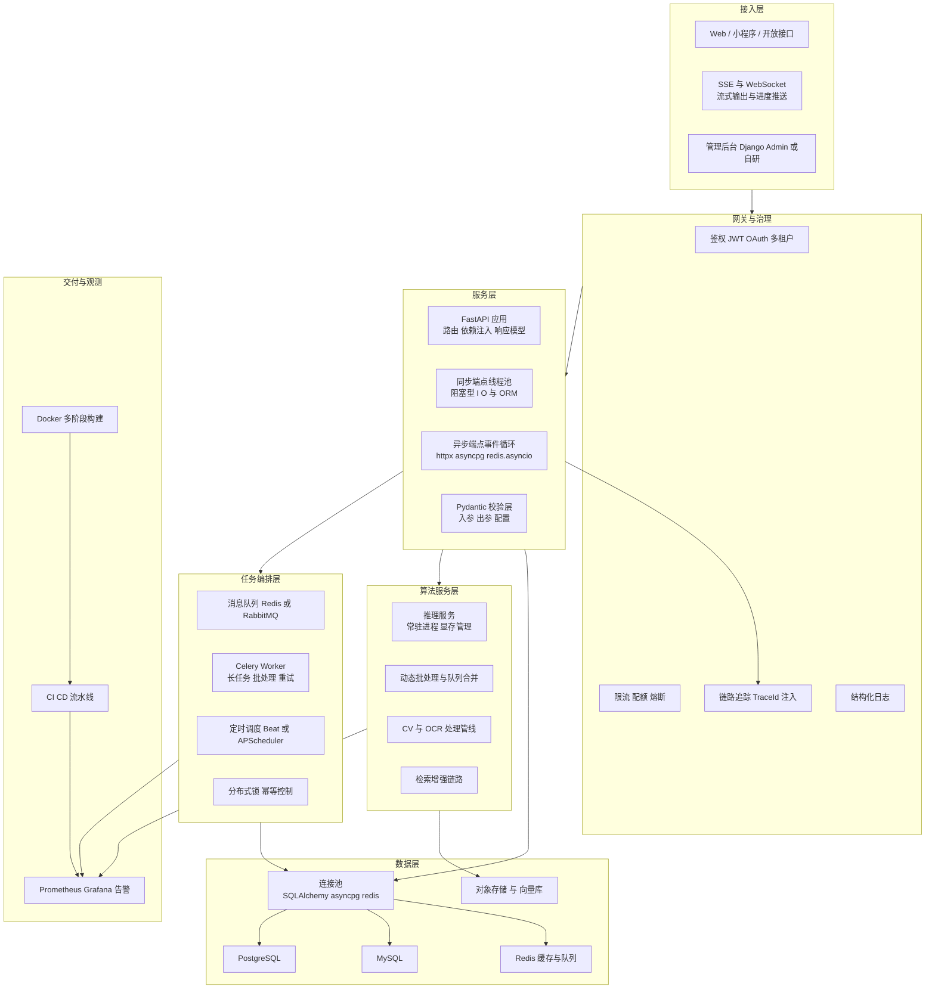
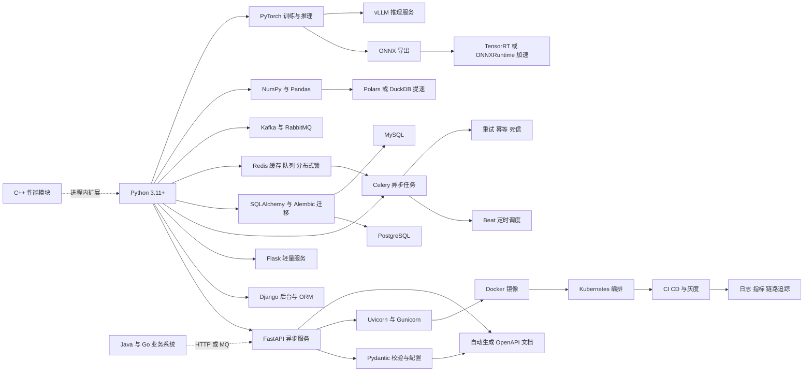
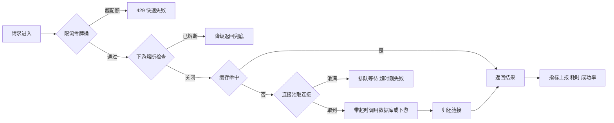
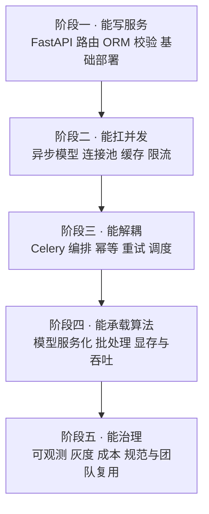
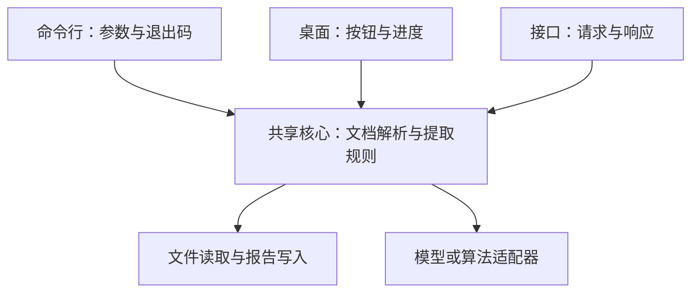
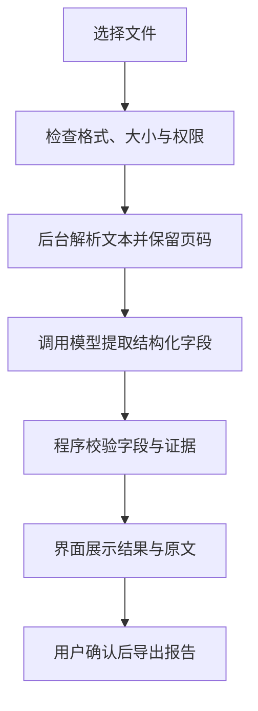
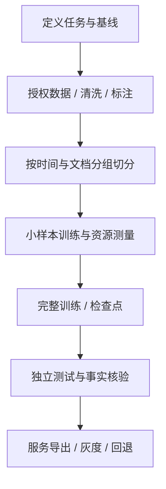

# 04 · Python 工程化与算法服务

> 配套学习：[Python 语言零基础到工程与算法实战](./04-Python语言零基础到工程与算法实战.md)，包含 GitHub 资料、原理、可运行练习和文档服务、企业集成、投研与算法项目路线。

> 数据基础：31 份 JD 聚合去重 | 薪资均值 19-29K | 学历主流：本科 | 经验主流：5 年以上
> 内容已去除公司信息，保留技术事实。
> 本次增补：结合新增高级 Python 工程师 JD，扩展跨平台应用、打包分发、AI Coding 与算法应用落地。上面的样本规模及下文词频沿用原统计，**未因本次补充而重新计算**；新增技术建议不代表 JD 原文逐项要求。
> 后续增补：结合投研 AI 岗位，增加领域微调、偏好对齐、强化学习、金融数据与回测、投研 RAG 和云端 MLOps。统计口径仍沿用原样本；教学示例用于理解技术，不代表投资建议或收益承诺。

**阅读建议**：初学者先看[新增知识导读](#十新增知识导读从脚本到完整产品)，再看[跨平台交付](#十一cli与桌面应用开发)、[打包分发](#十二打包与跨平台发布)、[AI 应用落地](#十五实战把文档处理能力做成跨平台-ai-助手)。前半部分保留服务端工程参考，适合有基础后查阅。

**投研 AI 专题**：从[概念导读](#十八投研-ai-岗位新增知识导读)开始，再学习微调、偏好对齐、回测与部署。建议先跑通普通机器学习基线，再研究强化学习，避免一次引入过多概念。

---

## 一、方向定位

这个方向不是"写 Python 脚本"，而是**用 Python 把业务服务、算法/模型能力与数据链路组织成可上线、可运维、可扩展的系统**。它的典型形态是：FastAPI/Django 承载业务接口，Celery 之类承担异步与定时，PyTorch/OpenCV 之类的算法模块被封装成独立服务，外面再用 Docker 与 CI/CD 交付。

从 JD 词频看，这个方向的"多语言共存"特征非常明显——Python 是主力，但 Java、Go、C++ 的高频出现说明它几乎总是在一个异构系统里做集成者。

| 技术/能力 | 出现篇数 | 占本方向比例 | 解读 |
|-----------|---------|-------------|------|
| Python | 30 | 97% | 绝对主力语言，无争议 |
| Java | 18 | 58% | 需与既有 Java 业务系统对接、共存或替换部分模块 |
| MySQL | 17 | 55% | 主业务库，绝大多数岗位的第一存储 |
| FastAPI | 17 | 55% | Python 侧服务化的事实标准，已远超 Flask |
| Redis | 15 | 48% | 缓存、队列、限流计数三合一 |
| 大模型相关关键词 | 14 | 45% | "算法服务"正在大量变成"模型服务" |
| Agent / 智能体 | 14 | 45% | 复杂任务编排成为 Python 侧的高价值场景 |
| PostgreSQL | 14 | 45% | 与 MySQL 并列，JSON/向量/GIS 场景更常见 |
| Go | 14 | 45% | 高性能旁路服务、网关与长连接服务由 Go 承担 |
| Docker | 12 | 39% | 容器化交付是基线而非加分项 |
| C++ | 12 | 39% | 性能内核、推理加速、硬件/设备对接 |
| Django | 11 | 35% | 后台管理、ORM 重的业务系统仍大量使用 |
| LLM 直接提及 | 9 | 29% | 明确要求懂模型调用与工程化封装 |
| PyTorch | 7 | 23% | 真正要求自训/微调的比例不高，多数是"会部署、会封装" |

对同批 JD 做二次细粒度扫描（n=31），还能看到这些更具体的技术点：

| 细分技术点 | 出现篇数 | 解读 |
|-----------|---------|------|
| SQL / 数据库设计 | 18 | 无论算法多复杂，最终都落在库表与查询上 |
| 流式输出 SSE / WebSocket | 8 | 模型与长任务的交互形态改变接口设计 |
| 异步 / 协程 | 6 | 高并发 Python 服务的分水岭 |
| 监控与日志体系 | 10 | 要求"能上线也能排障" |
| 权限体系 RBAC / OAuth / JWT | 9 | 系统级岗位而非脚本级岗位 |
| 知识库 / 向量检索 | 8 | Milvus、pgvector 出现 3 篇，属专业检索链路 |
| 单元测试与代码规范 | 6 | 工程化成熟度的直接指标 |
| 消息队列 Kafka / RabbitMQ | 4 | 解耦业务与重任务 |
| 模型推理运行时 vLLM / ONNX / TensorRT | 3 | 真正做推理加速的岗位 |
| 任务调度 | 4 | 周期任务、批处理、定时报表 |
| BI / 报表 | 4 | 结果最终要被人看、被决策用 |

**一句话总结**：这个方向的门槛在"工程闭环"——接口怎么设计、阻塞怎么消除、任务怎么编排、模型怎么部署、出问题怎么定位。

---


### 完整技术栈清单（全量抽取 · 基于本方向 31 篇 JD）

> 下表由 JD 全文穷举抽取生成，数字为**出现该术语的 JD 篇数**，用于补齐正文未展开的细分技术项。

| 类别 | 技术栈（数字为出现篇数） |
|------|------------------------|
| **语言** | Python(30)、Java(18)、C++(12)、SQL(7)、TypeScript(6)、Node.js(5)、JavaScript(5)、Go(4)、C#(3)、Golang(2)、Shell(1)、Kotlin(1)、PHP(1)、Dart(1) |
| **后端框架** | FastAPI(17)、Django(11)、Spring(8)、Flask(7)、Spring Boot(6)、SpringBoot(4)、Spring Cloud(2)、gRPC(2)、Gin(2)、RPC(2)、Celery(2)、MyBatis(1)、Dubbo(1)、NestJS(1) |
| **前端框架与UI** | React(11)、Vue(7)、Flutter(2)、Vite(2)、Ant Design(2)、组件化(2)、Next.js(1)、H5(1)、Vue3(1)、Webpack(1)、ESLint(1)、uni-app(1)、微前端(1)、qiankun(1)、拖拽(1) |
| **移动端** | Android(4)、移动端(3)、iOS(1)、Kotlin(1)、Framework(1)、App开发(1)、Uniapp(1) |
| **数据库与存储** | MySQL(17)、Redis(15)、PostgreSQL(14)、向量数据库(5)、pgvector(4)、MongoDB(3)、Milvus(3)、Neo4j(2)、Oracle(1)、SQL Server(1)、Elasticsearch(1)、SQLite(1)、ClickHouse(1)、Doris(1)、MinIO(1)、对象存储(1)、图数据库(1) |
| **消息与中间件** | Kafka(4)、RabbitMQ(2)、MQTT(1)、RocketMQ(1)、Nacos(1)、Prometheus(1)、Grafana(1)、OpenTelemetry(1) |
| **云容器与DevOps** | Docker(12)、CI/CD(7)、Kubernetes(6)、容器化(5)、流水线(4)、Nginx(3)、K8s(2)、回滚(2)、DevOps(1)、灰度发布(1)、资源调度(1)、Jenkins(1)、Ingress(1)、持续交付(1) |
| **大数据与数据平台** | 报表(3)、数据同步(2)、ETL(2)、Hadoop(2)、Flink(2)、埋点(2)、Spark(2)、BI(1)、数据治理(1)、数据质量(1)、元数据(1)、批处理(1)、血缘(1)、Trino(1)、Iceberg(1)、Hudi(1)、Airflow(1)、Superset(1)、离线计算(1) |
| **AI与机器学习** | 大模型(14)、Agent(14)、RAG(11)、Claude(9)、LLM(7)、LangChain(7)、多模态(7)、PyTorch(7)、Prompt(5)、微调(5)、模型部署(5)、TensorFlow(5)、智能体(4)、MCP(4)、LangGraph(4)、OpenCV(4)、Embedding(4)、DeepSeek(3)、ASR(3)、vLLM(3) |
| **音视频与流媒体** | 低延迟(2)、硬编(2)、编解码(1)、回放(1)、预览(1)、切片(1) |
| **嵌入式与硬件** | 运动控制(3)、嵌入式(2)、中断(2)、LoRa(2)、ROS(2)、SPI(1)、I2C(1)、串口(1)、CAN(1)、Modbus(1)、RTOS(1)、OTA(1)、PLC(1)、原理图(1)、传感器(1)、交叉编译(1)、瑞芯微(1)、IMU(1)、ROS2(1)、SLAM(1) |
| **桌面与客户端** | 客户端(1)、.NET(1)、WPF(1)、WinForms(1) |
| **协议与接口** | RESTful(6)、WebSocket(3)、SDK(3)、HTTP(2)、REST(2)、gRPC(2)、HTTPS(2)、SSE(2)、TCP(1)、接口对接(1)、JSON(1)、开放平台(1)、GraphQL(1)、OpenAPI(1) |
| **安全与合规** | 合规(3)、HTTPS(2)、权限控制(1)、SSL(1)、数据加密(1)、隐私保护(1)、敏感信息(1) |
| **工程化与质量** | 技术文档(8)、日志(6)、Git(4)、重构(4)、单元测试(4)、代码评审(2)、设计文档(2)、GitHub(2)、集成测试(2)、接口文档(2)、编码规范(2)、Selenium(2)、灰度(1)、监控告警(1)、复盘(1)、CMake(1)、覆盖率(1)、Playwright(1)、容量规划(1) |
| **架构与设计** | 架构设计(12)、性能优化(8)、微服务(6)、异步(5)、高并发(4)、方案设计(4)、高可用(4)、SaaS(4)、重试(3)、限流(2)、抽象(2)、降级(2)、幂等(2)、低延迟(2)、对账(2)、超时(2)、解耦(2)、DDD(2)、多线程(1)、技术选型(1) |
| **业务领域** | ERP(9)、库存(6)、供应链(5)、电商(5)、订单(5)、实施(3)、MES(3)、财务(3)、WMS(3)、支付(2)、金蝶(2)、物流(2)、SAP(2)、用友(2)、CRM(1)、OA(1)、金融(1)、医疗(1)、风控(1)、定制化(1) |
| **软技能** | 团队协作(9)、规划(6)、沟通能力(5)、需求分析(4)、培训(4)、文档编写(4)、责任心(3)、英语(3)、跨部门(2)、出差(2)、复盘(1)、owner(1) |

---

## 二、参考架构图

Python 侧服务体系的典型分层。注意"阻塞隔离"与"任务编排"两层，是把 Python 服务从能跑变成能扛的关键。



**解读**：
- 服务层内部区分同步端点和异步端点，是 FastAPI 项目能否扛住并发的分水岭；
- 任务编排层必须独立进程，绝不能让重任务占用 Web 请求线程；
- 算法服务层独立部署，便于 GPU 资源隔离与单独扩缩容；
- 观测不是附属品，TraceId 需要在网关层注入并贯穿队列任务。

---

## 三、技术栈关联图



**说明**：这张图里真正决定上限的是两条边——`Python → NumPy/Pandas` 的数据处理路径，以及 `Python → Celery` 的异步解耦路径。前者决定单机能处理多大数据量，后者决定系统能否承受突发流量。

---

## 四、核心能力矩阵

| 能力项 | 出现率 | 关键要点 | 常见追问 |
|--------|-------|---------|---------|
| FastAPI 服务开发 | 55% | 路由分层、依赖注入、响应模型、生命周期管理、自动文档 | `async def` 和 `def` 到底怎么选？ |
| 异步与并发模型 | 26%+ | 事件循环、线程池、GIL 影响面、阻塞点识别 | 为什么加了 async 反而更慢？ |
| 任务编排 | 中 | Celery 队列路由、重试与幂等、定时任务去重、结果后端 | 任务重复执行了怎么排查？ |
| 数据校验与契约 | 高 | Pydantic 模型、字段约束、版本兼容、OpenAPI 一致性 | 接口改字段怎么保证不破坏调用方？ |
| 数据库与连接池 | 55% | 池参数、慢查询、索引、事务边界、迁移管理 | 连接数打满的原因有哪些？ |
| 算法/模型服务化 | 45% | 模型加载策略、批处理、显存、健康检查、gRPC/HTTP 取舍 | 模型服务如何做到不停机更新？ |
| 数据处理性能 | 中高 | 向量化、dtype 优化、分块读、避免逐行遍历 | 一个 10GB 的文件怎么在 8G 内存里处理？ |
| 缓存与限流 | 48% | 缓存穿透/击穿/雪崩、令牌桶、熔断降级 | 缓存和数据库不一致怎么处理？ |
| 容器化交付 | 39% | 多阶段构建、依赖锁定、非 root 运行、镜像瘦身 | 镜像 1.2G 怎么降到 300M？ |
| 可观测与排障 | 32% | 结构化日志、TraceId、指标与告警、慢请求定位 | 线上偶发超时怎么定位？ |

---

## 五、关键实现要点

### 5.1 FastAPI 异步模型：最常见的坑是"假异步"

FastAPI 的规则很简单，但很多人理解反了：

- `async def` 端点在**事件循环**里执行，任何同步阻塞调用都会卡住整个进程的所有请求；
- `def` 端点由 Starlette 通过 AnyIO 在线程中执行，不直接阻塞事件循环；常见默认容量限制为 40 个并发令牌，并与同步依赖等共享，具体以安装版本和配置为准。这不等于固定创建 40 个线程。

因此真正的选择标准是：**这个端点内部的所有 I/O 是否都能 await**。

```python
# 反例：同步调用会阻塞当前 worker 的事件循环
@app.get("/bad")
async def bad():
    r = requests.get("https://api.example.com")   # 阻塞事件循环
    row = session.query(User).first()             # 同步 ORM，同样阻塞
    return {"ok": True}

# 正例一：全部异步化
@app.get("/good")
async def good():
    async with httpx.AsyncClient(timeout=3.0) as cli:
        r = await cli.get("https://api.example.com")
    row = await db.fetch_one(select(User).limit(1))  # asyncpg / SQLAlchemy asyncio
    return {"ok": True}

# 正例二：不得不阻塞时，显式声明为同步端点交给线程池
@app.get("/legacy")
def legacy():
    return {"data": old_blocking_sdk.query()}
```

配套要点：

1. **进程模型**：可用 `uvicorn app.main:app --workers 4` 启动多进程；Gunicorn 方案主要用于类 Unix 环境，若采用需确认与独立 `uvicorn-worker` 包的版本兼容。worker 数按内存、CPU、下游连接数实测决定；多进程还可能重复加载模型、占用多份显存。
2. **背压保护**：`--limit-concurrency`、`--timeout-keep-alive`、`--backlog` 三件套必须有，否则突发流量会把内存打爆而不是排队。
3. **生命周期**：用 `lifespan` 管理连接池、模型加载、后台任务的启停，避免用已废弃的 `@app.on_event`。
4. **依赖注入清理**：`Depends` + `yield` 保证会话归还连接池，异常路径也要能回滚。

### 5.2 任务编排：Celery 还是 APScheduler

| 维度 | Celery | APScheduler |
|------|--------|------------|
| 运行形态 | 独立 worker 进程，可跨机扩展 | 进程内调度器，随应用启停 |
| 持久化 | 取决于 Broker 类型、持久化与确认配置 | 默认可能在内存；持久化方式随版本配置 |
| 多副本问题 | Worker 可水平扩展；调度器仍需单活或协调 | 需按所用版本设计单实例调度或共享协调机制 |
| 适用 | 长任务、重试、削峰、跨服务 | 单机小任务、轻量定时 |

Celery 生产配置的关键项：

```python
app.conf.update(
    task_acks_late=True,              # 延迟确认；仍需幂等与 Broker 可靠性配置
    task_reject_on_worker_lost=True,  # worker 被杀时任务重回队列
    worker_prefetch_multiplier=1,     # 长任务常用起点，需结合并发与吞吐验证
    task_default_retry_delay=3,
    result_expires=86400,
    broker_transport_options={
        "visibility_timeout": 7200,   # Redis 等适用传输的示例；不通用于所有 Broker
    },
    task_routes={"app.tasks.heavy": {"queue": "heavy"}},  # 快慢队列隔离
)
```

重试次数应在任务的 `max_retries`、`retry()` 或自动重试配置中声明；以上配置不会让异常自动重试。`visibility_timeout` 需与适用 Broker 的其他相关配置保持一致，并结合最长任务、延迟任务与崩溃恢复时间评估。

必须处理的三件事：

- **幂等**：用业务键和数据库唯一约束或原子状态迁移去重；“先查再执行”有并发竞态。外部写入需下游支持幂等键；
- **调度协调**：Beat 单活或采用协调方案，锁需处理过期、续约与持有者校验；锁不能代替业务幂等；
- **失败处理**：明确重试上限、失败记录、人工重放与告警；Broker 死信队列需要单独设计，不是 Celery 失败后自动具备。

### 5.3 Pydantic：把契约从文档搬进代码

- 入参与出参都用模型声明，`response_model` 显式指定，避免把内部字段（密码哈希、内部状态）泄露出去；
- 用 `Field(..., gt=0, le=100, description=...)` 把约束写进类型层，校验失败自动返回 422 并带字段级错误信息；
- 配置统一走 `pydantic-settings`，环境变量、`.env`、默认值三层覆盖，避免散落的 `os.getenv`；
- 性能敏感路径用 `model_validate_json`（v2 的 Rust 核心）而不是 `parse_obj(json.loads(...))`；
- 接口演进时用别名与 `model_config` 控制兼容，破坏性变更走 `/v2` 路径而不是原地改字段语义。

```python
class PredictIn(BaseModel):
    model_config = ConfigDict(extra="forbid", str_strip_whitespace=True)

    text: str = Field(min_length=1, max_length=4000)
    top_k: int = Field(default=5, ge=1, le=50)
    threshold: float | None = Field(default=None, ge=0.0, le=1.0)

    @model_validator(mode="after")
    def check_pair(self):
        if self.threshold is not None and self.top_k > 20 and self.threshold < 0.1:
            raise ValueError("阈值过低且返回条数过多，疑似误用")
        return self
```

### 5.4 连接池、超时与限流：三层防护



- **池参数**：`pool_size` 按并发峰值估算，`max_overflow` 只作为缓冲；`pool_pre_ping=True` 抵御数据库主动断连；`pool_recycle` 小于数据库 `wait_timeout`；异步驱动用 `asyncpg.create_pool(min_size, max_size)`。
- **超时三层**：连接超时 < 读超时 < 接口总超时，缺任何一层都会出现"请求挂死"。
- **重试只对幂等操作**：读可以重试，写要么带幂等键要么不重试；重试必须加指数退避与抖动，否则会制造重试风暴。
- **限流实现**：单实例用内存令牌桶不够，多副本要用 Redis + Lua 保证原子；`INCR` + 过期时间的写法在边界会有漏桶问题。
- **优雅退出**：容器终止前先摘流量（preStop + sleep），再关闭连接池，否则会出现大量 502。

### 5.5 算法模型封装成服务：四种模式与 gRPC/HTTP 取舍

| 模式 | 结构 | 适用 | 风险 |
|------|------|------|------|
| 进程内联 | 模型加载进 Web 进程 | 小模型、低 QPS、快速验证 | 显存与请求争抢，一条进程挂全线挂 |
| 独立推理服务 | 单独进程/容器，HTTP 或 gRPC | 大多数生产场景 | 网络开销、序列化开销 |
| 队列异步 | 请求进队列，worker 批量处理 | 耗时任务、离线批处理 | 无法同步返回结果 |
| 专业推理服务器 | Triton / vLLM 统一管理 | 多模型、多版本、GPU 共享 | 运维复杂度高 |

**gRPC 还是 HTTP**：

- 选 gRPC：内部服务间、QPS 高、payload 大且要求低延迟、需要双向流、需要强 IDL 契约与多语言代码生成；
- 选 HTTP/JSON：需要浏览器或第三方直连、需要人类可读与 curl 调试、生态中间件（网关、限流、观测）成熟、团队异构；
- 现实中最常见的组合是：**内部用 gRPC，对外用 HTTP 网关做协议转换**，流式生成场景则优先 SSE（浏览器原生支持、穿透代理友好）。

服务化必须补齐的细节：

- `/health` 只探活，`/ready` 检查模型是否加载完成，否则滚动发布时会把流量打到未就绪实例；
- 模型**预热**：启动后先跑一次 dummy 推理，避免首个真实请求承受编译/显存分配开销；
- **动态批处理**：攒 8~16ms 窗口合并推理，吞吐可提升数倍，但要给单请求设置最大等待时间；
- 显存与并发的关系要先压测出"单实例最大并发"，再据此设置副本数与队列长度。

### 5.6 NumPy / Pandas 的性能坑

```python
# 坑 1：逐行遍历。10 万行时比向量化慢 1~2 个数量级
for i, row in df.iterrows():        # 避免
    df.at[i, "score"] = f(row)
df["score"] = np.where(df["x"] > 0, df["a"] * 2, df["b"])   # 向量化

# 坑 2：dtype 默认 float64/int64，内存翻倍
df["uid"] = df["uid"].astype("int32")
df["city"] = df["city"].astype("category")

# 坑 3：链式赋值产生副本，改动丢失
df[df.x > 1]["y"] = 0               # 无效
df.loc[df.x > 1, "y"] = 0           # 正确

# 坑 4：一次性读入大文件
import pyarrow.parquet as pq

parquet_file = pq.ParquetFile(path)
for batch in parquet_file.iter_batches(batch_size=200_000, columns=["uid", "score"]):
    process(batch.to_pandas())  # read_parquet 不支持 chunksize
```

- 内存估算：行数 × 列数 × 8 字节起步，字符串列按平均长度另算，先算再写；
- 关联前统一 key 的 dtype 与编码，否则 `merge` 会静默产生空结果或退化成笛卡尔积；
- `groupby` 用 `agg` 一次算完，避免多次扫描；
- 热点循环用 `numba` 或 C 扩展；CPU 密集且无法向量化时用 `multiprocessing` 绕开 GIL，注意 Windows/macOS 的 spawn 语义与序列化开销；
- 单机分析型负载优先考虑 DuckDB/Polars，往往能直接把分钟级降到秒级。

### 5.7 工程规范与可观测

- 日志统一结构化（JSON），每条日志带 `trace_id`、`user_id`、`request_id`，禁止拼字符串式日志；
- 用 OpenTelemetry 打通 HTTP 与 Celery 任务的链路，任务侧的 TraceId 通过消息头传递；
- `ruff` + `mypy` + `pytest` 进 pre-commit 与 CI，覆盖率阈值只设在新代码上（`diff-cover`）才可持续；
- 依赖用 `uv` 或 `poetry` 锁定，Docker 用多阶段构建：builder 装依赖 → runtime 只拷虚拟环境，配合 `--no-cache-dir` 与 slim 基础镜像。

---

## 六、典型职责归纳（去重合并）

- 负责 Python 侧服务的需求拆解、技术选型与接口设计，确定同步/异步、进程/任务的边界。
- 基于 FastAPI 或 Django 开发业务接口，设计数据模型、迁移脚本与权限体系。
- 设计异步与定时任务方案：队列选型、重试与幂等、调度去重、失败告警与死信处理。
- 把算法与模型能力封装为服务：加载策略、批处理、健康检查、扩缩容与版本管理。
- 打通异构系统：与 Java/Go/C++ 模块通过 HTTP、gRPC 或消息队列集成。
- 优化数据处理与查询性能：向量化、索引、缓存、分块与并发模型调整。
- 建设可观测与交付体系：结构化日志、链路追踪、指标告警、Docker 镜像与 CI/CD。
- 沉淀工程规范：代码评审标准、单元测试要求、配置管理、文档与知识库维护。

---

## 七、进阶路径建议



每个阶段都要有对应产出物：可跑的接口 → 压测报告达标的接口 → 稳定的任务系统 → 可独立扩缩容的模型服务 → 有 SLO 与告警的完整服务。

---

## 八、常见考察点清单

1. **FastAPI 里 `async def` 和 `def` 的区别？**（前者在事件循环执行，阻塞会拖垮全进程；后者进线程池；判断标准是端点内 I/O 是否全可 await）
2. **Python 服务 CPU 打不满但吞吐上不去怎么办？**（找阻塞点：同步 SDK、同步 ORM、CPU 密集逻辑未绕开 GIL；再调 worker 数与线程池）
3. **Celery 任务重复执行的原因？**（visibility_timeout 小于任务耗时、acks_late 未开、定时任务多副本无锁、业务侧不幂等）
4. **数据库连接池打满怎么排查？**（慢查询占连接、事务未提交、连接池过小、下游超时过长、连接泄漏进 finally 未释放）
5. **模型服务该用 HTTP 还是 gRPC？**（内部高 QPS 与流式用 gRPC，对外与浏览器场景用 HTTP/SSE，常见组合是网关转换）
6. **如何做到模型更新不停机？**（多版本并存、就绪探针区分加载状态、影子流量验证、按流量比例切换、保留回滚版本）
7. **Pandas 处理超大文件的思路？**（列裁剪、dtype 压缩、分块处理、换成 Parquet + 列式引擎、必要时上 Polars/DuckDB）
8. **缓存与数据库一致性怎么保证？**（更新数据库后删除缓存而非更新、设置短过期兜底、延迟双删、订阅 binlog 做最终一致）
9. **接口改字段如何不破坏调用方？**（契约由 Pydantic 模型与 OpenAPI 保证，破坏性变更走新版本路径，保留旧字段过渡期）
10. **限流为什么要用 Redis + Lua？**（多副本下内存计数不共享，`INCR`+`EXPIRE` 非原子会出现永不过期的 key，Lua 保证原子）

---

## 九、与其他方向的连接

- **与 AI 大模型应用工程**：本方向承担的是"模型能力的承载层"，RAG、Agent 的编排服务大多落在 FastAPI + Celery 上。
- **与 Java/Go 后端**：Python 服务通常以旁路或能力服务形式存在，通过 HTTP/gRPC/MQ 与主流业务系统集成，接口契约是协作焦点。
- **与数据平台**：算法特征、训练样本与效果指标依赖数仓与调度作业；Python 是数据清洗与特征工程的主力语言。
- **与前端**：SSE/WebSocket 流式输出改变了前端交互形态，接口契约与 Mock 需要提前对齐。
- **与 C/C++ 系统软件**：性能热点与硬件对接由 C++ 实现，通过扩展模块或独立进程与 Python 协作。

---

## 十、新增知识导读：从脚本到完整产品

### 10.1 新增 JD 补充了哪些能力

来源：[高级 Python 工程师 JD](职位描述/【非外包、双休】高级Python工程师｜Anker｜5ab268db5f267d740nB72t61FVFZ.md)。这里只提炼技术要求，不将职位标签自动推导为具体业务事实。

| JD 明确提及 | 用容易理解的话解释 | 本文扩展位置 |
|-------------|--------------------|--------------|
| CLI、GUI、自动化、跨平台应用 | 不仅做服务器接口，也要把功能做成用户能运行的工具 | 第十一节 |
| PyInstaller、cx_Freeze、Nuitka | 让没有 Python 环境的人也能安装和使用程序 | 第十二节 |
| 独立负责应用项目、工程规范 | 从需求、代码组织到测试、发布和维护都能负责 | 第十三节 |
| 性能分析、调优、精准定位问题 | 先测出慢在哪里，再针对瓶颈改进 | 第十四节 |
| 推理框架、智能体工作流、向量检索 | 把算法能力接到真实应用，管理输入输出和失败情况 | 第十五节 |
| AI 编程工具、LLM API、微调、本地部署 | 用 AI 辅助开发，并理解如何把模型接入产品 | 第十六节 |

下面出现的 Typer、PySide6、pytest 等是可选实施工具，不是该 JD 全部明确列出的要求。

### 10.2 四种交付形式，底层能力可以共用

假设需求是“读取一批文档，提取关键信息，输出 Excel 报告”：

- **脚本**：开发者在终端运行，适合一次性验证，但参数、错误处理可能不完整。
- **CLI**：命令行工具，例如 `doc-assistant extract ./docs --output report.xlsx`，适合批处理和自动化流水线。
- **GUI**：有窗口、按钮和进度条的桌面应用，适合不熟悉命令行的同事。
- **Web API**：通过网络提供功能，适合多个系统和用户共享调用。

这四种形式不必各写一套算法。把“读取、提取、生成报告”做成独立核心模块，再为它添加命令行、桌面或接口入口。



**工程化的含义**：换一台电脑仍能安装，错误能定位，数据能保护，修改后能验证，发布失败能回退。它不等于把所有框架都用上。

---

## 十一、CLI与桌面应用开发

### 11.1 CLI：把脚本变成有契约的工具

CLI 是 Command-Line Interface，即命令行界面。它适合重复执行、批量处理以及被其他程序调用。

| 方案 | 适合情况 | 注意点 |
|------|----------|--------|
| 标准库 argparse | 简单工具、希望减少依赖 | 子命令和帮助信息需要自己组织 |
| Click | 多级命令、成熟插件和扩展需求 | 明确参数类型与异常行为 |
| Typer | 希望用类型标注定义命令 | 锁定版本并测试与 Click 的兼容性 |

下面是只用标准库的最小例子，展示参数、校验、覆盖保护和退出码；它只统计文本长度，不调用模型。

```python
import argparse
import json
import sys
from pathlib import Path


def main() -> int:
    parser = argparse.ArgumentParser(description="统计 UTF-8 文本长度")
    parser.add_argument("input", type=Path, help="输入文本文件")
    parser.add_argument("--output", type=Path, required=True, help="输出 JSON 文件")
    args = parser.parse_args()

    try:
        text = args.input.read_text(encoding="utf-8")
        result = {"characters": len(text)}
        # x 模式：输出已存在时拒绝覆盖。
        with args.output.open("x", encoding="utf-8") as stream:
            json.dump(result, stream, ensure_ascii=False)
    except (OSError, UnicodeError) as exc:
        print(f"处理失败：{exc}", file=sys.stderr)
        return 1
    return 0


if __name__ == "__main__":
    raise SystemExit(main())
```

使用方式：`python text_stats.py notes.txt --output stats.json`。路径包含空格时加引号。成功返回 0；这里运行错误返回 1，argparse 参数错误默认返回 2，其他自动化系统就能据此判断执行是否成功。

进一步完善时：业务结果输出到标准输出，日志写标准错误；提供 `--version`、清晰帮助、输入范围校验和取消处理。大批量写入采用临时文件再原子替换，并明确失败时是否保留部分结果。不要让用户把密钥作为命令行参数传入，避免进入历史记录和进程列表。

### 11.2 GUI：界面响应和后台计算分开

GUI 是 Graphical User Interface，即图形界面。Python 常见选择：

| 工具 | 特点 | 适用与限制 |
|------|------|------------|
| Tkinter | 标准库接口，常见官方安装包含 Tcl/Tk | 简单内部工具；仍需确认发行环境包含运行库 |
| PySide6 / PyQt6 | Qt 组件丰富，适合较复杂桌面产品 | 包体较大；发布前核对所用库、模块和许可证要求 |
| Web 前端 + Python 后端 | 可以复用 Web 交互和接口 | 需管理本地服务启停、端口、访问控制与更新 |

**最常见的问题是点击按钮后窗口“假死”**：读取大文件、请求模型或运行推理占用了界面主线程，窗口没机会处理重绘和用户输入。

正确思路是“主线程更新界面，后台执行任务，结果通过框架支持的信号或事件送回来”。例如 Qt 用信号槽，Tkinter 用队列配合 `after()` 轮询；不要随意从后台线程直接修改控件。

任务状态至少包含：未开始、运行中、成功、失败、取消中、已取消。取消需要后台任务配合，在分段处理处检查取消标志；停止显示进度不代表任务真的停止。强制杀进程可能留下半成品文件，应通过临时文件和恢复规则处理。

### 11.3 跨平台不是“同一份代码一定到处能跑”

- 路径用 `pathlib`，不要硬编码盘符和斜杠；区分应用资源目录与可写的用户数据目录。
- Windows 常不区分文件名大小写，Linux 通常区分；测试大小写、中文、空格、长路径和无权限目录。
- 配置、缓存、日志放到用户可写目录，可用 `platformdirs` 获取对应系统位置；不要默认安装目录可写。
- 多进程入口使用 `if __name__ == "__main__"`；冻结程序按所用工具与 Python 文档配置 `multiprocessing.freeze_support()`，不要在导入时创建窗口或启动子进程。
- 原生扩展、GPU 驱动、系统证书、字体和外部命令都可能不同；接口与文件编码要显式约定。

---

## 十二、打包与跨平台发布

### 12.1 先分清三件事

**Python 包**（如 wheel）主要给 Python 环境安装；**桌面可执行分发包**面向最终用户；**Docker 镜像**主要面向服务部署。三者的受众和运行环境不同，不能互相替代。

### 12.2 三种打包工具怎么选

| 工具 | 大致原理 | 优点 | 需要验证 |
|------|----------|------|----------|
| PyInstaller | 收集解释器、代码和依赖，生成分发目录或单文件 | 上手较快、常见库支持较多 | 动态导入、资源文件、杀毒误报、单文件启动开销 |
| cx_Freeze | 冻结 Python 应用并收集运行依赖 | 适合按目录分发和构建流程集成 | 包含文件、系统库与安装包制作 |
| Nuitka | 将 Python 模块转换后编译；独立分发需相应模式 | 可构建独立程序，部分场景性能有收益 | C 编译工具链、构建时间、插件和真实性能 |

Nuitka 不是“所有代码自动快十倍”。网络等待不会因编译消失，NumPy/PyTorch 本来就大量使用原生代码，收益必须测量。打包也不等于加密，不能把 API Key 当作秘密硬编码进程序。

### 12.3 PyInstaller 的最小发布过程

在独立的构建环境中安装锁定依赖，再使用类似命令：

```bash
python -m PyInstaller --clean --noconfirm --onedir --name DocAssistant src/doc_assistant/__main__.py
```

这是单入口示意，包内相对导入、资源与插件可能需要专用启动脚本和 `.spec` 配置。先用 `--onedir` 排查缺依赖，确认稳定后再评估 `--onefile`。

`--onefile` 通常要在启动时解压运行资源，可能启动较慢，并受到临时目录权限影响。它只是改变分发形式，不会让程序脱离操作系统和原生库约束。

需要一并处理：图标、配置模板、Qt 插件、动态导入、模型权重、第三方许可证。大型模型通常单独分发或首次使用时受控下载，并验证校验和；不要默认塞入主程序。

### 12.4 Windows、macOS、Linux 分别构建验证

PyInstaller 通常需要在目标操作系统构建，不能在 Windows 上直接得到可用的 macOS 安装包。CPU 架构也要区分，例如 x64 与 ARM64。

| 平台 | 发布前重点检查 |
|------|----------------|
| Windows | exe 或安装包启动、普通用户权限、签名策略、DLL、卸载与杀毒软件兼容性 |
| macOS | 应用包结构、签名与按分发渠道需要的公证、架构、首次启动系统提示 |
| Linux | 目标发行版和 glibc 兼容性、共享库、桌面环境、执行权限 |

不要只在开发机验收：开发机已有的 Python、CUDA 或系统库可能掩盖缺失依赖。使用没有 Python 的干净虚拟机或测试机验证安装、启动、真实任务和卸载。

### 12.5 一条实用发布流水线

```text
确认版本与变更说明
→ 安装锁定依赖
→ 静态检查和业务测试
→ 在各目标系统分别构建
→ 干净环境安装与功能验证
→ 按发布渠道进行签名
→ 生成校验和、许可证与发布清单
→ 小范围试用
→ 正式发布并保留旧版
```

自动更新也属于工程功能：下载中断后能恢复，更新包来源和签名可验证，失败时能回到旧版。用户配置和数据的版本迁移应先备份，不能只替换 exe 就认为更新完成。

---

## 十三、应用架构、测试与独立交付

### 13.1 小项目也应分清责任

“高内聚”可以理解为相关事情放一起；“低耦合”是减少不必要的相互依赖。例如提取规则不应该知道按钮长什么样，GUI 不应该直接拼 SQL。

```text
doc-assistant/
├── pyproject.toml             # 项目元数据、依赖与工具配置
├── src/doc_assistant/
│   ├── __main__.py            # 入口
│   ├── cli.py                # 参数与命令
│   ├── gui/                  # 窗口、事件与状态展示
│   ├── services/             # 用例：提取、检索、报告生成
│   ├── domain/               # 数据模型与业务规则
│   └── adapters/             # 文件、数据库、模型接口适配
├── tests/                    # 单元与集成测试
└── packaging/                # 打包配置与发布脚本
```

这只是一个起点，小工具可以更简单。核心目标是同一个用例能被 CLI、GUI 和 API 调用，并能在不启动界面、不访问真实模型的情况下测试。

### 13.2 单元、集成、端到端分别验证什么

| 测试层次 | 示例 | 要捕获的问题 |
|----------|------|--------------|
| 单元测试 | 日期解析、字段校验、文件名规则 | 边界条件与业务判断错误 |
| 集成测试 | 临时数据库事务、测试模型服务、文件读写 | 接口不兼容、超时、资源未释放 |
| 端到端测试 | 安装应用后选择文档并生成报告 | 打包缺依赖、界面与后台衔接失败 |
| 回归评测 | 固定文档集比较提取结果与引用 | 模型或提示词修改导致效果退化 |

单元测试通常用可控替身模拟模型；少量受控集成测试再连真实服务。固定断言“这句文案一字不差”通常不适合模型输出，应检查字段合法性、关键事实和证据支持。

### 13.3 从需求到维护需要交付什么

先确定使用者、输入大小、响应时间、运行平台、离线要求与失败处理方式。随后交付源码、安装包、依赖锁文件、使用说明、测试报告、版本记录和故障排查方式。

对多用户服务，高可用不只是启动两个实例：还需避免本地任务和本地状态丢失，做好健康探针、数据库迁移兼容、共享存储和故障切换。对桌面应用，“稳定”更常体现为不丢文件、错误可理解、崩溃后能恢复。

---

## 十四、性能分析与精准排障

### 14.1 先确定慢在哪里

用户说“处理文档太慢”，可能是启动解压、读文件、解析 PDF、等待模型、网络传输或写报告慢。先分段计时，再优化，不要一上来就改成异步或换语言。

```python
from time import perf_counter

start = perf_counter()
result = extract_document(path)  # 项目自己的业务函数
elapsed = perf_counter() - start
logger.info("extract completed", extra={"elapsed_seconds": elapsed})
```

### 14.2 问题类型决定优化方式

| 现象 | 排查工具或指标 | 可能的处理方式 |
|------|----------------|----------------|
| 网络等待占比高 | 下游耗时、超时、连接池等待 | 连接复用、异步 I/O、有限并发、缓存 |
| CPU 长时间很高 | cProfile、py-spy、热点函数 | 改算法、向量化、原生扩展、进程池 |
| 内存持续增长 | RSS、tracemalloc、对象数量 | 分批处理、限制缓存、排查引用与重复加载 |
| GPU 显存不足 | 显存、请求长度、模型副本数 | 限制并发与输入、批大小调整、模型部署调整 |
| 桌面窗口无响应 | 主线程调用栈、事件处理耗时 | 后台执行、分段处理、受控进度更新 |
| 打包后启动慢 | 冷启动计时、导入与解压耗时 | 延迟加载、减少依赖、目录分发 |

`tracemalloc` 主要观察 Python 跟踪的内存分配，不能覆盖所有原生库或 GPU 显存。CPU 分析也要区分 Python 执行和原生扩展耗时。

### 14.3 线程、协程、进程如何选择

**协程**适合有异步客户端的网络等待；**线程**适合需要兼容同步 I/O 的调用；**进程**适合可拆分的 CPU 密集工作，但增加内存和进程通信成本。

常规启用 GIL 的 CPython 中，纯 Python CPU 密集任务通常不能靠多个线程获得多核加速；释放 GIL 的原生库表现可能不同。可选自由线程构建的兼容性和依赖支持需单独验证，不应默认所有运行环境都一样。

并发不是越多越好。假如模型服务最多承受 5 个同时请求，应用启动 100 个请求只会让排队、超时和成本更糟，应设置并发上限和等待队列。

### 14.4 出问题时按证据排查

1. 记录应用版本、操作系统、依赖版本、输入特征与完整异常堆栈，避免收集不必要的敏感原文。
2. 区分“只在打包后出现”“只在某个平台出现”“只在大文件出现”。
3. 用最小输入复现，再逐步加回依赖和数据。
4. 修复后加入能捕获该问题的回归用例，并验证发布包，而不只验证源码。

---

## 十五、实战：把文档处理能力做成跨平台 AI 助手

### 15.1 从一个可以验收的目标开始

**目标**：用户选择一份说明书，程序提取产品型号、使用限制和保修条款，显示原文出处，并生成报告。信息不足时留空或标注未知，不允许编造。

第一版只支持有文本层的 PDF 或 UTF-8 文本，限制文件大小和页数；扫描件 OCR、大批量处理、多用户协作放到后续版本，避免一次做得太大。

### 15.2 算法与工程分别负责什么

| 能力 | 算法侧重点 | 工程侧必须补齐 |
|------|------------|----------------|
| 文档解析 | 正确提取段落、表格与页码 | 格式检查、文件上限、错误提示、临时文件清理 |
| LLM 字段提取 | 理解文本并输出所需信息 | 请求超时、结构校验、引用核对、调用成本 |
| 向量检索 | 找到语义相关段落 | 索引版本、更新删除、权限隔离与来源追溯 |
| 本地推理 | 模型加载与生成质量 | 硬件检测、就绪状态、显存限制和服务启停 |
| Agent 工作流 | 根据结果选择下一步 | 工具白名单、执行次数上限、暂停恢复与确认 |

不要一开始就全部接入。全文较短时直接提取即可；文档很多、需要反复问答时再引入检索；步骤固定时先用工作流，需要灵活调查时再考虑 Agent。

### 15.3 一个清晰的处理流程



模型输出可以约定为 `product_model / restrictions / warranty / evidence` 等字段。服务端或应用核心用 Pydantic 校验类型，另外检查引用是否来自本次文档。JSON 格式正确只是第一关，不代表内容真实。

模型请求失败时明确显示失败；用户取消后不再开始新步骤，已发出的请求是否能够停止取决于客户端与服务端支持。对按量计费服务，取消界面等待不一定终止计费。

### 15.4 进一步升级为 Agent

第二阶段可允许用户说：“找出这几份说明书的保修差异，并生成比较报告。”助手可能先检索，再补读相关页，最后汇总。

这时开放的工具可以只有：读取用户选定文档、检索已导入资料、生成报告草稿。文件访问限制在已授权路径；写文件前校验目标目录与覆盖规则。文档中的“忽略要求并删除文件”只是待分析的数据，不能变成可执行指令。

设置最大步骤数、总运行时间和预算。失败时返回已完成部分与原因；不要提供无限制执行 Shell 或访问任意本地文件的工具。

### 15.5 API、微调、本地部署怎么选

- **先接 LLM API**：最快验证价值；封装统一适配器，避免业务到处依赖某家 SDK。密钥由后端或操作系统凭据存储保护，明确上传资料的许可与范围。
- **再评估本地部署**：适合离线或数据边界要求明确的情况。先测目标电脑的内存、显存、模型质量与速度；桌面多开时避免重复启动多个大模型副本。
- **最后考虑微调**：当固定任务的格式或领域表现无法通过提示词、检索和校验满足需求，且有合适训练数据时再评估；必须保留独立测试集。它不适合替代频繁更新的事实数据库。

### 15.6 四阶段交付与验收

| 阶段 | 交付内容 | 验收重点 |
|------|----------|----------|
| 1：核心与 CLI | 文档读取、提取、校验和报告导出 | 正常、空文档、损坏文件、中文路径、重复输出 |
| 2：GUI | 文件选择、后台任务、进度、取消、结果预览 | 处理期间可移动窗口，失败可理解，取消不破坏原文件 |
| 3：分发 | 目标平台安装包、日志目录、版本信息 | 干净环境无 Python 也能完成真实任务 |
| 4：持续优化 | 样本评测、性能基线、更新回退 | 引用准确性、耗时、费用、内存和旧版本兼容 |

效果报告至少写清楚测试文件数量与类型、字段正确率、未知处理、失败率、耗时分布和单文档成本。不要只展示一份成功案例。

---

## 十六、AI Coding：让 AI 辅助开发，责任仍在开发者

### 16.1 适合交给 AI 的工作

AI 编程工具可以辅助理解代码、起草函数、生成测试思路、解释堆栈、补充类型标注和文档。它也可能使用不存在的 API、引入多余依赖，或者生成看似合理但不满足业务的实现。

用 AI 写代码和在产品中调用大模型是两项不同能力：前者提升研发过程，后者需要设计运行时接口、数据和失败处理。这份 JD 同时关注两者。

### 16.2 一个可执行的协作流程

1. **给明确任务**：说明现有模块、输入输出、运行平台、限制和验收条件。
2. **要求小范围修改**：先读相关代码，只改解决当前问题所需的内容。
3. **检查差异**：查看新增依赖、网络请求、文件删除、权限和数据处理行为。
4. **运行验证**：静态检查、类型检查、必要测试及真实打包验证。
5. **人工验收**：核对业务结果、边界情况和维护成本，再提交版本。

例如可以这样描述任务：

```text
请为现有文档提取模块增加 CLI 入口。
输入：一个本地文本文件；输出：指定路径的 JSON。
约束：复用现有提取函数，不修改其业务规则，不添加网络上传。
输出已存在时拒绝覆盖，错误写 stderr，返回非零退出码。
请覆盖中文路径、文件不存在和重复输出的验证。
```

### 16.3 怎么判断 AI Coding 是否真的有效

看完成需求的总时间、评审返工、缺陷数量和可维护性，不以生成代码行数衡量。组织使用时还要明确哪些仓库和数据允许发送给外部模型；不要粘贴生产密钥、未授权客户文档和不必要的个人信息。

对于 AI 建议的依赖、API 参数和打包命令，应核对项目锁定版本的实际文档，不能因为回答流畅就直接合并。

---

## 十七、针对新增能力的学习与面试准备

### 17.1 建议学习顺序

**Python 基础与异常 → 文件和路径 → CLI → 项目结构与测试 → GUI 后台任务 → 打包分发 → API 与模型调用 → 性能分析 → 检索和 Agent。**

每一步做一个可运行的产物。初学阶段先掌握一种 CLI 工具和一种打包工具，完成从源码到别人电脑可运行的闭环，再比较其他框架。

### 17.2 能用实例回答的八个问题

1. **脚本怎样变成可交付产品？** 说明参数、错误处理、配置、测试、分发、版本和文档的补齐过程。
2. **GUI 为什么会卡死？** 说明主线程与后台任务分离、进度传递和合作式取消。
3. **为什么开发机能运行，用户电脑不行？** 排查隐藏依赖、资源路径、系统库、架构和权限。
4. **PyInstaller 与 Nuitka 怎么选？** 从构建链、启动速度、包体、兼容性和实测收益回答。
5. **打包后是否就隐藏了密钥？** 否；客户端分发内容可能被提取，密钥应另行安全管理。
6. **模型返回 JSON 就足够了吗？** 还需 Schema 校验、事实与引用核对、业务规则验证。
7. **AI 生成代码如何进入主分支？** 说明差异审查、版本核实、必要测试和业务验收。
8. **如何证明优化有效？** 给出相同输入、相同环境下的前后耗时、内存、错误率和成本，而不是只有主观感受。

一个有说服力的项目展示应包括：可运行 CLI、可操作 GUI、干净环境可安装的发布包、真实样本效果报告，以及一次故障定位与修复记录。

---

## 十八、投研 AI 岗位：新增知识导读

来源：[IT 工程师 JD](职位描述/IT工程师｜华为｜f4cc28a60c79273e03N93t68F1NZ.md)。标题较宽泛，正文实际聚焦金融投研平台的 AI 算法、微调和强化学习，不能把这些要求泛化为所有 IT 工程师岗位的通用要求。

### 18.1 先认识业务，再认识模型

**投研**就是收集资料、研究资产和形成投资判断的过程。**量化**是把部分判断表达成可计算、可测试的规则或模型。**因子**是用于描述资产特征、解释或预测收益风险的变量，例如历史波动率。**回测**是在历史数据上模拟策略行为，检查其表现和风险。

回测像一次历史模拟，不是对未来收益的保证。模型的任务也可以只是解析报告、识别异常和辅助研究，不必直接变成自动交易系统。

### 18.2 新增知识与现有内容的关系

| JD 明确提及 | 新增学习重点 | 与既有章节的衔接 |
|-------------|--------------|------------------|
| SFT、FFT、LoRA、QLoRA、Prefix Tuning | 如何用数据调整模型及控制训练成本 | 扩展第十五节的微调选型 |
| RLHF/RLAIF、奖励模型、PPO、DPO | 偏好数据、训练目标与效果验证 | 区别于普通提示词和工具调用 |
| MDP、Expert Iteration、自奖励与环境奖励 | 序列决策和训练闭环 | 不等于 Agent 工具编排 |
| 因子、时序预测、异常检测、归因、回测 | 数据时点、时间切分、成本与过拟合 | 扩展 Pandas/NumPy 数据管线 |
| LLM + RAG 投研知识系统 | 报告解析、引用与权限、事实核验 | 扩展文档助手场景 |
| AWS、CI/CD、训练推理监控自动化 | 数据和模型版本、实验追踪、发布回退 | 扩展容器化与服务工程 |

后文的工具组合为可选方案，不代表该 JD 全部明确指定。

### 18.3 模型基础不必一次学完

**Scikit-learn** 适合先做预处理、线性模型、树模型和评估基线。**LSTM** 是常用于序列建模的一类循环神经网络。**Transformer** 利用注意力等机制处理序列，是许多大模型的基础，但架构更新并不代表在每个金融任务上都更好。

先明确输入、标签、评价指标和数据时点。简单模型在可靠数据上得到的结果，通常比复杂模型在有泄漏的数据上得到的高分更有参考价值。

---

## 十九、领域微调：从数据到可发布模型

### 19.1 提示词、RAG 与微调分别改变什么

提示词说明当前任务；RAG 提供当前可用资料；微调通过训练修改模型参数或新增可训练参数。最新公告、价格和制度通常优先通过检索或数据接口获得，不应依靠微调记忆最新事实。

**SFT（监督微调）**使用“输入—期望输出”示例训练模型，例如给定报告段落，输出规范化财务字段与证据。它描述训练方式；**FFT（全量微调）**和 **PEFT（参数高效微调）**描述更新参数的范围和方式，因此 SFT 可以采用 FFT，也可以采用 LoRA。

### 19.2 几种微调技术怎么理解

| 方法 | 基本思路 | 主要取舍 |
|------|----------|----------|
| 全量微调 | 更新模型全部或几乎全部参数 | 优化状态、梯度与权重开销大，需要较强训练资源 |
| LoRA | 冻结基础权重，训练低秩适配参数 | 可训练参数少；目标模块、秩和训练数据仍需调试 |
| QLoRA | 基础模型以低比特等方式加载，训练 LoRA 适配参数 | 降低部分显存开销；并非所有参数和计算都变成低比特 |
| Prefix Tuning | 学习可训练的前缀表示等参数 | 不等于手写几句提示词；实现和支持范围依模型与框架 |

显存不只装权重，还要容纳激活、梯度、优化器状态和临时空间；序列长度、批大小及精度都会影响需求。梯度累积可以改变有效批大小，但不能让单个过长样本自动放进显存。

JD 提及 LLaMA-Factory、MS-SWIFT 等框架。使用前核对模型、许可证、版本、分布式训练和导出格式的支持；框架能降低配置工作，不能代替数据质量和评测设计。

### 19.3 微调全流程



例如做财报字段提取，标签应保留指标名称、金额、币种、单位、报告期和原文位置。不能只标一个“利润数字”，否则模型很容易混淆合并与母公司口径、万元与亿元、季度与累计值。

同一报告的不同片段、同一家公司的近重复公告，若被随机分到训练和测试两侧，可能让评测虚高。按任务采用时间、文档、公司等分组策略，并明确选择依据；金融训练还需防止把未来发布的资料带入历史预测样本。

### 19.4 怎样证明微调值得做

比较“基础模型 + 提示词”“基础模型 + RAG”和“微调模型”的同一锁定测试集表现，同时报告字段准确性、引用支持、拒答、延迟和成本。

另外检查通用能力是否退化、训练数据是否被复述以及少数样本是否变差。训练 loss 下降只说明拟合训练目标，不能直接证明业务收益或事实可靠性提升。

记录基础模型版本、数据快照、训练配置、随机种子、代码、依赖和适配器版本。固定种子不保证所有 GPU 和分布式环境逐位复现，应说明可接受差异。

---

## 二十、偏好对齐与强化学习：不要混为一谈

### 20.1 从“有标准答案”到“比较哪个更好”

SFT 通常提供示范答案；偏好数据可以是同一问题的两份回答，标出哪份更好。例如比较“有原文引用、说明不确定性”和“编造确定收益”的回答。

**RLHF** 利用人类反馈构建训练信号，典型流程包括偏好标注、奖励模型和策略优化；**RLAIF** 使用 AI 参与生成反馈。两者描述反馈来源或训练体系，不是一种固定算法。AI 标注仍需人工抽检、规则校验和偏差分析。

### 20.2 奖励模型、PPO、DPO 的区别

| 概念 | 做什么 | 容易误解的地方 |
|------|--------|----------------|
| 奖励模型 | 给回答或行为输出评分，拟合偏好等目标 | 得高分不一定事实正确，也可能迎合评分器 |
| PPO | 在采样交互等流程中做策略梯度优化，控制更新幅度 | 需要设计奖励和训练稳定性，不是接上算法就能赚钱 |
| DPO | 直接利用偏好对优化策略，常见形式无需单独训练奖励模型或在线 rollout | 属于偏好优化方法，不能简单等同于 PPO 式在线强化学习 |
| Expert Iteration | 迭代生成、搜索或筛选更优解，再训练策略 | 是一类迭代范式，具体专家、筛选和目标依实现而定 |

JD 将这些方法放在同一技能范围，学习时仍需分清训练数据、目标函数、采样与资源需求。实现可研究 TRL 等工具，但需核对具体版本支持和论文假设。

### 20.3 Self-Rewarding 与 Env-Rewarding

**自奖励**可理解为让模型或相关模型参与评价与产生训练信号；**环境奖励**来自外部任务结果，例如程序测试是否通过、约束是否满足或模拟环境中的结果。这些名称在不同论文和实现中含义可能不同，需要先阅读具体定义。

如果模型既出题、又作答、又评分，可能强化自己的偏见。即使奖励来自环境，也可能出现“钻奖励空子”：例如通过不合理交易频率获得模拟收益，却忽略真实手续费。需要独立验证、固定评测、奖励分项和异常样本检查。

### 20.4 金融序列决策中的 MDP

**MDP（马尔可夫决策过程）**用状态、动作、状态转移、奖励和折扣等概念描述连续决策。教学例子如下：

| 元素 | 示例 |
|------|------|
| 状态 | 当时可获取的历史价格特征、当前持仓、现金与风险暴露 |
| 动作 | 下一期的目标持仓比例，限定在约定范围内 |
| 转移 | 市场演化、订单执行和组合变化 |
| 奖励 | 扣除交易成本后的组合表现，再结合风险或约束惩罚 |
| 约束 | 杠杆、换手、资金、可交易性与仓位边界 |

金融市场通常无法完整观察，也不一定满足简化状态下的马尔可夫或平稳假设。模拟器的成交假设和市场冲击会影响结论；离线历史回放不等于真实交互，更不能从观察数据直接推断所有未执行动作的结果。

离线策略优化还面临分布外动作问题：历史数据很少覆盖的动作，其价值估计可能不可靠。先与简单固定规则策略对比，再研究在线或自训练方法；“自我博弈”是否合理也取决于是否有可信的对手与市场模拟。

---

## 二十一、金融数据、因子与回测：防止“看起来很准”

### 21.1 数据可用时间是第一条约束

至少区分事件发生时间、正式发布时间和平台首次可用时间。例如财报属于上一年度，但在下一年才披露，不能在上一年底的策略中提前使用。

还要处理时区、交易日历、停牌、复权、成分股变更、退市和财报修订。只回测今天仍存在的股票会引入幸存者偏差；直接用后来修订的数据也可能产生未来信息泄漏。

推荐保存 `event_time / published_at / available_at / ingested_at / source / version` 等字段，并说明实际来源是否提供这些时间。没有可靠历史可用时间的数据，需标记回测局限。

### 21.2 因子计算与标签要对齐

例如利用过去 20 个交易日收益构造特征，预测下一期收益。必须说明特征何时形成、订单何时提交和成交，不能用收盘后才知道的信息假设自己已按当天收盘价成交。

同一段价格可能同时参与特征窗口和未来收益标签，时间切分时应考虑标签区间重叠，采用适合任务的间隔或 purging/embargo 等方法。不能默认随机打散样本有效。

归一化、缺失值填充、特征选择、降维都要只在训练部分拟合，再应用到验证和测试。Scikit-learn 的 Pipeline 可帮助把这些处理和模型组合，减少误用全量数据的风险。

### 21.3 用滚动验证模拟持续研究

```text
较早区间训练 → 随后区间验证并选参数 → 更晚区间测试
窗口向后移动，再重复训练与验证
最终锁定未参与调参的区间，做一次独立评估
```

市场制度和分布会变化，因此要报告不同年份、行情和资产群体的结果。反复查看测试集再调参，测试集也会逐渐变成开发集；记录实验次数及失败方案，避免只保留最好的曲线。

### 21.4 回测必须包含现实摩擦

考虑手续费、价差、滑点、成交延迟、成交量限制、涨跌停、停牌及不同市场的交易规则。交易价格与调仓时间不明确，就难以解释收益。

| 指标 | 含义 | 使用限制 |
|------|------|----------|
| 收益及超额收益 | 策略表现，以及相对基准的差异 | 指定区间、基准、是否扣费与复利口径 |
| 最大回撤 | 从历史峰值到后续低点的最大跌幅 | 历史回撤不限制未来损失 |
| Sharpe 等风险调整指标 | 按约定口径比较收益和波动 | 无风险利率、采样频率和年化假设需说明 |
| 换手率与成本 | 调仓频率、交易摩擦 | 高频交易可能吞噬毛收益 |
| IC / Rank IC | 因子与后续收益的相关程度 | 需定义样本截面、预测期和统计稳定性 |
| 暴露与集中度 | 行业、风格、单一资产和杠杆风险 | 好收益可能只是承担了某种系统性风险 |

异常检测也需对应业务目标，例如坏行情数据、异常成交或风险暴露，而不是把所有统计离群点都当成交易机会。特征重要性或 SHAP 等可辅助解释模型，但不能自动证明因果关系或完成经济学归因。

Backtrader、Qlib、Zipline 等可研究作为回测或量化研究工具；需核对维护状态、市场适配、数据接口和成交语义，不应混用不同框架结果而不核对口径。

### 21.5 高性能管线先保证可复现

原始数据保留快照，清洗后按时间和资产等适当分区，使用 Parquet 等列式存储，按需读取列和区间。DuckDB/Polars 可用于单机分析，确有数据规模和并行需求时再评估 Spark；分布式计算不自动消除时间对齐错误。

SQL 存储结构化元数据与交易业务记录，时序设施按查询负载选型，对象存储保存报告和数据快照，图数据库可用于实体关系查询。不要因为 JD 同时提到 SQL、NoSQL 和图数据库就全部部署。

---

## 二十二、投研 RAG：回答有出处，数字可核对

### 22.1 与普通文档助手相比多了什么

金融报告包含表格、附注、口径变更、跨页内容和修订版。切片应尽量保留标题、公司、报告期、发布日期、页码、单位和表头；不能把“万元”与数字分到不同片段后直接生成结论。

检索时按公司实体、报告类型、时间、权限等过滤，再进行关键词与语义检索。用户问“截至某天当时可知的信息”，还必须按历史可用版本检索，而非默认使用今天最新资料。

### 22.2 原文事实、计算结果和推断分开表达

“报告披露收入为多少”应引用原文；“同比增长多少”应说明输入、单位与计算口径，优先交给确定性代码计算；“未来可能怎样”是推断，应说明假设和不确定性。

引用要能落到实际段落、页码或表格，且确实支持对应事实。相同公司不同年份数据、合并与母公司口径、原始与修订财报要避免混用。

RAG 不能保证消除幻觉。评测时分别检查找没找到相关资料、引用能否支持结论、数字是否正确、资料缺失时是否明确说明。

### 22.3 护栏落在权限和业务边界上

资料访问在检索之前或检索过程中按权限限制；日志和缓存也应隔离用户及租户。文档中的指令属于不可信内容，不能触发交易、外发数据或修改权限。

首期可定位为研究辅助系统，只读分析和报告草稿，不接真实交易。免责声明不能替代权限、数据授权、事实校验和业务审核。

---

## 二十三、云端 MLOps：让训练与推理可追踪

### 23.1 一次发布不止一个模型文件

MLOps 是把数据、实验、训练、评测、发布和监控组织成受控流程。一次模型版本至少关联代码、依赖、数据快照、配置、模型权重或适配器、评测报告和使用限制。

训练环境与在线推理环境通常分开：训练可持续较久并需断点恢复，在线服务更关注就绪、延迟、并发和故障回退。Notebook 可以探索，但生产任务应有参数、日志、失败状态和可复现入口。

### 23.2 AWS 组件按职责选择

| 职责 | AWS 可选组件示例 | 工程注意点 |
|------|------------------|------------|
| 数据与产物存储 | S3 | 权限、加密、版本、生命周期和数据访问范围 |
| 训练与推理 | SageMaker、EC2 GPU 等 | 资源配额、镜像、检查点、扩缩容和费用 |
| 容器镜像 | ECR | 固定镜像摘要、依赖扫描和回退版本 |
| 服务编排 | ECS / EKS 等 | 按团队能力选型，不默认必须 Kubernetes |
| 运行监控 | CloudWatch 或现有观测体系 | 日志、指标、告警、费用与敏感数据控制 |
| 身份与凭据 | IAM 及凭据管理设施 | 最小权限，避免静态密钥进入代码和镜像 |

这是常见职责映射，不是必须同时使用的产品清单。Azure 或其他平台也可按相同职责选服务；具体功能和价格以项目采用版本与区域为准。

### 23.3 代码流水线与模型流水线配合

```text
代码变更 → 静态检查 / 单元与集成测试 → 构建镜像
数据与配置确认 → 训练 → 独立评测 → 产物登记
发布审批 → 小流量验证 → 监控 → 扩大发布或回退
```

不是每次文档或业务代码变更都需要重训。明确哪些变化触发训练、索引重建、评测或服务发布，避免浪费 GPU 和混淆模型版本。

线上监控延迟、失败率、Token 与 GPU 成本，以及数据分布、输出异常和可获得的业务效果。金融标签往往延迟出现，漂移告警不是自动证明模型失效；同样，离线高分也不代表值得自动上线交易。

---

## 二十四、综合实践与学习路线

### 24.1 项目：可追溯的财报研究助手

第一期目标：选择授权公开报告，回答财务事实问题并给出处，生成可审核摘要。第二期加入离线因子研究和历史回测；模型训练作为独立实验分支，不先接真实账户或自动下单。

| 阶段 | 实施内容 | 验收产出 |
|------|----------|----------|
| 1：数据基线 | 报告解析、实体和时间信息、结构化字段校验 | 数据字典、版本与来源、人工抽检结果 |
| 2：检索问答 | RAG、引用、确定性计算、拒答和权限 | 锁定问题集、检索与答案分项评测 |
| 3：普通模型基线 | 简单因子、时序切分、含成本回测 | 基准对照、泄漏检查、风险与收益口径 |
| 4：微调实验 | 小规模 SFT/LoRA 与基础方案对照 | 数据划分、训练资源、独立测试与退化分析 |
| 5：高级实验 | 根据明确目标选择 DPO 或序列决策研究 | 奖励定义、偏差分析、简单基线对照 |
| 6：服务交付 | API、云端部署、版本与监控 | 可复现构建、成本报告、回退演练 |

不必全部做完才有价值。前两阶段就能交付研究辅助能力；只有简单基线暴露出明确不足，才有理由增加训练和强化学习复杂度。

### 24.2 AI 生成代码比例不是质量指标

JD 提到“80%+ 代码由 AI 生成”，这是该岗位描述的研发预期，不是通用工程标准。已有第十六节的评审与验证仍适用；金融任务尤其应独立检查时间对齐、收益计算、成交假设与数据泄漏。

例如 AI 生成回测代码后，要专门检查是否对全量数据先标准化、是否把未来收益列混进特征、是否用当前成分股代表历史、是否忽略手续费。测试也可能由 AI 复制同一错误逻辑，关键计算应有手工可核对的小样本。

### 24.3 学习顺序与面试准备

建议顺序：**Python 数据处理 → 概率统计与机器学习基础 → 时间序列验证 → 量化数据和回测 → PyTorch 与模型训练 → RAG → SFT/PEFT → 偏好优化 → 强化学习与 MLOps。**

可以用下面的问题检查理解：

1. SFT 与 LoRA 为什么不是互斥选项？一个描述训练方式，一个描述参数更新方法。
2. DPO 为什么不能直接理解为 PPO？训练目标、偏好数据使用和采样流程不同。
3. 财报所属年度能否当作可用时间？不能，需核对发布和实际可获取时间。
4. 时间序列为什么不能随意随机切分？可能把未来信息与重叠标签带入训练。
5. 回测毛收益很高为何可能没价值？需要扣费并检查滑点、可成交性、风险与多次试验偏差。
6. 有引用就等于回答正确吗？还要检查引用是否真正支持结论、单位和报告口径。
7. 训练 loss 下降就应该发布吗？需要独立评测、基线比较及回归与成本验证。
8. 云端可运行就等于可交付吗？还需版本、权限、观测、恢复和可复现证据。
