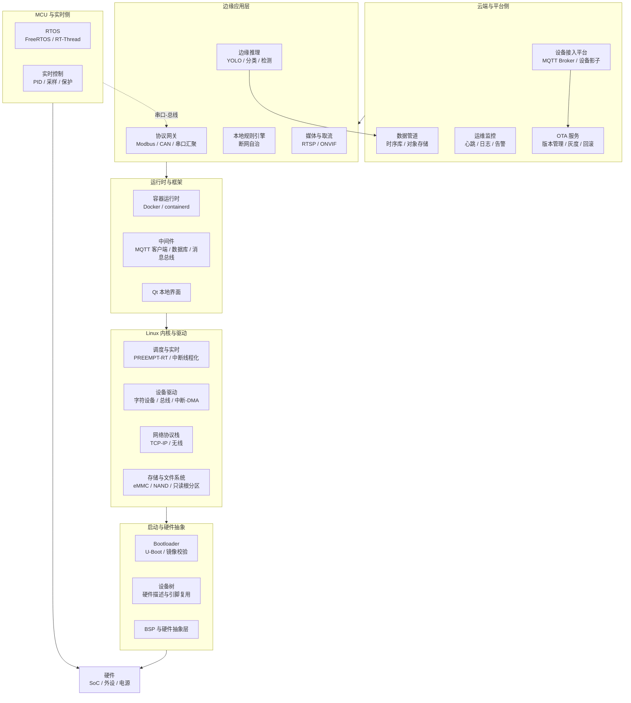
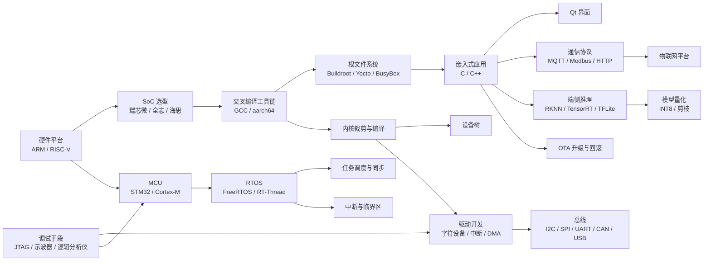
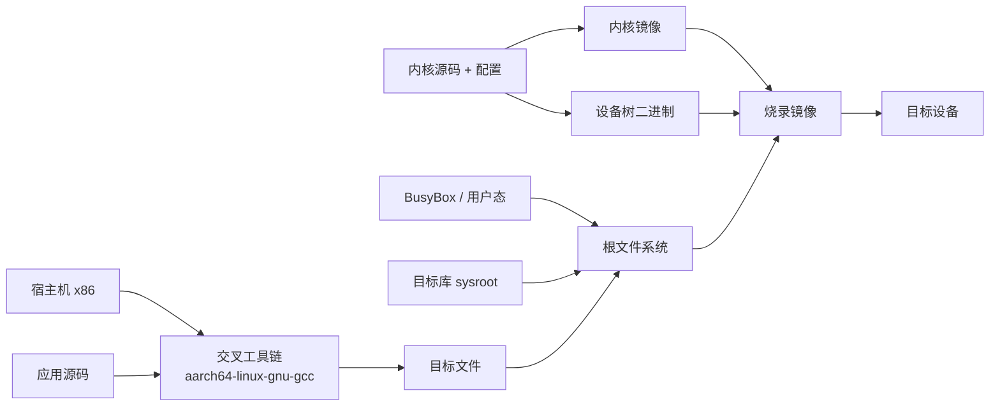
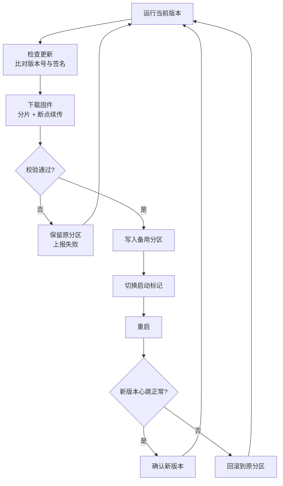
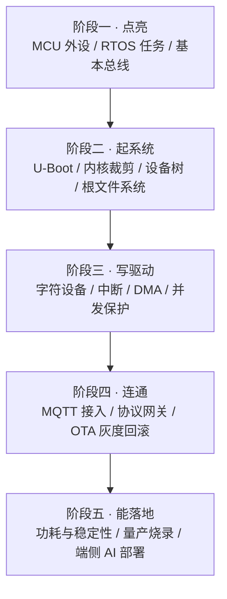
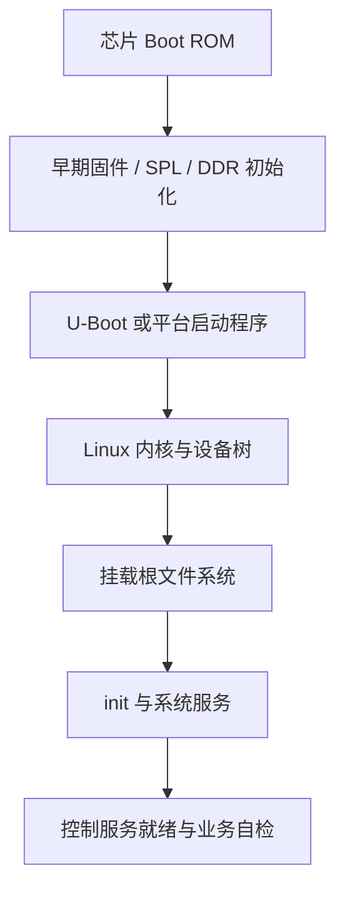
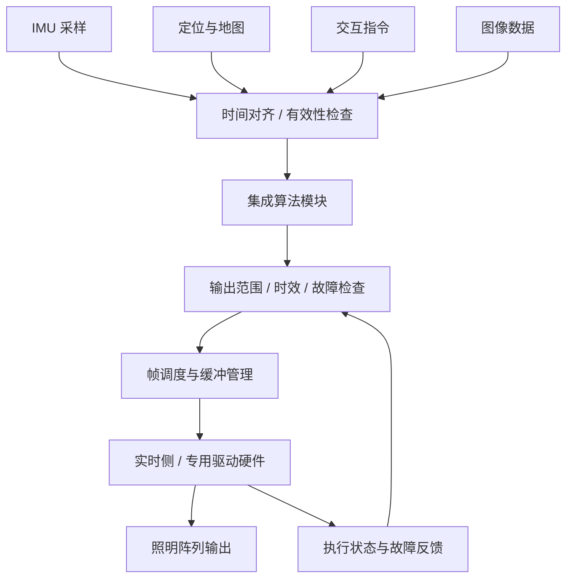

# 06 · 嵌入式 Linux 与边缘计算

> 系统学习入口：[嵌入式 Linux 零基础到边缘计算实战](06-嵌入式Linux零基础到边缘计算实战.md)，包含 GitHub 资料路线、原理、代码练习和网关/异构控制/边缘 AI/系统升级项目方案。

> 数据基础：30 份 JD 聚合去重 | 薪资均值 19-32K | 学历主流：本科 | 经验主流：5 年以上
> 内容已去除公司信息，保留技术事实。
> 本次增补：依据新增 SoC 控制器软件岗位，补充异构多核、照明控制数据通路、实时调优与车规工程体系。原有 30 份样本及词频统计未重新计算；后文实施建议不等于 JD 逐项要求，也不构成功能安全认证结论。

**阅读入口**：初学者先看第十节认识 SoC 与平台分层，再依次学习 Bring Up、驱动、多核通信与数据通路；第十六节以后讨论功能安全、项目实施与交付。

---

## 一、方向定位

这个方向的核心职责是**在资源受限的硬件上，让软件长期、确定、低功耗地跑起来**，并且能规模化地被部署与升级。

它横跨三层：裸机/RTOS 侧的实时控制、Linux 侧的驱动与应用、云端侧的设备管理与数据回传。JD 的关键词分布清晰地体现了这种"上下贯通"的要求——这也是为什么这个方向的经验门槛普遍要求 5 年以上。

### 1.1 高频技术统计（按出现篇数）

| 技术/能力 | 出现篇数 | 占本方向比例 | 解读 |
|-----------|---------|-------------|------|
| 嵌入式 | 25 | 83% | 方向主标签 |
| C++ | 15 | 50% | 应用层主力语言，C 仍占主导 |
| RTOS | 10 | 33% | 实时侧刚需，FreeRTOS 最常见 |
| 性能优化 | 8 | 27% | 内存、启动时间、功耗是三大目标 |
| Qt | 5 | 17% | 带屏设备的 UI 方案 |
| STM32 | 4 | 13% | MCU 侧主流平台 |
| MQTT | 4 / 6 | 13% / 20% | 设备接入云的事实标准协议 |
| CMake | 3 | 10% | 构建工具 |
| RK3588 / 瑞芯微 | 2 | 7% | 边缘 AI 盒子的主流 SoC |
| Docker / Kubernetes | 3 / 2 | 10% / 7% | 边缘侧容器化趋势已出现 |

### 1.2 细分技术二次统计

对 30 份 JD 正文做细粒度扫描后，可以看到大量不写在岗位标签里、却在职责描述中反复出现的技术点：

| 细分技术项 | 出现篇数 | 占比 | 说明 |
|-----------|---------|------|------|
| C 语言 | 23 | 77% | 仍是嵌入式第一语言，尤其是驱动与 MCU |
| 驱动开发 | 20 | 67% | 岗位重心，字符设备与总线驱动为主 |
| Linux | 19 | 63% | 嵌入式 Linux 是主流形态 |
| SPI | 12 | 40% | 高速外设总线 |
| I2C | 11 | 37% | 传感器与配置芯片 |
| RTOS | 9 | 30% | 与 Linux 并存而非替代 |
| ARM 架构 | 9 | 30% | Cortex-M / Cortex-A 双线 |
| CAN | 9 | 30% | 工业与车载总线 |
| UART | 9 | 30% | 调试与低速通信 |
| 内核 / 中断 | 7 / 6 | 23% / 20% | 内核裁剪与中断处理 |
| USB | 6 | 20% | 外设与烧录 |
| 功耗 / 低功耗 | 5 / 3 | 17% / 10% | 电池设备的核心指标 |
| 蓝牙 | 5 | 17% | 近距离配网与通信 |
| OTA 升级 | 5 | 17% | 规模化运维的前提 |
| 4G / 5G | 5 / 4 | 17% / 13% | 蜂窝回传 |
| 可靠性 / EMC | 5 / 3 | 17% / 10% | 硬件产品化必过关卡 |
| 原理图 / PCB | 5 / 3 | 17% / 10% | 软硬协同能力 |
| Yocto / OpenWrt | 各 3 | 10% | 定制发行版构建 |
| 实时性 / PREEMPT-RT | 3 / 2 | 10% / 7% | Linux 实时化改造 |
| NPU / 边缘 AI | 2 | 7% | 端侧推理是新增长点 |
| 交叉编译 / 根文件系统 | 2 / 1 | 7% / 3% | 工具链基础能力 |

**一句话总结**：这个方向的门槛不在"能不能跑通"，而在**能不能在几万台设备上，跑三年不出事、出问题能修、修完能回滚**。

---


### 完整技术栈清单（全量抽取 · 基于本方向 30 篇 JD）

> 下表由 JD 全文穷举抽取生成，数字为**出现该术语的 JD 篇数**，用于补齐正文未展开的细分技术项。

| 类别 | 技术栈（数字为出现篇数） |
|------|------------------------|
| **语言** | C++(15)、Python(4)、C语言(4)、Java(3)、Go(3)、Shell(2)、Rust(2)、C#(1)、Golang(1) |
| **后端框架** | Spring(1)、Spring Boot(1)、Django(1)、Flask(1) |
| **前端框架与UI** | Flutter(1)、SVG(1) |
| **移动端** | Android(4)、Framework(2)、Jetpack(1) |
| **数据库与存储** | MySQL(2)、Redis(2)、MongoDB(1)、SQLite(1)、S3(1) |
| **消息与中间件** | MQTT(4)、Kafka(1) |
| **云容器与DevOps** | Docker(3)、容器化(2)、Kubernetes(2)、CI/CD(1)、流水线(1)、DevOps(1)、GitHub Actions(1)、Terraform(1) |
| **大数据与数据平台** | Hadoop(1)、Flink(1)、Spark(1)、离线计算(1) |
| **AI与机器学习** | ASR(3)、GPU(2)、OpenCV(2)、NPU(2)、Claude(1)、智能体(1)、模型部署(1)、PyTorch(1)、TensorFlow(1)、算力(1)、TTS(1)、语音识别(1)、推理优化(1)、Whisper(1) |
| **音视频与流媒体** | 编解码(4)、低延迟(1)、RTSP(1)、WebRTC(1)、ONVIF(1)、推流(1)、帧率(1)、拉流(1)、DTS(1) |
| **嵌入式与硬件** | 嵌入式(25)、SPI(10)、I2C(10)、RTOS(9)、ARM(8)、单片机(8)、CAN(7)、Modbus(5)、中断(5)、原理图(5)、RS485(5)、串口(4)、电源(4)、OTA(4)、蓝牙(4)、PCB(4)、电机(4)、传感器(4)、STM32(4)、运动控制(3) |
| **桌面与客户端** | Qt(1)、客户端(1) |
| **协议与接口** | TCP(7)、HTTP(3)、UDP(2)、RESTful(1)、SDK(1)、接口对接(1)、FTP(1) |
| **安全与合规** | 合规(4)、防火墙(1) |
| **工程化与质量** | 技术文档(5)、设计文档(5)、Git(4)、日志(3)、CMake(3)、单元测试(2)、代码评审(2)、SVN(2)、GitHub(1)、集成测试(1)、接口文档(1)、复盘(1)、编码规范(1)、Make(1) |
| **架构与设计** | 性能优化(8)、架构设计(7)、方案设计(6)、高可用(4)、技术选型(3)、微服务(2)、高并发(2)、多线程(2)、SaaS(1)、低延迟(1)、边缘计算(1) |
| **业务领域** | 定制化(2)、物联网平台(2)、MES(1)、供应链(1)、支付(1)、项目管理(1)、医疗(1)、SAP(1)、教育(1)、车联网(1) |
| **软技能** | 英语(8)、团队协作(6)、规划(4)、沟通能力(3)、责任心(3)、需求分析(2)、培训(2)、跨部门(2)、文档编写(2)、抗压(2)、复盘(1) |

---

## 二、参考架构图



### 解读

1. **两条技术路线互补**：Linux 通常负责复杂业务与网络，MCU/RTOS 或专用硬件承担紧时限控制。是否满足实时要求应依据最坏响应时间和验证结果；RTOS 也可以支持网络与文件系统，不能仅按功能名称划分平台。
2. **设备树是硬件与内核的契约**：同一份内核镜像配合不同 dtb 适配不同板卡，避免把硬件参数硬编码进驱动。
3. **OTA 是产品化分水岭**：没有可靠 OTA 与回滚机制的设备，一旦出厂就无法修复，运维成本不可控。
4. **断网自治必须设计**：边缘设备不能假设网络永远可用，本地要缓存数据、本地要能独立决策，联网后补全。
5. **容器化在边缘是趋势但非必需**：资源紧张时容器开销并不划算，需按设备算力权衡。

---

## 三、技术栈关联图



### 说明

- **工具链 → 内核 → 驱动 → 总线**是嵌入式 Linux 的主干依赖链，任何一环缺失都会导致板卡起不来。
- **MCU → RTOS → 任务调度**是并行的一条链，与 Linux 链在"实时性"上互补。
- **端侧推理需匹配硬件能力**：部分 NPU 要求特定量化格式，另一些支持 FP16 等精度；先验证算子、布局与精度支持，再决定是否量化。
- **调试工具是硬门槛**：只会写代码、不会用示波器和逻辑分析仪，无法定位硬件相关问题。

---

## 四、核心能力矩阵

| 能力项 | 出现率 | 关键要点 | 常见追问 |
|--------|-------|---------|---------|
| C/C++ 语言 | 77% / 50% | 指针、位操作、内存对齐、volatile、无标准库环境 | `volatile` 和原子变量的区别？ |
| Linux 驱动开发 | 67% | 字符设备、设备树匹配、中断上下半部、DMA、并发保护 | 中断里能不能睡眠？为什么？ |
| 交叉编译与构建 | 27% | 工具链、sysroot、根文件系统、静态与动态链接 | 动态库版本不兼容怎么排查？ |
| RTOS 实时编程 | 33% | 任务优先级、优先级反转、信号量、消息队列、临界区 | 优先级反转怎么解决？ |
| 总线与协议 | 30%-40% | I2C/SPI/UART/CAN/Modbus 时序与帧格式 | SPI 四种模式的区别？ |
| 设备接入与云端 | 20% | MQTT QoS、Keepalive、断线重连、消息补发 | QoS1 和 QoS2 的区别与代价？ |
| 边缘 AI 部署 | 7% | 量化、算子支持、NPU 加速、前后处理 | INT8 量化精度掉了怎么办？ |
| 功耗与稳定性 | 17% | 休眠唤醒、看门狗、掉电保护、老化测试 | 设备跑一周死机怎么查？ |
| OTA 与运维 | 17% | A/B 分区、校验、灰度、回滚 | 升级断电了怎么办？ |
| 硬件协同 | 17% | 看原理图、引脚复用、时序、EMC | 通信不稳定是软件还是硬件问题？ |

---

## 五、关键实现要点

### 5.1 RTOS：任务调度与优先级反转

RTOS 通常采用**基于优先级的抢占式调度**：就绪队列中优先级最高的任务立即获得 CPU。

**优先级反转**是经典问题：低优先级任务 L 持有锁 → 高优先级任务 H 等待该锁 → 中优先级任务 M 抢占 L → 结果是 H 被 M 间接阻塞，优先级关系被"反转"。

三种解法：

| 方法 | 原理 | 代价 |
|------|------|------|
| 优先级继承 | L 临时提升到 H 的优先级，尽快释放锁 | 普遍支持，推荐 |
| 优先级天花板 | 持有锁时直接提升到预设上限 | 更保守，需配置 |
| 避免共享 / 无锁 | 设计上消除互斥 | 最彻底，但难 |

FreeRTOS 中的互斥量默认带优先级继承，而**二值信号量不带**——这正是两者关键区别，也是面试常考点。

其它要点：
- **ISR 中不能调用阻塞 API**，应使用 `xQueueSendFromISR` 等 FromISR 变体，并配合 `portYIELD_FROM_ISR`；
- **栈大小要量化**：启用 `uxTaskGetStackHighWaterMark` 检查水位，避免静默栈溢出；
- **临界区要短**：`taskENTER_CRITICAL` 关中断会影响系统实时性，只保护极小段代码。

### 5.2 FreeRTOS 与 Linux 的差异

这是选型时最需要讲清楚的问题：

| 维度 | FreeRTOS | Linux |
|------|----------|-------|
| 调度 | 常用优先级抢占，具体由配置决定 | 普通任务与实时策略并存；公平调度实现随内核版本变化 |
| 实时性 | 可用于硬实时系统，仍需验证整个硬件与软件时限 | 可配置 PREEMPT_RT，是否需外部补丁取决于内核版本与平台支持 |
| 内存 | 常见 MCU 无 MMU，可用静态或动态分配，部分端口支持 MPU | 常见 Cortex-A 平台有 MMU，支持虚拟内存与进程隔离 |
| 文件系统 | 可选轻量 FS | 完整 VFS 与多种 FS |
| 网络 | LwIP 等轻量栈 | 完整 TCP/IP 协议栈 |
| 启动 | 毫秒到百毫秒 | 秒级 |
| 适用场景 | 电机控制、采样、保护 | 网关、AI 盒子、复杂业务 |

**工程结论**：需要确定性响应 → RTOS；需要复杂生态与算力 → Linux；两者都要 → **异构方案**（如 Cortex-A + Cortex-M 双核，通过 RPMsg 或共享内存通信）。

### 5.3 交叉编译工具链与根文件系统



要点：

1. **sysroot 应与目标系统的 ABI 和运行库兼容**，最好由同一 BSP 构建产物生成，避免宿主库混入；并非要求所有文件逐字节一致；
2. **ABI 与浮点选项要对齐**（`hard-float` vs `softfp`），不匹配会导致难以理解的崩溃；
3. **根文件系统构建方式选型**：
   - `Buildroot`：简单、构建快，适合产品化；
   - `Yocto`：灵活、可维护性强，适合长生命周期产品线；
   - `BusyBox` 手工：最小但维护成本高；
4. **只读根分区 + 独立数据分区**是提升可靠性的标准做法，配合 overlayfs 提供可写层；
5. **调试符号单独保存**：发布镜像 strip，符号文件归档，用于后续 crash 回溯。

### 5.4 设备树与驱动

设备树把"硬件是什么"从内核代码里剥离出来：

```dts
/* 示意：控制器标签、引脚和绑定需按目标板调整。 */
&i2c1 {
    status = "okay";
    #address-cells = <1>;
    #size-cells = <0>;

    sensor@48 {
        compatible = "vendor,temp-sensor";
        reg = <0x48>;
        interrupt-parent = <&gpio1>;
        interrupts = <5 IRQ_TYPE_EDGE_FALLING>;
    };
};
```

驱动侧可通过 `of_device_id` 表匹配 `compatible`；设备与驱动完成匹配、依赖满足后进入 `probe()`，获取资源并注册到相应子系统。并非所有驱动都创建自己的字符设备节点；依赖未就绪时可能延迟探测。

关键要点：
- **`compatible` 必须带厂商前缀**，避免与上游冲突；
- **硬中断与 softirq/tasklet 上下文不能睡眠**；工作队列和线程化 IRQ 可在适合的进程上下文处理，但仍要遵守锁和时限约束；
- **并发保护**：驱动可能被多进程同时访问，需要 `mutex`、`spinlock` 或原子变量；自旋锁保护的临界区不能睡眠；
- **与用户态接口**：字符设备 `read/write/ioctl` + 异步通知 `poll/fasync`；调试阶段优先用 sysfs 暴露参数。

### 5.5 MQTT：Keepalive 与断线重连

MQTT 是设备接入的事实标准，工程落地有三个必答题：

**(1) Keepalive 与心跳**
客户端声明 Keepalive；在没有其他 MQTT 控制报文发送时，需在相应间隔内发送 PINGREQ。非零 Keepalive 下，服务端通常按规范在约 1.5 倍间隔未收到控制报文时断开连接；MQTT 5 的服务端覆盖值也需考虑。具体间隔应按网络、功耗与掉线检测需求选择。

**(2) QoS 等级选择**

| QoS | 语义 | 代价 | 适用 |
|-----|------|------|------|
| 0 | 至多一次，可能丢 | 最低 | 高频遥测、允许丢 |
| 1 | 至少一次，可能重复 | 一次往返 | 状态上报，需去重 |
| 2 | 协议相邻端交付的恰好一次语义，不等于业务副作用恰好一次 | 四报文握手 | 按可靠性和开销选择；关键操作仍需业务幂等 |

**(3) 断线重连与消息补发**
- 指数退避重连（如 1s → 2s → 4s，上限 60s），避免网络恢复瞬间全网设备同时冲击 Broker；
- 使用 **Clean Session = false + 持久会话**，让离线期间的 QoS1 消息在重连后补发；
- 本地**环形缓冲**缓存断网期间数据，重连后批量补报并做幂等去重；
- 遗嘱消息（LWT）用于通知其他系统设备掉线。

### 5.6 OTA 升级与回滚

可靠 OTA 的核心不是"下载固件"，而是**"任何时刻断电都能恢复"**。



要点：
- **A/B 双分区**是常用方案；资源受限时也可设计独立恢复环境等方案，关键是验证中断更新后仍有可信恢复路径；
- **签名校验必须做**：固件用非对称签名，设备端验签，防止恶意固件；
- **确认机制**：新版本启动后需在窗口期内上报健康状态，否则看门狗或 bootloader 自动回滚；
- **灰度发布**：先 1% → 10% → 全量，配合版本回滚率监控；
- **断电保护**：写分区前确保有足够空间，写入过程分块校验，避免半写状态。

### 5.7 端侧模型量化部署

推理运行时选型：

| 运行时 | 适用硬件 | 特点 |
|--------|---------|------|
| TensorRT | NVIDIA GPU / Jetson | 性能极致，需算子支持 |
| ONNX Runtime | 通用 CPU/GPU | 跨框架，EP 机制灵活 |
| TFLite | ARM CPU / NPU delegate | 移动端生态成熟 |
| RKNN | 瑞芯微 NPU | 端侧 So C 专用加速 |
| NCNN / MNN | ARM CPU | 轻量，无重依赖 |

量化落地要点：
1. **训练后量化（PTQ）可作为起点**，需要覆盖真实分布、异常工况的校准集，数量与模态由模型和工具决定，不能保证几百张一定足够；
2. **精度掉太多改量化感知训练（QAT）**，在训练时插入伪量化节点；
3. **算子支持是最大坑**：某些算子 NPU 不支持会回退到 CPU，性能断崖式下跌，需先用工具检查算子覆盖；
4. **前后处理常成为瓶颈**：解码、resize、归一化用 OpenCV/硬件加速，别让 CPU 拖后腿；
5. **批处理与异步**：多路视频时批处理能显著提升 NPU 利用率。

---

## 六、典型职责归纳（去重合并）

- 负责嵌入式 Linux 系统的 Bring-up：Bootloader 移植、内核裁剪、设备树编写与根文件系统构建。
- 负责外设驱动开发与调试：I2C、SPI、UART、CAN、USB、网卡、显示等模块的驱动适配。
- 负责 MCU 侧 RTOS 应用开发：任务划分、优先级设计、中断处理、实时控制与保护逻辑。
- 实现设备通信与协议栈：Modbus、CANopen、MQTT、自定义二进制协议的编解码与状态机。
- 负责设备接入云平台：MQTT 连接管理、心跳保活、断线重连、数据上报与指令下发。
- 实现 OTA 升级方案：固件签名校验、A/B 分区、灰度发布、失败回滚与健康确认。
- 负责系统稳定性与功耗优化：看门狗、休眠唤醒、掉电保护、内存与启动时间优化。
- 负责端侧 AI 模型部署：模型转换、量化、算子适配、推理性能调优与前后处理加速。
- 与硬件工程师协作：参与原理图评审、引脚分配、时序确认与 EMC、可靠性测试。
- 编写设计文档、测试用例与生产烧录方案，支撑量产与售后问题定位。

---

## 七、进阶路径建议



每阶段产出物建议：外设 Demo → 可启动的定制镜像 → 可交付的驱动模块 → 接入云平台的设备端 SDK → 批量部署并稳定运行的产品固件。

---

## 八、常见考察点清单

1. **优先级反转是什么，怎么解决？**
   低优先级持锁阻塞高优先级，被中优先级间接拖长。用优先级继承或优先级天花板。

2. **中断上半部和下半部怎么划分？**
   硬中断处理应短，按硬件要求确认或屏蔽中断并安排后续处理；并不意味着必须关闭系统所有中断。softirq/tasklet 不可睡眠，工作队列和线程化 IRQ 的可睡眠处理也需遵守锁与实时约束。

3. **`spinlock` 和 `mutex` 怎么选？**
   依据上下文、共享资源和锁类型选择。普通非 RT 内核中的自旋锁临界区不可睡眠；PREEMPT_RT 会改变 `spinlock_t` 的实现和语义，`raw_spinlock_t` 仍保留原始自旋行为。不能把所有内核配置的锁行为混为一谈。

4. **设备树的作用是什么？**
   把硬件拓扑、地址、中断、引脚复用从内核代码剥离，实现同一内核镜像适配不同板卡，驱动靠 `compatible` 匹配。

5. **MQTT 的 QoS 等级区别？**
   QoS0 至多一次；QoS1 至少一次，可能重复；QoS2 提供相邻协议端的恰好一次交付语义，握手开销更大。三者都不能自动保证端到端业务副作用只发生一次。

6. **设备断网期间数据怎么办？**
   本地环形缓冲持久化，重连后批量补报，服务端按消息 ID 或时间戳幂等去重，注意时钟回拨问题。

7. **OTA 升级断电了怎么办？**
   A/B 双分区 + 启动标记，只有新版本确认健康后才提交；未确认则由 bootloader 自动切回旧分区。

8. **交叉编译的程序在板子上跑不起来，怎么排查？**
   依次检查：架构 `file`、动态库依赖 `ldd`、sysroot 一致性、ABI 与浮点选项、`strip` 后是否误删符号。

9. **INT8 量化后精度下降明显怎么处理？**
   换校准集使其更具代表性；做混合精度（敏感层保留 FP16）；改用 QAT；检查是否有算子被回退到 CPU 导致数值差异。

10. **如何降低设备功耗？**
    空闲进休眠、外设时钟门控、降低采样率与唤醒频率、批量上报减少无线模块工作时间、选择低功耗模式与电源域划分。

11. **设备现场偶发死机如何定位？**
    看门狗复位计数 + 保留 RAM 中的日志、core dump 捕获、`addr2line` 回溯、内存泄漏与水位监控、长时间老化压测复现。

---

## 九、与其他方向的连接

- **与 C++ 系统软件**：嵌入式侧负责下位机与驱动，上位机由 Qt/C++ 实现，两者通过串口、总线或私有协议定义接口契约。
- **与音视频与流媒体**：边缘盒子常承担取流、转码与 AI 分析，涉及 RTSP/GB28181 接入与硬件编解码。
- **与机器人与智能硬件**：运动控制、传感器采集与实时保护属于嵌入式范畴，上层导航规划依赖其提供稳定的数据与控制接口。
- **与 Go 云原生高并发**：设备侧 MQTT 接入平台通常由 Go 实现高并发连接管理与消息路由。
- **与 AI 大模型应用**：边缘侧运行量化后的小模型，云端运行大模型，两者在算力、延迟与隐私之间做分工。

---

## 十、新增岗位知识导读：认识 SoC 控制器

来源：[SoC 软件工程师 JD](职位描述/soc软件工程师｜某知名智能硬件_消费电子公司｜d00fe65445a76c940nJ80tS4FFJY.md)。原文开头含“前端开发工程师”字样，但主要职责、技术边界及考核目标均指向嵌入式 Linux 控制器软件负责人，本文按这些实质内容提炼。

### 10.1 先弄懂几个名词

**SoC（片上系统）**：把处理器、内存控制器和多种外设控制器等集成在一颗芯片里。具体是否包含 GPU、NPU、Cortex-M，要看芯片型号，不能看到 SoC 就默认都有。

**Cortex-A** 通常承载 Linux、复杂应用和算法集成；**Cortex-M** 常承担低功耗、采样、控制和保护。两者可以位于同一 SoC，也可以通过外部总线连接，通信方式不同。

**BSP（板级支持包）**：让操作系统适配具体板卡的一组软件与配置，通常涉及启动程序、内核、设备树、驱动及构建支持。**HAL（硬件抽象层）**把设备差异封装成稳定接口，例如上层统一调用“设置亮度”，不用直接操作寄存器。

### 10.2 这份 JD 新增了什么

| JD 明确提及 | 对应知识 | 本文扩展 |
|-------------|----------|----------|
| Cortex-A Linux、协同 Cortex-M | 异构多核职责划分和通信 | 第十三节 |
| SDK、U-Boot、内核、根文件系统、启动优化 | 从评估板到目标板的系统移植 | 第十一节 |
| MIPI、CAN FD、IMU、GPS、多通道 PWM | 接口差异、驱动子系统与硬件调试 | 第十二节 |
| 多源接入、帧同步、姿态与地图、光型输出 | 时间戳、数据流、算法与执行链路 | 第十四节 |
| 实时性、PREEMPT_RT、中断延迟 | 端到端时延预算与测量 | 第十五节 |
| ISO 26262、ASPICE、目标 ASIL-B 或项目等级 | 功能安全与开发过程证据 | 第十六节 |
| 软件负责人、平台复用、三个月目标 | 分阶段交付、团队分工与量产 | 第十七节 |

后文的工具、数值和实施案例是学习与设计建议，不代表该公司已经采用的方案。

---

## 十一、从评估板到目标板：系统 Bring Up

### 11.1 Bring Up 是什么

Bring Up 就是让一块新板从“通电”走到“可运行和调试软件”。先验证供电、时钟、复位和启动介质，再看启动日志和系统外设，不能看到串口没输出就直接认定内核有问题。

| 阶段 | 做什么 | 可检查证据 |
|------|--------|------------|
| 获取基线 | 保存厂商 SDK、手册、参考镜像与板卡版本 | 已知可工作的版本与构建说明 |
| 评估板启动 | 使用参考镜像确认启动与调试方式 | 串口完整日志、启动介质与恢复方式 |
| 重建参考系统 | 从源码构建并启动，而非仅运行预编译镜像 | 工具链版本、配置与构建产物 |
| 目标板硬件检查 | 和硬件团队检查供电、复位、启动配置、串口 | 测量记录、原理图版本与问题单 |
| 基础移植 | 按板卡修改 DDR、引脚、时钟、电源及设备树等 | 分阶段启动日志与最小外设用例 |
| 业务验证 | 在稳定系统上接入数据流与算法 | 测试报告、资源占用与失败行为 |

DDR 初始化常涉及厂商固件、训练参数和硬件设计，不应假设只改设备树即可解决。

### 11.2 启动链逐段排查



这是概念链路，实际 ARM 平台还可能包含可信固件、安全世界、不同启动阶段与镜像格式。以芯片 SDK 为准。

系统停在哪一段，就先检查该段的输入与输出。例如 U-Boot 已打印、内核无日志，要核对镜像地址、设备树、启动参数和串口配置；内核启动但挂载失败，要检查根设备、存储驱动与文件系统支持。

### 11.3 启动优化先定义终点

“开机 3 秒”没有说明终点：串口出现提示、屏幕亮起、网络连通和安全控制输出可用是不同指标。应分别记录上电、内核启动、用户态启动、关键服务就绪和首次有效输出时间。

优化可从删除无用探测、缩短不必要等待、服务并行、延迟非关键功能、控制日志量入手。使用 systemd 时可分析 `systemd-analyze`，内核可结合启动日志及 `initcall_debug`；调试参数本身也可能影响耗时。必须保留必要自检和安全机制。

---

## 十二、驱动与硬件接口：从引脚到业务数据

### 12.1 先复用 Linux 子系统

驱动不是所有外设都写一个字符设备。优先确认主线或厂商已有支持，再选择对应子系统，减少自定义接口。

| 接口或设备 | 常见 Linux 路径 | 联调重点 |
|------------|----------------|----------|
| IMU 等传感器 | I2C/SPI 控制器、设备驱动、IIO 等 | 量程、采样率、轴方向、时间戳、FIFO 溢出 |
| UART 与定位模块 | TTY、串口服务、模块协议 | 电平、波特率、校验、语句完整性、定位有效性 |
| CAN / CAN FD | SocketCAN 与控制器驱动 | 收发器、终端电阻、位时序、总线负载与 bus-off |
| PWM 与阵列驱动器 | PWM 子系统或具体硬件驱动 | 时钟源、同步更新、分辨率、死区与输出安全状态 |
| MIPI 图像输入 | 例如 CSI-2、接收器和 V4L2/media 管线 | lane、速率、像素格式、带宽与帧同步 |
| 显示 / 触摸 | DRM/KMS、输入子系统等 | 时序、帧缓冲、触摸坐标与显示方向 |
| 以太网 / USB | 网络、PHY、USB 对应类驱动 | 角色、链路、吞吐、电源管理和插拔恢复 |

MIPI 是一组接口规范，不等于单一协议。输入图像常见 CSI-2，显示常见 DSI；具体 JD 未指定标准，设计时需要确认。CAN FD 的数据段可使用更高比特率，但需链路节点和收发器支持；最大载荷与经典 CAN 不同。

### 12.2 驱动资源和退出路径一样重要

在 `probe()` 中获取时钟、电源、GPIO、中断和内存映射，检查返回值，处理依赖延迟。优先按子系统规范使用设备管理资源接口，但它不能自动解决并发、DMA 正在运行和用户仍持有句柄的问题。

退出、挂起或错误恢复时，需要停止新请求、关闭中断来源、同步未完成工作、停止 DMA，再释放相关资源，顺序依赖硬件。只测正常读写而不测复位、断连和卸载，很容易漏掉现场故障。

### 12.3 示波器与逻辑分析仪怎么分工

**示波器**看电压、边沿、噪声、时序和 PWM 抖动；**逻辑分析仪**适合观察多路数字信号并解码 I2C/SPI/UART 等协议。二者互补。

例如 I2C 读不到 IMU，先检查供电、电平、上拉、地址、引脚复用，再看是否发出时钟和应答。确认链路后再核对寄存器及驱动时序。避免在设备工作时随意扫描总线或写未知寄存器。

---

## 十三、Cortex-A 与 Cortex-M：明确谁做什么

### 13.1 按时限和故障边界分工

| Cortex-A / Linux 候选职责 | Cortex-M / 实时侧候选职责 |
|--------------------------|--------------------------|
| 地图、网络、HMI、文件、算法推理 | 周期采样、硬件输出更新、局部快速响应 |
| 生成并发送目标光型或控制参数 | 检查命令范围、按时执行、回报实际状态 |
| 日志、远程诊断、配置和升级 | 通信丢失检测、按设计进入降级状态 |

这是架构候选，并不意味着 Cortex-M 天然满足功能安全，也不保证 Cortex-A 可以排除在安全范围外。两侧的故障传播、供电复位和共享资源都要分析。

### 13.2 通信方式与消息契约

同片异构核可按平台采用 `remoteproc` 管理远端核、使用 RPMsg 通信；是否支持取决于 SDK、固件和资源表。外置 MCU 也可通过 SPI、UART、CAN 等通信。

消息至少约定：协议版本、消息类型、长度、序列号、时间戳或有效期、载荷、错误码。是否需要 CRC、计数器和端到端保护由链路与安全要求决定；传输层已有校验不代表应用所有错误都已覆盖。

共享内存不能只“双方拿同一个指针”：需约定物理地址和映射、缓存一致性、内存屏障、缓冲区所有权与生命周期。`volatile` 不能替代原子操作、同步机制或缓存维护。

### 13.3 一条命令要有执行反馈

“发送成功”“对端收到”“参数通过检查”“硬件已更新”是不同状态。重要控制命令需区分这些反馈，设置超时，处理重复、乱序和核重启。

例如 Linux 卡住时，MCU 不应无限使用过期光型；应按预定义策略保留、切换或关闭相关输出。具体安全输出由危害分析与系统设计确定，不能一概规定“全关灯最安全”。

---

## 十四、多源数据到光型输出：打通核心数据通路

### 14.1 先理解“感知—决策—执行”

IMU 提供运动与姿态相关测量，定位和地图提供场景信息，HMI 提供用户意图，图像输入提供视觉数据。算法结合输入产生目标光型，控制系统将其转成硬件支持的输出。



### 14.2 时间戳比“收到一条消息”更重要

IMU、图像和定位数据频率不同，而且存在采集、缓存与传输延迟。需区分采集时间和接收时间，记录时钟域、序列号、有效标志及数据年龄。

设备内计算间隔通常使用单调时钟，避免系统校时造成跳变；跨设备对时需按精度需求选择硬件时间戳、PPS/PTP 或其他同步方案。不能把不同设备的时间戳直接相减就当成延迟。

处理策略可以是“以图像帧为基准，匹配附近 IMU 数据”，也可能需要插值或算法补偿。必须由算法与工程团队约定允许误差；定位无效或数据超龄时应走降级分支，而非继续使用看起来正常的旧数据。

### 14.3 缓冲与背压决定是否越跑越慢

实时显示往往关心最新帧，而离线记录可能要求尽量不丢。两者应采用不同队列策略：有界队列、丢弃旧帧或拒绝新请求、记录丢帧计数，并明确最大等待时间。

双缓冲或环形缓冲需定义“谁在写、谁在读、何时切换”。DMA-BUF 可用于部分图像管线共享缓冲，但还需同步和缓存管理；零拷贝也不等于零开销。

### 14.4 多通道高精度 PWM 的关键关系

简单计数型 PWM 中，若计数器时钟为 `f_clk`、一个周期包含 `N` 个计数，则 `f_pwm ≈ f_clk / N`，占空比分辨率约为 `1/N`。在同一时钟和计数机制下，提高频率通常会减少可用分辨率；实际还受预分频、对齐方式及芯片实现影响。

多通道阵列还需关心同步锁存、相位、通道间偏差和更新是否发生在帧边界。用户态循环写 GPIO 不能替代硬件 PWM；GPIO 翻转也不能直接代表真实光学响应，需要结合驱动器、电流与光学测量验证。

---

## 十五、实时性与边缘算法部署：测整条链路

### 15.1 快和实时不是一回事

平均 1 毫秒完成，但偶尔卡住 100 毫秒，不代表满足 10 毫秒截止期。实时性关注是否在规定时限内完成，需同时观察尾延迟、最大观测延迟和超期次数。

例如可以先做一个**教学用 20 毫秒预算**：采集传输 3、对齐预处理 2、算法 8、调度传输 3、执行更新 2、余量 2 毫秒。它不是岗位指标，也不是实际设计保证；需结合采样率、流水线并行和硬件测量重新制定。

### 15.2 PREEMPT_RT 不是确定性的保证书

PREEMPT_RT 可降低部分不可抢占时段，并改变部分锁与中断处理行为。仍需分析驱动长临界区、IRQ、缺页、内存回收、共享总线、热降频与硬件固件等延迟来源。

常见措施包括实时优先级设计、CPU/IRQ 亲和性、预分配和锁页、减少关键路径分配与日志，以及隔离后台负载。使用 `SCHED_FIFO` 等策略要防止饿死系统服务，保留恢复通道。

`cyclictest` 用于观察调度唤醒延迟，ftrace/trace-cmd 等帮助定位；它们不能单独证明完整控制链满足时限。应同时使用硬件时间戳或示波器测输入事件到实际输出，在网络、存储、推理与高温等负载下测试。观测最大值也不自动等于最坏执行时间上界证明。

### 15.3 算法集成需要稳定契约

与算法团队约定输入单位、坐标系、矩阵布局、图像格式、有效范围、输出含义、版本与异常行为。例如角度是度还是弧度，时间是毫秒还是微秒，RGB 和 BGR 是否一致，错误都可能比“推理慢”更危险。

部署前后使用同一批样本比对输出，分别测解析、预处理、拷贝、推理和后处理。NPU 标称算力不等于整机帧率；不支持的算子、格式转换与内存带宽都可能成为瓶颈。

模型更新应与运行库、驱动、前后处理及参数配置形成兼容清单，并保留回退版本。启动预热、负载峰值、热稳定运行及输入异常都要纳入测试。

---

## 十六、车规知识入门：ISO 26262 与 ASPICE

### 16.1 两者分别关注什么

**ISO 26262** 关注道路车辆电气电子系统的功能安全，即避免系统故障行为带来不可接受风险。**Automotive SPICE（ASPICE）**用于评价开发过程能力，关注需求、架构、实现、验证与支持过程等是否受控。

ASPICE 过程能力等级与 ASIL 是不同概念；完成静态扫描、上 RTOS 或使用车规芯片，都不等于整个系统已经符合目标要求。

### 16.2 ASIL 不能由软件团队随便选择

系统需先明确边界与运行场景，通过危害分析和风险评估确定安全目标及相应 ASIL，再分配需求和设计安全机制。JD 提及 ASIL-B 或项目目标等级，不代表现有软件已经认证，也不能由本文判定最终等级。

Linux、MCU、驱动及算法是否承担安全相关职责，取决于系统分解、隔离与安全分析。认证或评估范围、方法和证据应由具备资质的专业人员及相关机构按项目确定。

### 16.3 从第一天积累可追溯证据

```text
系统需求 / 安全相关要求
→ 软件需求与唯一编号
→ 架构及接口设计
→ 代码与配置版本
→ 测试用例与结果
→ 缺陷、变更分析和评审记录
```

例如“输入数据失效时，在指定时限内进入已定义降级模式”，需要明确失效判断、时限、降级行为、实现位置与验证方法。只写“系统要可靠”无法直接验证。

| 工程活动 | 需要保留的产物 |
|----------|----------------|
| 需求评审 | 编号、来源、验收条件、假设与约束 |
| 架构与安全分析 | 故障传播、隔离边界、诊断与响应机制 |
| 代码质量 | 编码规则、静态分析、评审和偏离理由 |
| 验证 | 单元、集成、台架测试、故障注入与覆盖分析 |
| 变更与配置 | 影响分析、批准记录、基线、工具和依赖版本 |
| 发布 | 镜像清单、已知问题、适用硬件与验证报告 |

具体覆盖度、独立性、工具资格与证据深度按适用标准版本、目标等级和项目计划决定，不能把某个覆盖率数字当作通用合规结论。

### 16.4 故障处理要有状态和时间约束

围绕 IMU 无数据、定位失效、通信中断、推理超时、输出异常等设计诊断和响应。看门狗只能发现部分失活，不能识别所有错误计算；喂狗应与关键任务健康状态关联，避免某个无关线程持续喂狗掩盖故障。

功能安全、网络安全和照明法规合规是相关但不同的问题。验签更新可防止未授权镜像，但不能证明控制逻辑安全；光型是否符合法规也需要相应领域验证。

---

## 十七、实战路线：三个月跑通照明控制平台

### 17.1 以评估板先行，分开管理硬件依赖

沿用 JD 的阶段原则：目标板是否回板不硬性绑定第三个月；以下为建议交付物，不能当作量产承诺。

| 阶段 | 工作重点 | 可审查交付物 |
|------|----------|--------------|
| 第一个月 | 评估板启动、核心接口验证、芯片可行性与构建基线 | 启动日志、接口矩阵、选型风险、源码构建和恢复说明 |
| 第二个月 | 集成算法样例，模拟输入到受控输出，设计模块边界 | 核心链路演示、接口契约、资源与延迟初测、架构草案 |
| 第三个月 | 回板后 Bring Up；未回板则完善评估板平台与测试 | 分平台测试报告、目标板问题单、路线图和协作机制 |

先通过模拟数据和安全台架验证协议、帧调度与故障分支。真实光源上电前需与硬件团队确认电气、散热和输出限制；实际车辆或道路验证应走项目规定流程。

### 17.2 小团队怎样分工

可以按 BSP/驱动、数据通路与控制、算法集成与 HMI、构建测试等职责拆解；负责人掌握系统边界、风险与发布基线。岗位数量少时一人可兼多职，但关键接口和变更仍要评审。

跨团队协作应明确：硬件团队提供原理图和时序，芯片厂商提供 SDK 支持范围，算法团队提供输入输出和基准结果，系统与安全负责人确定安全要求和验收边界。

### 17.3 平台复用靠接口，不靠复制目录

驱动层处理硬件机制，HAL 暴露稳定能力，系统服务处理状态与资源，应用实现业务策略。板卡差异通过设备树、受控配置和具体适配器表达；不要把所有差异塞进一个巨大的条件编译文件。

SDK 接口应约定版本、单位、线程安全、错误码、超时与资源归属。新增控制器型号时，通过兼容性测试确认，而非只检查编译通过。

### 17.4 从原型到量产还差哪些验证

- **硬件异常**：反复上电、欠压、复位、外设断连及总线错误后的行为。
- **数据异常**：丢包、乱序、重复、超龄、时钟变化、无效定位与异常传感器值。
- **长期负载**：内存泄漏、存储写入、日志膨胀、温度与降频、队列积压。
- **升级恢复**：更新中断电、A/M 固件版本不兼容、配置迁移失败、启动失败恢复。
- **生产与现场**：序列号与校准数据管理、烧录验证、硬件版本识别、现场日志与符号归档。

发布清单建议同时绑定 Bootloader、内核、DTB、根文件系统、M 核固件、模型、配置、工具链与板卡版本。升级时核对整套兼容关系，不能只替换一个应用文件。

---

## 十八、学习与面试准备：用证据说明能力

### 18.1 学习顺序

**C 与内存基础 → ARM 与原理图 → 评估板启动 → 交叉编译 → 设备树与驱动 → 多线程与通信 → 实时测量 → 算法集成 → 系统验证与车规流程。**

初学者先在一块开发板上完成“读取传感器—生成受限控制参数—硬件 PWM 输出—记录时间与故障”的小闭环，不必一开始就实现整个照明系统或深入光学算法。

### 18.2 值得准备的具体问题

1. **新板串口无输出从哪里查？** 按供电、时钟、复位、启动介质、串口电平与各启动阶段逐段验证。
2. **Linux 与 MCU 如何分工？** 结合时限、故障边界、资源和恢复机制，解释设计依据。
3. **两核共享内存为什么会读到旧数据？** 检查缓存一致性、内存顺序、所有权与同步，不以 volatile 代替协议。
4. **多源数据为何需要时间戳？** 区分采集与接收时间、时钟域、超龄和对齐误差。
5. **PWM 频率和精度怎样权衡？** 用时钟与计数周期说明，并验证硬件同步能力。
6. **cyclictest 数值很好就代表业务实时吗？** 不代表，仍需测完整输入到输出链路及压力工况。
7. **ASIL 与 ASPICE 有何区别？** 分别解释风险相关完整性等级与开发过程能力，避免混淆。
8. **算法能运行为什么还不能交付？** 还缺输入输出契约、时限、精度、故障行为、资源与版本兼容验证。

项目展示应包含启动与架构说明、真实测量波形、延迟和资源报告、一个故障定位案例，以及可从源码复现的构建版本。明确哪些在评估板验证、哪些在目标板验证、哪些仍是待验证假设。

Android / Debian / OpenHarmony 多智能操作系统平台的 CI/CD 流水线设计与落地；基于

Jenkins / Quickbuild 构建覆盖多款 SOC（瑞芯微、高通、MTK 等）的自动化编译、打包、签名与

发布流程，并持续优化编译资源负载均衡

