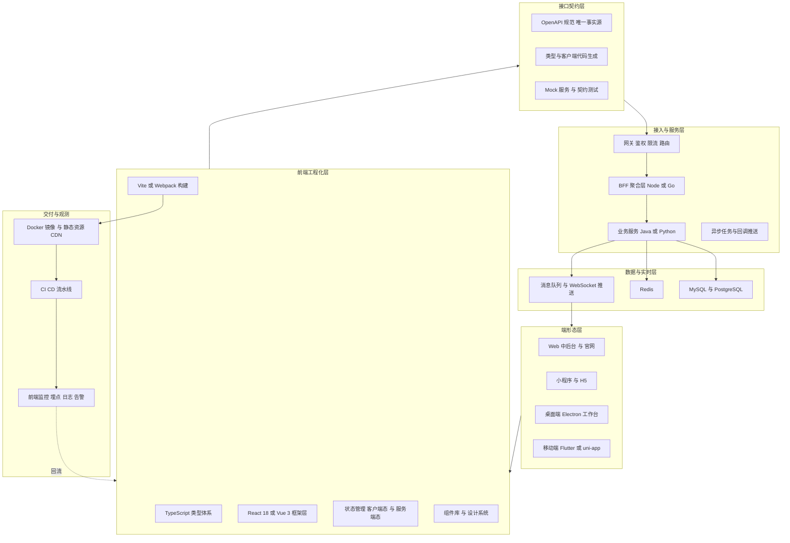
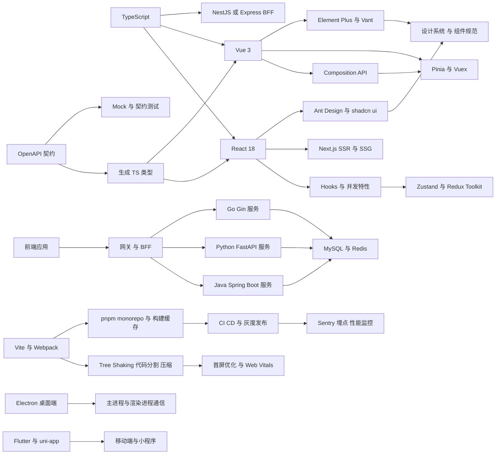
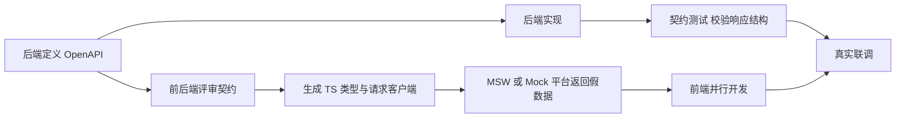
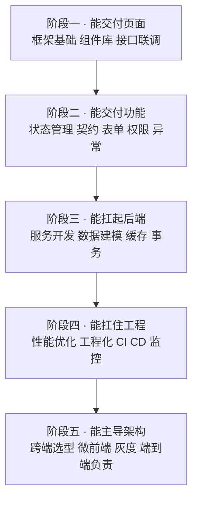

# 08 · 前端与全栈工程

> 系统学习入口：[前端零基础到全栈工程实战](08-前端零基础到全栈工程实战.md)，包含 GitHub 资料路线、基础原理、代码实验，以及工单工作台、AI 助手、实时看板和桌面工具项目方案。

> 数据基础：51 份 JD 聚合去重 | 薪资均值 18-29K | 学历主流：本科 | 经验主流：5 年以上
> 内容已去除公司信息，保留技术事实。

---

## 一、方向定位

这个方向的关键词不是"会写页面"，而是**一个人或一个小组要对端到端交付负责**：前端交互、接口契约、后端服务、数据建模、部署运维都要能兜住。JD 里 Java、Python、Go 与 React、Vue 同时高频出现，正说明了这一点。

| 技术/能力 | 出现篇数 | 占本方向比例 | 解读 |
|-----------|---------|-------------|------|
| React | 34 | 67% | 前端主力框架，海外与 AI 类产品更普遍 |
| Java | 34 | 67% | 大量"全栈"岗位的后端底座仍是 Java |
| Python | 30 | 59% | 与 AI/算法服务对接时的主要语言 |
| MySQL | 28 | 55% | 主力关系库 |
| Vue | 27 | 53% | 国内中后台与内部系统的主力框架 |
| Docker | 26 | 51% | 全栈岗位被要求自己把服务跑起来 |
| Redis | 26 | 51% | 缓存、会话、限流的标配 |
| Go | 24 | 47% | 高并发旁路服务与 BFF 常用 |
| CI/CD | 20 | 39% | 交付自动化已成刚需而非加分项 |
| 性能优化 | 20 | 39% | 前后端都被明确点名的能力 |
| Node.js | 18 | 35% | BFF、构建工具链、SSR 的基础 |
| TypeScript | 16 | 31% | 类型系统渗透率仍在上升 |
| 微服务 | 15 | 29% | 后端侧要有服务拆分与治理概念 |

对同批 JD 做二次细粒度扫描（可精确匹配样本 40 篇），还能定位到这些更具体的工程点：

| 细分技术点 | 出现篇数 | 解读 |
|-----------|---------|------|
| Next.js / SSR 相关 | 5 | 首屏与 SEO 需求推动服务端渲染回归 |
| 单元测试与 E2E | 6 | Jest、Vitest、Playwright 均有出现 |
| WebSocket / SSE | 6 | 实时推送与 AI 流式输出驱动 |
| Nginx / 网关 | 4 | 全栈要自己处理反向代理与路由 |
| 低代码 / 可视化搭建 | 4 | 内部系统提效的重要手段 |
| 前端监控与埋点 | 3 | 白屏、错误、性能指标成为交付项 |
| Flutter | 3 | 跨端移动方案 |
| ECharts / 数据可视化 | 2 | 报表与看板是常见交付物 |
| 微前端 / qiankun / Module Federation | 1 | 大型平台才会引入，属差异化能力 |
| 小程序 / uni-app | 2 | 少量岗位要求多端同构 |
| Electron 桌面端 | 少量 | 桌面工作台类产品的明确要求 |

**一句话总结**：这个方向真正的门槛在"端到端闭环"——契约怎么定、前端怎么不卡、跨端怎么取舍、产物怎么上线、线上怎么观测。

---

### 完整技术栈清单（全量抽取 · 基于本方向 51 篇 JD）

> 下表由 JD 全文穷举抽取生成，数字为**出现该术语的 JD 篇数**，用于补齐正文未展开的细分技术项。

| 类别 | 技术栈（数字为出现篇数） |
|------|------------------------|
| **语言** | Java(32)、Python(30)、Node.js(18)、SQL(17)、Go(16)、TypeScript(16)、JavaScript(13)、C++(8)、Golang(6)、Dart(3)、C#(2)、PHP(2)、Kotlin(1)、Rust(1)、Lua(1)、Swift(1) |
| **后端框架** | Spring(15)、Spring Boot(13)、FastAPI(8)、MyBatis(6)、Spring Cloud(6)、SpringBoot(5)、Django(4)、gRPC(4)、Gin(3)、Flask(3)、NestJS(3)、Celery(2)、RPC(1)、Dubbo(1)、Spring MVC(1)、MyBatis-Plus(1)、JPA(1)、Express(1)、Echo(1)、go-zero(1) |
| **前端框架与UI** | React(34)、Vue(25)、Flutter(8)、Next.js(6)、低代码(4)、Vite(4)、小程序(4)、jQuery(3)、H5(3)、Element UI(3)、Ant Design(3)、Vue3(2)、组件化(2)、Webpack(2)、Electron(2)、Tauri(2)、ECharts(2)、Three.js(2)、响应式(2)、Nuxt(1) |
| **移动端** | 移动端(5)、Android(4)、iOS(4)、App开发(2)、React Native(2)、Uniapp(2)、Kotlin(1)、Swift(1) |
| **数据库与存储** | MySQL(28)、Redis(26)、PostgreSQL(15)、Oracle(6)、SQL Server(6)、向量数据库(6)、MongoDB(5)、pgvector(5)、Milvus(4)、Elasticsearch(1)、SQLite(1)、ClickHouse(1)、Doris(1)、Neo4j(1)、MinIO(1)、S3(1) |
| **消息与中间件** | Kafka(8)、RabbitMQ(7)、MQTT(4)、RocketMQ(3)、Nacos(2)、定时任务(2)、Prometheus(2)、Grafana(2)、OpenTelemetry(2)、NATS(1)、Loki(1) |
| **云容器与DevOps** | Docker(26)、CI/CD(20)、容器化(10)、K8s(8)、流水线(8)、Nginx(6)、Kubernetes(5)、DevOps(4)、灰度发布(3)、GitHub Actions(3)、资源调度(2)、Jenkins(2)、Istio(2)、Service Mesh(2)、Terraform(2)、回滚(1)、自动化部署(1)、Helm(1)、GitLab CI(1)、Ingress(1) |
| **大数据与数据平台** | 埋点(4)、数据同步(3)、报表(2)、BI(2)、ETL(2)、CDC(2)、Flink(1)、Spark(1)、数据质量(1)、数据中台(1)、元数据(1)、数据仓库(1)、实时计算(1)、Storm(1)、OLAP(1) |
| **AI与机器学习** | Agent(19)、大模型(15)、Claude(15)、RAG(14)、LLM(10)、LangChain(7)、智能体(6)、Prompt(6)、提示词(4)、MCP(3)、DeepSeek(3)、微调(3)、多模态(3)、模型部署(3)、Embedding(3)、LangGraph(2)、Llama(2)、vLLM(2)、LlamaIndex(2)、Qwen(2) |
| **音视频与流媒体** | 编解码(2)、低延迟(2)、回放(2)、WebRTC(2)、预览(2)、RTSP(1)、硬编(1)、切片(1)、多路(1)、对讲(1)、云台(1) |
| **嵌入式与硬件** | 固件(4)、SPI(2)、I2C(2)、串口(2)、OTA(2)、烧录(2)、嵌入式(1)、电源(1)、蓝牙(1)、PLC(1)、WiFi(1)、5G(1)、LoRa(1)、ROS(1)、储能(1)、CoAP(1)、数字孪生(1)、光伏(1) |
| **桌面与客户端** | .NET(5)、客户端(3)、Qt(2)、安装包(2) |
| **协议与接口** | RESTful(16)、WebSocket(10)、SDK(8)、gRPC(4)、TCP(3)、HTTP(3)、接口对接(3)、REST(2)、UDP(2)、JSON(2)、HTTPS(2)、开放平台(2)、SSE(2)、Webhook(1)、FTP(1)、WebService(1)、OpenAPI(1)、断线重连(1)、SOAP(1)、Swagger(1) |
| **安全与合规** | 合规(4)、权限控制(3)、HTTPS(2)、数据加密(2)、等保(1)、SSL(1)、脱敏(1)、敏感信息(1) |
| **工程化与质量** | Git(12)、单元测试(12)、日志(12)、GitHub(9)、技术文档(7)、重构(7)、集成测试(7)、代码评审(6)、接口文档(4)、设计文档(3)、灰度(3)、监控告警(3)、复盘(2)、编码规范(2)、压测(2)、覆盖率(2)、敏捷(2)、Playwright(2)、技术债(2)、SVN(1) |
| **架构与设计** | 架构设计(22)、性能优化(20)、微服务(15)、方案设计(13)、高并发(11)、SaaS(9)、异步(8)、高可用(7)、技术选型(7)、抽象(6)、限流(5)、重试(5)、降级(4)、锁(3)、中台(3)、负载均衡(3)、分布式事务(3)、多租户(3)、解耦(3)、多线程(2) |
| **业务领域** | ERP(11)、支付(9)、MES(8)、供应链(6)、电商(6)、库存(5)、WMS(4)、订单(4)、OA(4)、实施(3)、PLM(3)、金蝶(3)、物流(3)、医疗(3)、SAP(3)、保险(3)、财务(2)、CRM(2)、项目管理(2)、金融(2) |
| **软技能** | 团队协作(15)、规划(9)、需求分析(8)、责任心(8)、沟通能力(5)、跨部门(4)、学习能力(4)、英语(3)、培训(2)、文档编写(2)、出差(2)、复盘(2)、抗压(1)、owner(1) |

---

## 二、参考架构图

全栈交付视角下的分层结构。注意"接口契约层"被单独抽出，它是前后端并行开发与 AI 辅助编码的共同前提。

**解读**：
- 端形态层不再是单一 Web，桌面端与跨端移动正在进入全栈职责；
- 契约层前置是缩短联调周期最有效的手段，也是 AI 生成代码可控的前提；
- BFF 层存在的意义是"为前端定制接口"，避免前端为了一个页面调七八个接口；
- 观测要覆盖前端，因为白屏、资源失败、交互延迟这些后端监控看不见。

---

## 三、技术栈关联图

**说明**：这张图里最值得投入的是 `OpenAPI → 类型生成 → 前端` 这条链路。它把"接口联调"从人力沟通问题变成了编译期问题，全栈人效差距往往就出在这里。

---

## 四、核心能力矩阵

| 能力项 | 出现率 | 关键要点 | 常见追问 |
|--------|-------|---------|---------|
| React 18 / Vue 3 渲染模型 | 67% / 53% | 响应式原理、渲染时机、重渲染边界、并发与编译优化 | 为什么改了状态组件没更新/更新太频繁？ |
| 性能优化 | 39% | 首屏指标、长任务拆分、虚拟列表、包体积、缓存策略 | 首屏从 5s 优化到 1s 你怎么做？ |
| 状态管理选型 | 中 | 客户端态与服务端态分离、缓存失效、持久化 | 什么数据该进全局 store？ |
| 接口契约与 Mock | 中 | OpenAPI 优先、类型生成、Mock、错误码与鉴权约定 | 前后端怎么做到零等待联调？ |
| TypeScript 工程化 | 31% | 类型体操适度、泛型约束、接口类型生成、严格模式 | any 泛滥怎么治理？ |
| 组件与设计系统 | 中 | 受控/非受控、复合组件、无障碍、文档与示例 | 组件 API 怎么设计才不会被吐槽？ |
| 跨端方案取舍 | 中低 | Electron、Flutter、uni-app、小程序的能力边界 | 同一个业务要不要做跨端统一？ |
| 前端工程化与 CI/CD | 39% | monorepo、依赖治理、构建缓存、流水线、灰度 | 构建从 8 分钟降到 1 分钟怎么做？ |
| 微前端与集成 | 低 | iframe、qiankun、Module Federation 的隔离与共享 | 老系统怎么并入新平台？ |
| 后端服务与数据建模 | 55%+ | 接口设计、事务、索引、缓存、幂等 | 全栈的你后端深度到什么程度？ |

---

## 五、关键实现要点

### 5.1 Vue 3 / React 18 渲染模型与性能优化

**渲染模型差异**：

- Vue 3 用 Proxy 做依赖收集，组件级更新粒度更细；编译期有 PatchFlag、静态提升、块树优化，模板越规范收益越大。响应式陷阱：`reactive` 解构丢失响应、`shallowRef` 与 `markRaw` 用于大对象与第三方实例。
- React 18 引入并发渲染：自动批处理、`useTransition`/`useDeferredValue` 标记非紧急更新、`Suspense` 做加载边界。渲染是"重新执行组件函数"，因此重渲染边界要靠 `memo`、稳定的 props 与合理的状态存放位置来控制。

**优化动作清单（按收益排序）**：

1. **减少渲染量**：虚拟列表处理长列表；把不参与渲染的大对象移出响应式/state；Context 按域拆分，避免一个大 Provider 引起全树更新。
2. **减少渲染成本**：`memo`/`useMemo`/`useCallback` 只在确实有昂贵计算或引用稳定需求时使用，滥用反而增加开销；`key` 必须稳定且唯一，别用数组下标。
3. **拆分长任务**：单次超过 50ms 的 JS 执行会拖垮 INP，用 `requestIdleCallback`、`scheduler.yield()` 或分页渲染把大任务切片。
4. **包体积**：路由级 `React.lazy` / `defineAsyncComponent` 懒加载；用 `rollup-plugin-visualizer` 找出体积大头；moment→dayjs、lodash→lodash-es 按需引入；大库走 CDN 外链或动态 import。
5. **资源与网络**：图片 WebP/AVIF + 尺寸自适应 + 懒加载；静态资源长缓存 + 内容 hash；关键 CSS 内联；预连接与预加载关键域名。
6. **度量先行**：接入 Web Vitals（LCP / INP / CLS），用 Lighthouse CI 卡阈值，没有度量就不要谈优化。

### 5.2 状态管理：先分清两类状态

| 状态类型 | 特征 | 推荐方案 |
|---------|------|---------|
| 服务端数据 | 来自接口、可缓存、会过期 | TanStack Query / SWR，缓存、重试、失效、乐观更新都由它管 |
| 客户端 UI 态 | 弹窗、主题、筛选条件、向导步骤 | Zustand / Pinia / Redux Toolkit |
| 跨端持久态 | 需要落盘 | localStorage/sessionStorage + 版本化迁移 |
| 表单态 | 校验、联动、脏检查 | React Hook Form / 受控组件精细化 |

常见错误：把接口返回的数据塞进全局 store，然后手写刷新、加载态、错误处理，最后得到一份不可维护的复制品。正确做法是让请求库持有服务端缓存，全局 store 只放真正的客户端状态。

失效策略要提前设计：按 key 精确失效优于全量刷新；列表与详情用同一套 key 前缀；写操作后失效相关查询而不是手动改缓存。

### 5.3 组件与接口契约：让联调从"等"变成"并行"

落地要点：

- 响应结构统一为 `code / message / data`，错误码分业务码与 HTTP 状态码两套，前端只按约定处理；
- 分页、排序、空值、时间格式、枚举值在契约里写死，避免"字段有时是字符串有时是数字"；
- 401 统一拦截并做刷新令牌重试，刷新失败再跳登录，且要防止并发刷新风暴；
- 组件 API 设计遵循"受控优先、受控非受控都支持"，props 数量超过 10 个时应考虑复合组件拆分；
- AI 辅助编码场景下，契约文件是最好的上下文——把 OpenAPI 喂给模型比把需求描述喂给它可靠得多。

### 5.4 Electron 桌面端：打包、更新与安全

- **架构边界**：主进程负责窗口、系统能力、本地存储与原生模块；渲染进程只负责 UI；两者通过 `contextBridge` + `preload` 暴露的最小 API 通信，禁止直接开 `nodeIntegration`。
- **安全基线**：开启 `contextIsolation`、配置 CSP、校验 `webContents` 跳转与打开外部链接的行为、本地缓存的令牌加密存储。
- **打包**：`electron-builder` 产出 nsis/dmg/AppImage；显式声明 `files` 白名单避免把开发依赖打进去；原生模块需按目标平台 `electron-rebuild`；Windows 代码签名才能避开拦截。
- **更新**：`electron-updater` 配合静态资源服务托管 `latest.yml`；大版本走全量包，小版本走差分；更新必须支持"强制更新"与"跳过版本"两种策略，并提供回滚通道。
- **性能**：桌面端最容易被诟病的是内存与启动速度——延迟加载非首屏模块、控制渲染进程数量、避免主进程做重计算。

### 5.5 跨端取舍：Flutter / uni-app / 小程序

| 方案 | 优势 | 代价 | 适合 |
|------|------|------|------|
| Flutter | 自绘渲染、多端表现一致、性能接近原生 | Dart 技术栈、包体积较大、原生能力需写插件 | 追求体验的独立 App |
| uni-app | Vue 语法、一套代码多端、生态成熟 | 深度依赖厂商生态、复杂场景性能天花板明显 | 内部工具、中小电商、需要快速覆盖多端 |
| React Native | React 生态复用、热更新成熟 | 升级成本高、原生桥接复杂 | 已有 React 团队的 App |
| Taro | React 语法、小程序优先 | 跨端一致性需额外适配 | 小程序为主的应用 |
| 小程序原生 | 体验与能力最完整 | 平台锁定、体积与审核限制 | 强依赖平台能力 |

判断标准：先看**性能敏感点**（长列表、动画、图表、实时数据），再看**原生能力依赖**（蓝牙、文件、硬件），最后看**团队语言栈**。三者都不苛刻时才适合用一套代码覆盖多端。

### 5.6 嵌入式 iframe 与微前端

- **iframe** 的隔离是浏览器级的，CSS 与全局变量天然不冲突，代价是：路由不同步、弹窗被裁剪、通信只能走 `postMessage`、每次打开重新加载资源、SEO 与可访问性差。适合集成完全不可控的第三方页面。
- **qiankun/single-spa**：路由劫持 + 生命周期协议 + JS 沙箱 + 样式隔离，能实现"独立开发、独立部署、统一入口"。难点在共享依赖版本冲突与样式隔离不彻底。
- **Module Federation**：构建期声明远端模块，运行时按需加载并共享依赖，适合同一技术栈下的多团队协同，天然支持依赖去重。
- 选型建议：能模块化就不要微前端；第三方页面用 iframe；自研多团队平台优先 Module Federation，历史技术栈混杂才上 qiankun。

### 5.7 前端工程化与 CI/CD

- **仓库形态**：pnpm workspace + turborepo/nx 做任务编排与缓存，公共组件与工具库独立发包，避免复制粘贴式复用。
- **依赖治理**：锁文件进仓、禁止幽灵依赖、定期 `pnpm audit`，升级走自动化 PR。
- **构建产物**：内容 hash + 长缓存，`index.html` 设 `no-cache`；运行时配置用 `config.js` 动态注入，避免一个环境变量打一个包。
- **Source Map**：不随产物发布到公网，上传至错误监控平台后删除，既保护源码又能还原堆栈。
- **灰度**：静态资源按版本目录发布，入口 HTML 按 cookie/header/百分比分流；出问题只需切回旧 HTML。

---

## 六、典型职责归纳（去重合并）

- 负责全栈需求拆解与方案设计，把业务需求转换为功能规格、交互状态、边界条件与验收标准。
- 基于 React 或 Vue 构建 Web 界面，完成页面结构、交互效果、响应式适配与组件封装。
- 设计并维护接口契约与 BFF 聚合层，与后端约定错误码、鉴权、分页与幂等规则。
- 完成后端业务服务与数据建模：接口、事务、索引、缓存、权限与多租户隔离。
- 负责性能优化：首屏指标、长列表、包体积、渲染开销与接口聚合。
- 建设组件库与设计系统，沉淀可复用能力与开发规范。
- 承担部署与运维：Docker 镜像、CI/CD 流水线、灰度发布、监控告警与线上排障。
- 覆盖多端形态：桌面端、移动端、小程序或跨端方案的选型与落地。
- 推动 AI 辅助研发流程：用 AI 工具生成原型与代码，并建立人工审查、测试与兜底机制。

---

## 七、进阶路径建议

每个阶段都要有对应产出物：可用的页面 → 完整的业务模块 → 独立可跑的服务 → 有指标与流水线的产品 → 能支撑多团队复用的平台。

---

## 八、常见考察点清单

1. **首屏加载慢，你的排查与优化顺序？**（先度量 LCP/INP；再看网络瀑布：资源体积、请求数、串行依赖；再看渲染：长任务、重渲染；最后上缓存与预加载）
2. **React 组件频繁重渲染怎么定位？**（React DevTools Profiler 记录提交，定位 props 引用变化、Context 变更、父组件重渲染传递；再决定 memo 还是状态上提）
3. **Vue 3 响应式失效的常见原因？**（解构 `reactive` 丢失代理、新增属性在旧写法下未触发、`shallowRef` 未用 `.value` 整体替换、异步时序导致依赖收集不到）
4. **客户端状态和服务端状态为什么要分开管？**（服务端数据有过期与失效语义，请求库能处理缓存、重试、乐观更新；混进全局 store 会退化成手工同步）
5. **前后端如何做到并行开发？**（OpenAPI 先行的契约流程：定义→评审→生成类型→Mock→并行实现→契约测试，联调只做验收）
6. **Electron 桌面端的安全与更新怎么做？**（contextIsolation + preload 白名单 + CSP；electron-updater 差分更新，强制/可选双策略与回滚通道）
7. **跨端方案怎么选？**（按性能敏感点、原生能力依赖、团队语言栈三要素判断；体验优先选 Flutter，覆盖速度优先选 uni-app）
8. **微前端三种方案怎么取舍？**（iframe 给不可控第三方，Module Federation 给同栈多团队，qiankun 给历史技术栈混杂场景）
9. **构建产物怎么做到秒级回滚？**（版本化目录 + 内容 hash + 入口 HTML 分流，回滚只切入口文件）
10. **前端线上白屏怎么排查？**（资源加载失败监控、JS 错误采集、Source Map 还原堆栈、按版本/浏览器/地域维度对比定位）
11. **全栈岗位后端深度应该到哪里？**（能独立设计接口与库表、处理事务与并发、定位慢查询、完成容器化部署与监控，不必精通全部中间件源码）

---

## 九、与其他方向的连接

- **与 AI 大模型应用工程**：全栈是 AI 能力的落地载体，流式输出、会话界面、工具调用结果展示都由这里完成。
- **与 Python 工程化与算法服务**：算法能力通过 HTTP/SSE 提供给前端，契约与流式渲染体验是协作接口。
- **与 Java/Go 后端**：多数全栈岗位的后端底座仍是 Java 或 Go，服务拆分、鉴权与网关约定是共同语言。
- **与数据平台**：埋点数据、业务指标看板依赖数仓与实时链路，前端既是数据生产者也是消费方。
- **与 C/C++ 系统软件**：桌面端与设备控制类场景中，前端需要通过本地服务或 IPC 与原生模块协作。
