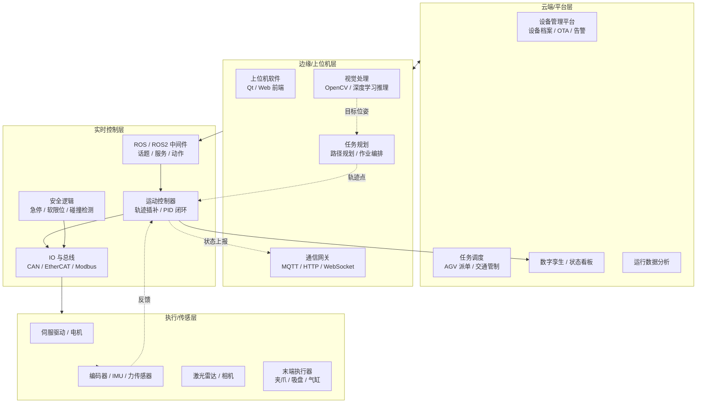
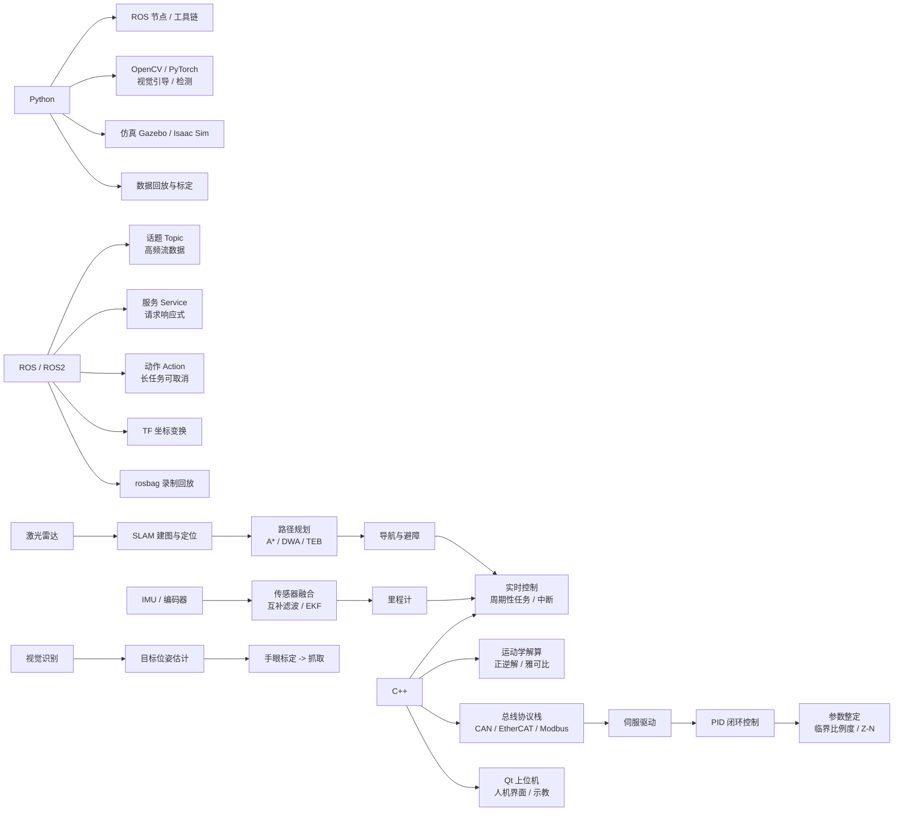
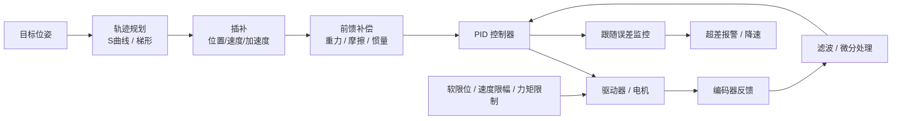
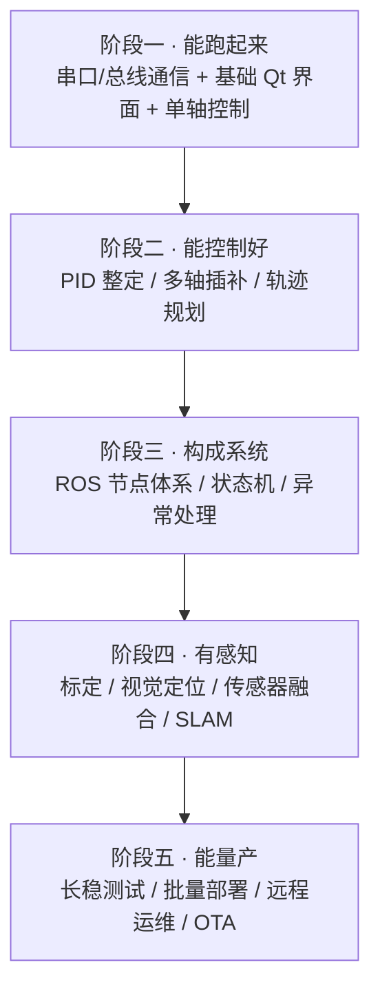

# 10 · 机器人与智能硬件

> 系统学习入口：[机器人与硬件设计零基础到项目实战](10-11-机器人与硬件设计零基础到项目实战.md)，包含 ROS 2、运动控制、工业通信、硬件协作、代码实验和项目路线。

> 数据基础：严格口径 14 份 JD 聚合去重（宽口径相关JD 50 份） | 薪资均值 20-35K | 学历主流：本科（13/14） | 经验主流：3 年以上
> 内容已去除公司信息，保留技术事实与行业共识。

---

## 一、方向定位

这一方向处在**软件与物理世界的交界处**：代码写出来不算完，要能让电机按预期转动、让设备在产线上连续跑几千小时不出事。因此它的技术结构与纯互联网岗位明显不同——

- **实时性是一票否决项**：控制周期抖动毫秒级就可以让运动轨迹失真、让传送带错位。
- **通信靠工业总线而非 HTTP**：CAN / EtherCAT / Modbus / 串口是主战场。
- **调试成本极高**：没有"刷新页面重来"，一次停机可能意味着产线停线，所以冗余、保护、可复现日志比功能更重要。

从词频看，这个方向呈现清晰的"三层能力"结构：

| 技术/能力 | 出现篇数 | 占比 | 解读 |
|-----------|---------|------|------|
| C++ | 10（宽口径 21） | 71% | 实时控制、运动学解算、驱动层的绝对主力 |
| Python | 8（宽口径 16） | 57% | 算法原型、视觉处理、仿真与数据分析 |
| ROS / ROS2 | 6 | 43% | 已成为机器人软件的事实标准通信与工具链框架 |
| MySQL / Redis | 5 / 3 | 36% / 21% | 任务台账、设备档案、状态缓存 |
| 嵌入式 / RTOS | 5 / 3 | 36% / 21% | 下位机与实时任务执行 |
| 工业总线 CAN / Modbus / EtherCAT | 16 / 8 / 8（宽口径） | — | 设备互联的实际手段 |
| Qt | 3（宽口径 8） | 21% | 上位机人机界面的主流选择 |
| OpenCV / PyTorch | 各 2（宽口径 4 / 3） | 14% | 视觉引导、缺陷检测的入口 |
| 多线程 / 实时性 | 2（宽口径 8 / 4） | 14% | 控制周期稳定性的保障 |
| CMake / Git | 2 / 4 | 14% / 29% | 工程化基础能力 |

**一句话总结**：这个方向要的是"软件 + 控制 + 硬件认知"的复合能力，纯软件背景的人最大的坎通常不是语言，而是**建立对物理延迟、机械误差、总线时序的直觉**。

---


### 完整技术栈清单（全量抽取 · 基于本方向 14 篇 JD）

> 下表由 JD 全文穷举抽取生成，数字为**出现该术语的 JD 篇数**，用于补齐正文未展开的细分技术项。

| 类别 | 技术栈（数字为出现篇数） |
|------|------------------------|
| **语言** | C++(10)、Python(8)、C#(5)、Java(4)、SQL(3)、C语言(2)、LabVIEW(1) |
| **后端框架** | Spring(2)、Spring Boot(1)、MyBatis(1)、FastAPI(1)、RPC(1) |
| **前端框架与UI** | Vue(1)、Element UI(1)、Three.js(1) |
| **移动端** | Framework(1) |
| **数据库与存储** | MySQL(5)、Redis(3)、SQL Server(2)、PostgreSQL(1)、Oracle(1)、SQLite(1)、Neo4j(1)、MinIO(1)、图数据库(1) |
| **消息与中间件** | MQTT(1)、Nacos(1) |
| **云容器与DevOps** | Docker(2)、Nginx(1)、回滚(1) |
| **大数据与数据平台** | 报表(1)、批处理(1)、实时计算(1) |
| **AI与机器学习** | OpenCV(3)、PyTorch(2)、Agent(1)、RAG(1)、Claude(1)、智能体(1)、LLM(1)、LangChain(1)、Prompt(1)、MCP(1)、模型部署(1)、LangGraph(1)、ASR(1)、幻觉(1)、OCR(1)、TTS(1)、评测集(1)、语音识别(1)、目标检测(1)、Whisper(1) |
| **音视频与流媒体** | 低延迟(1)、回放(1)、硬编(1) |
| **嵌入式与硬件** | 运动控制(6)、嵌入式(5)、电机(4)、ROS(4)、Modbus(3)、RTOS(3)、传感器(3)、EtherCAT(3)、伺服(3)、AGV(3)、串口(2)、CAN(2)、中断(2)、PLC(2)、PID(2)、IMU(2)、ROS2(2)、SLAM(2)、路径规划(2)、SPI(1) |
| **桌面与客户端** | Qt(2)、WPF(2)、MFC(2)、客户端(1)、OpenGL(1)、WinForms(1)、桌面应用(1) |
| **协议与接口** | TCP(3)、RESTful(1)、HTTP(1)、WebSocket(1)、REST(1)、JSON(1)、WebService(1) |
| **安全与合规** | 权限控制(1) |
| **工程化与质量** | 技术文档(5)、Git(3)、日志(2)、设计文档(2)、接口文档(2)、CMake(2)、重构(1)、单元测试(1)、代码评审(1)、编码规范(1)、Selenium(1) |
| **架构与设计** | 架构设计(3)、性能优化(2)、多线程(2)、补偿(2)、方案设计(1)、SaaS(1)、限流(1)、重试(1)、降级(1)、幂等(1)、低延迟(1)、熔断(1)、超时(1)、Saga(1) |
| **业务领域** | ERP(2)、实施(2)、WMS(2)、库存(2)、MES(1)、供应链(1)、财务(1)、订单(1)、金蝶(1)、物流(1)、SAP(1)、用友(1) |
| **软技能** | 团队协作(5)、出差(5)、规划(4)、文档编写(3)、沟通能力(2)、责任心(2)、培训(2)、需求分析(1)、跨部门(1)、英语(1)、学习能力(1)、抗压(1) |

---

## 二、参考架构图

典型智能装备 / AGV / 机械臂系统的分层结构。注意下层是"硬实时"、上层是"软实时或异步"，两者的边界是这个方向最重要的设计决策。



### 架构解读

1. **实时与非实时必须物理隔离**：运动控制在实时线程 / 实时内核（如 PREEMPT_RT）或下位机上运行，绝不与视觉推理、日志落盘抢占同一线程。
2. **安全逻辑独立于控制逻辑**：急停应走硬件回路或高优先级任务，不能依赖上层软件判断——这是工业现场的红线。
3. **ROS 不是万能的**：ROS1 的 TCPROS 通信在丢包与实时性上不可靠；量产装备常见做法是**ROS 做上层数据与仿真，控制环仍走 EtherCAT/CAN 直连**。
4. **状态回传要压缩且带序号**：设备状态上报频率高（几十到几百 Hz），需按周期聚合、带时间序列号，便于断线补全与回放复现。

---

## 三、技术栈关联图



---

## 四、核心能力矩阵

| 能力项 | 出现率 | 关键要点 | 常见追问 |
|--------|-------|---------|---------|
| C++ 实时编程 | 71% | 确定性内存分配、避免动态分配抖动、优先级继承、避免优先级反转 | 控制周期 1ms 抖动大，怎么排查？ |
| ROS / ROS2 应用 | 43% | 节点/话题/服务/Action 四种通信语义、TF 坐标树、rosbag 回放、DDS 配置 | ROS1 和 ROS2 的实时性差别在哪？ |
| 运动控制 | 13篇 | 梯形/S 曲线速度规划、多轴插补、前馈+PID、串级控制结构 | 怎么让机械臂末端抖动变小？ |
| 工业总线通信 | 中 | CAN 报文滤波、EtherCAT 分布时钟 DC、Modbus 寄存器映射、超时重试 | 总线丢导致的数据不同步怎么处理？ |
| 多线程与同步 | 21% | 采集线程/控制线程/通信线程分离、环形缓冲、无锁队列、看门狗 | 如何避免采集与控制互相阻塞？ |
| 视觉与深度学习 | 14% | 相机标定、畸变矫正、手眼标定、目标检测部署、光照鲁棒性 | 视觉引导精度怎么标定和评估？ |
| 上位机开发 | 21% | Qt 信号槽与线程亲和、示教界面、报警管理、权限分级 | 界面卡死但控制仍在跑，怎么保证？ |
| 嵌入式下位机 | 36% | FreeRTOS 任务划分、定时器、DMA、中断上下半部 | 什么时候用 RTOS 而不是裸机？ |
| 系统联调与稳定性 | 高 | 长稳运行(72h+)、日志分级、黑匣子数据、故障复现机制 | 偶发性宕机如何定位？ |
| 工程化 | 中 | CMake 多目标构建、版本与固件管理、CI、静态检查 | 固件如何做灰度与回滚？ |

---

## 五、关键实现要点

### 5.1 实时性：先把抖动降下来

实时性问题的排查顺序通常是：

```
观测周期抖动分布 → 定位抖动来源 → 分离关键路径 → 固化优先级与核绑定
```

具体做法：

1. **核隔离（CPU affinity / isolcpus）**：把控制面板核。
2. **内存预分配**：控制周期内不做 new/delete，用对象池或栈内存，避免缺页中断。
3. **优先级上限 + 看门狗线程**：关键线程优先级低于硬件中断，高于一切通信/日志线程。
4. **避免优先级反转**：互斥量启用优先级继承（PTHREAD_PRIO_INHERIT），或改用无锁环形队列。
5. **日志绝不能同步落盘**：高频线程只写无锁缓冲，由低优先级线程批量 flush。

### 5.2 运动控制：从"能动"到"动得准"



关键经验：

- **先做 S 曲线再做 PID**：加速度突变本身就会激起机械共振，很多"PID 调不好"的问题其实是规划曲线不行。
- **微分项要处理噪声**：用**微分先行**（对反馈而非误差求导）或在反馈通道加低通，否则会放大编码器噪声。
- **串级优于单环**：位置环 → 速度环 → 电流环的分层结构，带宽逐层递增约 5-10 倍。
- **跟随误差是核心观测量**：正常情况下误差应随速度线性增长，超出阈值立即降速而非硬停。

### 5.3 通信：工业现场的现实约束

| 总线 | 典型周期 | 特点 | 适用 |
|------|---------|------|------|
| CAN / CANopen | 1-10ms | 抗干扰强、成本低、每帧 8 字节 | 分布式 IO、电机驱动器 |
| EtherCAT | 0.1-1ms | 分布时钟同步精度<1μs、主站多为软件实现 | 多轴同步运动控制 |
| Modbus RTU/TCP | 10-100ms | 简单、通用，但不保证实时 | 仪表、变频器、温湿度 |
| RS-485/232 | 不定 | 老设备兼容主力 | 扫码枪、老型号 PLC |
| ROS Topic(DDS) | 不定 | 灵活但不硬实时 | 上层算法、数据汇聚 |

实践要点：所有总线通信都要有**心跳 + 超时降级 + 自动重连**；报文要做 CRC 与序号校验；断线期间的输出要保持"最后安全值"或进入安全态，而不是保留最后一次命令。

### 5.4 ROS：知道它的边界

- ROS1 的 Master 是单点（弱容错），量产环境要么升级 ROS2（基于 DDS），要么自行加固。
- ROS2 的实时性靠 `PREEMPT_RT` + executor 优先级 + 静态 executor 组合才真正可用，默认配置仍会抖动。
- 话题传大数据（点云、图像）用 **零拷贝 / shared memory** 传输，否则序列化会成为瓶颈。
- TF 树设计要提前规划坐标系（`map` → `odom` → `base_link` → 传感器），后期改动成本极高。

### 5.5 视觉：从检测到可用的位姿

```
相机标定(内参/畸变) → 手眼标定(眼在手/眼在外) → 目标检测 → 特征点/位姿解算 → 坐标变换到基坐标系 → 抓取/装配
```

工业视觉最大的坑通常是**标定与环境**：光源不稳定、反光、振动导致标定失效。因此：

- 固定光源与曝光参数，把"调参"变成"标定"；
- 每次开机或温漂后做一次快速自检标定；
- 位姿结果做时间同步——检测耗时 50ms 意味着控制要用"上一帧预测位置"而非当前位置。

---

## 六、典型职责归纳（去重合并）

- 负责运动控制软件的设计与实现：轨迹规划、速度前瞻、多轴插补、PID 整定与跟随精度优化。
- 实现设备通信：CAN / EtherCAT / Modbus / 串口协议对接，心跳保活、超时降级与自动恢复。
- 基于 ROS/ROS2 构建节点体系：传感器接入、坐标变换、任务编排、数据录制与回放。
- 开发上位机软件：示教界面、状态监控、报警管理、权限分级与操作日志。
- 集成视觉能力：相机与手眼标定、目标/位姿识别、深度学习模型部署与精度验证。
- 负责系统稳定性：长稳测试、黑匣子数据、故障诊断工具、固件升级与回滚。
- 承担跨团队联调：与电气/结构/工艺协作，明确软硬件接口边界与安全策略。

---

## 七、进阶路径建议



判断自己处在哪个阶段的简单标准：**能否独立把一个从未接触的部件（新电机、新相机）在一周内调通并长期稳定运行**。

---

## 八、常见考察点清单

1. 控制周期抖动大，怎么定位？（抖动的统计分布 → 是否缺页/GC/日志/锁竞争 → 核隔离 → 优先级继承）
2. PID 三个参数分别管什么？整定步骤？（P 管响应、I 管静差、D 管阻尼；先 P 后 D 再 I，用临界比例度法起点）
3. ROS1 到 ROS2 的核心变化？（去中心化、DDS、QoS、Executor、实时性支持）
4. 为什么差速 AGV 会越走越偏？（轮径误差、打滑、编码器累积误差 → 需 IMU/里程计融合与外部纠偏）
5. EtherCAT 怎么保证多轴同步？（分布时钟 DC，从站 ESC 硬件同步，主站周期性 PDO）
6. 手眼标定是什么，怎么验证精度？（求相机到机械臂基座/末端的固定变换；用已知点多次测量算 RMS）
7. 设备偶发死机如何排查？（黑匣子数据、core dump、看门狗复位记录、分期灰度加压重现）
8. 界面卡死会不会导致失控？（设计上必须隔离——控制线程独立于 UI；必要时独立安全回路）
9. 上位机与 PLC/驱动器之间通信中断怎么办？（心跳超时 → 进入安全停机或保持位控，不允许失联后继续按照旧命令运行）
10. 如何做固件灰度升级？（双分区 A/B + 版本号 + 回滚计数 + 失败自动回退）

---

## 九、与其他方向的连接

- **与嵌入式 Linux / 边缘计算**：下位机与 RTOS 任务承接最底层控制，边缘盒子承担视觉推理与协议转换，两者通过总线或内网通信。
- **与 C++ 系统软件**：Qt 上位机、数据结构与性能优化是共同基础。
- **与 AI 大模型应用**：大模型正在进入设备侧担任"任务理解/自然语言示教"角色，即所谓具身智能入口；视觉模型则普遍部署在 Jetson / 国产算力盒子上。
- **与 Go 云原生高并发**：车队管理系统、设备接入 MQTT Broker、任务调度服务通常由 Go 实现高并发连接管理与消息路由。
- **与数据平台**：设备时序数据（振动、温度、电流）通过 MQTT → Kafka → 时序库沉淀，用于预测性维护与良率分析。
