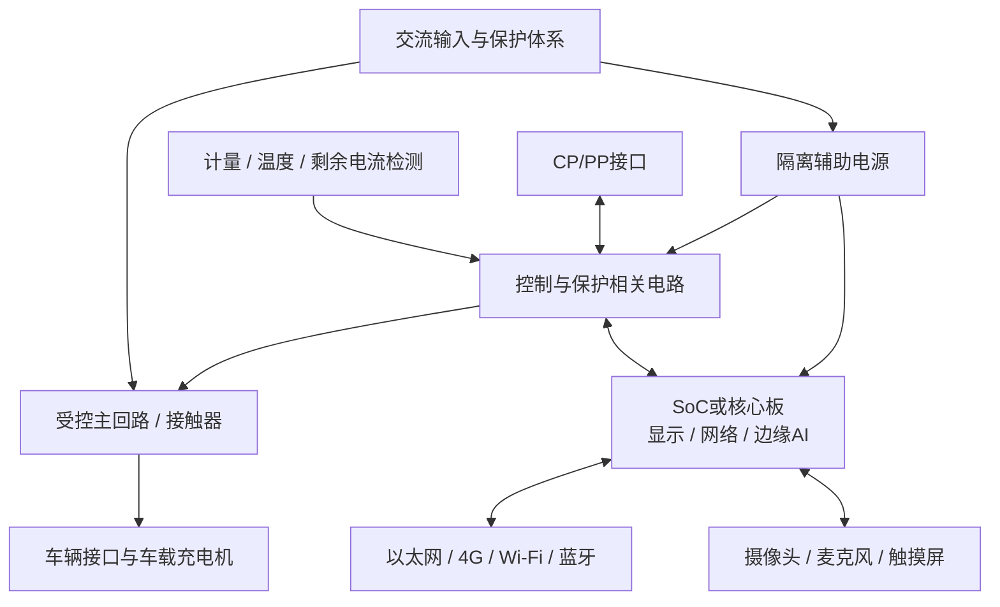

# 11 · 硬件工程师与充电桩硬件设计

> 系统学习入口：[机器人与硬件设计零基础到项目实战](10-11-机器人与硬件设计零基础到项目实战.md)，包含电路与 PCB、计量、充电软件、产测、GitHub 资料与分阶段项目方案。

> 数据基础：2 份指定 JD 的定性整理，不代表全行业统计。
> 样本薪资分别为 20–35K、18–30K；经验要求分别为 5 年以上、8 年以上；学历要求分别为大专及以上、本科及以上，不据此推导市场均值或主流要求。
> 本文区分岗位明确要求与工程延伸建议。标准适用性取决于销售地区、产品结构、用途和版本，不能将本文作为电气施工图、认证结论或可直接量产的设计方案。

## 一、来源与阅读路线

两份来源：

- [硬件工程师（充电桩）JD](职位描述/硬件工程师（充电桩）｜易视腾科技｜c22ad0c6f3292e0c0nN92du0GFZW.md)：交流充电桩主控板、电能计量、漏电保护、CP/PP、RK 边缘 AI、通信、认证与量产。
- [硬件工程师 JD](职位描述/硬件工程师｜麦格米特｜121ff73b39514d040nFz2N24F1JY.md)：智能硬件架构、模拟与数字电路、SoC/MCU、DDR/存储/通信、PCB 工艺、ESD/EMC；电机控制与 3D 打印机为优先项。

**初学顺序**：电路和仪器基础 → 原理图与器件 → PCB → 低压板卡调试 → 通信与 SoC → 保护和 EMC → 产品测试与量产。交流充电桩涉及危险电压与大电流，市电、耐压、漏电和故障试验需在具备资质、条件和防护的实验环境中按流程进行。

---

## 二、方向定位：从需求到可制造的物理产品

硬件工程师把产品需求变成电路、PCB 和可生产的整机，并证明它在约定环境中能稳定工作。原理图正确只是其中一环，还要考虑供电、信号、热、结构、可靠性、成本、供应链和认证。

| 能力 | 两份 JD 的对应要求 | 应有产出 |
|------|--------------------|----------|
| 架构与器件选型 | 均明确提及 | 需求分解、框图、器件对比和风险清单 |
| 原理图、PCB 与调试 | 均明确提及 | 可审查设计、板卡版本、测量记录 |
| SoC/MCU 与外设 | 均明确提及 | 电源时序、接口与软件协作说明 |
| ESD/EMC、稳定性 | 均涉及，责任深度不同 | 预扫、整改和回归记录 |
| AI 辅助研发 | 均提及，第一份要求更具体 | 经核验的辅助流程与评审证据 |
| 交流充电控制与保护 | 第一份专项 | CP/PP、计量、保护和安全状态方案 |
| 电机与 3D 打印机 | 第二份优先项 | 按项目补充驱动、采样和执行器知识 |

**硬件、嵌入式与结构的边界**：硬件负责电路与物理接口，嵌入式负责驱动和控制逻辑，结构负责安装与防护等机械约束；三方共同确认时序、散热、连接器和故障状态，不能等 PCB 完成后才对接口。

---

## 三、先建立基础概念

### 3.1 模拟、数字与混合信号

模拟电路处理连续电压、电流，例如传感器、放大器和滤波；数字电路处理逻辑与时序，例如 MCU、存储器和通信。真实产品通常混合两者，数字电源噪声可能影响模拟采样，布局和回流路径也会改变表现。

电阻、电容、电感不只看标称值，还需看容差、温度、额定电压、电流、频率特性和封装。芯片需核对推荐工作条件、绝对最大值、上电顺序和异常输入条件；绝对最大值不是正常设计目标。

### 3.2 MCU、SoC、核心板

MCU 常适合实时控制、采样和保护；复杂 SoC 常用于 Linux、显示、网络和 AI。核心板集成部分高难度电路，可降低 DDR 等设计工作量，但仍需核对载板供电、连接器、接口引出与散热。

RK3566/RK3568/RK3588 等是 JD 列出的候选平台，不同型号的接口、功耗和 NPU 支持不同；ESP32、STM32 也不能仅按系列名确定具体能力。

### 3.3 用预算表代替“应该够用”

提前计算电源各路电流与峰值、通信带宽、GPIO 数量、存储容量、散热空间和成本。记录假设及余量依据，并在实测后修正；不是所有预算都适合统一加一个百分比。

---

## 四、总体架构与平台化设计

下面是交流充电桩的**概念框图**，省略具体安全电路，不是接线图：



### 4.1 交流桩和直流桩不能混为一谈

交流桩通常提供受控交流电源和充电连接控制，交流到电池直流的主要能量转换由车辆的车载充电机完成。直流桩则涉及桩侧大功率 AC/DC 等转换和直流输出，架构及适用标准不同。

JD 的范围是 7kW 单相到 22kW 三相交流产品。单相有功功率可用 `P≈U×I×功率因数` 理解，平衡三相可用 `P≈√3×线电压×线电流×功率因数` 理解。实际额定功率受当地供电、连接器、线缆、保护和车辆能力约束，不能按近似公式直接选安全器件。

### 4.2 多地区平台化不是换插头

可复用控制、软件接口和部分感知能力，但供电、计量、连接器、保护、无线、标识、结构和认证可能需要不同配置或板型。建立型号差异表与兼容矩阵，避免把关键安全差异隐藏在未经管理的跳线中。

---

## 五、原理图、器件与 PCB：设计阶段消除风险

### 5.1 原理图按功能分块审查

电源、处理器、存储、接口、模拟采样、执行驱动和保护分别列出输入输出、上电状态和故障行为。连接器明确针脚、电平、方向、防呆和插拔条件。

选型除了功能和价格，还看生命周期、交期、可替代性、环境等级、散热、认证资料和供应商支持。替代料需按电气、热、封装和软件影响验证，不能只看引脚兼容。

### 5.2 PCB 不只是“线能连上”

| 设计点 | 核对内容 |
|--------|----------|
| 叠层与参考面 | 阻抗、连续回流路径、层间耦合和制造能力 |
| 电源分配 | 压降、瞬态、去耦位置、铜厚、温升和大电流路径 |
| 高速接口 | 阻抗、长度/偏斜、过孔、连接器与厂商约束 |
| 模拟采样 | 噪声、参考源、滤波、保护和高低电平耦合 |
| 隔离区域 | 电气间隙、爬电距离、槽、材料与结构接口 |
| 制造装配 | 焊盘、可焊性、器件间距、测试点和维修空间 |

安全距离取决于适用标准、工作电压、绝缘类别、污染等级、材料、海拔等，不能在所有板子上套一个毫米数。走线载流能力也需结合铜厚、层数、散热和温升验证。

### 5.3 EDA 与审查产物

JD 提及 Altium Designer、Cadence、PADS 等工具；第二份将掌握两种及以上列为优先。重点是会使用原理图检查、PCB 规则、库管理、版本和制造输出，而非只记软件快捷键。

保存设计规则、ERC/DRC 报告及经过审核的豁免；输出 PCB 制造数据、钻孔、叠层、装配、BOM 和坐标文件等约定资料。规则检查无报错不等于信号、热或安全设计正确。

---

## 六、SoC、存储与通信接口

### 6.1 DDR、Flash 与启动

DDR 需结合芯片和存储器手册处理叠层、阻抗、时序、参考电源、布线拓扑及训练配置；不能仅凭“等长了”判断可用。核心板方案仍需核对厂商保证范围与载板约束。

Flash、eMMC、SD 等要确认接口电压、供电与复位、启动配置、寿命和异常掉电行为。硬件与软件共同确认 boot strap、恢复烧录口和日志接口。

### 6.2 通信集成常见问题

| 接口 | 硬件重点 | 软件协作点 |
|------|----------|------------|
| CAN | 收发器、终端、共模范围、保护及隔离需求 | 位时序、错误计数、bus-off恢复 |
| RS485 | 终端、偏置、拓扑、方向与电气保护 | 波特率、协议、超时与总线占用 |
| 以太网 | PHY、时钟、磁性器件和布线 | 链路、驱动、吞吐与掉线恢复 |
| 4G/Wi-Fi/蓝牙 | 瞬态供电、天线、射频净空与共存 | 配网、重连、射频和协议栈版本 |
| MIPI CSI | lane、速率、差分布局和摄像头供电 | 驱动、时序、像素格式与带宽 |
| I2S | 时钟关系、电平、布线与音频供电噪声 | 采样率、主从模式和格式 |

模块已有某项认证，不代表安装到整机后无需评估。天线、外壳和供电变化可能改变射频与 EMC 表现。

### 6.3 NPU 感知与电机控制是两个延伸方向

第一份 JD 的车牌识别、语音与异常行为检测，需要硬件确保采集、算力、带宽和散热，算法效果由完整软硬件链路验证。AI 功能不能绕过充电控制和保护约束。

第二份的电机与 3D 打印机优先项可延伸学习驱动、电流采样、限位、编码器和电源瞬态等；其具体功率拓扑、控制算法和安全要求取决于产品，不能据此推断岗位已指定某种电机方案。

---

## 七、交流充电控制：CP/PP、电能计量与执行

### 7.1 CP 与 PP 大致做什么

**CP（Control Pilot）**参与连接状态和充电控制信息交互；**PP（Proximity Pilot）**在相应接口体系中用于连接/线缆能力等识别，具体电路及语义依标准和接口类型而定。

CP PWM 可在规定条件下传达允许电流等信息，但并不是用这根信号线直接驱动车载电池。不同标准和状态下的幅度、频率、占空比与检测要求应按适用规范验证，本文不提供通用参数表。

主回路闭合应建立在所有必需条件满足之后。插拔、状态变化、异常信号和恢复都要测试，不能只测“正常接车后能充电”。

### 7.2 电能计量看完整误差链

JD 提及 ATT7022、RN8302、HLW 等芯片系列，具体型号应按单相/三相、通道、精度与接口选择。计量链路还包括传感器、采样、滤波、基准、温漂、校准与存储，并非换上计量芯片就自动满足计费计量要求。

区分产品内部能耗统计与受法规约束的结算计量。功率、电量、电流、电压、单位和更新周期要与软件约定；校准参数有版本、完整性和生产写入记录。

### 7.3 继电器和接触器不能只看额定电流

选择时考虑负载类别、分断能力、电寿命、线圈功耗、温升、驱动和反馈。是否需要粘连检测、冗余或其他保护由安全分析和适用标准决定。

MCU 复位、SoC 死机、驱动损坏、触点粘连等故障应有明确检测和响应。软件发送“断开”命令不等于触点真的断开，反馈和测试必须与真实硬件状态关联。

---

## 八、漏电与电气保护：按系统组合验证

### 8.1 概念不能互相替代

| 名称 | 入门理解 | 必须注意 |
|------|----------|----------|
| Type A RCD | 检测规定类型的交流及脉动直流剩余电流 | 适用波形和抗干扰能力按具体标准与器件确认 |
| Type B RCD | 支持更广的剩余电流波形，包括相应平滑直流范围 | 不等于任意安装条件都适用 |
| RDC-DD | 交流充电场景的直流剩余电流检测相关装置 | 与上游RCD等配合及动作链路按规范设计 |
| 6mA直流检测 | JD 提及的直流分量检测要求 | 不是“整机只需要一个6mA检测芯片” |

是否使用 Type B，或 Type A 与符合要求的 RDC-DD 等组合，要由目标市场规范、安装条件及系统设计确定。检测、判定、断开与自检的链路必须完整验证；不能将检测输出等同于完成全部人身保护。

### 8.2 保护对象和故障模式

除了剩余电流，还要关注过压、欠压、过流、过温、接地相关异常、浪涌和短路等适用情形。传感器开路/短路、测量饱和、电源跌落和控制器失活也可能让保护失效。

高低压隔离、电源、通信隔离、连接器、线束及外壳共同构成保护边界。不要让调试线、USB、示波器接地或其他附件意外跨越隔离。

相关试验需使用适当设备、方法和人员，危险电压测量采用符合测量类别和额定条件的探头与仪器。不能通过断开示波器保护接地来规避测量问题。

---

## 九、ESD、EMC 与可靠性：从设计开始

**EMC**同时涉及设备产生的干扰和对外部干扰的耐受能力；**ESD**是静电放电相关现象及测试方向之一，不等于整个 EMC。

### 9.1 按“源—路径—受扰对象”分析

开关电源、继电器动作、高速数字信号和射频可能是源；走线、线缆、地与空间耦合是路径；采样、复位和通信可能受扰。记录工作模式和失效时刻，定位后再选择滤波、屏蔽、回流或保护措施。

不要不加分析地“多加电容”“到处割地”或更换保护器件。新增器件也可能增加漏电流、影响信号或造成浪涌时过热，需要完整回归。

### 9.2 一次整改的闭环

```text
记录测试条件与失效现象
→ 确认受扰电路及耦合路径
→ 提出可验证假设
→ 修改少量变量
→ 复测同一工况
→ 检查功能、温升和其他EMC项目
→ 更新设计、BOM与整改记录
```

可靠性还需按使用环境安排温度、湿度、振动、老化、插拔和电源异常等试验。具体项目与等级由需求及适用规范确定，不能统一套用一个“高低温范围”。

---

## 十、标准与认证：区分法规、标准和标志

来源 JD 中列出的名称应作为认证策划入口，不代表每款产品在所有市场都必须取得全部项目。

| 市场或类别 | JD 提及 | 理解与核对事项 |
|------------|---------|----------------|
| 中国 | GB/T 18487.1、GB/T 20234.2、CCC | 标准范围、版本及CCC目录/实施规则的实际适用性 |
| 欧洲 | IEC/EN 61851-1、IEC 62196-2、IEC 62955；CE相关LVD、EMC、RED | CE是符合性标志，按配置识别适用法规和协调标准；无线产品等需判断RED与其他法规关系 |
| 美国等市场 | UL 2594、UL 2231、SAE J1772、FCC | 安全标准、接口规范、射频/电磁要求属于不同层面，按销售与安装要求确认 |
| 能效项目 | ENERGY STAR | 属能效认证项目，适用性与市场要求单独确认，不等同通用电气安全认证 |

“做过 CE”不能简单等于拿到一张涵盖所有产品的证书。应与实验室和合规负责人确认产品分类、标准版本、测试配置、差异型号覆盖与技术文件要求。

设计变更可能影响既有结论，例如电源、绝缘材料、接触器、无线模块、天线或外壳变化。建立变更影响评估，不凭“只是替代料”直接免测。

---

## 十一、样机 Bring Up 与故障定位

### 11.1 先低风险验证，再扩大范围

按批准的测试方案分阶段检查外观、短路、供电、复位、时钟、启动、接口和业务。低压板卡可在额定条件内采用限流供电验证；涉及市电和大功率部分时转入具备条件的专门测试流程。

| 现象 | 优先检查 |
|------|----------|
| 上电无启动 | 供电顺序、纹波、复位、时钟、启动配置和存储 |
| 网络发射时复位 | 电源瞬态、压降、地弹、复位路径和模块峰值负载 |
| DDR压力测试才失败 | 布线与时序、训练、电源、温度和器件批次 |
| 继电器动作导致误码 | 线圈驱动、瞬态路径、供电耦合和软件恢复 |
| 计量漂移 | 基准、传感器、温度、采样、校准与软件口径 |
| ESD后失联但未复位 | 接口保护、驱动状态、局部电路和系统恢复机制 |

示波器用于看波形、电压、边沿和噪声；逻辑分析仪用于多路数字时序及协议；万用表和合适负载用于基础电气检查。选仪器时考虑带宽、探头加载和安全额定，而不是仅看屏幕上有没有波形。

### 11.2 问题单必须可复现

记录板卡和BOM版本、固件、样品编号、环境、接线、仪器设置、负载及复现步骤。保存原始波形和日志，对比良品，区分设计、制造、器件与软件因素；更换器件后现象消失还需验证根因。

---

## 十二、从样机到量产：可制造、可测试、可追溯

### 12.1 建议阶段及产出

| 阶段 | 目标 | 产出 |
|------|------|------|
| 需求与方案 | 明确指标、地区、成本和边界 | 需求、框图、预算与认证计划 |
| 工程样机 | 验证关键电路和软件接口 | 原理图/PCB/BOM、Bring Up与问题记录 |
| 设计验证 | 完整功能、保护、EMC与可靠性 | 受控测试、整改及回归报告 |
| 试产验证 | 装配、校准、烧录、产测和良率 | 工装、作业指导、限值与不良分析 |
| 量产维护 | 追溯、替代料、变更和售后 | 发布基线、ECO、批次与现场问题闭环 |

EVT/DVT/PVT等阶段名在不同组织中定义不同，采用时先统一入口和退出条件。

### 12.2 量产资料清单

包括原理图、PCB及叠层、BOM/合格料与替代料、制造装配数据、关键件资料、固件版本、烧录和校准、产测规范、工装版本、结构装配要求及认证相关技术文件。

产测限值要有设计依据和测量误差考虑；功能通过不能替代必需的安全测试。测试记录按序列号和批次关联，维修后按受影响范围复测。

---

## 十三、AI 辅助硬件研发：提效但不代签核

可用 AI 整理数据手册对比项、起草审查清单、解释故障假设、生成测试记录模板和辅助脚本。最终必须回到原厂资料、测量和适用标准核验。

AI 容易混淆引脚编号、封装、额定值、标准条款和过期料号；不要直接据其建议修改高风险保护电路。原理图、BOM和客户资料上传前确认授权与数据规则。

一个实用任务示例：给出经过授权的两个器件资料片段，请 AI 列出供电、温度、封装、接口和生命周期差异，并逐项注明来源。缺失项写“待确认”，再由工程师查原文与样品验证。

OCPP 是桩与后台通信的相关协议，不是 CP/PP 电气接口。硬件需为联网、时间、存储和恢复等能力提供基础，协议实现、版本及认证责任需与软件团队协商。

---

## 十四、练习项目、学习路线与面试准备

### 14.1 分层练习，不从市电实物开始

先做低压 MCU 传感器与通信板，完成原理图、PCB、供电测量和固件联调；再做 SoC 核心板载板，接显示、摄像头或网络并验证带宽与温升。

充电专项可先使用合适的低风险模拟环境学习状态机、接口语义、计量数据和故障上报；涉及真实充电接口电气性能、剩余电流和主回路的验证，应交由具备条件的团队按标准开展，模拟器成功不等于产品认证通过。

### 14.2 面试需要用证据回答的问题

1. **如何从需求做总体方案？** 展示预算、框图、器件对比和风险，而不只给原理图。
2. **SoC和MCU怎样分工？** 从性能、时限、故障边界、成本和维护解释。
3. **DDR等长了为何还可能失败？** 时序、阻抗、回流、电源与训练均需核对。
4. **交流桩为何不是大功率直流电源？** 解释车载充电机和桩的能量与控制边界。
5. **6mA检测能否替代全部漏电保护？** 不能，应按适用标准分析完整装置组合和动作链路。
6. **EMC整改怎样证明有效？** 同条件前后测量、根因和跨项目回归记录。
7. **器件替代怎么做？** 电气、热、工艺、固件和认证影响一起评估。
8. **AI辅助设计如何保证质量？** 原文溯源、独立核验、测试与人工签核。

最终项目展示建议包括：受控原理图/PCB/BOM、一次启动与测量、一个故障定位、EMC或可靠性整改、量产测试及变更记录。明确个人负责范围和实际验证条件，不把团队成果或未完成认证说成个人已独立交付。

## 十五、与现有知识方向的连接

- [嵌入式 Linux 与边缘计算](06-嵌入式Linux与边缘计算.md)：板级启动、设备树、驱动、实时控制和升级。
- [机器人与智能硬件](10-机器人与智能硬件.md)：电机、传感器、工业总线与机电协同。
- [AI 大模型应用工程](01-AI大模型应用工程.md)：算力选型、温升功耗和AI能力交付；不替代电气保护设计。
- [Python 工程化与算法服务](04-Python工程化与算法服务.md)：产测工具、仪器控制、自动化报告与桌面交付。
