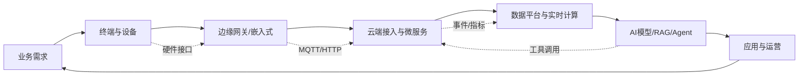
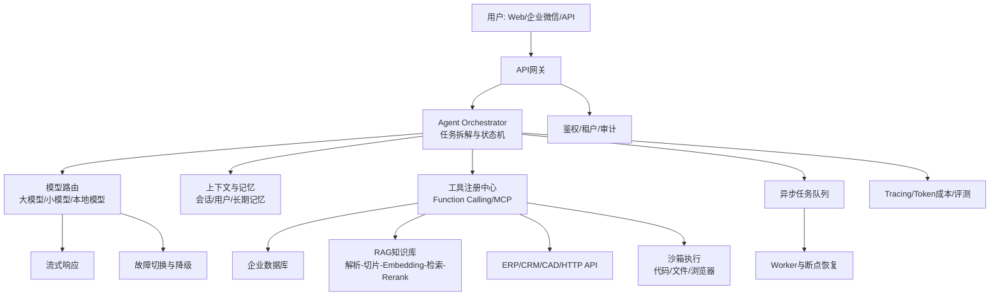
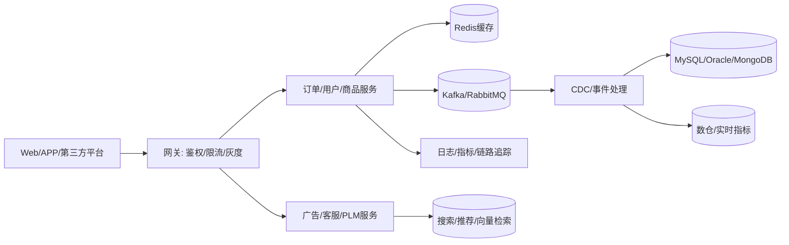
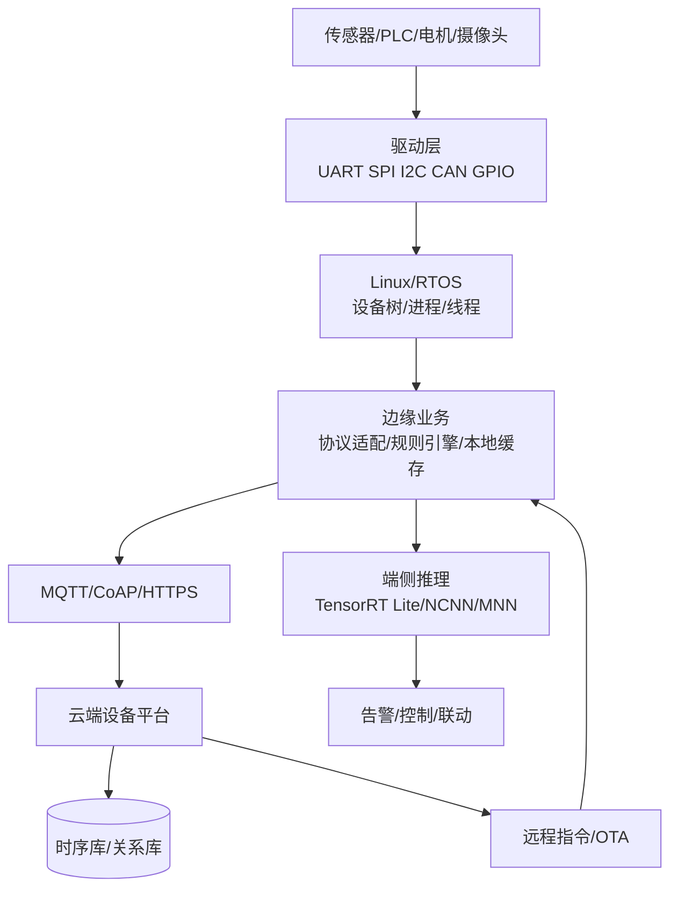
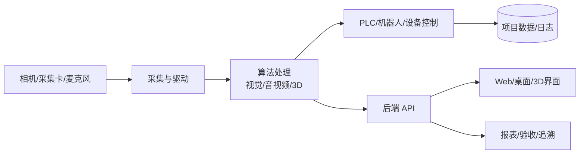
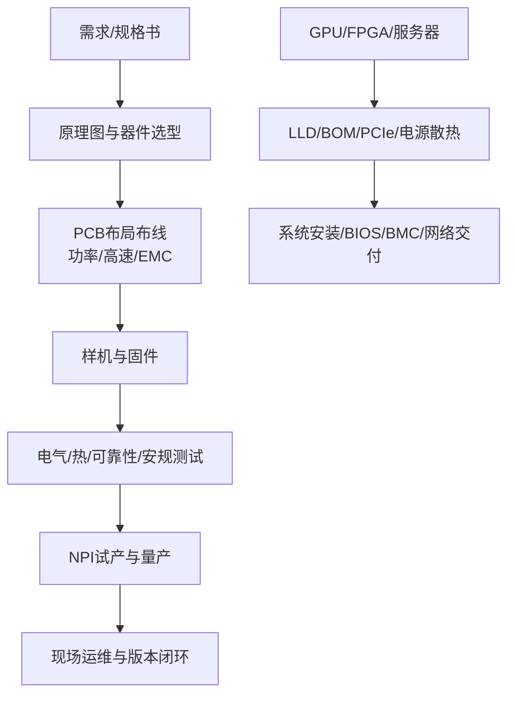

# 职位描述分类与项目落地地图

> 本文把 `JD/职位描述` 中的 50 份真实岗位，按“能做什么、在哪些项目里用、需要哪些技术”重新整理。阅读顺序建议：先看分类总表，再看项目架构图，最后回到对应专题文档深入学习。

## 1. 怎么读这份地图

每个岗位都可以拆成四层：

1. **业务目标**：解决什么问题，例如让工厂自动检测、让客服自动回答、让设备远程运维。
2. **系统位置**：岗位位于终端设备、边缘网关、后端平台、数据平台还是 AI 能力层。
3. **关键技术**：招聘要求中反复出现、决定能否交付的技术。
4. **落地项目**：可以用来练习或面试讲解的最小闭环项目。

## 2. 分类总表

| 分类 | 对应专题文档 | 主要岗位 | 典型项目场景 |
|---|---|---|---|
| AI 大模型、RAG、Agent、AI Infra | [01-AI大模型应用工程](./01-AI大模型应用工程.md) | Agent 架构师、AI 工程师、AI 大模型资深技术工程师、ai 开发工程师、工业 AI 负责人、量化 IT 工程师 | 企业知识库、工业 CAD Agent、智能客服、模型私有化、GPU 推理平台 |
| AI 服务器与算力硬件 | [01-AI大模型应用工程](./01-AI大模型应用工程.md)、[11-硬件工程师与充电桩硬件设计](./11-硬件工程师与充电桩硬件设计.md) | AI 服务器硬件工程师 | GPU/FPGA 一体机、机房交付、国产算力适配 |
| Go、Java 微服务与后端 | [02-Go云原生与高并发服务](./02-Go云原生与高并发服务.md)、[03-Java微服务后端架构](./03-Java微服务后端架构.md) | Go/Java 后端、CDC、PLM/Windchill、广告、语音平台、SAAS | 电商与广告平台、数据同步、PLM、客服呼叫中心、海外业务 |
| Python、量化与算法服务 | [04-Python工程化与算法服务](./04-Python工程化与算法服务.md) | 量化 IT、AI 应用、Python/算法服务相关岗位 | 因子回测、风控、NLP/多模态、模型 API、数据处理 |
| C/C++、嵌入式 Linux、机器人 | [05-C++系统软件](./05-C++系统软件.md)、[06-嵌入式Linux与边缘计算](./06-嵌入式Linux与边缘计算.md)、[10-机器人与智能硬件](./10-机器人与智能硬件.md) | 系统软件、IoT 网关、机器人、嵌入式、客户端 | ROS 导航、摄像头边缘推理、工业网关、智能硬件 |
| 音视频与音频 | [07-音视频与流媒体](./07-音视频与流媒体.md) | AI 盒子音视频、音频系统 | NVR、RTSP/RTMP、语音设备、媒体转码 |
| 前端、全栈、桌面与 3D | [08-前端与全栈工程](./08-前端与全栈工程.md) | 全栈、SAAS、Android、Web3D、C#/WPF 上位机 | 管理后台、海外社媒、广告机、工业可视化、自动化上位机 |
| 数据平台与实时计算 | [09-数据平台与实时计算](./09-数据平台与实时计算.md) | CDC、广告数据、时序数据、量化 IT | Kafka 数据链路、实时指标、设备时序数据 |
| 工业自动化、视觉与 PLM | [03-Java微服务后端架构](./03-Java微服务后端架构.md)、[08-前端与全栈工程](./08-前端与全栈工程.md)、[10-机器人与智能硬件](./10-机器人与智能硬件.md) | PLM/Windchill、工业软件产品、视觉上位机、LabVIEW | PCB/CAM、MES、视觉检测、PLC/机器人联线 |
| 芯片、数字后端与硬件电源 | [05-C++系统软件](./05-C++系统软件.md)、[11-硬件工程师与充电桩硬件设计](./11-硬件工程师与充电桩硬件设计.md) | 数字后端、电池、充电桩、电源、MCU/电机 | 7nm 芯片流片、充电桩、BMS、电机驱动、开关电源 |

## 3. AI 大模型与 Agent 类

### 3.1 相关 JD

- `Agent架构师｜某大型知名互联网上市公司｜a2e52ae16dd9e07d0nJz3Nm1FFdX.md`：公司级 Agent 基础设施、千万级调用、vLLM/SGLang/TensorRT-LLM、KV Cache、MCP、可观测与成本治理。
- `AI 工程师（软件AI 应用开发）｜中软国际｜bbc91ab8dce4ee5f0nN72du0EVBV.md`：企业 Agent、工具/技能、记忆、沙箱、MCP、RAG、LangGraph、评测。
- `AI大模型资深技术工程师｜某大型知名计算机软件公司｜b05fc98bcf939c100nx52dq4F1RS.md`：私有化部署、量化、LoRA/QLoRA/SFT/DPO、RAG 平台、模型网关。
- `ai开发工程师｜某大型知名社交网络与媒体上市公司｜d19d842383ff9ea20nJ73d66FlNY.md`：工业 AI 产品路线、CAD API、知识库、数据治理、工厂现场闭环。
- `量化it工程师｜外企德科数字｜ed954d054ce62ed60nN52ty1GVJX.md`：C/C++、Java、Python、风控、NLP、多模态与大模型算法。
- `工业软件产品经理（PCB _ CAM _ AI方向）｜傲基｜4936211abdf6d3b30nN60tS6GFNQ.md`：PCB/CAM/DFM、EDA 自动化和 AI 产品化。

### 3.2 从零落地一个企业 Agent

**推荐落地顺序**：先做“一个问题、一个知识库、三个工具”的 MVP；再增加权限、异步任务和评测；最后建设多 Agent、模型路由、缓存和成本治理。每个工具都必须有输入校验、权限校验、超时、重试、幂等和审计记录。

### 3.3 可练习项目

| 项目 | 最小闭环 | 进阶能力 |
|---|---|---|
| 制造业工程助手 | 上传工艺文档 → RAG 问答 → 输出引用来源 | CAD API、BOM 查询、工单创建、人工审批 |
| 企业 IT 助手 | 查询知识库 → 调用资产/工单 API | MCP 工具市场、权限隔离、异步巡检 |
| 私有化模型平台 | Docker 部署 Qwen → OpenAI 兼容 API | vLLM、量化、K8s、GPU 监控、灰度发布 |
| 智能客服 Agent | 意图识别 → FAQ 检索 → 订单查询 | 多轮记忆、转人工、质量评测、成本路由 |

## 4. Go、Java 与数据平台类

### 4.1 相关 JD

- `Java 基础软件研发（CDC _ 数据同步引擎）｜京东集团｜f683c4df7d29bcc30nN60tS9E1tQ.md`：CDC、MySQL/Oracle/MongoDB、日志解析、数据一致性。
- `java后端研发工程师｜外企德科数字｜3952c6935e6eb70d0nF82di7F1FS.md`、`海外广告开发工程师（后端）｜外企德科数字｜f28e20297c154cdd0nJz3d65GVNU.md`：Java、Spring、JVM、Kafka、Hadoop、广告/推荐。
- `PLM开发工程师｜某大型知名计算机软件公司｜dc990f2b0ca256b30nJy2d25ElZS.md`、`Windchill开发｜某大型知名计算机软件公司｜ec8b840ac4115d8a0nJz2tm7FVpR.md`：Java、Spring Cloud、MySQL、PLM/PDM。
- `高级JAVA工程师｜某知名智能硬件_消费电子公司｜d5a4f5030d173b400nR73tm8FVtZ.md`、`高级全栈工程师（SAAS）｜华为｜c3014ba5fb4dd2800nJ80tm0ElNR.md`：语音/客服/SaaS、多租户、Redis。
- `DTC _ Shopify 后端开发工程师（Go）｜某大型互联网公司｜04bf39a75ad110920nx52N21EFdS.md`：Go、Shopify、电商订单与高并发 API。

**落地重点**：Java 服务重点练习事务、幂等、线程池、JVM 和 Spring Cloud；Go 服务重点练习 goroutine、context、连接池、限流和优雅停机；CDC 项目重点练习 offset、断点续传、重复消费和最终一致性。

## 5. 嵌入式、IoT、机器人与边缘计算类

### 5.1 相关 JD

- `系统软件工程师｜大疆创新｜623a05e2316f2cb60nN73NW7GVRY.md`、`软件工程师｜欧陆通｜adbca29a72c485cb0nNy3dy0FFBR.md`：C++/Linux、ROS、SLAM、路径规划。
- `高级物联网网关研发｜深德科｜72ee7dd058f2aac50nN72tW8GVFV.md`：UART/SPI/I2C、RS485/CAN、MQTT、Modbus、OTA、时序数据库。
- `软件工程师｜达迪迩智能机器人｜da3f1612679cb3480nBz2dy9F1ZT.md`、`软件工程师｜星特科技股份｜979215297e43c5d21nJ83Nu9FVtZ.md`：机器人/自动化、C/C++/Python、嵌入式。
- `软件研发工程师｜振邦智能｜c2deabbf6b8cc6251HF92tq7EVJW.md`、`软件工程师｜c 软件工程师｜青岛宝亿煌科技｜ef2c5d08687b6ba30nZ42Nm1GVdY.md`：STM32、C、驱动和固件。
- `软件需求工程师｜赛意信息｜09a3dd5363b24afe0nx73N25E1JY.md`：TBOX、ECALL/NTN、卫星通信和汽车软件需求。
- `广告机安卓开发工程师｜深圳酷赛智能有限公司｜673b19e360b905880nx43tq7FlRY.md`、`资深客户端开发工程师｜璇玑动力｜d5a420ae674208c80nx42d26F1tY.md`、`android逆向工程师｜湖南合鑫｜b03d630e53d2df8503F809u0FVJX.md`：Android、客户端、逆向和设备应用。

**项目模板**：做一个“工业网关 + 云端设备平台”：南向接入 Modbus 电表，网关本地解析和缓存，MQTT 上报，云端存入时序库，网页显示曲线，支持远程参数下发和 OTA 回滚。这个项目可以同时覆盖嵌入式、Go/Java 后端、数据平台和前端。

## 6. 音视频、前端、全栈与工业软件类

### 6.1 相关 JD

- `高级软件开发工程师｜科曼医疗｜27971a18b89805b30nN72tW9GFFT.md`：FFmpeg/GStreamer、RTSP/RTMP/HTTP-FLV、ONVIF、NVR、PS/TS/MP4。
- `音频系统工程师｜开立医疗｜743290152b982f460nN82dW7GFtQ.md`：音频采集、处理、设备集成。
- `全栈开发工程师｜陶果源创｜fd96ce226eca9b770nNy2N20FVVZ.md`、`高级全栈工程师｜卡思科｜cb9890ee6b5f204f0nJ73du0FlJQ.md`、`高级全栈工程师｜思谋科技｜318badc41c08a3d60nJ92ti8GVVZ.md`、`高级全栈工程师｜潜山市窝窝信息科技｜340112c53ae4d9880nN72Nq9F1pY.md`、`高级全栈工程师｜珍爱网｜1cddc5338a89736d0nF439W6FVFS.md`：Web、Node.js、Vue/React、Electron、SAAS。
- `web3d开发工程师｜某知名人工智能公司｜848bb4d5dd7824ed0nV72Nq1FlpY.md`：WebGL/3D 可视化。
- `软件工程师｜博众精工｜924f196f232cdf0f1nV63du4EVRW.md`、`高级软件工程师｜深圳华锴信息｜1a2e5a2d6b806d8f03N739y1ElRQ.md`、`软件工程师 labview｜深圳市新凯来技术｜5f806a96cbf40a7e0nF909W0FFNX.md`：C#/WPF/WinForms、Halcon/VisionPro、PLC/Modbus、测试台。
- `工业软件产品经理（PCB _ CAM _ AI方向）｜傲基｜4936211abdf6d3b30nN60tS6GFNQ.md`：PCB/CAM/EDA/DFM 和 AI 工业软件。

## 7. 芯片、数字后端、硬件、电源与电池类

### 7.1 相关 JD

- `数字后端工程师｜大疆创新｜8a8eb4a60ec375860nJ529y8GFNR.md`：7nm/16nm、布局布线、时序、功耗、量产。
- `AI 服务器硬件工程师｜和而泰智能｜11049a0802096b320nJ929q0GFtX.md`：GPU/FPGA、一体机、BIOS/BMC、PCIe、NVMe、机房交付。
- `硬件工程师（充电桩）｜易视腾科技｜c22ad0c6f3292e0c0nN92du0GFZW.md`、`电池工程师｜智联科迅｜6a8adc07bfa83f460nN82924GFdR.md`：充电桩、电源、BMS、电池热管理。
- `高级研发工程师｜深圳市英威腾｜489a8157c2c5213d0nNy09i6GFZW.md`、`软件工程师｜陶果源创｜bcdc3b41cf677c000nJ529u1GVpT.md`：AC-DC/DC-DC、PFC、LLC、EMC、C2000/DSP。
- `高级软件开发工程师｜某知名智能硬件_消费电子上市公司｜4853df4efa0fe32a0nN629q6FlBS.md`、`高级软件工程师｜amlogic｜2113ae8abbf09cc91HZ42965EVBT.md`、`软件工程师｜amlogic｜26bfb961c75d52120nV73Nu6GVFR.md`：电机 FOC、舞台灯、逆变器、MCU 外设。
- `软件工程师｜东莞市汇海精密机...｜045a60772df682ab0nB439i5F1ZY.md`、`软件工程师｜光速时代｜41fdc363ade5aad00nN92t28FVZW.md`、`软件工程师｜卓翼科技｜8a606b447f84c7860nN73t24ElZY.md`、`软件工程师｜深圳市燕麦科技｜acc088a8ebedd3a80nV82NS5FldR.md`、`软件研发工程师｜振邦智能｜c2deabbf6b8cc6251HF92tq7EVJW.md`：硬件配套软件、测试和产品化交付。

## 8. 通用能力矩阵：从 JD 到可交付成果

| 能力 | 入门交付物 | 熟练交付物 | 高级交付物 |
|---|---|---|---|
| 需求分析 | 用户故事、接口清单 | 领域模型、验收标准 | 路线图、风险与容量模型 |
| 编码工程化 | Git、单元测试、日志 | CI/CD、配置中心、故障排查 | 架构治理、SLO、成本模型 |
| 数据与接口 | REST/MQTT/SQL | 事务、幂等、消息重试 | 数据一致性、跨地域容灾 |
| AI 应用 | Prompt、RAG 问答 | 工具调用、评测、权限 | 多 Agent、推理优化、模型路由 |
| 设备交付 | 驱动/协议 Demo | OTA、监控、现场联调 | 量产 SOP、兼容性矩阵、可复制交付 |
| 文档沟通 | README、调试记录 | 设计文档、测试报告 | 技术决策、架构评审、培训材料 |

## 9. 推荐学习与项目路线

1. **基础阶段**：用 Python 或 Java/Go 完成一个 REST API，补齐 Git、Linux、SQL、日志和测试。
2. **平台阶段**：加入 Redis、消息队列、Docker、CI/CD，做一个可观测的订单或设备平台。
3. **数据阶段**：做 CDC 或 MQTT 数据链路，加入时序库、实时指标和告警。
4. **AI 阶段**：部署本地模型，完成 RAG，再加入 3 个带鉴权和审计的工具调用。
5. **端云阶段**：把设备/摄像头/机器人接入边缘网关，完成云边协同、OTA 和断网续传。
6. **生产阶段**：补齐容量压测、故障演练、灰度发布、成本统计、验收文档和运维 SOP。

## 10. 原始 JD 索引

本地图覆盖的原始文件均位于 `JD/职位描述`。为保持来源可追溯，原始文件保留公司、薪资、城市、职位链接和完整岗位要求；本文件只抽取技术主题与落地方法，不替代原始 JD。

